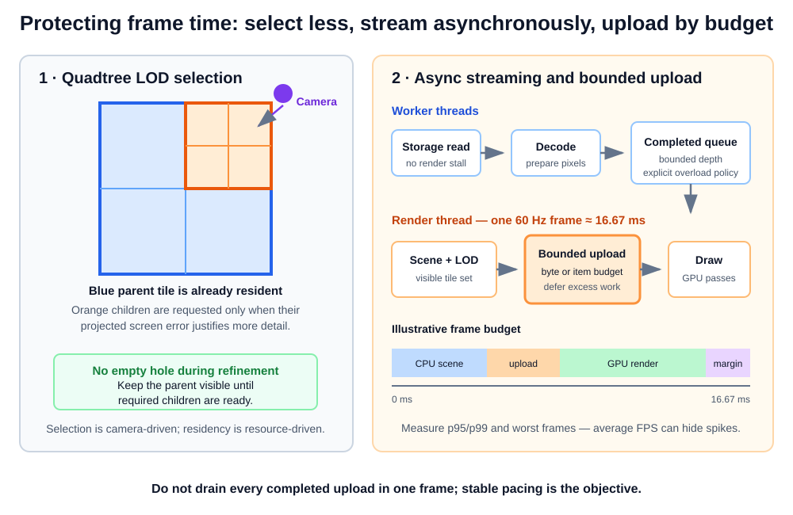
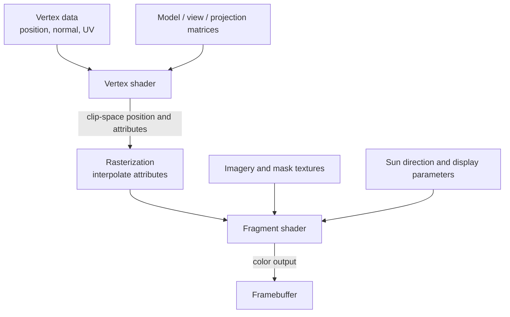
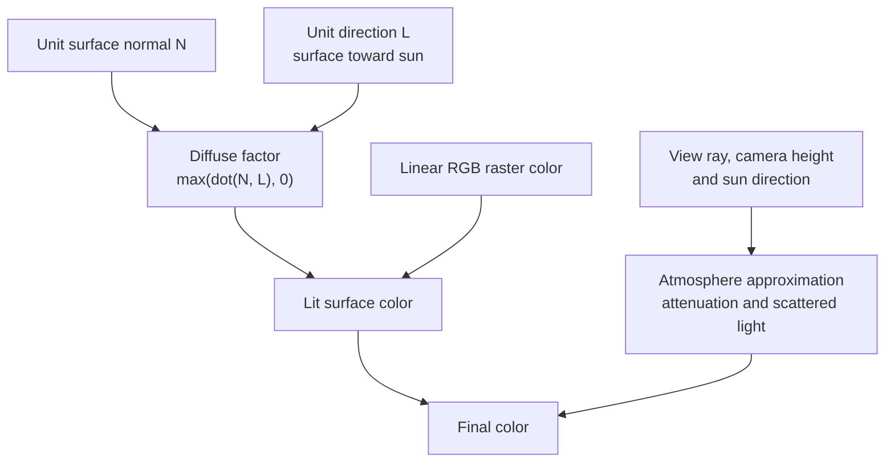
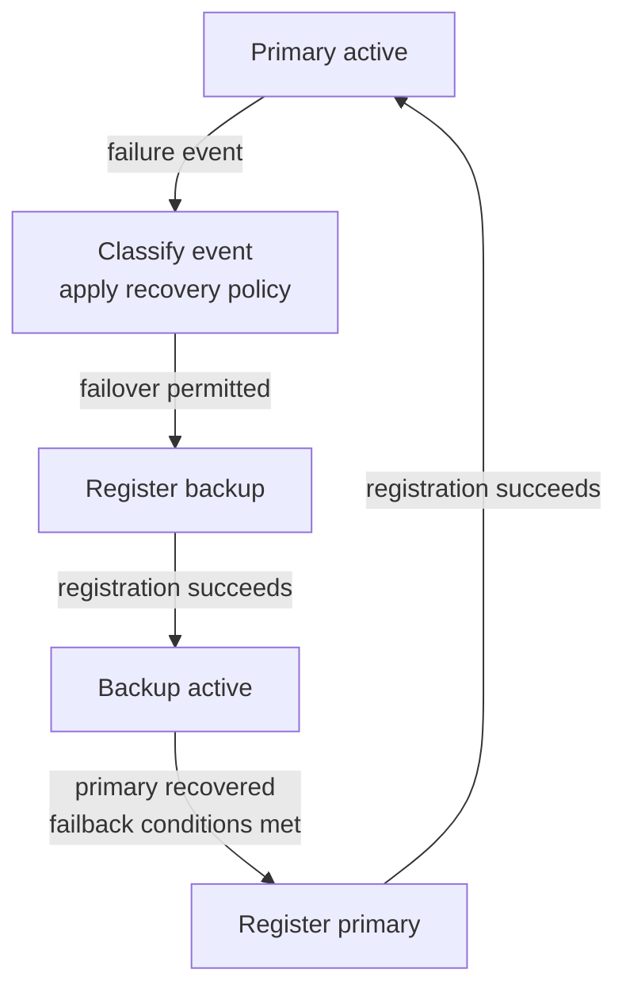
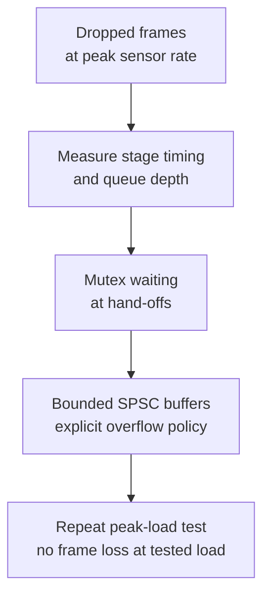
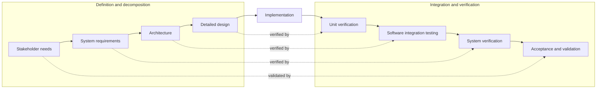
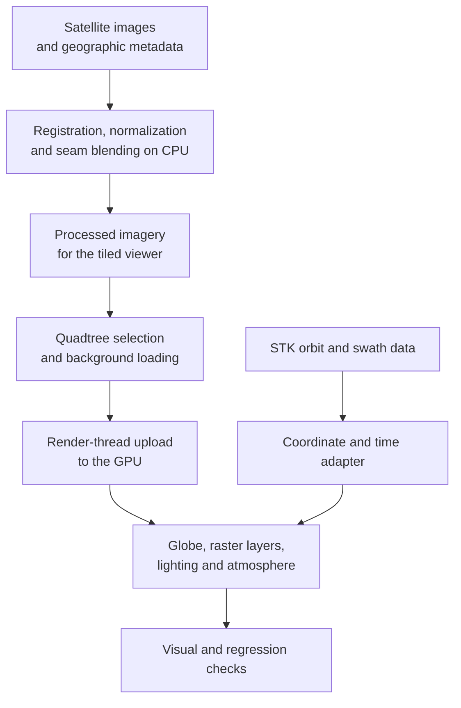
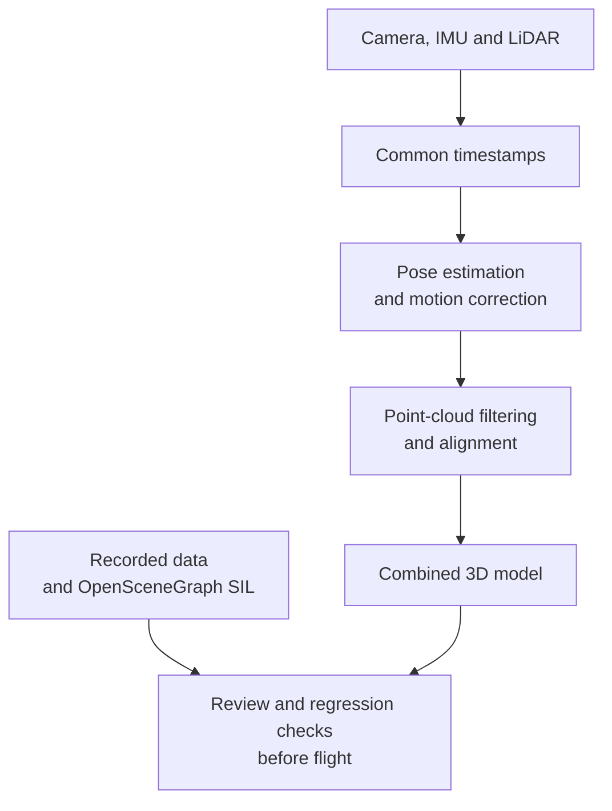
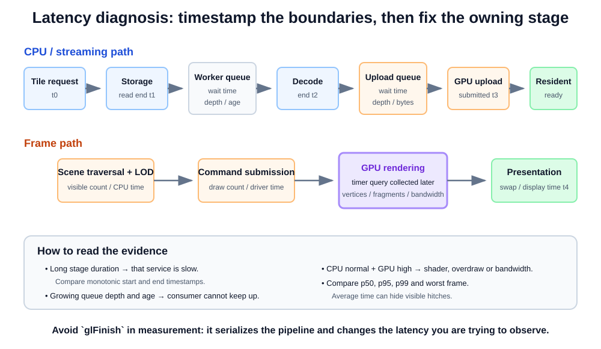
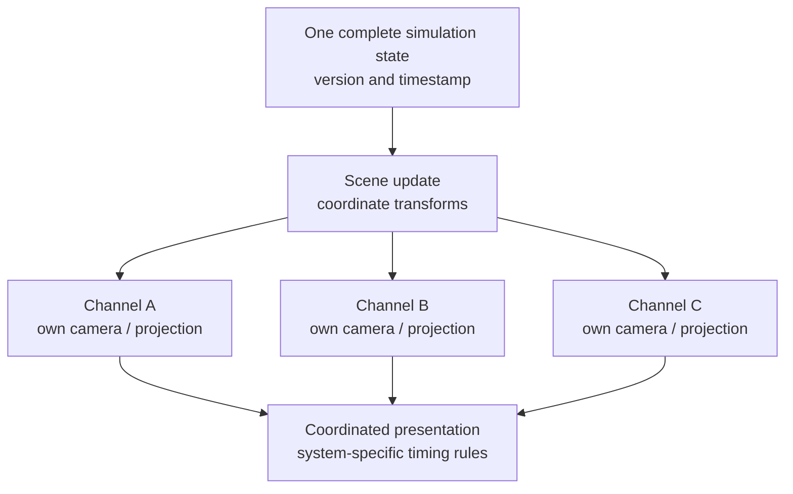

# Interview Preparation: BrightBox Pre-Screen and Acron Interview

- Request ID: E482
- Candidate: Aliaksei Ivanou; preferred interview name: Alex
- Target role: Senior Embedded C++ and Real-Time Graphics Engineer
- Source request: E482_Request_AliakseiIvanou.md
- Source CV: E482 Aliaksei Ivanou (8, C++) BrightBox.pdf
- Preparation language: English
- Last updated: 2026-10-09

# Question Index

Question 0 is the opening introduction. Five technical and profile blocks follow it, ordered for preparation. The document contains 71 main questions, numbered 0–70, plus the lettered variants. Questions 58–70 provide dedicated answers for topics that were previously missing or distributed across several answers.

Start with [Question 0](#question-0) for the opening introduction, then use Block 1 for Acron's technical priorities. The challenge stories are [7a: satellite optimization](#question-7a), [7c: SIP recovery](#question-7c), [7d: UAV root cause](#question-7d), [7e: satellite lighting](#question-7e) and [7f: UAV LiDAR](#question-7f). Question [7b](#question-7b) explains the satellite CPU/GPU choice. Choose one challenge case; do not read all of them as one answer.

| Block | Questions | Preparation focus |
|---|---|---|
| [1. Acron priorities: graphics, root cause and verification](#block-1-acron-priorities-graphics-root-cause-and-verification) | 1–13 | The colleague's first 13 topics: globe, streaming/LOD, timing, GLSL, STK, root cause, tests, requirements, legacy, ECSS/MISRA and accuracy |
| [2. Projects, real-time and system integration](#block-2-projects-real-time-and-system-integration) | 14–34 | Satellite and UAV pipelines, OpenMP/SIMD, sensor timing, latency, hardware diagnosis, visual nodes, interfaces, platforms and SIP/tooling |
| [3. Graphics and C++ technical depth](#block-3-graphics-and-c-technical-depth) | 35–43 | Rendering pipeline, resource lifetime, culling, frame capture, C++ ownership/data layout, API comparison, weather and materials |
| [4. Profile, teamwork and logistics](#block-4-profile-teamwork-and-logistics) | 44–57 | Role fit, ownership, collaboration, priorities, first weeks, learning, AI, location and English |
| [5. Dedicated answers from the expanded bank](#block-5-dedicated-answers-from-the-expanded-bank) | 58–70 | Logging, timing rates, port verification, test oracles, optimization scope, concurrency, reviews, baselines, lifecycle and failure handling |

## 0. Opening

| № | Question |
|---|---|
| q[0](#question-0) | Please introduce yourself and explain why you are interested in this role |

## 1. Acron priorities: graphics, root cause and verification

| № | Question |
|---|---|
| q[1](#question-1) | What graphics experience do you have, and what did you implement in your projects? |
| q[1a](#question-1a) | How did the satellite globe render multi-gigapixel rasters, and what did you own? |
| q[2](#question-2) | How did you protect the real-time frame budget? |
| q[2a](#question-2a) | How did asynchronous tile streaming work when the globe camera moved quickly? |
| q[2b](#question-2b) | How would you explain quadtree LOD, visible bounds and seam-free transitions? |
| q[37](#question-37) | How did you optimize a large scene with culling, LOD, batching and instancing? |
| q[3](#question-3) | What does real-time mean in your projects, and how do deadlines differ? |
| q[4](#question-4) | Which shader stages have you used? |
| q[4a](#question-4a) | Describe a shader bug and how you diagnosed it |
| q[4b](#question-4b) | What was the most complex shader you worked on? |
| q[4c](#question-4c) | How did you debug shaders? |
| q[4d](#question-4d) | How did you compile, link and integrate shaders? |
| q[5](#question-5) | How did you implement lighting and atmosphere? |
| q[42](#question-42) | How did you implement weather, particles, volumetric effects and compute work? |
| q[6](#question-6) | Explain coordinate spaces, camera matrices and projection choices |
| q[6a](#question-6a) | How did STK orbit and imaging-swath data fit the globe's coordinates and time? |
| q[7](#question-7) | What caused bugs in your projects, and how did you investigate them? |
| q[7a](#question-7a) | Satellite case: how did you reduce image-processing time? |
| q[7b](#question-7b) | Why optimize satellite processing on CPU rather than move it to GPU? |
| q[7c](#question-7c) | SIP case: how did you implement failover and failback? |
| q[7d](#question-7d) | UAV case: how did you diagnose frame drops? |
| q[7e](#question-7e) | Satellite viewer bug: how did you diagnose and fix camera-dependent lighting? |
| q[7f](#question-7f) | UAV bug: why did LiDAR objects look smeared during turns? |
| q[8](#question-8) | Talk me through your software-testing methodology |
| q[9](#question-9) | How did you test the renderer and prove that a refactor preserved behaviour? |
| q[10](#question-10) | How do you work with requirements, ambiguity and traceability across the lifecycle? |
| q[11](#question-11) | How did you improve a poorly documented legacy SIP codebase without breaking behaviour? |
| q[12](#question-12) | How did ECSS, MISRA C++ and the V-Model affect your work? |
| q[13](#question-13) | What did you do in image processing, and how does it differ from reconstruction and rendering? |
| q[13a](#question-13a) | How did you check geometric accuracy and detect drift after processing changes? |

## 2. Projects, real-time and system integration

| № | Question |
|---|---|
| q[14](#question-14) | What is your experience with multithreading and parallel processing? |
| q[15](#question-15) | Describe the satellite image-processing and visualization pipeline |
| q[16](#question-16) | Describe the UAV data-processing and 3D reconstruction pipeline |
| q[16a](#question-16a) | How would you decide which UAV stages should run on CPU or GPU? |
| q[16b](#question-16b) | What is Software-in-the-Loop, and how did you use it? |
| q[16c](#question-16c) | Why can software pass all unit tests but fail during SIL integration? |
| q[17](#question-17) | What exactly is your FreeRTOS and STM32 experience? |
| q[18](#question-18) | How would you diagnose latency, a frame-time spike or a CPU/GPU bottleneck? |
| q[19](#question-19) | How do you investigate hardware-only bugs when rig access is limited? |
| q[20](#question-20) | What is OpenSceneGraph, and what can make a scene graph expensive? |
| q[21](#question-21) | How would you structure a flight-simulator visual system and synchronized displays? |
| q[22](#question-22) | How would you share simulation state across threads, rates and a jittery network? |
| q[23](#question-23) | How would you integrate a third-party model through an ICD into a real-time system? |
| q[24](#question-24) | How would you port legacy software and work across Windows and Linux? |
| q[25](#question-25) | Is your work independently tested before release? |
| q[26](#question-26) | What experience do you have with TCP/UDP, sockets, shared memory or simulator datapools? |
| q[27](#question-27) | Have you used CAN, ARINC 429 or AFDX? |
| q[28](#question-28) | Walk me through the SIP phone architecture and your personal ownership |
| q[29](#question-29) | What exactly did you change in the legacy call architecture? |
| q[30](#question-30) | How did you diagnose media and conferencing problems on the physical device? |
| q[31](#question-31) | How did you preserve behavior during the .NET 8 persistence migration? |
| q[32](#question-32) | What experience do you have with security software development? |
| q[33](#question-33) | Have you worked with pre-boot software or file-system extensions? |
| q[34](#question-34) | Which other languages and UI technologies have you used, including C# and web tools? |

## 3. Graphics and C++ technical depth

| № | Question |
|---|---|
| q[35](#question-35) | How would you structure a renderer, from scene data to a displayed frame? |
| q[36](#question-36) | How would you manage and update meshes, textures and shaders without stalls? |
| q[38](#question-38) | How would you use RenderDoc and investigate a graphics defect across GPUs? |
| q[39](#question-39) | How do you manage C++ ownership, lifetime and modern language features? |
| q[40](#question-40) | How would you design performance-critical C++ APIs and data layouts? |
| q[41](#question-41) | How do OpenGL, Direct3D and Vulkan differ, and how would you design an API abstraction? |
| q[43](#question-43) | Explain environment mapping, bump mapping, normal mapping and displacement |

## 4. Profile, teamwork and logistics

| № | Question |
|---|---|
| q[44](#question-44) | Why Acron, which technical layer do you prefer, and where would you need to ramp up? |
| q[45](#question-45) | Describe your current role and day-to-day work |
| q[46](#question-46) | How hands-on are you, what is your team scope, and what does your leadership involve? |
| q[47](#question-47) | What kind of engineering work gives you the most satisfaction? |
| q[48](#question-48) | How do you work with a team, mentor engineers and participate in reviews? |
| q[49](#question-49) | How do you prioritize work and resolve competing urgent tasks? |
| q[50](#question-50) | How do you handle disagreement with a manager or programme priority? |
| q[51](#question-51) | How do you work autonomously without becoming isolated? |
| q[52](#question-52) | Can you support customer or programme-manager conversations? |
| q[53](#question-53) | How would you approach the first weeks and the first work package? |
| q[54](#question-54) | Which courses, books and other resources do you use to keep learning? |
| q[55](#question-55) | Do you use AI when coding? |
| q[56](#question-56) | Location and availability |
| q[57](#question-57) | English level |

## 5. Dedicated answers from the expanded bank

| № | Question |
|---|---|
| q[58](#question-58) | How do you organize logging and diagnostics without breaking a real-time budget? |
| q[59](#question-59) | How do simulation update rate, render rate and display refresh differ? |
| q[60](#question-60) | How do you verify performance after moving software to a new platform? |
| q[61](#question-61) | How do you choose the expected output when the specification is incomplete? |
| q[62](#question-62) | How do you choose between a local optimization and an architectural change? |
| q[63](#question-63) | How do you organize simulation and rendering threads without long blocking? |
| q[64](#question-64) | How do you find and fix a race condition in a latency-sensitive system? |
| q[65](#question-65) | How do you run a design review for a complex software component? |
| q[66](#question-66) | How do you support multiple hardware and software baselines? |
| q[67](#question-67) | What does full product lifecycle mean in your experience? |
| q[68](#question-68) | How do verification and validation differ in practice? |
| q[69](#question-69) | How do you test failure handling and degraded modes? |
| q[70](#question-70) | When is bitwise-identical output required, and when is functional equivalence enough? |

## Priority route: colleague's personal questions

Start here for Acron. Source numbers below belong to the colleague's 145-question bank, not the Intro numbering. Its qualitative priorities guide preparation; they do not guarantee interview frequency. Use the complete answer first and only the relevant follow-ups.

| Colleague № | First-pass topic | Intro answer | Follow-up focus / boundary |
|---|---|---|---|
| 1 | Large raster globe and GPU working set | [1a](#question-1a) | Tiles, visible/requested/resident sets; exact sizes and culling implementation to confirm. |
| 2 | Asynchronous tile streaming | [2a](#question-2a) | Worker/render ownership, queues, slow I/O, camera movement and bounded admission. |
| 3 | Quadtree LOD and transitions | [2b](#question-2b) | Projected detail, bounds, fallback, popping versus seams and resource limits. |
| 4 | Closest visual-system experience and personal ownership | [1a](#question-1a), [1](#question-1) | Use the satellite globe as one concrete example; separate component contribution from full-engine ownership. |
| 5 | Real-time requirements | [3](#question-3), [2](#question-2) | Update rate, latency, deadline consequence; no invented project FPS or hard guarantee. |
| 6 | GLSL masks, overlays, lighting and atmosphere | [4](#question-4), [4a](#question-4a), [4b](#question-4b), [4c](#question-4c), [4d](#question-4d), [5](#question-5) | Stages, bug diagnosis, shader complexity, debugging, build integration, layer composition and measured effect cost. |
| 7 | STK orbits and imaging swaths | [6a](#question-6a) | Connect data contract, coordinates, epoch/time and planetary-scale precision. |
| 8 | Difficult defect from symptom to root cause | [7](#question-7), [7d](#question-7d), [7e](#question-7e), [7f](#question-7f) | Start with the general bug patterns, then choose one detailed case: thread hand-off, coordinate-space lighting or LiDAR timing. |
| 9 | Correctness after a software change | [8](#question-8), [9](#question-9) | Unit/component/integration/system checks; justified oracle and regression evidence. |
| 10 | Requirements and ambiguous specifications | [10](#question-10) | Acceptance criteria, competing interpretations, ownership and traceability. |
| 11 | Poorly documented existing code | [11](#question-11) | Intended versus observed behaviour, characterization and external compatibility. |
| 12 | ECSS and MISRA C++ | [12](#question-12) | Engineering versus assurance, design/review/evidence; no full compliance ownership. |
| 13 | Satellite geometric accuracy | [13a](#question-13a) | Reference ground points, tolerances, independent checks and accuracy drift. |

### Next pass: colleague questions 14–68

| Topic | Colleague question numbers | Intro route | Coverage / next depth |
|---|---|---|---|
| CPU optimization and architectural trade-offs | 14, 37, 38, 64 | [7a](#question-7a), [7b](#question-7b), [14](#question-14), [62](#question-62) | Core cases, CPU/GPU trade-offs and the local-versus-architectural decision now have dedicated answers. Confirm actual profiler, SIMD details and numerical acceptance. |
| UAV, SIL and synchronized sensors | 15, 16, 18, 19, 65, 66 | [16](#question-16), [16a](#question-16a), [16b](#question-16b), [17](#question-17), [13](#question-13) | Core pipeline, SIL theory and conditional CPU/GPU stage choices exist. Exact processing hardware/backends, video rates, drift correction, noise distributions and replay controls remain to confirm. |
| Concurrent hand-offs and freshness | 17, 39, 40, 67 | [7d](#question-7d), [14](#question-14), [63](#question-63), [64](#question-64) | Root cause, bounded ownership and race diagnosis now have separate answers. Do not relabel the recorded UAV contention case as a confirmed data race. |
| Latency, spikes and diagnostics | 20, 25, 34, 35, 36, 42 | [18](#question-18), [2](#question-2), [58](#question-58) | Measurement and real-time logging now have direct routes. Historical logging implementation details still need a concrete project example if requested. |
| Hardware/customer defects and deadline risk | 21, 43, 46, 49 | [19](#question-19), [30](#question-30), [49](#question-49) | Investigation method exists. No additional historical hardware bug is established by this question bank. |
| OSG, compute, visual nodes and interfaces | 22, 23, 24, 27, 28, 29 | [20](#question-20), [4](#question-4), [42](#question-42), [21](#question-21), [59](#question-59), [22](#question-22), [23](#question-23) | Weather, compute and the distinction between simulation, render and display rates now have direct answers. |
| CPU/GPU resource ownership | 41 | [36](#question-36), [39](#question-39) | Lifetime and completion contracts are covered. Actual cache handles and deletion queues must be confirmed. |
| Tile residency, camera movement and STK | 57, 58, 59, 60, 68 | [15](#question-15), [1a](#question-1a), [2a](#question-2a), [2b](#question-2b), [6a](#question-6a) | The complete satellite route and focused answers exist. Exact cache/upload/culling settings remain historical confirmation items. |
| Tests, lifecycle, interfaces and assurance | 30, 31, 32, 33, 45, 48, 50, 51, 52, 54, 55, 61, 62, 63 | [8](#question-8), [9](#question-9), [61](#question-61), [65](#question-65), [67](#question-67), [68](#question-68), [69](#question-69) | Expected output, design review, lifecycle, verification/validation and degraded modes now have dedicated routes. Named tolerances and formal acceptance authority still come from the programme. |
| Long-lived code and platform changes | 26, 44, 47, 53, 56 | [11](#question-11), [24](#question-24), [60](#question-60), [66](#question-66), [70](#question-70) | Platform comparison, supported baselines and functional equivalence now have direct answers. |

### Optional depth: colleague questions 69–145

| Topic | Colleague question numbers | Intro route | Coverage / next depth |
|---|---|---|---|
| Geospatial sampling and image-quality theory | 69, 70, 71, 72, 73, 141, 143, 144 | [2a](#question-2a), [2b](#question-2b), [13](#question-13), [13a](#question-13a), [4](#question-4), [6a](#question-6a), [7a](#question-7a) | MTF/RER method and thresholds need confirmation. Do not infer them from an attractive output. |
| SIL, fusion, deskew and deterministic replay | 74, 75, 76, 77, 134, 145 | [16](#question-16), [16b](#question-16b), [16c](#question-16c), [20](#question-20), [17](#question-17) | Core explanations exist. Exact project settings for random seeds, scheduling and cross-hardware replay still need confirmation. |
| Phone media, migration and secure configuration | 78, 79, 80 | [30](#question-30), [31](#question-31), [32](#question-32) | Use the current phone cases. Signed updates/rollback are design topics, not new delivery claims. |
| Rendering stages, transforms and color | 81, 82, 86, 87, 88, 99, 100, 101, 108, 110 | [35](#question-35), [4](#question-4), [6](#question-6), [42](#question-42), [38](#question-38) | Core pipeline exists. Render-pass dependencies and quaternion details are secondary depth. |
| Lighting, materials, shadows and effects | 83, 84, 85, 102, 103, 104, 105 | [5](#question-5), [43](#question-43), [42](#question-42) | PBR/BRDF, forward+ and cascaded-shadow mechanisms are not yet full stand-alone spoken answers. |
| Visibility and scene/data organization | 89, 90, 91, 92, 93, 111, 112, 142 | [37](#question-37), [20](#question-20), [2b](#question-2b) | ECS/data-oriented trade-offs and GPU-generated visible lists need deeper theory. No GPU-quadtree delivery claim. |
| Resource lifetime, buffering and uploads | 94, 95, 96, 97, 98 | [36](#question-36), [2a](#question-2a), [18](#question-18) | Core ownership exists. Full double/triple-buffer, leak/thrashing and dynamic-update examples remain follow-up depth. |
| Visual clusters and display consistency | 106, 107, 109 | [21](#question-21), [9](#question-9) | Prepared design only. Clock/frame synchronization, calibration and target-GPU acceptance are distinct. |
| APIs, resize and graphics crashes | 113, 114, 115, 116, 117, 118 | [41](#question-41), [36](#question-36), [38](#question-38), [19](#question-19) | API comparison is prepared theory. Resize/in-flight-resource and release-only-crash scenarios need deeper answers. |
| C++ parallelism and data layout | 119, 120, 121, 122, 123, 124, 125, 126, 127, 128 | [14](#question-14), [39](#question-39), [40](#question-40), [7d](#question-7d), [7a](#question-7a) | Core C++ examples exist. Job scheduling, happens-before and exception guarantees need deeper follow-up. |
| Builds, remote diagnosis, CI and fuzzing | 129, 130, 131, 132 | [24](#question-24), [19](#question-19), [26](#question-26) | Core boundaries exist. Performance CI and property/fuzzing test design are not yet complete dedicated answers. |
| Integration, reviews, compatibility and customer acceptance | 133, 135, 136, 137, 138, 139, 140 | [27](#question-27), [26](#question-26), [22](#question-22), [23](#question-23), [10](#question-10), [11](#question-11), [32](#question-32), [52](#question-52) | Core contract route exists. Third-party crash isolation and subjective simulator validation need specific secondary scenarios. |

This is a complete routing map for all 145 source questions, not a claim that every sub-question already has a separate two-to-three-minute answer. The first 13 have full answer routes. Lower-priority gaps are explicitly marked above. Unknown historical parameters need confirmation; generic theory must not become invented project history.

## Reference sections

- [Sources and factual boundaries](#sources-and-factual-boundaries)
- [How to use this script](#how-to-use-this-script)
- [Role context](#role-context)
- [Quick reference and questions to ask](#quick-reference-and-questions-to-ask)
- [Graphics readiness checklist: short answers](#graphics-readiness-checklist-short-answers)
  - [Check 5a: satellite processing and OpenGL globe](#check-5a-satellite-image-processing-and-opengl-globe)
  - [Check 5b: UAV processing, reconstruction and SIL](#check-5b-uav-sensor-processing-reconstruction-and-sil)
  - [Check 5c: SIP phone signalling, media and provisioning](#check-5c-sip-phone-signalling-media-and-provisioning)
- [Questions for BrightBox](#questions-for-brightbox)
- [Questions for Acron](#questions-for-acron)
- [Final memory card](#final-memory-card)

---

## Sources and factual boundaries

Primary spoken source: [BrightBox interview, 2026-10-01](C:/Users/User/Downloads/Aliaksei-Ivanou-CV-Embedded-C-BrightBox-Group-ARad-20261001-085935.mp4). Use the successful introduction after recording restarted.

The question bank also covers the supplied [likely Acron questions](C:/Users/User/Desktop/вероятные-вопросы-с-акроном.txt), [additional Acron questions](C:/Users/User/Desktop/доп-вопросы-с-акроном.txt) and [BrightBox/customer preparation notes](C:/Users/User/Desktop/пред-собес-с-брайт-боксом.txt). These files contain proposed questions and commentary. They do not prove a new project, implementation or guaranteed interview format.

The [colleague's personal 145-question bank](C:/Users/User/.codex/attachments/7d2fd15d-bf70-46f1-8589-c50bede0ffaa/Вставленный текст.txt) has priority for preparation. Its first 13 questions are the first pass, 14–68 the next pass and 69–145 optional depth. Its header mentions other interviews that were not supplied here. Do not treat that header or question wording as evidence of a personal implementation. Use the current E482 CV and supplied BrightBox recording for project scope. Exact historical settings still need confirmation.

| Recording time | Recorded topic | Preparation |
|---|---|---|
| 03:07–09:22 | SIP phone → satellite processing and OpenGL/GLSL → UAV timing, reconstruction and OSG SIL; reviews, mentoring and simulator interest | [Introduction](#question-0), [project stories](#block-2-projects-real-time-and-system-integration), [graphics scope](#question-1) |
| 09:42–12:36 | SIP failover; satellite normalization/seam-blending optimization; UAV mutex hand-off waiting | [Failover](#question-7c), [optimization](#question-7a), [root cause](#question-7d) |
| 12:54–14:28 | Globe, quadtree LOD, background loading, GLSL, STK; UAV OSG SIL and PCL/Open3D review | [Graphics](#question-1), [shaders](#question-4), [satellite pipeline](#question-15), [UAV pipeline](#question-16) |
| 14:40–15:35 | Complete hardware-to-software path; finding the cause and checking the full result | [Engineering satisfaction](#question-47) |

Use only the three projects in the current CV and recording: SIP phone, satellite platform and UAV software. Do not introduce additional projects or older project history.

Preserve the recorded results: satellite processing went from several hours to under forty minutes; the UAV pipeline had no frame loss under the tested peak load. Do not invent percentages, buffer capacities, latency targets, API minor versions or guarantees under unlimited load.

New design answers use “I would.” They are preparation theory, not extra achievements. Question 42 is written as user-confirmed implementation experience; exact project context, target values and effect settings should still be prepared. RenderDoc and multi-projector synchronization remain preparation topics rather than new historical claims.

Shader project map, checked against the current E482 CV and the existing interview script:

| Project | Shader type | Purpose | Preparation boundary |
|---|---|---|---|
| Satellite platform | **GLSL vertex and fragment/pixel shaders** | Vertex transforms for the globe; fragment work for raster imagery, cloud masks, overlays, lighting and atmosphere | Existing satellite shader topics. The detailed personal ownership split below still needs confirmation. |
| UAV / SIL | **GLSL compute shaders** | **Proposed role:** generate simulated LiDAR rays, find scene intersections and output ranges for synthetic returns | The UAV CV environment lists compute shaders, and the project describes LiDAR emulation. Their exact connection is **not confirmed**. This is a plausible preparation scenario, not a recovered historical kernel. |
| SIP phone | **No custom shader-authorship example identified** | Existing SDK/media rendering is not evidence of a shader written by me | Do not add a phone shader project or infer authorship from video display. |

GLSL is the language. **Vertex, fragment and compute** are execution types. Cloud masks, overlays, lighting and atmosphere are tasks, not additional shader stages. Parenthetical project cues below are reminders, not extra sentences to read aloud. The word **proposed** always marks the unconfirmed UAV compute/LiDAR connection.

The proposed LiDAR case uses ray casting and configurable noise/dropout, mechanisms illustrated by [CARLA's LiDAR sensor documentation](https://carla.readthedocs.io/en/latest/ref_sensors/#lidar-sensor). Independent work items and buffer output fit the [GLSL compute execution model](https://registry.khronos.org/OpenGL/specs/gl/GLSLangSpec.4.60.html). These are theory references, **not evidence that this project used CARLA or this particular kernel**.

CPU/GPU boundary: the satellite story establishes an optimized CPU processing path alongside GPU rendering. It does not establish why the team did not port a stage, or a measured CPU/GPU comparison. The UAV story establishes synchronization firmware, pipeline hand-offs and graphics/SIL work, not an all-CPU processing architecture. Questions [7b](#question-7b) and [16a](#question-16a) distinguish these facts from conditional engineering rationale.

Graphics ownership: the detailed split below is a proposed preparation scenario, not a verified allocation of work between engineers. The CV and recording establish the projects and broad contribution areas. They do not establish who authored every viewer component. Confirm the added first-person details before using them as interview history. This split does not change the SIP story.

| Graphics project | Team context and result | Proposed personal contribution | Do not imply |
|---|---|---|---|
| Satellite platform | Complete image-processing platform and interactive analyst globe | Viewer-side tile selection; loading-to-render hand-off; raster/mask shader code and C++ bindings; lighting/atmosphere integration; STK orbit/swath display adapter | Sole authorship of the whole engine, data pipeline, orbit propagator or compliance programme |
| UAV / SIL | Complete surveying pipeline, reconstruction and preparation for flight testing | OSG scene integration; timestamped flight-path replay into transforms; synthetic LiDAR noise/dropout scenarios; point-cloud review view | Authorship of OSG itself, the whole aircraft or every flight-control/navigation algorithm |

In spoken answers, describe the team's system first. Then name the code or interface you changed. Use “we” for the shared product result, and “I” for the specific contribution. Do not assign other work to a particular colleague or department without confirmation.

## How to use this script

Technical and project answers keep enough detail for roughly two to three minutes at a calm pace. Simple factual answers, such as location, English level or lack of specific experience, are deliberately shorter. Do not stretch them just to fill time. Preparation notes and follow-up answers are optional depth, not part of the spoken answer.

Give the direct answer first. For a multi-part question, name the main categories before the details. Explain each category briefly, then use the relevant project example, mechanism and result or check. Use short sentences and pause between ideas. The bold phrases are speaking cues, not a second script to read aloud. Use deeper theory only when it helps answer the question. If interrupted, answer the narrower question instead of finishing the script.

For the reported BrightBox short-interview set, start with [introduction](#question-0), [one challenge](#question-7), [enjoyment](#question-47) and [learning resources](#question-54). Learning resources were not asked in the supplied recording; they remain additional preparation.

For Acron, begin with [Block 1](#block-1-acron-priorities-graphics-root-cause-and-verification). The [source crosswalk](#priority-route-colleagues-personal-questions) keeps the colleague's ordering visible. Keep actual ownership, [real-time](#question-3), [latency](#question-18), [root cause](#question-7d), [testing](#question-8), [independent verification](#question-25) and [legacy changes](#question-11) as recurring themes. Then follow the assigned technical layer. The exact customer component and interview format remain unconfirmed.

Known production boundaries: no Vulkan, Direct3D or HLSL; no CAN, ARINC 429 or AFDX; no DO-178C or ISO 26262 delivery; no bootloader or custom kernel file-system authorship; no certified Image Generator or calibrated projector-system ownership. Say no directly, then describe only the nearest relevant experience.

Unknown customer detail: “I don't know yet. I would confirm it from the owner, interface document and a running baseline.” Forgotten historical value: “I don't remember the exact value, and I don't want to guess.” A fluent theory answer must not imply production ownership.

## Role context

The supplied role context concerns development, porting, adaptation and verification for aviation training systems. Possible areas include cockpit emulation, Control and Motion, middleware, visual systems, Instructor Operating Stations, scenarios and hardware-rig verification. The actual workstream, API and first work package are not confirmed.

The request is EU-only; account notes mention Poland or Romania. BrightBox must confirm the applicable location and work-authorization rule. Approved remote access and scheduled rig slots may affect delivery. Confirm those arrangements instead of assuming them.

AI permission is also unconfirmed. No safety-critical project use by default. Approved tool, approved data and approved purpose are separate decisions.

---

## Question 0

**Please introduce yourself and explain why you are interested in this role**

[↑ Question index](#question-index) · [Role fit](#question-44)

Stage: Both.

Structure: professional summary → current SIP phone → satellite processing and graphics → UAV processing and SIL → hands-on reviews and mentoring → why Acron.

(Project shaders: satellite — **vertex/fragment GLSL**; UAV/SIL — **compute GLSL for LiDAR emulation**, **proposed scenario**.)

Recommended answer:

Hello, I'm Alex. I'm a senior software engineer with more than eight years of experience. I focus on **C++, real-time and embedded** systems, computer graphics and aerospace software. I enjoy projects where software works with real hardware.

My current project is a **SIP phone platform**. It uses C++17, Qt and Yocto Linux. I work across drivers, GStreamer, Linphone-SDK and the Qt interface. I improved call handling, implemented server failover and reduced media latency. I also worked on the C# provisioning tool.

On the satellite project, **our team built** an image-processing and visualization platform. I contributed C++ processing code and OpenMP/SIMD optimization. The mosaic run went from several hours to under forty minutes.

My graphics work was in the OpenGL viewer. I worked on **quadtree tile selection, streaming integration and GLSL effects**. I also adapted STK orbit and swath data for display. The complete viewer was a team result. We used MISRA C++, reviews, UML, GTest and ECSS processes.

Before that, I worked on the team's UAV surveying software. I developed **STM32 and FreeRTOS synchronization firmware** and contributed to processing. In graphics, I worked on OSG scene integration, flight-path replay and point-cloud review. Recorded data and SIL helped the team check changes before flight tests.

I stayed **hands-on** while leading code reviews and mentoring engineers. The SIP project strengthened my embedded Linux, networking and production-debugging experience. At the same time, it confirmed that the satellite and UAV projects were the work that interested me most.

I want to **return to aerospace** because I enjoy systems that combine real-time C++, graphics, simulation, sensor data and real hardware. I have also had a strong personal interest in **space exploration and space technology** for a long time, so the satellite project was especially meaningful to me. Flight-simulator development brings these interests together, and I can also bring the product experience I gained on the SIP platform.

Be ready to explain:

- A strong introduction follows present → relevant past → role fit. It is not a chronological reading of the CV.
- Separate the product context from personal ownership: what the system did, what you changed and how the result was checked.
- Keep the opening broad enough for follow-up questions, but do not list technologies that you cannot explain one or two levels deeper.
- If a brief introduction is explicitly requested, shorten the project sequence in the room. The prepared main version remains a full two-to-three-minute answer.
- If seniority is challenged, discuss scope, ambiguity, technical risk, reviews and team influence rather than relying only on a job title.

---

# Block 1. Acron priorities: graphics, root cause and verification

[↑ Back to question index](#question-index)

## Question 1

**What graphics experience do you have, and what did you implement in your projects?**

[↑ Question index](#question-index) · [Questions in this block](#1-acron-priorities-graphics-root-cause-and-verification)

Stage: Acron; first-pass question about graphics projects. The focused satellite example continues in 1a.

(Main graphics examples: satellite — **OpenGL and vertex/fragment GLSL**; UAV — **OpenSceneGraph SIL**.)

Recommended answer:

My main graphics experience comes from two projects: an **OpenGL satellite viewer** and an **OpenSceneGraph UAV simulation environment**.

On the satellite project, we processed very large raster images and displayed them on an interactive 3D globe. I worked on **quadtree tile selection, background loading, the hand-off to the render thread and controlled GPU uploads**. When a detailed tile was not ready, a lower-resolution parent tile remained visible.

I also wrote and integrated **GLSL vertex and fragment shaders** for raster masks, overlays, Lambert lighting and atmosphere. Another part of my work connected STK orbit and imaging-swath data to the globe.

On the UAV project, I used **OpenSceneGraph** in a software-in-the-loop environment. I connected flight-path replay to scene transforms, added sensor scenarios with noise or missing data and displayed point clouds and reconstruction results from PCL and Open3D for review before flight tests.

Across these projects, I worked with coordinate systems, camera and object transforms, asynchronous data loading, CPU-to-GPU resource updates, visual debugging and frame-time measurements.

Be ready to explain:

- **Satellite data path:** storage → worker thread → render-thread hand-off → GPU texture → GLSL → globe.
- **Why quadtree LOD?** It kept memory and rendering work bounded while the camera moved between global and detailed views.
- **What did the shaders do?** They placed and combined raster data, masks and overlays and calculated surface lighting and atmosphere.
- **What did OSG provide?** A scene graph for organizing objects, transforms and rendering in the UAV simulation.
- **UAV review path:** recorded or simulated sensor data → synchronized processing → point cloud or reconstruction → OSG visualization.
- **How did you verify the work?** Repeat the same data and camera path, check transforms and visual output, and measure CPU and GPU frame time separately.

Short follow-up answers:

- **Which technologies did you use directly?** **C++, OpenGL and GLSL** in the satellite viewer; **C++ and OpenSceneGraph** in UAV SIL; **PCL and Open3D** for point-cloud processing and reconstruction.

- **What did you implement on the satellite project?** Tile selection and loading integration, controlled GPU uploads, raster and mask shaders, lighting, atmosphere and the STK display adapter.

- **What did you implement on the UAV project?** Flight replay and scene transforms, sensor test scenarios and visualization of point clouds and reconstruction results.

- **How did OpenGL and OSG differ in these projects?** In the satellite viewer, I worked closer to OpenGL resources and GLSL. In the UAV project, OSG provided the higher-level scene graph and rendering structure.

---

### Question 1a

**How did the satellite globe render multi-gigapixel rasters, and what did you own?**

[↑ Question index](#question-index) · [Satellite pipeline](#question-15) · [Questions in this block](#1-acron-priorities-graphics-root-cause-and-verification)

Stage: Acron; colleague bank 1 and 4, first-pass priority.

Preparation note: the personal graphics split in this answer is proposed. Confirm it against your actual work before using the first-person wording.

(Satellite shaders: **vertex/fragment GLSL** — rasters, cloud masks, overlays, lighting and atmosphere.)

Recommended answer:

The raster was much larger than GPU memory, so we could not load it as one texture. We divided the imagery into a **quadtree of tiles** with several detail levels and loaded only the tiles needed for the current view.

The camera selected the required tiles. Worker threads loaded and decoded them outside the render loop, and the render thread uploaded ready data to the GPU. If a detailed tile was not ready, its lower-resolution parent remained visible so the globe did not show an empty area.

Each tile included both image data and placement metadata, such as its geographic region and detail level. A texture could decode correctly but still appear in the wrong place if that metadata or its coordinate conversion was wrong.

My work covered the path from **tile selection to drawing**: selection logic, the loading-to-render hand-off, render-thread resource updates and shader inputs. I also worked on raster and mask shaders, lighting, atmosphere and the STK orbit and swath display adapter.

I tested the same dataset and camera path for placement, LOD changes and timing. The complete globe and processing platform were a **team result**.

Be ready to explain:

- The project facts are OpenGL/GLSL, a large-raster globe, quadtree detail, background loading and controlled render-thread uploads. The visibility and cache mechanisms above are explanation/design unless the exact implementation can be recalled.
- Do not turn a raster quadtree into a claim of GPU-driven culling, sparse textures, bindless resources or indirect drawing.
- A visible set, a requested set and a GPU-resident set are different. A requested tile is not automatically ready to draw.
- The CV says OpenGL 4.x. Confirm the actual context version and extensions before naming a minor version.

Short follow-up answers:

- **How were the tiles divided?** The globe used a **tile pyramid organized by a quadtree**. A region can refine into four children. I would check the actual tile dimensions and storage format before giving implementation numbers.

- **How was the visible set determined?** I would explain **tile bounds and camera visibility** first. Frustum and horizon checks are useful on a globe. I would check the actual selection code before claiming a specific production test or GPU culling pass.

- **What stops GPU memory growth?** A **residency budget, controlled uploads and an eviction policy**. Keep required fallback content and in-flight ownership safe. I would confirm the actual cache algorithm and byte limit rather than assume LRU.

- **Architecture or only shader code?** **More than shaders, but not the whole engine**. I worked on tile selection, loading hand-offs, shader bindings and the STK display adapter. The team integrated the complete viewer with the processing platform.

- **What belonged to the team?** The **complete product**, its processing and viewer integration, and the overall release result. I also contributed to processing, as described in question 13. I separate that work from my graphics tasks.

---

## Question 2

**How did you protect the real-time frame budget?**

[↑ Question index](#question-index) · [Tile streaming](#question-2a) · [LOD and transitions](#question-2b) · [Questions in this block](#1-acron-priorities-graphics-root-cause-and-verification)

Stage: Both; graphics deep probe. Colleague bank 2–3 has focused answers in 2a and 2b.

Preparation diagram. The 60 Hz / 16.67 ms budget is illustrative, not a recorded project requirement. The colored bar is a conceptual allocation, not a measured timeline; CPU and GPU execution can overlap.

(Satellite shaders: **vertex/fragment GLSL** — rasters, cloud masks, overlays, lighting and atmosphere.)

Recommended answer:

I protected the frame budget in three ways: I moved slow work out of the render loop, limited GPU uploads per frame and measured slow frames instead of looking only at average FPS.

File access and tile decoding ran on worker threads. The render thread continued drawing the globe, and a lower-resolution parent tile remained visible until the requested detail was ready.

The render thread uploaded only a **limited amount of data per frame**. If many tiles became ready together, their uploads were spread across several frames instead of causing one long pause.

I repeated the same scene and camera path and measured CPU time, GPU time and frame-time spikes. That showed which stage exceeded its budget. After changing that stage, I repeated the same test to check that camera movement was smooth and the spikes were reduced.

Be ready to explain:

- At 60 frames per second the total frame budget is about 16.67 milliseconds; at 30 frames per second it is about 33.33 milliseconds.
- CPU time can be spent on simulation updates, scene traversal, culling, command preparation and driver overhead. GPU time can be spent on vertices, fragments, bandwidth, overdraw and shader work.
- Useful controls include frustum and occlusion culling, level of detail, batching or instancing, asynchronous streaming, bounded uploads and avoiding unnecessary state changes.
- Avoid synchronizing the CPU with the GPU in the hot path. Reading query results, mapping a busy buffer or immediately reusing an upload resource can force a pipeline stall; use delayed query collection and multiple buffered staging resources.
- Fragment cost grows with covered pixels and overdraw, not just object count. Transparent atmosphere and overlays should minimize full-screen or repeatedly blended work and reject invisible layers before expensive sampling.
- Texture bandwidth depends on resolution, format, filtering and cache locality. Mipmaps reduce undersampling and can improve locality; anisotropic filtering improves oblique surfaces at additional cost.
- Latency and throughput are different: a renderer can sustain the average frame rate and still have visible spikes or poor frame pacing.
- Double or triple buffering can improve pipeline utilization, but additional queued frames may increase input-to-display latency.

Short follow-up answers:

- **What if a correct feature breaks the frame budget?** Treat **timing as another acceptance criterion**. Measure the added cost. Offer reduced frequency, LOD, bounded asynchronous work or an agreed quality trade-off. Do not ship a hidden timing regression.

- **Which budgets do you track?** **CPU time, GPU time, memory residency and upload volume**. Include cold loading and recovery scenarios, not only warm steady state. Track slow frames and worst observed cases.

- **What does p99 mean, and does it prove a hard deadline?** **p99 is the 99th percentile**: 99% of the measured frame times were at or below that value, while the slowest 1% were above it. It summarizes one measured workload; it does not prove that every future frame will meet a hard deadline. A hard guarantee needs the programme's timing analysis and stated assumptions.

- **What is a useful memory estimate?** A 4096 by 4096 RGBA8 image is **64 MiB before overhead**. A full conventional mip chain adds roughly one third. The texture format and driver allocation determine actual residency.

- **What were the actual rendering FPS and before/after GPU times?** I would need to check the **measured FPS and GPU timings** before quoting them. The several-hours-to-under-forty-minutes result was **CPU image processing**, not rendering. Sixty FPS is an example budget, not a confirmed project target.

---

### Question 2a

**How did asynchronous tile streaming work when the globe camera moved quickly?**

[↑ Question index](#question-index) · [Large-raster globe](#question-1a) · [Frame budget](#question-2) · [Questions in this block](#1-acron-priorities-graphics-root-cause-and-verification)

Stage: Acron; colleague bank 2, first-pass priority.

Recommended answer:

The camera requested the tiles needed for the current view. Worker threads read and decoded them outside the render loop. Completed tiles entered an upload queue, and the render thread uploaded only a **limited amount per frame**. A tile became drawable only after its GPU data was ready.

My work covered this **loading-to-render hand-off**. The difficult case was fast camera movement: the requested area could change before an earlier load finished. The viewer kept a lower-resolution parent visible, prioritized tiles required by the current view and prevented old work from filling an unlimited queue.

When a worker finished, the result still had to match a valid request before it was published or uploaded. The exact cancellation and cache policy should be confirmed, but the ownership rule was that outdated work must not become visible or keep resources alive incorrectly.

I tested cold loading, fast movement and repeated direction changes. I checked that fallback content remained visible, memory stayed bounded and loading did not create large frame-time spikes.

Be ready to explain:

- Confirm the actual thread count, queue capacity, cache algorithm and cancellation policy before presenting them as historical details.
- Keep four states separate: requested, CPU-ready, upload-admitted and GPU-ready. Failure and cancellation must release ownership at each state.
- Priorities, duplicate-request suppression, generation IDs and prefetch are prepared mechanisms. The recording establishes asynchronous loading, not each of these implementation choices.
- A PBO holds pixel-transfer data; it is not the texture's permanent image storage. It also consumes memory. Avoid overwriting it while a transfer still uses it. These rules follow the [Khronos PBO documentation](https://wikis.khronos.org/opengl/Pixel_Buffer_Object).

Short follow-up answers:

- **Which threads participated?** **Workers loaded and decoded tiles; the render thread handled OpenGL work**. I would check the actual worker count before giving a number.

- **What happens under slow I/O?** **Keep usable parent content**. Prioritize visible requests and admit uploads within budget. Track the age of pending work rather than simply adding an unlimited queue.

- **What if a worker finishes after cancellation?** Check the **request or generation identity** before publication. Discard or retain the result under the cache policy. Cancellation must not create a use-after-free.

- **How do you detect thrashing?** Track **loads, evictions, repeated uploads and resident bytes** along a fixed camera path. Stable memory with constant reloads can still indicate poor cache behaviour.

---

### Question 2b

**How would you explain quadtree LOD, visible bounds and seam-free transitions?**

[↑ Question index](#question-index) · [Questions in this block](#1-acron-priorities-graphics-root-cause-and-verification)

Stage: Acron; colleague bank 3, first-pass priority.

Recommended answer:

A quadtree divides the image into levels. A parent tile covers a large area, and its four children show the same area in more detail.

I treated **detail, visibility and readiness** as separate questions. First, the camera chose a useful detail level. Then we skipped regions outside the view. Finally, the renderer checked whether the required tiles were loaded and ready to draw.

My part was the **viewer-side tile selection** and its connection to streaming. I worked with each tile's level, region and geographic position. The team supplied and integrated the complete imagery layers.

The detail level depended on how large the tile appeared on screen, not only on its distance from the camera. Zoom, field of view and screen resolution also affected the choice. If a tile looked too coarse, the viewer requested a finer one.

If a detailed tile was still loading, its parent stayed visible. This prevented holes in the globe. Stable thresholds could reduce sudden switching between levels, and a short blend could make the change less noticeable if the image data allowed it.

Visible borders can have different causes. A texture seam may come from edge sampling or mismatched image data, while a geometry crack comes from edges that do not meet. I identified the type of problem before choosing a fix.

I tested slow movement across a detail boundary and fast movement into an uncached area. I checked image coverage, borders and frame time together while keeping CPU work, GPU memory and uploads within limits.

Be ready to explain:

- Screen-space error, hysteresis, cross-fades and horizon rejection explain possible mechanisms. Confirm which the actual renderer used. Do not recite example thresholds as project measurements.
- Raster quadtree refinement and texture mipmapping solve related but different problems. Quadtree selection controls geographic tile detail/residency; mipmaps control sampling of a resident texture.
- Texture borders, geographic placement, radiometric differences and geometry cracks have different causes. Start by identifying which boundary failed.
- A full GPU memory cache is not permission to exceed the budget indefinitely. Keep active users and fallback coverage safe while reducing detail or delaying admission.

Short follow-up answers:

- **How do you choose the level?** Explain **projected texel size or screen-space error**, then availability and budget. Confirm the actual criterion. Distance by itself misses camera and viewport changes.

- **What avoids popping?** Stable thresholds or hysteresis can prevent oscillation. A transition blend may soften changes. These are **design choices**, not additional confirmed project history.

- **What avoids seams?** Check **shared geographic boundaries**, texture coordinates, border sampling and mip construction. For geometry, check matching edges between levels. A cross-fade does not repair wrong placement.

- **What was the performance budget?** I would confirm the actual FPS, upload and residency limits. The diagram's 60 Hz / 16.67 ms example is **not a measured project target**.

Theory reference, not a claim that the project used Cesium: its [tile-selection explanation](https://cesium.com/learn/cesium-native/ref-doc/selection-algorithm-details.html) illustrates screen-space refinement and load prioritization.

---

## Question 37

**How did you optimize a large scene with culling, LOD, batching and instancing?**

[↑ Question index](#question-index) · [Quadtree LOD](#question-2b) · [Bottleneck diagnosis](#question-18) · [Resource management](#question-36) · [Questions in this block](#1-acron-priorities-graphics-root-cause-and-verification)

Stage: Acron; graphics implementation experience.

(Implemented large-scene path: **camera-frustum culling**, **quadtree LOD**, compatible-state batching and instancing for repeated geometry.)

Recommended answer:

I measured the bottleneck first because these techniques solved different problems. **Culling removed invisible work, LOD reduced unnecessary detail, batching grouped compatible draw calls, and instancing reused one mesh for many similar objects.**

I used camera-frustum culling to reject objects and tiles outside the visible area. I kept their bounds correct when objects moved so visible content was not removed by mistake.

For the satellite globe, I used **quadtree LOD** based on screen-space size. A usable parent tile remained visible until a more detailed child was ready, and stable thresholds avoided rapid switching near an LOD boundary.

When CPU draw submission was the bottleneck, I batched objects with compatible state and used instancing for repeated geometry. I did not combine objects with incompatible meshes or materials. When GPU pixel cost was the problem, I reduced overdraw or shader cost instead because instancing did not solve that bottleneck.

I compared each change on the **same scene and camera path**, checking CPU time, GPU time and visual correctness together. I kept an optimization only when it improved the measured bottleneck without introducing missing objects, LOD instability or excessive memory use.

Be ready to explain:

- **Where does indirect drawing fit?** Draw parameters can live in a buffer. That can support **GPU-generated work** in a suitable design. It is optional theory here, not a claimed satellite implementation.

- **When will instancing not help?** It may not help when objects use **unrelated geometry or incompatible state**. It will not solve an existing fill-rate bottleneck. Instance data and visibility processing still have a cost.

- **When are many draw calls acceptable?** When measured submission cost remains **inside the budget**. The count is a diagnostic, not a universal limit. Hardware, driver, state changes and workload determine the result.

- **CPU or GPU culling?** I used **CPU culling** because it removed invisible work before draw submission and matched the scene organization. **GPU culling** can fit very large GPU-resident datasets, but it adds output-buffer and synchronization requirements.

- **Portal or sector culling?** It uses **connectivity or visibility between regions**, often in structured interiors. It is prepared knowledge here, not an additional satellite implementation claim.

Theory references — not project evidence: [Khronos instancing sample](https://docs.vulkan.org/samples/latest/samples/api/instancing/README.html).

---

## Question 3

**What does real-time mean in your projects, and how do deadlines differ?**

[↑ Question index](#question-index) · [Questions in this block](#1-acron-priorities-graphics-root-cause-and-verification)

Stage: Acron; first-pass priority, colleague bank 5.

Recommended answer:

For me, real-time did not simply mean fast. It means **finishing work within the required time**. The effect of missing that time depends on the system. A late sensor timestamp can make later calculations wrong. A late rendered frame can cause a visible pause. Slow registration recovery can leave a phone unavailable.

On the UAV project, I worked on sensor timing and real-time data flow. STM32 and FreeRTOS firmware timestamped camera, IMU and LiDAR data using **GNSS PPS**. The processing pipeline used these timestamps for stabilization, sensor fusion and reconstruction. Lock-free hand-offs helped us achieve **no frame loss under the tested peak load**.

The satellite globe had a different timing goal: smooth and stable rendering. We used **LOD, background streaming and limited GPU uploads per frame**. The SIP phone was a soft-real-time example where network and media callbacks and registration recovery had to remain responsive.

Each system required different measurements. For sensors, I checked event timing and clock synchronization. For rendering, I checked CPU and GPU frame time. For recovery logic, I checked state changes and timeouts.

I also tested overload and failure cases, not only normal operation. Queues and critical work need limits; otherwise, a short overload can create increasing delay. For a new system, I first confirm the deadline and what should happen if it is missed. Then I test normal load, overload and recovery.

This is also why I want to **return to aerospace**. I have a long-standing interest in **space exploration and space technology**, and aerospace real-time systems combine that interest with C++, sensor timing, graphics and hardware. The SIP project strengthened my production skills, but aerospace systems are the domain I find most engaging.

Be ready to explain:

- Hard real-time means missing a deadline is unacceptable; firm real-time means a late result has no value; soft real-time means lateness degrades quality but is tolerable.
- Latency is elapsed time for one operation; throughput is work per unit time; jitter is variation in timing; a deadline is the latest acceptable completion time.
- Determinism means behavior has analysable timing bounds, not merely that the average is fast.
- WCET is worst-case execution time. It is harder to establish on systems with caches, dynamic allocation, preemption and general-purpose operating systems.
- Priority inversion occurs when a high-priority task waits for a resource held by a lower-priority task; priority inheritance is one mitigation.

Likely follow-ups: What was the deadline? Was execution deterministic? What happened when processing was late? Which part did you implement personally?

Short follow-up answers:

- **Hard or soft real-time?** A hard deadline has an **unacceptable consequence** when missed. Soft real-time can tolerate some misses with degraded service. The classification comes from system requirements, not only the use of an RTOS.

- **What is low latency, and is it the same as determinism?** Low latency means short response delay for the relevant path. Determinism concerns **predictable behaviour under stated conditions**. A fast average does not establish a bounded worst case.

- **FPS, frame time or input-to-display latency?** FPS measures throughput. Frame time describes spacing or work associated with frames. End-to-end latency measures the **age of the state** when visible. A deep queue can produce high FPS and old images.

- **What is the frame budget at 60 or 90 Hz?** The intervals are about **16.67 ms and 11.11 ms**. They are examples, not recorded project targets. CPU and GPU can overlap, so stage times cannot always be added as one serial timeline.

- **What matters most for a simulator?** **Coherent correct state, bounded age and predictable presentation** under the required scenarios. A high average FPS does not compensate for visible spikes or wrong state. The programme defines the accepted limits.

- **What happens when a deadline is missed?** Follow the **specified failure or degradation policy**. Record the miss and its context. Do not assume that dropping, repeating or delaying a frame is acceptable for every component.

- **What were your exact update rate and latency budget?** I would need to check the **actual deadlines and measurements** for each stage. The 60/90 Hz values are examples, not project targets.

---

## Question 4

**Which shader stages have you used?**

[↑ Question index](#question-index) · [Questions in this block](#1-acron-priorities-graphics-root-cause-and-verification)

Stage: Both; Acron first-pass priority, colleague bank 6. Lighting and atmosphere detail continues in [5](#question-5).

The rendering example below explains a typical globe-tile path. Example colors, opacity values and compute dimensions are teaching examples, not recorded project measurements. Keep those distinctions when answering follow-ups.

Preparation diagram — typical draw pipeline, not an exact project resource layout:

(Project shaders: satellite — **vertex/fragment GLSL**; UAV/SIL — **compute GLSL for LiDAR emulation**, **proposed scenario**.)

Recommended answer:

I separate my shader experience into **graphics shaders** and **compute shaders**.

**Vertex and fragment shaders — satellite globe**

My main production examples are **GLSL vertex and fragment shaders** for the satellite globe. The vertex shader transformed the globe geometry using the model, view and projection matrices and passed texture coordinates and normals to the fragment stage.

The fragment shader combined satellite imagery, cloud masks and overlays. It also applied surface lighting and atmosphere to produce the final color. I worked on the **raster and cloud-mask GLSL and their integration with the C++ rendering code**.

The C++ side supplied textures, matrices and display settings. I checked that the shader bindings and coordinate spaces matched. Masks also needed the correct filtering, while transparent layers needed consistent alpha and blending settings.

To debug the result, I displayed texture coordinates or normals as colors and enabled one layer at a time. I used **RenderDoc** to inspect the actual draw call and **GPU timer queries** to find expensive effects.

**Compute shaders — UAV/SIL**

A compute shader runs parallel calculations without using the normal triangle and rasterization path. Compute shaders appear in my **UAV/SIL experience**.

A useful design example is **LiDAR emulation**. One shader invocation can process one emitted beam, find the nearest scene intersection and write a simulated distance or a no-return result. The CPU supplies the sensor pose, scan parameters, scene data and timestamp.

Compute was a good fit because a scan contained many beams that could be processed independently. I dispatched one invocation per beam, added a bounds check for a partial workgroup and kept the beam count and output buffer size bounded.

Compute output needed correct synchronization before another shader or the CPU read it. I validated the results against simple known scenes and measured the complete path, including dispatch and readback.

Spoken follow-ups — use only the block that matches the question:

**Vertex and fragment shader follow-ups**

**How do interpolation and normals work?**

Texture coordinates normally use **perspective-correct interpolation**. That keeps a texture aligned when a triangle is viewed at an angle. A tile ID is different. It is a discrete value, so I'd use flat interpolation. A normal is a direction, not a position. With non-uniform scaling, it needs an **inverse-transpose normal matrix**. After interpolation, I'd normalize it again before lighting.

**What can go wrong with masks and blending?**

A mask is data, not an sRGB photograph. A categorical mask normally needs **nearest filtering**. Linear filtering can mix two labels and create a false intermediate value. A continuous opacity mask is a different case. It can use interpolation if that matches its meaning.

For a translucent overlay, I'd keep the alpha convention consistent. Straight-alpha and premultiplied-alpha colors need **different blend factors**. Mixing them can create dark borders. RGB composition should happen in linear color space. I'd also check the no-data rule and the order of overlapping layers.

**Compute shader follow-ups**

**Can you give a compute-shader example?**

A simple example is a **brightness-threshold operation** on an image. This explains compute; it is **not a claimed UAV kernel**. Each invocation reads one pixel, applies the threshold and writes one output value. There is no triangle or rasterization step.

Suppose the image is 512 by 512. A workgroup of **16 by 16** contains 256 invocations. I'd dispatch **32 by 32** workgroups to cover the image. The global invocation ID gives the pixel coordinates. For other sizes, I'd round the group count up and check bounds. Input and output images would be separate. I'd compare the result with a small CPU reference.

**How do you synchronize compute results?**

The barrier depends on the **next consumer**. If a fragment shader samples the written image, I'd use a texture-fetch barrier. If another shader reads an SSBO, I'd use a shader-storage barrier. These make shader writes visible to later GPU accesses. They are not a CPU completion wait. For CPU access, I'd also establish completion, for example with a fence.

Inside a workgroup, `barrier()` coordinates the participating invocations. They must all reach it in the same order. It **cannot synchronize different workgroups**. The independent-pixel example needs no workgroup barrier.

**How could compute shaders support LiDAR emulation in UAV SIL?**

Preparation scenario (UAV/SIL — **proposed compute use**, not confirmed implementation history).

A useful case is **generating synthetic LiDAR returns** from the simulated scene. This is the sensor emulator, not processing a real scan or moving the synchronization firmware to GPU.

The CPU sets the sensor pose, scan angles, range limit and timestamp. It prepares GPU-readable scene geometry. A compute shader cannot directly read the CPU-side OSG scene graph.

**One invocation can handle one emitted beam**. It builds the ray direction and finds the nearest valid scene intersection within range. It writes a distance or hit point and a validity flag into its own output slot. A beam that misses must remain a no-return, not a false zero-distance point.

The useful parallel work is the large set of rays. There is **no triangle-rasterization step** for the sensor calculation. Noise and dropout can then modify the ideal returns before the simulator feeds them into the timestamped processing interface.

I would check a plane at a known distance, an empty scene and a few rays against a CPU reference. I would keep the scene pose and simulation time consistent. I would also measure **the complete path**, including dispatch and readback. A faster kernel is not enough if the result reaches the consumer late. Buffer visibility and GPU completion must be established before reuse or CPU access.

**General shader performance follow-up**

**How would you investigate shader performance?**

I'd first separate **CPU submission time from GPU execution time**. Then I'd disable one effect at a time. A full-screen pass at 1920 by 1080 covers over two million pixels. Several transparent passes can shade those pixels repeatedly. That is overdraw. More texture layers also mean more lookups. I'd test a simpler shader and check whether GPU time changes. I wouldn't add more geometry to solve a fragment bottleneck.

Be ready to explain:

- The main rendering example expands the recorded satellite shader topics. It does not establish the exact production uniforms, blend order, filtering, normal matrix or debug views. Explain these as mechanisms unless the implementation can be recalled.
- Compute shaders appear in the UAV project environment in the current CV. The threshold operation is a basic teaching example. The LiDAR ray-generation/intersection case is a **proposed UAV/SIL scenario**. Neither is a confirmed delivered kernel. Do not infer that all UAV processing was CPU-only; use [16a](#question-16a).
- For the straight-alpha RGB example, `result = base * (1 - alpha) + tint * alpha`. This assumes the stated composition order and linear RGB. Premultiplied RGB uses a different source factor.
- A categorical mask can use an integer texture and integer sampler. Its values must not be treated as gamma-encoded colors. Continuous masks need a filtering policy that follows their semantics.
- Mipmaps reduce minification aliasing and can improve texture access. Mask mip levels need meaningful aggregation; averaging class IDs is not a valid classification rule.
- The example uses `glDispatchCompute(32, 32, 1)` with `local_size_x = 16` and `local_size_y = 16`. General dimensions use ceiling division. This is a starting configuration, not a guaranteed optimal workgroup size.
- After image stores, later sampler reads need `GL_TEXTURE_FETCH_BARRIER_BIT`; later SSBO accesses need `GL_SHADER_STORAGE_BARRIER_BIT`. Select bits for the subsequent access paths. More than one bit may be required.
- An early bounds-check return is safe in this independent-pixel example. Do not put such a return before a workgroup barrier that other invocations will reach.
- Tessellation subdivides patches and evaluates new vertices. Geometry shaders process primitives and can emit more primitives. Explain their purpose without adding new production-ownership claims.
- Match stage interfaces at link time and resource bindings at runtime. A compiled shader can still receive the wrong texture, matrix, buffer offset or coordinate frame.
- For the proposed LiDAR kernel, GPU-readable geometry and an efficient intersection structure would be needed. Do not claim a particular BVH, hardware ray-tracing feature, beam count or GPU speedup without an actual implementation. A ray should use the pose for its emission time; a static-scene test alone does not model every moving-scan effect.

Technical references, not spoken text: stage interfaces and interpolation follow the [GLSL specification](https://registry.khronos.org/OpenGL/specs/gl/GLSLangSpec.4.60.html). Color-space and alpha details follow the Khronos [framebuffer](https://wikis.khronos.org/opengl/Framebuffer) and [blending](https://wikis.khronos.org/opengl/Draw_Buffer_Blend) documentation. Compute dispatch and visibility rules are documented in [glDispatchCompute](https://registry.khronos.org/OpenGL-Refpages/gl4/html/glDispatchCompute.xhtml) and [glMemoryBarrier](https://registry.khronos.org/OpenGL-Refpages/gl4/html/glMemoryBarrier.xhtml).

Short follow-up answers:

- **What are the optional programmable stages?** **Tessellation control** sets subdivision levels and related data. Tessellation evaluation calculates generated vertex positions. A geometry shader processes primitives and can emit geometry. The rasterizer is fixed-function. Compute is a separate dispatch path, not a stage after fragment shading.

- **Did you use geometry, tessellation or HLSL personally?** My concrete shader examples are **vertex and fragment GLSL**. I would need a real project example before claiming geometry or tessellation work. I have not used HLSL in production.

- **Where do depth and blending fit?** They are pipeline operations around fragment output. **Depth and stencil** decide which results affect a target. Blending combines source and destination color under the selected factors. They are not extra shader languages.

---

### Question 4a

**Describe a shader bug and how you diagnosed it**

[↑ Question index](#question-index) · [Satellite pipeline](#question-15) · [Questions in this block](#1-acron-priorities-graphics-root-cause-and-verification)

Stage: Acron; graphics deep probe.

Preparation boundary: no specific historical shader bug is confirmed in the available project record. The cloud-mask case below is a realistic diagnostic scenario based on the satellite viewer. Confirm it against the original implementation before presenting it as project history.

Recommended answer — use after confirming this case:

One difficult bug appeared as **incorrect colors along cloud-mask boundaries**. The mask contained discrete class IDs, but it was sampled with linear filtering. The GPU blended neighbouring IDs and created values that did not represent a real class.

I reproduced the problem with one fixed tile and camera position. Then I displayed the raw mask value as a debug color and compared it with the source data. This showed that the data was correct before sampling and that the error appeared at class boundaries.

I checked the texture format, sampler type and filtering mode. For categorical data, I used an integer texture or nearest filtering so that one stored class remained one class. I then tested different zoom levels, tile borders and no-data regions.

The important lesson was that the shader formula was not the only possible cause. The bug was in the **contract between the texture data and the sampler state**.

Be ready to explain:

- Linear filtering is suitable for continuous values such as color or opacity, but it can invent meaningless intermediate values between category IDs.
- Texture internal format, shader sampler type and uploaded pixel format must agree. A mismatch can produce wrong values even when the GLSL code compiles.
- Mipmaps for categorical masks need a defined aggregation rule. Averaging class IDs is not a valid classification policy.
- Until the case is confirmed, say: “I do not have a verified historical shader bug to quote. I can explain how I would diagnose a relevant mask-sampling failure.”

---

### Question 4b

**What was the most complex shader you worked on?**

[↑ Question index](#question-index) · [Questions in this block](#1-acron-priorities-graphics-root-cause-and-verification)

Stage: Acron; graphics deep probe.

Recommended answer:

The most complex shader topic in the satellite viewer was the **atmosphere fragment shader**. A mask shader mainly maps input values to colors, but atmosphere depends on the view direction, camera height, sun direction and the length of the path through the atmosphere.

We used a lightweight **single-scattering approximation** because the viewer needed a stable interactive frame rate, not a fully physical simulation. The C++ side supplied the camera and sun parameters, and the shader combined attenuation and scattered light with the globe surface.

I checked views from near the ground, across the horizon and from orbit. I also changed the sun position and looked for seams, sudden transitions and excessive GPU cost.

Be ready to explain:

- Complexity comes from interacting inputs, coordinate spaces, visual continuity and performance, not only from shader length.
- The atmosphere shader was separate from Lambert surface lighting and from raster or cloud-mask composition.
- The UAV LiDAR compute shader remains a separate proposed preparation case; do not use it as the most complex delivered shader without confirming the implementation.

---

### Question 4c

**How did you debug shaders?**

[↑ Question index](#question-index) · [Questions in this block](#1-acron-priorities-graphics-root-cause-and-verification)

Stage: Both; graphics preparation.

Recommended answer:

I start with a **fixed scene and camera** so that every change can be compared with the same image. First, I check shader compilation and program-link logs. If the program runs but the image is wrong, I isolate one stage or input at a time.

In a fragment shader, I can replace the final output with simple debug colors. I display texture coordinates, normals, mask values or one layer at a time. This helps separate a geometry problem, a bad texture, a coordinate-space error and a blending problem.

I also check the C++ side because many apparent shader bugs are actually wrong bindings. I verify the active program, uniform values, texture units, texture formats and sampler state. A correct GLSL formula cannot repair a wrong matrix or texture binding.

For a difficult visual problem, I use **RenderDoc** to capture one failing frame. I find the relevant draw call and inspect its pipeline state, shader, input geometry, bound textures, samplers, buffers and render target. This shows the actual data and state used by the GPU, not only what the application was expected to bind.

For performance problems, I measure GPU time and disable one effect at a time. I use a small known input or CPU reference where possible, then restore the full scene after the focused test passes.

Be ready to explain:

- Shader debugging usually combines compile/link logs, API validation, debug output colors, resource inspection and GPU timing.
- Check for NaN or infinite values, invalid normalization, wrong coordinate spaces, incorrect alpha conventions and unexpected sRGB conversion.
- A compile success proves syntax and interfaces only; it does not prove correct bindings, correct data or correct visual output.

Detailed RenderDoc workflow: [38](#question-38).

---

### Question 4d

**How did you compile, link and integrate shaders?**

[↑ Question index](#question-index) · [Questions in this block](#1-acron-priorities-graphics-root-cause-and-verification)

Stage: Acron; graphics preparation.

Preparation boundary: the exact project source packaging, preprocessing and hot-reload workflow are not recorded. The answer below describes the standard OpenGL/GLSL integration path. Do not invent a custom build system or offline compiler.

Recommended answer:

The C++ side loaded the GLSL source for each stage. It created a shader object, supplied the source and compiled it. After every compilation, I checked the status and saved the complete information log.

Then I attached the required stages to a program and linked them. Linking checks that the outputs of one stage match the inputs of the next. I used the program only after both compilation and linking succeeded.

After linking, the C++ and GLSL interfaces had to agree. I connected vertex attributes, matrices, textures, samplers and other uniforms to the expected locations or bindings. Shader creation and OpenGL resource work had to run with the correct graphics context.

For a development reload, I would build a new program separately and keep the previous valid program if compilation or linking failed. I would confirm whether the actual project loaded files, embedded resources or generated variants before describing that part.

Be ready to explain:

- Compilation checks one shader stage. Linking checks the complete program interface across stages.
- Always read the log even when compilation succeeds; warnings can expose portability or interface problems.
- Uniforms that are not used may be optimized out. Missing locations are not automatically a compiler failure.
- Attribute, uniform-block, storage-buffer and sampler bindings are different interfaces and should be handled explicitly.
- A successful link does not validate runtime texture formats, buffer contents, matrices or draw state.

---

## Question 5

**How did you implement lighting and atmosphere?**

[↑ Question index](#question-index) · [Lighting bug](#question-7e) · [Questions in this block](#1-acron-priorities-graphics-root-cause-and-verification)

Stage: Both; graphics deep probe.

Preparation diagram — conceptual lighting inputs. `L` points from the surface toward the sun. This does not identify the project's exact atmosphere model or layer order.

(Satellite shaders: **vertex/fragment GLSL** — rasters, cloud masks, overlays, lighting and atmosphere.)

Recommended answer:

I worked on lighting and atmosphere shaders in the team's satellite viewer. My part was the **GLSL code and its integration** with camera, sun, raster and mask data. I treated surface lighting and atmosphere as two different effects.

**Surface lighting**

The globe used **Lambert-style directional lighting** for the terrain and Earth surface. The shader used the **surface normal, sun direction and raster color**. The normal and sun direction had to be normalized and expressed in the same coordinate space.

Lambert was a good fit because the goal was a clear, interactive view of satellite imagery, not a physically exact material model. It was simple, predictable and inexpensive to calculate. The globe did not need a view-dependent specular highlight across the terrain, so the extra complexity of Phong was unnecessary for the main surface lighting.

**Atmosphere**

The globe atmosphere used a lightweight **single-scattering approximation** based on view height and sun direction. It attenuated surface light and added scattered light. Near the horizon, the view ray crosses more atmosphere, so attenuation and haze become stronger.

**Testing and performance**

I tested views near the ground, at the horizon and from orbit, with different sun positions. The effect should change smoothly without visible seams or sudden changes.

I also compared GPU time with the effect enabled and disabled. Lighting and blending should use **linear RGB values**, with display encoding applied at the output. This avoids incorrect brightness and blending results.

Be ready to explain:

- The basic local-lighting terms are ambient, diffuse and specular. Lambert models diffuse reflection; Phong or Blinn-Phong adds an empirical specular term.
- For Lambert lighting, the diffuse factor is `max(dot(N, L), 0)`, where `N` and `L` are normalized surface-normal and light-direction vectors in the same coordinate space. A surface facing the light is bright, while a surface facing away receives no direct light. A small ambient term can keep the dark side readable.
- **Lambert and Phong are different lighting models.** Lambert calculates only diffuse light from the angle between the surface normal and light direction. Classic Phong combines ambient and diffuse light with a view-dependent specular highlight. Blinn-Phong calculates that highlight using a halfway vector.
- In classic Phong, the specular term can be written as `pow(max(dot(R, V), 0), shininess)`, where `R` is the reflected light direction and `V` points toward the camera. Moving the camera changes `V`, so the highlight changes even when the surface and light stay fixed.
- **Neither Lambert nor Phong is an atmosphere model.** They shade a surface. Atmospheric scattering calculates attenuation and added light along the view path through the atmosphere.
- **Lambert lighting is not the Beer-Lambert law.** Lambert diffuse lighting uses `dot(N, L)` for surface orientation. Beer-Lambert transmittance uses an exponential such as `exp(-tau)` to describe light attenuation through a medium.
- Physically based rendering commonly uses material parameters such as base color, metallic, roughness and normal, with an energy-conserving BRDF.
- Normals must be transformed correctly; normal maps perturb the apparent surface direction without adding geometry.
- For a sphere, the geometric normal can be derived from the normalized position relative to the globe centre. For general transformed geometry, use the inverse-transpose of the model matrix's linear part when non-uniform scale is present.
- Lighting should be evaluated in linear color space. If source rasters are sRGB-encoded, sample or convert them consistently, perform lighting and blending in linear space and encode for display at the output boundary.
- Atmospheric scattering distinguishes Rayleigh scattering by small molecules from Mie scattering by larger particles. Practical real-time implementations often use approximations or precomputed lookup tables.
- Rayleigh scattering is strongly wavelength-dependent and creates a blue sky; Mie scattering is less wavelength-dependent and produces the brighter haze or halo near the sun.
- Optical depth represents the amount of atmosphere traversed by a ray. Near the horizon the path is longer, so scattering and extinction become stronger.
- A common density approximation is `rho(h) = exp(-h / H)`, where `h` is altitude and `H` is the scale height. Beer-Lambert transmittance is `T = exp(-tau)`, with optical depth `tau` accumulated along the view and light paths.
- The Rayleigh phase function is symmetric and depends on `1 + cos²(theta)`; a Henyey-Greenstein-style phase term is often used to approximate the strongly forward-scattering Mie component.
- A ray-sphere intersection bounds the part of the camera ray inside the atmosphere. A small fixed-step integration or lookup-table approximation accumulates in-scattered light while keeping shader cost bounded.
- Single scattering considers light scattered once toward the viewer. Multiple scattering is more accurate but more expensive; real-time systems often use analytic approximations or precomputed lookup tables.
- Alpha blending commonly uses `source * sourceAlpha + destination * (1 - sourceAlpha)`. Draw order and premultiplied versus straight alpha must be consistent.
- Fog is usually a simpler depth- or height-based attenuation. Volumetric clouds, precipitation and visibility are broader simulation problems than a sky or atmosphere shader.

The directional-light numbers are illustrative. The approximation-versus-LUT comparison is follow-up theory, not a claim that this project used a particular scattering implementation. For an implementation reference, see [Bruneton's atmospheric scattering functions](https://ebruneton.github.io/precomputed_atmospheric_scattering/atmosphere/functions.glsl.html); this is a learning source, not the recorded project's model.

Short follow-up answers:

- **Directional, point or spot light?** A directional light uses **one direction**, such as a simplified sun. A point light has a position and distance attenuation. A spot light also restricts contribution to a cone. Normals and light vectors must use the same space.

- **Diffuse and specular?** Diffuse describes a broad response to incoming light. Specular models a **directional highlight**. Blinn-Phong uses a halfway vector for its specular term. A physically based model uses a different material and light-response contract.

- **Forward or deferred rendering?** Forward shading calculates lighting while rendering surfaces. Deferred shading first stores surface data in a **G-buffer**, then evaluates lighting. Deferred can fit many lights, but adds memory traffic and complicates transparency and some anti-aliasing choices.

- **How would you optimize many lights?** **Cull lights** to the regions or objects they influence. Consider tiled or clustered lists when the workload justifies them. Measure shader work and memory traffic. I do not claim that I shipped either system on the globe.

- **Is this the exact atmosphere algorithm?** This is **an explanation of the effect**, not the exact production formula. I would check the model and parameters before naming them.

Theory reference for the forward/deferred trade-off: [NVIDIA deferred-shading case study](https://developer.nvidia.com/gpugems/gpugems3/part-iii-rendering/chapter-19-deferred-shading-tabula-rasa).

---

## Question 42

**How did you implement weather, particles, volumetric effects and compute work?**

[↑ Question index](#question-index) · [Shader stages](#question-4) · [Lighting and atmosphere](#question-5) · [CPU/GPU decisions](#question-16a) · [Questions in this block](#1-acron-priorities-graphics-root-cause-and-verification)

Stage: Acron; graphics implementation experience.

(Implemented shader path: **vertex/fragment GLSL** for drawing and composition, with **compute GLSL** for parallel particle updates.)

Recommended answer:

I started from the required weather behaviour: visibility range, precipitation, wind, lighting and transition time. The CPU owned this high-level state and passed the current parameters to the rendering effects.

Rain, snow and nearby dust used a **bounded particle system**. Each particle stored position, velocity and age. The CPU controlled spawning, lifetime and system state, while a compute shader updated the large set of independent particles in a GPU buffer. Vertex and fragment shaders then drew the updated particles with the required transparency and depth behaviour.

For simple fog, I used distance-based attenuation. For volumetric fog and clouds, I sampled a density field along the view ray using **ray marching**. I bounded the step count and used reduced-resolution rendering where appropriate to control GPU cost.

The compute stage and drawing stage shared GPU buffers, so synchronization was explicit. Each invocation updated its assigned particle, bounds checks handled partial workgroups, and a memory barrier made the completed data visible before the draw call consumed it.

I tested fixed weather states and smooth transitions with the same camera path and lighting. I checked the required visibility, particle behaviour, volumetric artifacts and GPU time, including slow frames. The particle count, ray-march steps and buffer sizes remained bounded so the effect could not grow without limit.

Be ready to explain:

- **Why compute rather than a fragment shader?** Compute can process data **without generating fragments** or tying output to a render target. It exposes workgroups and shared-memory coordination. A screen-space image pass can still fit a fragment shader well.

- **How did you choose CPU versus GPU particles?** The CPU handled spawning, lifetime rules and high-level weather state. The GPU handled the large parallel update. This avoided sending every updated particle from CPU to GPU each frame.

- **How did you optimize ray marching?** I used a **bounded step count**, stopped when further contribution became negligible and reduced the volumetric render resolution where acceptable. I checked the result during camera movement for loss of detail, ghosting and visible sampling patterns.

- **What did you implement personally?** I worked on the weather parameters, bounded particle update, compute-to-draw synchronization, volumetric sampling and the related vertex/fragment composition. The exact target values and project-specific effect settings should be prepared for follow-up questions.

Theory references — not project evidence: [Khronos compute pipeline specification](https://docs.vulkan.org/spec/latest/chapters/pipelines.html); [NVIDIA volume-rendering techniques](https://developer.nvidia.com/gpugems/gpugems/part-vi-beyond-triangles/chapter-39-volume-rendering-techniques).

Additional theory reference for particle overdraw and blending: [NVIDIA off-screen particles](https://developer.nvidia.com/gpugems/gpugems3/part-iv-image-effects/chapter-23-high-speed-screen-particles).

---

## Question 6

**Explain coordinate spaces, camera matrices and projection choices**

[↑ Question index](#question-index) · [Questions in this block](#1-acron-priorities-graphics-root-cause-and-verification)

Stage: Acron; technical preparation. Proposed design, not an additional project claim. STK follow-up: 6a, colleague bank 7.

Recommended answer:

I explain it by following one point through the pipeline. Its coordinates first describe a position inside the object. The model transform places that object in the shared scene; for a globe, the world origin can be the centre of the Earth. The view matrix then describes the point relative to the camera, and the projection and viewport determine its position on the display.

I use perspective projection for the interactive 3D globe because distant objects should appear smaller. Orthographic projection is more suitable for a flat map or overlay, where the apparent size should not depend on distance.

At planetary scale, I keep global positions in double precision on the CPU and send camera-relative values to the GPU. I verify the result with known points and camera positions and check axes, units and coordinate-system conventions.

Quick reference:

| Coordinate space | What it means |
|---|---|
| **Local or object space** | A vertex position relative to the object's own origin. |
| **World space** | The object placed in the common scene by its model transform. |
| **View or camera space** | The scene expressed relative to the camera; the camera is treated as the origin. |
| **Clip space** | The result of projection, before division by the homogeneous `w` coordinate; clipping happens here. |
| **Normalized device coordinates** | Coordinates after perspective division, expressed in the API's normalized range. |
| **Screen or window space** | The viewport converts the normalized position into display pixels and a depth value. |

In short, the model matrix places the object in the scene, the view matrix represents that scene from the camera, and the projection matrix converts the camera view into a form suitable for display.

Be ready to explain:

- With column vectors, a common expression is `clipPosition = projection * view * model * localPosition`. Some libraries use a different convention and written order, so check the active math library.
- Projection produces clip-space coordinates. Perspective division produces normalized device coordinates, and the viewport maps them to screen coordinates.
- Field of view, aspect ratio and near and far planes define the perspective frustum. A very small near plane can reduce depth precision and contribute to z-fighting.
- At planetary scale, keep global coordinates in double precision where needed and use a camera-relative origin for GPU rendering.
- **How are normals transformed?** A normal is a direction, not a position. Non-uniform scaling requires an **inverse-transpose normal transform**. Normalize again after interpolation before lighting.

- **Does every API use the same NDC convention?** No. **Depth ranges, viewport conventions and projection choices** can differ. I would verify the active API settings and math library together.

- **How would you organize multiple cameras?** Share the **coherent scene state and resources**. Give each view its own camera, projection, viewport and visibility work. Display calibration can require an asymmetric frustum.

- **What happens after a camera teleport?** Do not interpolate across a discontinuity as normal motion. **Reset the relevant interpolation history** and update culling and streaming priorities.

Theory references — not project evidence: [Khronos coordinate transformations](https://www.khronos.org/opengl/wiki_opengl/index.php/Coordinate_Transformations); [Khronos clipping and viewport specification](https://docs.vulkan.org/spec/latest/chapters/vertexpostproc.html).

---

### Question 6a

**How did STK orbit and imaging-swath data fit the globe's coordinates and time?**

[↑ Question index](#question-index) · [Questions in this block](#1-acron-priorities-graphics-root-cause-and-verification)

Stage: Acron; colleague bank 7, first-pass priority.

Recommended answer:

STK supplied **time-tagged orbit data and access intervals** through STK Connect. My part was the adapter that turned this data into orbit lines and imaging-swath geometry in the team's OpenGL globe. I did not write STK's orbit propagator.

For every sample, I needed its position, units, reference frame and timestamp. I converted the source coordinates into the globe's world coordinates. This conversion had to use the sample time because an inertial frame and an Earth-fixed frame move relative to each other.

The ephemeris described the satellite position over time. Access intervals described when observation was possible, while the swath boundary described the imaged area on the ground. These were related, but they were not the same data.

Orbit positions, swath geometry and the displayed animation all had to use the **same time reference**. For planetary distances, I kept global calculations in double precision and used camera-relative values for GPU rendering.

I verified known positions and timestamps against STK output before checking the rendered view. This was important because a smooth-looking orbit could still use the wrong coordinate frame or the wrong time.

Be ready to explain:

- The recording establishes STK orbit/swath data. The current CV additionally names Connect, ephemeris and access data. Exact commands, frame names, sample spacing and interpolation methods still need confirmation.
- Do not guess that the project used J2000, ICRF, ECEF or a specific local ENU frame. These are possible frame choices, not interchangeable labels.
- Keep reference epoch, sample timestamp, time scale and animation time distinct. Do not confuse coordinate epoch with the first sample time.
- Camera-relative rendering limits position precision loss. It does not automatically solve depth-buffer precision or an incorrect coordinate conversion.
- Geodetic latitude, longitude and altitude need an Earth/ellipsoid convention. A raster geotransform places pixels in its CRS; it does not by itself convert every CRS to the globe.

Short follow-up answers:

- **Which exact Connect command?** I would check the **actual query and response format** before naming a command. I do not want to replace the project implementation with a command from a tutorial.

- **How do you synchronize time?** Agree the reference epoch and time representation. Evaluate related layers for the **same displayed time**. Reject or flag missing/out-of-range data rather than silently using a different instant.

- **How do you handle the dateline or poles?** Follow the geographic tiling convention and treat **wrap boundaries** explicitly. Test continuity and bounds near the dateline and high latitudes. Do not assume one planar coordinate rule works everywhere.

- **What proves the transform correct?** Known positions at known times, **numeric comparison before rendering** and simple camera cases. A plausible screenshot alone cannot verify it.

Theory references, not project implementation evidence: [STK coordinate frames](https://help.agi.com/stk/content/stk/referenceFramesCBdescriptions.htm), [STK ephemeris metadata](https://help.agi.com/stk/content/stk/importfiles-02.htm), [STK scenario time](https://help.agi.com/stk/content/stk/sc-01.htm) and [GDAL geotransforms](https://gdal.org/en/stable/tutorials/geotransforms_tut.html).

---

## Question 7

**What caused bugs in your projects, and how did you investigate them?**

[↑ Question index](#question-index) · [Legacy SIP code](#question-11) · [Lighting bug](#question-7e) · [LiDAR bug](#question-7f) · [Questions in this block](#1-acron-priorities-graphics-root-cause-and-verification)

Stage: Both.

Recently reported wording: "Tell me about a challenge you faced during a project."

Recommended answer:

In my experience, many difficult bugs come from a **broken contract between components**, not from one obviously incorrect line. Three common examples are duplicated state in legacy code, inconsistent coordinate systems in graphics and incorrect timestamps in sensor processing.

On the SIP project, the codebase had passed through several teams and the same **call status was stored or updated in several layers**. An SDK callback, service, model and UI could all react to one call transition. These copies had to remain synchronized. If one path handled an event differently or missed a late callback, different parts of the application could disagree about the call state. This duplication made every new change capable of creating another bug.

I reduced that risk through **incremental refactoring**. I moved call-state ownership toward one component, kept SDK details behind adapters and made the UI display state instead of owning it. Unit, integration and physical-phone tests protected the existing scenarios while the duplicated logic was removed step by step.

Graphics bugs often come from mixing coordinate spaces, axis conventions or handedness. In the satellite lighting bug from question 7e, the normal was in world space while the sun direction was in camera space. The calculation was mathematically valid but geometrically meaningless, so the illuminated area moved with the camera. Debug colors and a fixed scene exposed the mismatch, and converting both vectors to the same space fixed it.

For sensor processing, **time is part of the measurement**. In the LiDAR bug from question 7f, using one pose for a scan acquired while the UAV was turning placed points using the wrong moment in time. The result looked like smeared geometry. Per-point or per-packet timestamps, pose interpolation and deskew connected every measurement to the correct vehicle pose.

My general method is to reproduce the problem, reduce it to one path and check the contracts at each boundary: **who owns the state, which coordinate system is used and what time the data represents**. After the fix, I keep a regression test for the original scenario. This prevents the same class of bug from returning in another form.

Be ready to explain:

- Legacy code does not create bugs merely because it is old. Risk grows when ownership is unclear, logic is duplicated and changes must remain synchronized across several places.
- A single source of truth reduces inconsistent state, but callbacks, lifetime and publication rules still need a clear contract.
- Graphics code must define coordinate space, axis direction, handedness, units and matrix convention at each interface.
- Sensor data needs a timestamp with a defined clock domain and meaning. Correct values associated with the wrong time still produce a wrong result.
- A regression test reproduces the original failure and protects the corrected behaviour.

Interview use:

- For a general question about bugs, use this overview.
- If the interviewer asks for **one challenge**, choose one detailed story: [7a](#question-7a), [7c](#question-7c), [7d](#question-7d), [7e](#question-7e) or [7f](#question-7f).
- Question [7b](#question-7b) is a follow-up about the satellite CPU/GPU decision.

### Question 7a

**Satellite case: how did you reduce image-processing time?**

[↑ Question index](#question-index) · [Satellite pipeline](#question-15) · [Questions in this block](#1-acron-priorities-graphics-root-cause-and-verification)

Stage: Both.

(This case is **CPU image processing**, not a shader or GPU-rendering optimization. The processed imagery was later displayed in the OpenGL viewer.)

Recommended answer:

On the satellite project, the image-processing result was correct, but a full mosaic took several hours. I profiled the pipeline and found that **normalization and seam blending** used most of the processing time.

I divided independent image tiles between CPU threads with OpenMP. I also improved the memory layout and optimized repeated calculations. The important point was to parallelize only work that did not share mutable state or depend on neighbouring results.

I used the same input images and expected output before and after the change. Regression tests checked alignment, image values and seam quality, while a separate measurement checked processing time.

The full mosaic then took **under forty minutes instead of several hours**. This was a CPU image-processing improvement, not a reduction in GPU frame time. My main lesson was to profile first, optimize the measured bottleneck and verify speed and correctness separately.

Be ready to explain:

- Keep the structure: symptom, evidence, personal action, verification and lesson.
- This is CPU image processing, not a measured GPU-rendering improvement.
- OpenMP distributes independent tile work. SIMD accelerates suitable repeated calculations inside the loops. Memory layout affects how efficiently those loops access data.
- Check tile dependencies and neighbouring pixels before assuming that all tiles are independent.
- Explain why geometric alignment and radiometric matching were verified separately.
- Compare timing on the same workload and check output correctness separately. Do not invent an exact profiler, dataset size or percentage.

Short follow-up answers:

- **Which profiler and exact before/after figures?** The result was **several hours to under forty minutes**. I would check the profiler name, dataset and build before giving more precise figures.

- **Was this CPU-side or GPU-side optimization?** This story is **CPU image processing**: normalization, seam blending, OpenMP and SIMD. It is not evidence that the viewer's GPU frame time improved by the same amount. The viewer also used GPU rendering. The detailed answer is in [7b](#question-7b).

---

### Question 7b

**Why did you optimize satellite processing on CPU rather than move it to GPU?**

[↑ Question index](#question-index) · [Satellite pipeline](#question-15) · [Original optimization case](#question-7a)

Preparation boundary: the recorded facts are C++ processing, profiling, OpenMP/SIMD and the several-hours-to-under-forty-minutes result. The historical reason for not porting a stage to GPU, a CPU/GPU benchmark and any formal rejection of GPU processing are not established. The rationale below explains engineering trade-offs, not an undocumented team decision.

(The optimized CPU processing path and the GPU rendering path were separate parts of the system.)

Recommended answer:

The measured bottleneck was in the existing **C++ image-processing pipeline**, not in GPU rendering. The image data was already read, decoded and processed on the CPU, so I first improved that path instead of moving the problem to a new execution model.

Profiling showed that normalization and seam blending used most of the time. I parallelized independent tiles with OpenMP and improved the memory layout. Processing went from several hours to **under forty minutes**, while regression tests preserved alignment, image values and seam quality.

A GPU implementation could also process these operations, but the comparison must include the complete path: preparing data, transferring it, running the GPU work, synchronizing and handling the result. A fast GPU kernel may not improve the full job if every tile must move between CPU and GPU.

The CPU change was smaller, reused the existing interfaces and tests, and fixed the measured bottleneck. I do not have a confirmed CPU-versus-GPU benchmark, so I would not claim that GPU processing was slower or unsuitable—only that the verified improvement was achieved on the CPU path.

Be ready to explain:

- Rendering and compute are different GPU workloads. Using OpenGL/GLSL for display does not prove GPU acceleration of registration or mosaicking.
- Compare the complete processing job on the same dataset. Do not compare CPU end-to-end time with GPU kernel time alone.
- A large raster can be processed in tiles on either CPU or GPU. Dataset size is not, by itself, a reason that GPU processing is impossible.
- Memory transfers may be overlapped with computation. Shared memory may avoid a copy. Neither removes publication, lifetime and completion requirements.
- An accepted CPU optimization does not prove the required performance target was met unless that target is known. Do not invent a forty-minute acceptance limit.
- GPU is not inherently unsuitable for accurate or real-time work. Numeric behaviour and timing need verification. Any programme approval or assurance restriction must come from the actual requirements, not an invented CPU/GPU rule.
- Do not claim a CUDA prototype, GPU speedup, insufficient VRAM or hardware restriction unless those facts can be confirmed.

Short follow-up answers:

- **Would normalization or seam blending be good GPU candidates?** Possibly. They can contain parallel image work. I would prototype a representative stage and include **preparation, transfers, synchronization and downstream use** in the comparison.
- **Why not just upload the whole raster?** That is not necessary. I would use **bounded tiles and reusable buffers**. The useful question is how much work can remain on the GPU between transfers.
- **Did you compare CPU with GPU in that project?** I can give the **CPU optimization result**. I do not have a confirmed CPU-versus-GPU benchmark, so I would not quote one.
- **Does GPU use change numerical correctness?** It can change evaluation order and numeric behaviour, just as SIMD can. I would compare with an **independently justified reference**. CPU is not automatically the more accurate choice.

Theory references, not project evidence: [NVIDIA workload selection and end-to-end transfer costs](https://docs.nvidia.com/cuda/cuda-c-best-practices-guide/index.html#what-runs-on-a-cuda-enabled-device) and [asynchronous execution, overlap and completion](https://docs.nvidia.com/cuda/cuda-programming-guide/02-basics/asynchronous-execution.html). CUDA is used here as a technical reference, not a claim of project CUDA use.

---

### Question 7c

**SIP case: how did you implement failover and failback?**

[↑ Question index](#question-index) · [SIP pipeline](#question-28) · [Questions in this block](#1-acron-priorities-graphics-root-cause-and-verification)

Stage: Both; also the direct Acron failover question.

Recommended answer:

The phone had to register with a **backup SIP server** when the primary server failed and return safely when the primary recovered.

I implemented the registration watchdog and failover state machine in our customized liblinphone layer. I connected it to the Qt application and provisioning tool. One component owned the active server and registration state.

The state machine recorded the current server, transition reason and failback conditions. It distinguished connection loss from authentication or registration failures. Late or repeated callbacks were checked against the current registration attempt so they could not start duplicate transitions.

The provisioning data supplied consistent primary and backup domains and authentication settings. Failback happened only after the primary met the recovery conditions, which prevented conflicting registrations and repeated switching.

I tested the full sequence on real phones: primary loss, backup registration, primary recovery, failback and repeated interruptions. Logs made each transition visible. My contribution was making the recovery path **explicit, observable and testable**. Registration recovery was tested separately from active-call media continuity.

Be ready to explain:

- A SIP user agent registers an Address of Record with a registrar using REGISTER; registrations expire and must be refreshed.
- SIP Digest authentication commonly uses a 401 or 407 challenge with realm, nonce and calculated response rather than sending the password directly.
- Failover needs an explicit state model for primary, backup, retry, recovery and failback. Exponential backoff and jitter reduce retry storms.
- Hysteresis or a stability interval can prevent rapid oscillation between servers.
- Idempotent event handling means repeating the same event does not corrupt state or create duplicate side effects.

Preparation diagram — one illustrative permitted recovery path, not the SDK's full transition table. Eligibility, authentication failures, unsuccessful registration and retry intervals must follow the actual policy.

Short follow-up answers:

- **Where did the state machine live?** The registration watchdog and failover logic were in our **customized liblinphone layer**. I connected its state and APIs to the Qt application and provisioning tool.

- **How did you prevent oscillation?** The active server, transition reason and failback conditions were explicit. A **stability interval or hysteresis** is a useful general mechanism. I would confirm the actual policy before claiming a specific timer or algorithm.

- **What happened to authentication data?** The work included **authentication realms and backup domains**. Those settings must match the selected server context. I would confirm the exact credential handling rather than guess it.

---

### Question 7d

**UAV case: how did you diagnose frame drops?**

[↑ Question index](#question-index) · [UAV pipeline](#question-16) · [Questions in this block](#1-acron-priorities-graphics-root-cause-and-verification)

Stage: Both; also the Acron root-cause follow-up to the recorded example at 11:32–12:20.

(This was a **CPU-side pipeline and synchronization issue**, not a confirmed shader defect. Compute GLSL for synthetic LiDAR in SIL is a separate prepared design.)

Recommended answer:

The problem appeared at the highest sensor rate: the pipeline started dropping frames. I measured **the time spent in each stage** and logged **queue depth** instead of guessing which algorithm was slow.

The measurements showed that threads were spending too much time **waiting on mutexes between stages**. I replaced those blocking hand-offs with **bounded single-producer, single-consumer ring buffers**, so one stage did not unnecessarily block the next one.

I then repeated the same peak-load test and compared frame counts, waiting time and queue behaviour. At that **tested load**, the pipeline handled the data without losing frames. The main lesson was to measure synchronization and waiting time, not only computation time.

Be ready to explain:

- Distinguish sensor arrival rate, processing time, queue wait and output rate.
- Queue growth indicates that a stage cannot keep up; waiting on a shared lock can also prevent otherwise independent stages from progressing.
- A single-producer/single-consumer buffer has one writer and one reader. Capacity, slot ownership, publication order and the full-buffer policy must be clear.
- The producer must publish only a completed item. A slot must not be reused while the consumer still owns it.
- Bounded storage does not guarantee that no data will ever be dropped. The recorded result is no frame loss under the tested peak load, not under unlimited load.
- Check that latency and queue depth do not keep growing. No frame loss is not enough if the output becomes increasingly stale.
- Do not invent buffer capacity, exact latency, atomic operations, memory-order values or a stress-test duration that were not stated. Prepare the actual implementation details for follow-up questions.
- Verify both output correctness and timing after changing a concurrent hand-off.

Conceptual diagnostic path:

Short follow-up answers:

- **Was this a graphics bug or a data race?** The UAV defect was **waiting on mutexes between stages**. It was not a confirmed shader bug or data race. My OSG scene and visualization work was a separate contribution.

- **Why did you not fix it with GPU acceleration?** The measured cause was **waiting at stage hand-offs**. My fix changed those hand-offs. Moving calculations to GPU would not automatically repair ownership or waiting. GPU could still help another stage; see [16a](#question-16a).

- **How did you establish root cause?** Timing and queue-depth information localized waiting at the hand-off. The changed hand-off then passed the **same tested peak-load case**. A new algorithm elsewhere would not explain that evidence.

- **What if the interviewer insists on a GPU-only defect?** The UAV hand-off issue is my **strongest concrete root-cause example**. I can explain how I would investigate a GPU defect, as in question 38. I would not present that proposed method as a past bug I fixed.

---

### Question 7e

**Satellite viewer bug: how did you diagnose and fix camera-dependent lighting?**

[↑ Question index](#question-index) · [Satellite pipeline](#question-15) · [Lighting and atmosphere](#question-5)

Recommended answer:

The bug was that the illuminated side of the globe moved when I moved the camera, even though the simulation time and sun position were fixed. Camera movement should change the viewpoint, not the position of sunlight on the Earth.

I first checked whether the incorrect brightness was already present in the processed color mosaic. I compared the source red, green and blue bands and displayed the raster without lighting. The source imagery and channel positions were stable, while the wrong brightness changed with the camera. This localized the problem to rendering rather than satellite acquisition or mosaic processing.

I then kept the sun and scene fixed and displayed the surface normals and Lambert diffuse value as debug colors. The debug output showed that the surface normal was in **world space**, but the direction to the sun was in **camera space**. The shader was comparing vectors from different coordinate spaces, so the result changed with the view.

I converted the sun direction to world space and normalized both vectors before calculating the lighting. I repeated the test from near the ground, at the horizon and from orbit. After the fix, moving the camera no longer changed the illuminated side, while changing the sun position still changed the lighting correctly.

Be ready to explain:

- **What is the rainbow or traffic-light effect?** Some multispectral push-broom sensors observe spectral bands at slightly different times. A fast-moving aircraft can therefore appear at different positions in the red, green and blue bands. Brightness, tone mapping or clipping can make this existing offset more or less visible, so disabling lighting alone does not rule it out. I checked the individual bands directly.

- **Why can you not calculate `dot(N, L)` in different coordinate spaces?** A dot product compares two directions using the same coordinate axes. If `N` is in world space and `L` is in camera space, their components describe different bases and the result has no valid geometric meaning. Because camera space changes with the view, the calculated brightness can incorrectly change when the camera moves.

- **How is a direction transformed differently from a position?** A position is affected by rotation and translation. A direction is affected by rotation but not translation. In homogeneous coordinates, a position uses `w = 1` and a direction uses `w = 0`. In this case, I used the inverse view rotation to convert the sun direction from camera space to world space.

- **Why normalize the vectors?** Lambert lighting assumes unit-length vectors. Only then does `dot(N, L)` represent the cosine of the angle between them. Transformations and interpolation can change vector length, so I normalized the normal and light direction before the calculation.

- **How did the debug colors help?** I mapped the normal components from `[-1, 1]` to RGB and displayed the diffuse value as grayscale. For the same geographic point and a fixed sun, these values should remain stable when only the camera moves. The changing grayscale output showed that the lighting inputs were inconsistent.

- **How did you separate sensor data, mosaic processing and rendering?** I checked the individual source bands first, then the processed mosaic, then the rendered output. A source-band timing problem creates a measurable offset between color channels. A mosaic error remains stored at the same raster location. The lighting error appeared only in the rendered result and changed with the camera.

- **How did you distinguish surface lighting from atmosphere?** Lambert surface lighting depends on the normal and sun direction, not on the camera. Atmosphere can legitimately depend on camera height and view direction. I tested the raster, surface lighting and atmosphere separately before combining them again.

- **How would RenderDoc help?** A frame capture can show the relevant draw call, active shader, bound textures, matrices and uniform values. It can confirm whether the CPU supplied the expected sun vector and whether the correct shader variant was active.

- **How did you prove the fix?** I repeated the same camera path with fixed input data, time and sun position and compared the result with the approved reference image. Camera movement no longer changed the illuminated area. I also varied the sun position and checked views near the ground, at the horizon and from orbit.

Theory references, not project evidence: [ESA on the Sentinel-2 aircraft rainbow pattern](https://www.esa.int/Applications/Observing_the_Earth/Monitoring_European_air_traffic_with_Earth_observation) and [Copernicus Sentinel-2 documentation on spectral misregistration](https://sentiwiki.copernicus.eu/web/s2-products).

---

### Question 7f

**UAV bug: why did LiDAR objects look smeared during turns?**

[↑ Question index](#question-index) · [UAV pipeline](#question-16) · [Sensor timing](#question-17)

Recommended answer:

The bug was in the way we compensated for UAV movement while a LiDAR scan was being collected.

A LiDAR does not capture every point at exactly the same moment. It builds a scan over a short period of time. During that time, the UAV can move or turn. Our pipeline used **one position and orientation for the complete scan**, as if all its points had been captured at the same time.

The result looked correct when the UAV was stationary. During turns, however, walls and other fixed objects became smeared or appeared twice because points captured at different moments were placed using the same UAV position.

I reproduced the problem with the same recorded flight and compared stationary, straight-flight and turning sections. The distortion increased when the UAV moved more quickly. I then checked the LiDAR timestamps and the position and orientation used for each part of the scan. That exposed the incorrect use of one pose for all points.

I fixed it by using the timestamp of each point or packet. For each timestamp, the pipeline interpolated the UAV's position and orientation between the nearest navigation measurements. It then transformed the point from the LiDAR sensor to the UAV body and finally to the world. This motion correction is called **deskew**.

I replayed the same flight after the change. Known stationary objects remained aligned during turns, and the smearing disappeared.

Be ready to explain:

- A **pose** is the UAV's position and orientation at a particular time.
- **Deskew** corrects every point or packet using the pose that matches its acquisition time.
- The transform chain was **sensor to body to world**. Changing the order produces a different and incorrect result.
- The fact that the error increased during movement pointed to timing or motion correction. A fixed sensor-calibration error would also be visible while the UAV was stationary.
- Verification used the same recorded route and known stationary geometry. Prepare the exact reference object, tolerance and LiDAR timestamp granularity for follow-up questions.

---

## Question 8

**Talk me through your software-testing methodology**

[↑ Question index](#question-index) · [Questions in this block](#1-acron-priorities-graphics-root-cause-and-verification)

Stage: Acron; first-pass priority, colleague bank 9.

Recommended answer:

My testing approach has four steps: define the expected result, choose the right test level, cover failure cases and keep repeatable evidence.

First, I define what correct means. The expected result can come from a requirement, approved reference data or an independent calculation. Existing behaviour is useful, but it is not automatically correct.

Then I use the **smallest useful test**. Unit tests cover calculations and local rules. Integration tests cover interfaces between components. System tests check the complete behaviour on the real or representative target.

I also test negative and timing cases, such as malformed input, timeouts, late callbacks and overload. Performance tests use the same hardware, build and workload so that the comparison is meaningful. I compare the timing distribution and slow cases, not only one average value.

The exact tools depend on the project. On the satellite work, we used regression checks and reference points. On the UAV work, recorded data and SIL made scenarios repeatable. On the SIP product, focused tests were followed by checks on physical devices.

After a fix, the regression test should fail on the broken version and pass after the correction. I record the inputs, environment and result so another engineer can repeat the test. I also state what was not covered.

Be ready to explain:

- Unit tests isolate a small behavior; integration tests check component contracts; system tests exercise the complete system; acceptance tests check stakeholder needs.
- Functional tests ask what the system does. Non-functional tests cover timing, load, reliability, security and resource use.
- A mock controls and verifies interactions; a stub returns prepared data; a fake is a lightweight working implementation. Over-mocking can test implementation detail rather than behavior.
- The V-model pairs requirement levels with corresponding verification levels, while the test pyramid encourages many fast low-level tests and fewer expensive system tests.
- A regression test preserves a previously correct behavior or a fixed defect. It should fail for the original defect and pass for the intended correction.
- Graphics tests can be numeric or image-based. Prefer numeric checks for transforms, tile selection and buffers; use image comparisons with defined tolerance for final composition because driver and floating-point differences can make exact pixels brittle.
- Performance regression needs controlled hardware, driver, dataset, camera path and warm-up. Record distributions and worst frames, not a single FPS number. **p95** means that 95% of measurements were at or below that value; **p99** means that 99% were at or below it. For example, if 10,000 frames have a p99 of 20 ms, about 9,900 frames took 20 ms or less and the slowest 100 took longer. The remaining 5% or 1% form the slower tail.

Likely follow-ups: What do you mock? How do you test asynchronous callbacks? What belongs in a hardware test rather than a unit test?

Short follow-up answers:

- **Where does the expected result come from?** A specification, approved reference data or **independently justified calculation**. Existing behaviour is useful for characterization, but can contain a bug. Resolve that discrepancy rather than canonize it as truth.

- **TDD for graphics?** It fits **deterministic math, state machines and resource policy**. GPU-heavy output also needs integration and target tests. I do not claim strict test-first delivery on every project.

- **What do you mock?** **External interfaces** when testing our own logic and failure handling. A mock checks the expected contract. It cannot prove the real device or third-party implementation behaves the same.

- **How do you test asynchronous callbacks?** Control the event sequence and time source where practical. Test **late, repeated and cancelled events** as well as normal order. Avoid tests that only sleep and hope the callback arrives.

- **What is SIL versus HIL?** SIL runs software with **simulated or replayed inputs**. HIL puts actual hardware into the controlled loop. My UAV simulation example is **OSG SIL**, not ownership of an HIL rig.

---

## Question 9

**How did you test the renderer and prove that a refactor preserved behaviour?**

[↑ Question index](#question-index) · [Questions in this block](#1-acron-priorities-graphics-root-cause-and-verification)

Stage: Acron; renderer testing and refactoring experience.

(Project example: the satellite **OpenGL/GLSL renderer**, tested with fixed scenes, reference images and CPU/GPU timing.)

Recommended answer:

I tested the refactor at three levels: **logic, visual output and performance**. A matching screenshot alone was not enough.

For logic, I used unit tests for transforms, bounds, LOD decisions and resource-state rules. These tests were fast and usually ran without a GPU.

For visual output, I used a reviewed **golden image** as the reference for a fixed scene. I kept the camera, simulation time, input data, assets and settings unchanged, then compared the new frame with that reference. On one controlled GPU, I could use an exact comparison. Across GPUs, I used reviewed tolerances and inspected the difference image.

I also checked the meaning of the image: correct objects, positions, layers and visibility. A small pixel difference could be harmless, while a missing object was not.

For performance, I repeated the same workload and compared CPU time, GPU time, slow frames, memory use and resource lifetime. A refactor could preserve the image and still introduce a frame spike or leak.

The golden image was reviewed against the requirement because an old screenshot was not automatically correct. I versioned it together with the scene, build and configuration. I also kept the inputs, results and differences so another engineer could reproduce the comparison.

Be ready to explain:

- **How do you know the expected image is correct?** Use specified geometry, **reference coordinates**, approved assets and requirement-based tolerances. Compare with independent evidence where practical. Do not label the current output correct solely because it is current.

- **What can you unit-test without a GPU?** **Transforms, visibility calculations, tile selection**, validation and scheduling policy. Mock interfaces can check command intent. They do not prove that a driver renders the intended pixels.

- **How do you avoid false positives?** Control inputs first. Separate **harmless numeric variation from semantic changes**. Use reviewed thresholds and explain any excluded region. Keep a failing diff available for inspection.

- **How do you update a golden baseline?** Only after a **reviewed intentional change**. Record the reason and affected requirements. Do not automatically accept the new screenshot after every failure.

- **What about GPU or driver updates?** Treat them as **configuration changes**. Re-run the approved scenes and timing checks. Record the new environment rather than silently replacing the old baseline.

Theory references — not project evidence: [RenderDoc resource and pipeline inspection](https://github.com/baldurk/renderdoc/blob/v1.x/docs/window/pipeline_state.rst).

---

## Question 10

**How do you work with requirements, ambiguity and traceability across the lifecycle?**

[↑ Question index](#question-index) · [Questions in this block](#1-acron-priorities-graphics-root-cause-and-verification)

Stage: Both; Acron first-pass priority, colleague bank 10.

(Satellite shaders: **vertex/fragment GLSL** — rasters, cloud masks, overlays, lighting and atmosphere.)

Recommended answer:

My process has four steps: **clarify the request, make it measurable, implement the agreed behaviour and keep the verification evidence linked to it**.

First, I identify the input, operating conditions and expected result. If a requirement is ambiguous, I write down the possible interpretations and their effects on accuracy, timing or failure handling. Then I confirm the intended meaning with the requirement owner.

I split the requirement into testable parts. For example, a new raster layer needs correct placement, defined loading behaviour, an agreed frame-time impact and a response to missing data. Each part needs a clear acceptance criterion before implementation.

For traceability, I link each **requirement** to the related design decision, code change and test result. If an interface changes, I also identify the affected components and regression tests.

Finally, I keep the dataset, camera, build, settings and results so another engineer can repeat the verification. Open questions and agreed decisions remain visible in the project's required tracking system.

Be ready to explain:

- How a requirement became evidence: clarify the acceptance condition, record the design decision, add the implementation and test, review the result and keep the link visible in the project documentation.
- Graphics requirements need objective observables: maximum frame time, supported dataset size, coordinate tolerance, acceptable LOD transition, required layer semantics, reproducible camera pose and a reference output or capture.
- Where automation fits: isolated logic can use focused automated tests, while calibration, image quality, hardware interaction and full-system behavior require reference data and physical validation.
- What a software test cannot prove: passing unit or integration tests does not by itself validate optical quality, geometry or behavior on the real payload.

Short follow-up answers:

- **How do you make a requirement testable?** Name the **input, operating conditions and observable result**. Specify the tolerance or deadline and failure response. Replace vague terms such as fast or correct with measurable acceptance criteria.

- **What if a requirement is ambiguous?** Write down the competing interpretations and their consequences. **Confirm the intended behaviour** with the owner before implementation. Keep the agreed example with the requirement.

- **How do you preserve traceability?** Link the **requirement to the design decision**, implementation change and verification result. When a shared interface changes, identify all affected consumers and tests. Use the programme's required tooling.

- **What do you review before implementing?** **Interfaces, ownership, timing, error handling and testability**. Confirm that the design can be integrated and verified. The review should expose assumptions before code makes them expensive.

- **How do verification and validation differ?** **Verification** checks conformance to specified requirements. **Validation** checks whether the result serves the intended use. The programme defines the formal evidence and responsibility for each.

- **How do you decompose a high-level requirement?** Separate **functional behaviour, interfaces, timing and failure handling**. For a terrain feature, define placement, loading response and degraded behaviour separately. Give each part an observable acceptance check and an owner.

---

## Question 11

**How did you improve a poorly documented legacy SIP codebase without breaking behaviour?**

[↑ Question index](#question-index) · [SIP architecture](#question-29) · [Questions in this block](#1-acron-priorities-graphics-root-cause-and-verification)

Stage: Acron; first-pass priority, colleague bank 11; concrete SIP project example.

Recommended answer:

When I joined the SIP phone project, the code had already passed through two teams and we became the third. The codebase effectively contained **three different working styles**. Documentation was very limited, ownership was unclear and similar call logic was duplicated in SDK callbacks, services, models and the Qt UI.

The project used **C++17**, but that did not make the design modern. It was legacy because changes from several teams had created duplicated state handling, hidden dependencies and behaviour that nobody wanted to break.

I first reconstructed the real behaviour from the physical phone, application and SIP logs, entry points, callbacks and the tests that still existed. I also clarified the **business requirements** because observed behaviour could be an old bug rather than an intended rule.

I documented the main call flows and added **unit tests for every part that could be isolated**, such as state transitions and decision logic. For behaviour tied to SDK callbacks or the physical device, I used characterization, integration and device tests.

I followed an **incremental refactoring** approach and changed one scenario at a time. I did not rewrite the complete subsystem because too much important behaviour existed only in the code and on the device. I gradually separated the oversized call model into **sessions, services, adapters and presentation code** and moved duplicated state changes toward a single owner.

I also followed a simple rule: if I could not explain what a piece of code did, which business rule it implemented and who depended on it, I did not change it only because it looked strange. I investigated it first, added a test around the observed behaviour or left it unchanged until the contract was clear.

After each step, I ran the focused tests, checked SIP and application traces and repeated the scenario on the physical phone. Code review also helped us agree on one style for new changes. The result was less duplication, clearer ownership and documentation tied to real call scenarios.

Be ready to explain:

- Legacy describes **accumulated risk and maintainability problems**, not only an old language version. C++17 code can still contain legacy architecture.
- Characterization tests capture current observable behaviour before refactoring. They do not automatically prove that every old behaviour is correct.
- Unit tests cover isolated rules and state transitions. Integration and device tests cover behaviour that depends on Linphone-SDK, timing, media or hardware.
- Business requirements decide which behaviour is intentional. Existing code and existing output are evidence, not the final authority.
- Duplicated call state is especially risky because two paths can update the same logical session differently.
- Sessions, services and adapters create explicit ownership and isolate Linphone-SDK callbacks from presentation code.
- Physical-device checks remain important because a mock cannot reproduce every SDK, media, timing and hardware interaction.

Likely follow-ups: What if there are no tests? How do you decide whether an unusual line is intentional? How do you control the migration risk?

Short follow-up answers:

- **Why not rewrite everything?** The old code contained undocumented device and SDK behaviour. An incremental refactor kept working scenarios available and made each change small enough to verify.

- **How did you understand the code without documentation?** I followed entry points, callbacks, state changes and logs for one real scenario. I compared that path with the physical phone and recorded the resulting sequence and ownership.

- **What does “do not touch code you do not understand” mean?** It means I do not perform speculative cleanup. I first identify the code's callers, observable behaviour and business purpose, then protect that behaviour with an appropriate test before changing the implementation.

- **How did you avoid preserving an old bug?** I separated observed behaviour from approved behaviour. When logs, tests and requirements disagreed, I recorded the mismatch and confirmed the intended result before changing it.

- **What was duplicated?** Call state transitions, callback handling, error paths and UI updates appeared in several layers. The refactoring moved each responsibility toward one clear owner.

- **How did you protect external behaviour?** I kept the SIP scenarios and component interfaces stable, added tests around the boundaries and checked the complete result on the phone after each focused change.

---

## Question 12

**How did ECSS, MISRA C++ and the V-Model affect your work?**

[↑ Question index](#question-index) · [Questions in this block](#1-acron-priorities-graphics-root-cause-and-verification)

Stage: Acron; first-pass question about development standards, colleague bank 12.

V-Model overview:

How to read it: on the left, requirements are refined into architecture and detailed design. Implementation is at the bottom. On the right, the system is integrated and tested at each corresponding level. This means that tests are linked to requirements and are planned as part of development, not only after coding.

Recommended answer:

I worked with **ECSS development processes, MISRA C++ coding rules and a V-Model workflow**. For me, they meant that software had to be not only functional, but also understandable, reviewable and connected to clear verification evidence.

MISRA C++ affected my daily implementation. I paid particular attention to conversions, bounds, object lifetime, allocation and clear ownership. I used compiler warnings, static analysis and code review to find risky or ambiguous code.

ECSS and the V-Model affected the complete development process. Requirements and design were defined first, and each level had a corresponding verification activity. In practice, I connected requirements to design decisions, implementation and test results. For graphics and data interfaces, I documented types, units, coordinate systems, timing and expected behaviour for invalid data.

When code changed, I checked the affected requirements, interfaces and regression tests. If a MISRA rule could not be followed, I documented the reason, the risk and the supporting checks and passed the deviation through the project's review process.

In practice, the standards added work at the beginning, but they made reviews clearer and later changes safer. My work included implementing the code, participating in reviews and preparing test evidence for my components.

Be ready to explain:

- MISRA is a coding-guideline family intended to reduce unsafe or ambiguous language use; it is not a complete development lifecycle or a certification by itself.
- Compliance requires an agreed rule set, configured analysis, manual review where needed and controlled deviations with rationale and compensating evidence.
- The V-model decomposes stakeholder and system needs toward detailed design and implementation, then integrates and verifies against corresponding requirement levels.
- Traceability links requirements to design, implementation, tests, results and change impact.
- A shader change can affect several requirements at once: visual semantics, accuracy, performance, memory and hardware compatibility. Change impact should include shader variants, CPU bindings, reference captures and target-GPU timing.
- Verification independence and required evidence depend on the governing standard, safety level and project tailoring.

Short follow-up answers:

- **DO-178C or ISO 26262 delivery?** No. **I have not delivered under either standard**. My closest experience is MISRA-aware C++ and a V-model-style aerospace lifecycle. I would need to learn the programme's exact process.

- **Does MISRA compliance prove system safety?** No. Coding rules address **implementation risks**. Requirements, architecture and verification address other questions. The full assurance decision belongs to the programme.

- **What is a deviation?** A **controlled exception** with the rule, reason, risk and supporting evidence. It follows the agreed review and approval path. It is not simply suppressing a warning.

- **What is the V-model relationship?** Decompose requirements toward design and implementation. Then **verify components, integration** and the system against the corresponding requirement levels. Plan the evidence while defining the requirement.

- **How do ECSS and MISRA differ?** ECSS-E-ST-40 addresses **software-engineering processes**. ECSS-Q-ST-80 addresses **software product assurance**. MISRA C++ addresses source-level coding risks. They support different parts of the evidence chain; none alone proves system safety.

- **Which edition and tailoring?** I would check the **project baseline and tailoring record** before giving exact ECSS edition details. My role was code, reviews and test evidence for my components, not ownership of the whole compliance process.

Theory reference, not personal certification evidence: the [ECSS software-engineering standard](https://ecss.nl/wp-content/uploads/standards/ecss-e/ECSS-E-ST-40C6March2009.pdf) describes its relationship to software product assurance. The [current ECSS-Q-ST-80 overview](https://ecss.nl/standard/ecss-q-st-80c-rev-2-software-product-assurance-30-april-2025/) is a learning reference, not the historical project's claimed edition.

---

## Question 13

**What did you do in image processing, and how does it differ from reconstruction and rendering?**

[↑ Question index](#question-index) · [Questions in this block](#1-acron-priorities-graphics-root-cause-and-verification)

Stage: Acron; personal processing context. Colleague bank 13 has the focused accuracy answer in 13a.

Use the C++ satellite and UAV work described in the recording and current CV.

(Satellite shaders: **vertex/fragment GLSL** — rasters, cloud masks, overlays, lighting and atmosphere.)

Recommended answer:

I separate three stages: **image processing changes image data, reconstruction creates 3D geometry, and rendering displays the result**.

On the satellite project, image processing included **registration, radiometric normalization, mosaicking and image-quality checks**. Registration aligned overlapping images, normalization made their values more consistent and blending reduced visible seams. I also optimized this CPU pipeline with OpenMP, memory-layout changes and SIMD.

On the UAV project, processing included debayering, stabilization and synchronization. Reconstruction used timestamped sensor measurements and poses to build point clouds and 3D models with Open3D and PCL.

Rendering was a separate stage. The satellite viewer displayed raster tiles, masks, lighting, atmosphere, orbits and swaths. The UAV tools displayed reconstructed geometry and flight-path replay in OSG. A result can look correct in a viewer and still contain a coordinate or timing error, so I use numerical checks and recorded data as well as visual review.

Be ready to explain:

- Debayering reconstructs full-color pixels from a color-filter array; interpolation quality trades detail, artifacts and computation.
- Radiometric correction compensates for detector sensitivity, offset and illumination differences. Geometric correction aligns pixels to the correct spatial position.
- Registration estimates the transform between images; stitching combines aligned data; blending reduces visible seams.
- Lossy compression removes information to reduce size; rate-distortion trade-offs compare data rate with reconstruction quality.
- Spatial resolution describes distinguishable detail. Edge-based methods can derive an edge-spread function, line-spread function and MTF, but claim only the method actually used.
- A raster tile needs both pixel content and placement metadata: geographic extent, resolution level, coordinate reference, dimensions, format and validity. Losing metadata can produce a perfectly decoded texture in the wrong place.
- Keep image correction and display transfer separate. Radiometric correction changes the product values; visualization color mapping or gamma changes how those values are presented.

Conceptual distinction:

| Stage | Input | Result |
|---|---|---|
| Image processing | Satellite raster images | Aligned, normalized or mosaicked image |
| Reconstruction | UAV measurements and poses | Point cloud or 3D model |
| Rendering | Scene, camera and textures | Visible frame |

Short follow-up answers:

- **Processing, reconstruction or rendering?** **Image processing** changes raster content or alignment. **Reconstruction** builds spatial geometry from measurements. **Rendering** converts a scene and camera into a visible frame. One stage's good-looking output does not prove the other stages correct.

- **What exactly did STK provide?** **Orbit and imaging-swath data** for the viewer, with ephemeris and access data through Connect. The full integration explanation is in [6a](#question-6a). I would check the exact queries and coordinate conventions.

- **How do you assess image quality?** Use the required **geometric or radiometric metric** and a fixed dataset. Reference points can assess placement. An MTF example explains spatial response, but its exact project implementation needs confirmation.

---

### Question 13a

**How did you check geometric accuracy and detect drift after processing changes?**

[↑ Question index](#question-index) · [Questions in this block](#1-acron-priorities-graphics-root-cause-and-verification)

Stage: Acron; colleague bank 13, first-pass priority.

Recommended answer:

To check geometric accuracy, we used **reference points with known ground coordinates**. After processing an image, I checked where those points appeared and compared their positions with the expected coordinates. The difference showed the positioning error.

To detect a regression, I ran the same source images and reference points before and after a code change. If the position error increased beyond the accepted tolerance, the test failed. GTest helped automate these repeatable checks.

I checked points across the image, especially near overlap boundaries. This helped detect a shift, scale problem or local distortion that might not be visible from one point.

I tested the viewer separately. The processed image could have correct coordinates but still appear in the wrong place because of an incorrect tile transform or texture coordinate. This separated image-processing errors from rendering errors.

Be ready to explain:

- Ground control points and GTest accuracy regression are explicit in the current CV. The recording does not establish point count, CRS, tolerance, residual metric or a specific independent-check-point split.
- Reference uncertainty and required accuracy must justify the acceptance threshold. Do not invent a metre, pixel or percentage limit.
- Absolute placement, relative overlap alignment, radiometric consistency and visual display continuity are separate checks.
- RMSE summarizes squared residuals; a maximum or spatial distribution can reveal outliers that a mean hides. Use the actual approved metric rather than assuming the project used RMSE.
- MTF/RER assess spatial response or sharpness, not geographic placement. An image may be sharp and misplaced.

Short follow-up answers:

- **Where does expected output come from?** Approved reference points and the **specified coordinate/accuracy contract**. A previous release is a useful regression baseline, but it is not automatically ground truth.

- **What were the exact tolerances?** I would confirm the **project requirement, units and reference uncertainty**. I would not invent a value. Tests need that agreed limit before their result can be called acceptable.

- **How do you distinguish processing and rendering seams?** Inspect numeric placement and overlap in the **processed data first**. Then check the same region at several viewer scales. A scale-dependent seam points toward LOD, sampling or tile placement, but needs a discriminating test.

- **How do you preserve accuracy after SIMD?** Keep a **fixed accepted reference**, check tails/alignment and compare the same datasets across the relevant builds. Bitwise identity is required only if the contract says so; otherwise use justified functional tolerances.

Theory reference for pixel placement, not evidence of a particular project metric: [GDAL geotransform conventions](https://gdal.org/en/stable/tutorials/geotransforms_tut.html).

---

# Block 2. Projects, real-time and system integration

[↑ Back to question index](#question-index)

## Question 14

**What is your experience with multithreading and parallel processing?**

[↑ Question index](#question-index) · [Questions in this block](#2-projects-real-time-and-system-integration)

Stage: Both. This is a core technical question for the role.

Recommended answer:

My experience covers three main patterns: **parallel image processing, background worker queues and asynchronous event handling**.

On the satellite processing pipeline, I used OpenMP for independent raster tiles. I compared the optimized result with a reference implementation. Processing time went from several hours to under forty minutes.

In the renderer, worker threads handled file I/O and tile decoding. They passed completed data through a **bounded queue**, while the render thread owned OpenGL resources and GPU uploads. This kept slow I/O outside the frame loop.

On the UAV pipeline, single-producer/single-consumer ring buffers handled sensor-data hand-offs under peak load. On the SIP phone, I worked with Qt UI events, SDK callbacks and media events running in different execution contexts.

Across these systems, I first check whether work is truly independent. I define who owns the data, how it is transferred and what happens when a queue is full or the system shuts down. Then I repeat the same workload and measure throughput, waiting time, frame loss and slow cases. More threads are useful only when those measurements improve.

Be ready to explain:

- Concurrency means several tasks can make progress during the same period; parallelism means work actually runs at the same time on multiple CPU cores.
- A race condition happens when the result depends on uncontrolled timing between threads. A deadlock happens when threads wait for one another in a cycle.
- Data parallelism divides independent elements or tiles; task parallelism runs different pipeline stages. The satellite processing chain used OpenMP and SIMD where iterations were independent.
- The number of workers was selected through measurement. Creating more threads than useful CPU capacity can add context switches and memory contention without increasing throughput.
- Bounded queues keep memory use and worst-case behaviour predictable. An overload counter and an explicit drop policy are safer than an unlimited queue.
- OpenGL contexts are thread-affine in common architectures. Background workers should load and decode; the designated graphics thread should create, update and destroy context-owned resources unless explicit shared-context rules are designed and tested.
- CPU/GPU concurrency is asynchronous too: command submission can return before GPU completion. Fences, barriers and multiple buffered resources prevent the CPU from overwriting data still in use.
- For a single-producer/single-consumer ring buffer, the producer publishes a completed slot with release ordering and the consumer observes it with acquire ordering; capacity and overflow policy must be explicit.

Short follow-up answers:

- **What can run in parallel in a renderer?** **File reads, decoding and independent CPU preparation** can be worker jobs. In the satellite viewer, OpenGL resource work stayed on the render thread. Parallel command recording needs an API and ownership model that support it.

- **How do you avoid large locks?** Use clear **ownership and immutable hand-offs** where useful. Keep necessary critical sections small. Do not hold a shared lock during I/O, callbacks or expensive rendering.

- **How would you investigate a race?** I would repeat a fixed scenario, **trace data hand-offs and object lifetime**, and use a race detector where supported. I would check shared state and shutdown. The UAV issue was contention, not a proven data race.

- **How would you investigate a deadlock?** Capture **all thread stacks** and identify which lock each thread owns and waits for. Look for a cycle and reentrant callbacks. A timeout can expose the symptom, but it does not remove the cycle.

- **How do you prevent deadlocks?** Use a **consistent lock order**. Avoid calling unknown code while holding a lock. Prefer one clear owner for state. If several locks are required together, use the language's appropriate coordinated-lock mechanism.

- **Threads or processes?** Threads share an address space and need synchronization around shared state. Processes give a **stronger isolation boundary** and communicate through IPC. Shared memory between processes still needs publication and layout rules.

- **Why CPU rather than GPU for these projects?** The satellite result was a CPU-chain optimization, **not a rejection of GPU processing**. The UAV pipeline had different kinds of work; its exact processing backends need confirmation. Use [7b](#question-7b) or [16a](#question-16a).

---

## Question 15

**Describe the satellite image-processing and visualization pipeline**

[↑ Question index](#question-index) · [CPU optimization](#question-7a) · [Lighting bug](#question-7e) · [Questions in this block](#2-projects-real-time-and-system-integration)

Stage: Both; complete satellite-project flow from source imagery to the interactive globe.

(Satellite shaders: **vertex/fragment GLSL** — rasters, cloud masks, overlays, lighting and atmosphere.)

Recommended answer:

The system had two connected parts: **CPU image processing and interactive GPU visualization**.

First, the processing pipeline took satellite images together with their geographic metadata. It registered overlapping images, normalized their values and blended seams. The result was imagery that the tiled viewer could display. I optimized the expensive normalization and seam-blending work, reducing a full run from several hours to **under forty minutes** while preserving the expected output.

In the viewer, a quadtree selected the required detail for the current camera. Worker threads loaded and decoded tiles in the background. The render thread uploaded ready data to the GPU. Vertex shaders positioned the globe geometry, while fragment shaders combined the imagery, masks and overlays with lighting and atmosphere.

STK supplied time-tagged orbit and imaging-swath data. The adapter converted it to the viewer's coordinate and time model so it could be displayed over the globe.

I checked the processing result and the rendered result separately. For the data, we checked alignment, image values and seams. For the viewer, we checked tile placement, level-of-detail changes and frame behaviour. My work covered the CPU optimization and viewer-side tile, shader and STK integration; the complete platform was a **team result**.

Be ready to explain:

- Image processing changes or combines the raster data. Rendering turns the processed data and scene state into a displayed image.
- Each tile needs both pixels and placement metadata, such as its geographic extent and detail level.
- The CPU handled raster processing, tile selection, loading and decoding. The GPU rendered the globe and combined visual layers in vertex and fragment shaders.
- Background workers prepared tiles, but the render thread owned OpenGL uploads and resource updates.
- Numerical data checks and visual checks answer different questions. A plausible picture can still have the wrong coordinates or image values.
- Confirm exact source formats, coordinate reference systems, tile dimensions and cache limits before quoting them.

Conceptual data flow:

Short follow-up answers:

- **Where was the CPU/GPU boundary?** The CPU processed imagery and prepared the visible tiles. The GPU rendered the globe and composed raster, mask, overlay, lighting and atmosphere layers.
- **What did you personally own?** I worked on the CPU performance improvement and on tile selection, streaming hand-offs, shader integration and the STK display adapter. I did not build the complete platform alone.
- **How did you verify the complete pipeline?** I checked data correctness before rendering, then checked geographic placement, LOD behaviour and frame performance in the viewer.
- **Why not load the whole raster?** The data was much larger than the useful view. The tiled quadtree kept only the required detail active and allowed coarser data to remain visible while finer tiles loaded.

---

## Question 16

**Describe the UAV data-processing and 3D reconstruction pipeline**

[↑ Question index](#question-index) · [LiDAR bug](#question-7f) · [Questions in this block](#2-projects-real-time-and-system-integration)

Stage: Acron; follow-up to the recorded UAV project description.

(UAV/SIL shader: **compute GLSL** — LiDAR ray generation and scene hits, **proposed scenario**.)

Recommended answer:

The UAV pipeline combined camera, IMU and LiDAR data. We synchronized the sensor measurements, estimated the vehicle pose, corrected the data for motion, processed the point clouds, built the 3D result and reviewed it visually.

The first important step was synchronization. All sensor measurements needed a common time reference. The estimated pose at each timestamp was then used to correct LiDAR points for vehicle movement during a scan. Without this correction, the final geometry could be distorted.

After motion correction, Open3D and PCL were used to filter and align point clouds and combine them into a 3D result. I connected that result to the OSG review scene so we could inspect its position and geometry.

Recorded data and SIL made the tests repeatable before flight. We could replay flight paths and introduce noise or missing sensor data. My contribution covered synchronization, processing and review components; the complete UAV and navigation system was a team result.

I checked **timing, coordinate frames and reconstructed geometry separately**. A point cloud can look plausible while still using the wrong timestamp or coordinate transform.

Be ready to explain:

- Keep this example inside the UAV project from the current CV and recording.
- Synchronization assigns measurements to a common timeline. Deskew compensates for motion while a scan is acquired.
- Filtering removes unwanted samples; registration aligns clouds; reconstruction combines the spatial data into a usable model. State the method actually used before naming a particular algorithm.
- Recorded data preserves a repeatable input. SIL generates or replays scenarios in software; it does not automatically mean Hardware-in-the-Loop.
- Proposed compute role (UAV/SIL: **LiDAR rays and scene intersections**). This is sensor emulation, not timestamp capture or an assumed GPU reconstruction stage. The mechanism and checks are in the LiDAR follow-up in [4](#question-4).
- The recording describes filtering, alignment and combination with Open3D/PCL. It does not name an exact filter, ICP variant, mesher or numeric tolerance. Confirm those details before using them as project facts.

Conceptual data flow:

Likely follow-ups: How were sensor times aligned? How did pose data correct scan motion? What did SIL test before flight?

### Question 16a

**How would you decide which UAV stages should run on CPU or GPU?**

[↑ Question index](#question-index) · [UAV pipeline](#question-16) · [Recorded hand-off defect](#question-7d)

(UAV/SIL shader: **compute GLSL** — LiDAR ray generation and scene hits, **proposed scenario**.)

Recommended answer:

I would use a clear CPU/GPU split for this pipeline.

**CPU stages.** The STM32 with FreeRTOS captures the GNSS timing reference and timestamps camera, IMU and LiDAR measurements. The CPU processing side performs bilinear debayering, feature tracking, stabilization-transform estimation, pose estimation, LiDAR motion correction and the PCL/Open3D filtering, registration and reconstruction steps. It also owns pipeline control, queues and error handling.

**GPU stages.** The GPU renders the OpenSceneGraph scene, point clouds and flight-path replay. In SIL, a compute shader generates synthetic LiDAR rays, tests them against the scene and writes simulated ranges.

This split keeps hardware-event handling, stateful estimation and pipeline ownership on the CPU. It uses the GPU for rendering and for the large set of independent simulated LiDAR rays. I would verify the complete design through end-to-end latency, transfer and synchronization cost, memory use, dropped data, power and output quality.

Be ready to explain:

- Separate the synchronization microcontroller, processing platform and review/SIL environment. They need not be one processor or one deployed executable. Exact hardware and deployment boundaries still need confirmation.
- In this prepared architecture, the small stateful pose update stays on the CPU, while the independent simulated LiDAR rays run on the GPU.
- GPU execution can introduce new publication, queueing and completion boundaries. Moving arithmetic does not automatically fix an existing producer/consumer contract.
- In this prepared architecture, debayering and Open3D/PCL reconstruction stay on the CPU. Do not present that allocation as recovered project history without confirmation.
- Shared or integrated memory does not make GPU work instantaneous. Check dispatch, completion, resource contention and the age of the result on the actual target.
- Throughput and sensor-to-output latency are separate. A large batch can improve throughput while increasing the age of an individual measurement.
- Power, thermals and memory capacity are comparison criteria. They are not proof that this project rejected GPU for those reasons.
- In question 4, the threshold shader remains a teaching example. The LiDAR ray-generation/intersection case is the GPU compute stage in this **prepared UAV/SIL architecture**.

Short follow-up answers:

- **Where does the pose filter run?** On the **CPU**. It is a small stateful update and belongs with the timestamped sensor-processing and control path in this design.
- **Could a GPU have prevented frame drops?** Not automatically. The cause was **mutex waiting**. GPU acceleration may help computation, but the hand-offs and queue behaviour still need to work.
- **Which stage uses GPU compute?** **Synthetic LiDAR generation in SIL**. One invocation handles one beam, tests it against the scene and writes a simulated range or no-return result.
- **Where does Open3D/PCL run?** On the **CPU** in this prepared architecture. The GPU is used for OSG rendering and SIL LiDAR compute.

Theory references, not project evidence: [Khronos graphics and compute pipelines](https://docs.vulkan.org/spec/latest/chapters/pipelines.html) and [NVIDIA asynchronous execution and synchronization](https://docs.nvidia.com/cuda/cuda-programming-guide/02-basics/asynchronous-execution.html). These explain mechanisms, not production Vulkan or CUDA ownership.

---

### Question 16b

**What is Software-in-the-Loop, and how did you use it?**

[↑ Question index](#question-index) · [UAV pipeline](#question-16) · [OpenSceneGraph](#question-20) · [SIL limitations](#question-19)

Stage: Acron; SIL theory with a UAV project example.

Recommended answer:

Software-in-the-Loop means running the software under test with **simulated or replayed inputs instead of the complete physical system**. It allows the team to repeat the same scenario, inspect internal state and inject failures before using aircraft or scarce test hardware.

On the UAV project, our OpenSceneGraph-based SIL environment replayed timestamped flight paths and sensor scenarios. We could introduce noise or missing sensor data and inspect the resulting scene, point cloud and reconstruction. I worked on scene integration, replay and review components. This gave us repeatable checks before flight tests, but it did not replace testing on the target system.

A useful SIL test has a controlled time source, known inputs and configuration, realistic interface contracts, recorded outputs and a clear expected result. It can check processing logic, coordinate transforms, timestamp handling, state transitions, failure handling and regressions.

HIL adds real hardware to the loop. It exposes effects that SIL can miss, including real drivers and buses, physical I/O, scheduling jitter, power behaviour and differences between a model and the real sensor or vehicle.

Be ready to explain:

- **SIL is more than visualization.** The simulator supplies controlled inputs to the software, observes outputs and evaluates behaviour.
- **Replay and simulation are related but different.** Replay uses previously recorded inputs. Simulation generates inputs from models and can create conditions that were never recorded.
- **Repeatability requires control.** Keep the dataset, configuration, software version, simulation step and random seed identifiable.
- **Simulation time is not necessarily wall-clock time.** A SIL test can run in real time, faster or slower, but all components must use the same defined time model.
- **Model fidelity sets the limit.** A passing SIL test proves behaviour for the tested model and scenario, not automatic correctness on real hardware or in flight.
- **SIL, HIL and flight tests are complementary.** SIL supports early and repeatable software checks; HIL adds actual hardware interfaces and timing; flight tests validate behaviour in the real environment.

Short follow-up answers:

- **What did SIL test in your UAV project?** Timestamped flight replay, sensor scenarios, missing or noisy data, scene transforms and review of point-cloud and reconstruction results.
- **Why not test everything in flight?** SIL made scenarios repeatable, reduced risk and allowed failures to be injected safely before expensive flight tests.
- **What can SIL not prove?** It cannot fully prove real hardware timing, electrical interfaces, driver behaviour or the accuracy of the physical and sensor models.
- **What makes a SIL regression useful?** A versioned input, configuration and expected result, plus deterministic time and random inputs where practical.

---

### Question 16c

**Why can software pass all unit tests but fail during SIL integration?**

[↑ Question index](#question-index) · [SIL theory](#question-16b) · [Testing methodology](#question-8)

Stage: Acron; integration-testing follow-up.

Recommended answer:

Passing all unit tests shows that the component works for the **tested inputs and isolated dependencies**. It does not prove that the complete system is integrated correctly.

In SIL, the component interacts with other software, real interface formats, timing and configuration. A failure can come from different units or coordinate systems, incorrect timestamps, message ordering, concurrency, configuration differences or a mock that did not represent the real dependency accurately. The problem can also be in the simulator or its test data.

I first reproduce the failure and capture the component's inputs, outputs, configuration and timestamps. Then I compare the observed data with the interface contract and a known-good case. This shows whether the defect is inside my component, at an integration boundary or in the SIL environment.

Be ready to explain:

- One hundred percent of the existing tests passing does not mean one hundred percent of possible behaviour was tested.
- Unit tests mainly check local logic. Integration tests expose assumptions between components.
- Environment differences are one possible cause, but interface and timing problems are often more important.
- Useful checks include units, ranges, coordinate frames, timestamps, message sequence, configuration and dependency versions.
- After finding the cause, add the smallest suitable regression test: a unit test for local logic or an integration test for a boundary problem.

---

## Question 17

**What exactly is your FreeRTOS and STM32 experience?**

[↑ Question index](#question-index) · [Questions in this block](#2-projects-real-time-and-system-integration)

Stage: Acron; high-risk scope question.

Recommended answer:

My STM32 and FreeRTOS work focused on **timestamping and sensor synchronization**. The design separated **hardware timing capture, a short interrupt handler and task-level work**.

On the UAV project, I developed the firmware for camera, IMU and LiDAR data.

A **hardware timer** captured the GNSS timing pulse and provided a common reference. The interrupt handler captured timing information and notified a high-priority task. That kept the critical path short and predictable.

The processing side used **timestamped poses** for fusion and correction of LiDAR measurements during movement.

The Yocto Linux ARM64 phone was another embedded environment. Its **scheduling and failure model** differed from FreeRTOS on STM32.

The reason for the timing design is that **different sensors must be comparable**. Their data does not necessarily arrive at the same time. The timestamp should identify the measurement event. It should not simply identify when a later processing task received the item.

The hardware timer captures **timing close to the event**. The interrupt records only the essential information. A task handles the longer work. That keeps acquisition from waiting for processing.

FreeRTOS priorities are only one part of the design. A high-priority task can still be delayed by a **shared resource**. A long critical section can affect other work. I would inspect those dependencies and keep the critical path bounded.

I would also make the **abnormal cases** explicit. What happens if the timing reference is missing? How is timer rollover interpreted? What happens if a queue becomes full? The required behaviour should come from the system contract, not an accidental implementation detail.

I would test **known event sequences and their timestamps**. Recorded data helps repeat the processing checks. SIL helps check how the software reacts to simulated conditions before flight tests.

I would need to check the **exact timer frequency, priorities and jitter figures** before quoting them. I can explain the synchronization design. For Acron, I would first confirm the target RTOS, deadlines and what must happen if one is missed.

Be ready to explain:

- An RTOS schedules tasks with priority and provides timing and synchronization primitives intended for predictable embedded behavior.
- Preemptive scheduling lets a higher-priority ready task interrupt a lower-priority task; cooperative scheduling requires tasks to yield.
- An ISR should do minimal bounded work and defer longer processing to a task using a queue, semaphore or notification.
- Common synchronization tools are mutexes, semaphores, queues and event groups. Mutexes may support priority inheritance.
- STM32 is a family of Arm Cortex-M microcontrollers; direct production ownership would require concrete evidence about peripherals, interrupts, timers, DMA, drivers and debugging.

Short follow-up answers:

- **Interrupts, tasks and priorities?** Keep essential **capture work short** in the interrupt path. Notify a task for longer processing. Priorities do not remove blocking dependencies. I would confirm the actual task and interrupt implementation before quoting exact settings.

- **What about memory and CPU limits?** Use **bounded storage** and measured execution paths. Check stack usage, queue capacities and overload. Dynamic allocation in a critical path needs an explicit timing and failure contract.

- **How low in the stack did you work?** The stated examples are **embedded Linux integration and UAV synchronization firmware**. I would separate application and integration changes from ownership of the complete BSP, scheduler or RTOS kernel.

- **Why not do PPS synchronization on GPU?** The stated task captured a **hardware timing reference** in STM32 firmware and timestamped measurements. It is not a bulk image-processing job. That does not make the rest of the UAV pipeline CPU-only. Its [CPU/GPU stage choices](#question-16a) are a separate discussion.

---

## Question 18

**How would you diagnose latency, a frame-time spike or a CPU/GPU bottleneck?**

[↑ Question index](#question-index) · [Frame budget](#question-2) · [UAV hand-off defect](#question-7d) · [RenderDoc](#question-38) · [Questions in this block](#2-projects-real-time-and-system-integration)

Stage: Acron; very high probability.

Preparation diagram — an example measurement plan for a renderer, not a claim that every shown counter or profiling API was used in the recorded projects. Compare timestamps only within a common clock or an established clock mapping.

(Project shaders: satellite — **vertex/fragment GLSL**; UAV/SIL — **compute GLSL for LiDAR emulation**, **proposed scenario**.)

Recommended answer:

I start with one **repeatable slow scenario** and define the actual symptom. A long frame, low throughput and old data reaching the display are different problems, even if they all look like delay to the user.

Then I measure the boundaries of the pipeline. For a renderer, that includes loading, decoding, queue wait, CPU scene work, GPU upload, GPU rendering and presentation. CPU traces show computation and waiting. GPU timer queries are read in a later frame so the measurement itself does not force a stall. All timestamps must use the same clock or a known clock conversion.

Next, I compare **CPU work, GPU work and queue behaviour**. Long CPU stages with an idle GPU suggest a CPU bottleneck. Long GPU timings suggest GPU cost. Growing queues show that a downstream stage cannot keep up, even if individual functions look fast. This also separates processing time from time spent waiting.

I change one suspected cause at a time and repeat the identical workload. I compare the frame-time or latency distribution, including p95, p99 and the maximum observed value, not only the average. Finally, I verify output quality and recovery and check that the delay was removed rather than moved into another queue.

Be ready to explain:

- End-to-end latency is the sum of acquisition, queueing, processing, serialization, transport, buffering and presentation delays.
- Measure at boundaries with a monotonic clock and a shared correlation identifier; wall-clock timestamps can jump and are less suitable for durations.
- Averages hide spikes. **p95 and p99 are percentiles**: 95% or 99% of measured durations were at or below the reported value, while the remaining 5% or 1% were slower. Percentiles, histograms and the maximum observed value make this slow tail visible.
- Little's Law relates average items in a stable system to arrival rate and average time: L = λW. Growing queues usually indicate that service cannot keep up with arrivals.
- Profiling finds where time is spent; tracing preserves event order across components; counters expose rate, queue depth, drops and retries.
- A frame capture explains one frame's draw calls, resources and shader state; a timing trace explains behavior across many frames. Use both because the slow frame may be caused by streaming work scheduled earlier.
- Do not put `glFinish` into normal timing code: it serializes CPU and GPU and changes the behavior being measured. Prefer timer queries and fences with delayed observation.

Likely follow-ups: Which timestamps would you add? How would you distinguish queueing from CPU saturation? Which profiler or logs did you use?

Short follow-up answers:

- **Where did you apply this approach?** On the satellite globe, the boundaries were loading, decoding, queueing, upload and rendering. On the UAV pipeline, they were acquisition, hand-offs, processing and output timestamps. On the phone, application, SIP and system logs were followed by verification on the physical device.

- **High FPS but occasional stutter: where do you start?** Capture a frame-time distribution and a **trace around a spike**. Separate simulation, CPU preparation, upload, GPU work and presentation wait. Average FPS can hide the event completely.

- **How do you distinguish CPU-bound from GPU-bound?** Compare **CPU stage timings with asynchronous GPU timings**. GPU idle time can indicate insufficient submission. A CPU wait for GPU completion is not necessarily expensive CPU computation.

- **What experiments help isolate GPU cost?** **Lower resolution** to test sensitivity to fragment work. Simplify shaders or reduce geometry as separate experiments. Watch the affected timings. No single experiment proves every bottleneck.

- **Draw calls, allocations, locks or uploads?** **Correlate each counter with the spike**. Submission and state changes suggest CPU overhead. Queue waits suggest contention or backlog. Upload bursts and synchronous readback can create GPU or driver waits.

- **What about shader compilation and background work?** Check whether a new **shader variant, asset load or container growth** coincides with the hitch. Inspect operating-system scheduling and background load too. Move work only after identifying the owner.

- **Can RenderDoc replace a GPU profiler?** No. It is useful for **inspecting frame content and state**. For timing, use the appropriate queries or profiler. Keep capture overhead out of the normal performance baseline.

- **How do you prove the fix?** Repeat the **same workload** and compare end-to-end latency and the slow-frame distribution. Verify output quality and recovery too. Moving delay into another queue is not a complete improvement.

---

## Question 19

**How do you investigate hardware-only bugs when rig access is limited?**

[↑ Question index](#question-index) · [Questions in this block](#2-projects-real-time-and-system-integration)

Stage: Acron; high probability.

(Project shaders: satellite — **vertex/fragment GLSL**; UAV/SIL — **compute GLSL for LiDAR emulation**, **proposed scenario**.)

Recommended answer:

I use three steps: **offline reproduction, a focused rig test and target verification**. I start by saving inputs, versions, configuration and logs.

I replay as much as possible locally or in SIL. Then I prepare the **exact test and capture plan**.

On the UAV project, recorded data and OpenSceneGraph SIL helped verify changes before flights. That was **software simulation**, not a hardware-in-the-loop rig. On the phone, I use logs and repeatable scenarios before testing on the device.

For graphics, I'd also save the **scene, camera, layers, shader version, GPU, driver and timing**.

On the rig, I run the **smallest test that answers the question**. I capture the data needed for offline analysis.

A rig slot uses both equipment and people's time. I prepare **one hypothesis and an expected result**. The test should tell us which explanation fits, rather than just produce more logs.

Before the session, I would confirm the **deployment and recovery steps**. I would also check that the instrumentation is permitted. Heavy logging can change timing, so the capture plan should be proportionate. Useful bounded traces are better than uncontrolled output.

The offline preparation should include a **known-good case** where possible. That tells us whether the setup itself is working. Then the failing case can be compared with the same configuration. The build and input versions must remain identifiable.

If SIL cannot reproduce the problem, I identify **what must be measured on the target**. Then I prepare that measurement before the rig session. I do not treat a passing simulation as proof that the hardware issue is fixed.

After the session, I would organize the results promptly. The team needs the **scenario, observation and next decision**. If the hypothesis was rejected, that is useful evidence too. It should change the investigation plan.

After the fix, I repeat the **original failing case on the target** and check nearby scenarios. I also keep a regression test where practical, so the next change does not reopen the same problem.

Be ready to explain:

- Observability comes from logs, metrics and traces: logs describe events, metrics summarize numeric behavior and traces connect work across components.
- Record and replay turns a scarce or nondeterministic hardware scenario into a repeatable offline input when the interface permits it.
- For graphics, record logical inputs rather than only a video: simulation timestamp, camera matrices, object state, resource IDs or hashes, layer settings and shader version. A video shows the symptom but cannot reconstruct the frame.
- On the rig, capture the smallest useful GPU frame or timing trace and annotate it with the exact scenario version. Avoid broad captures that perturb timing or expose unrelated protected data.
- A simulator, stub or hardware abstraction can test logic, but only target hardware can expose every timing, driver, electrical and integration effect.
- Crash dumps preserve process state after failure; watchdog resets may require persistent breadcrumbs, counters or logs that survive restart.
- Prepare a rig session with a hypothesis, exact configuration, minimal discriminating test and capture plan; otherwise scarce hardware time becomes exploratory noise.

Short follow-up answers:

- **What if the problem exists only on real hardware?** Compare the target with the development setup: **input, load, clocks, drivers** and configuration. Capture the smallest useful target trace. Replay what can be replayed, and keep the hardware-only limitation explicit.

- **When do you inspect physical signals?** When software evidence points to **transport errors, clock instability**, reset or inconsistent acquisition. A qualified hardware owner can check signals, termination, power and interference with approved instruments.

- **Oscilloscope or logic analyzer?** Use the instrument that answers the **physical-layer question** with the hardware specialist. Synchronize the observation with the software event where possible. Do not infer electrical correctness from an application log.

- **What can SIL miss?** **Real driver behaviour**, physical interfaces, clock drift, power issues and target scheduling. It can also miss realistic load. A software model is useful, but its fidelity has limits.

- **How do you prepare a scarce rig slot?** **One hypothesis, known build, exact input, expected result** and capture plan. Confirm deployment and recovery steps. Return with a decision or a rejected hypothesis, not only a new screenshot.

---

## Question 20

**What is OpenSceneGraph, and what can make a scene graph expensive?**

[↑ Question index](#question-index) · [Questions in this block](#2-projects-real-time-and-system-integration)

Stage: Acron; technical preparation. Proposed design, not an additional project claim.

Preparation note: the personal graphics split in this answer is proposed. Confirm it against your actual work before using the first-person wording.

(UAV/SIL shader: **compute GLSL** — LiDAR ray generation and scene hits, **proposed scenario**.)

Recommended answer:

OpenSceneGraph is a **scene-graph framework above the graphics API**. It organizes objects, transforms and rendering state. Its main phases are **update, cull and draw**.

The UAV team used it for Software-in-the-Loop testing. My part was **scene integration and replay code**.

I connected **timestamped flight-path data** to vehicle and sensor transforms. I added synthetic LiDAR scenarios with noise or missing data. I also connected point-cloud output to a review view. The team used those components before flight testing. I did not write OpenSceneGraph itself or the complete flight-control simulator.

A scene graph organizes **objects and relationships**. A group contains children. A transform node changes the coordinate frame for its descendants. Drawable content supplies renderable geometry. Cameras define views of the scene.

A **StateSet** describes rendering state associated with part of the graph. That can include textures, attributes and modes. State can be inherited and overridden. I would inspect the actual hierarchy before assuming which state reaches a drawable.

The main conceptual phases include **update, cull and draw**. Update advances application-controlled state. Culling finds work relevant to a view. Drawing executes the prepared rendering work. The threading model determines how those phases overlap.

That overlap matters for **ownership**. Modifying an object while another traversal reads it can be unsafe. A scene graph does not remove the need for publication and lifetime rules. I would follow the framework's supported update and threading patterns.

Cameras can share scene data, but **each view still needs culling and drawing**. Sharing the graph does not make every channel free.

**Deep hierarchies, small drawables and changing bounds** can add CPU work. Loading new content can also create frame spikes.

I would **profile those stages** before flattening the whole graph. Some hierarchy is valuable for clear transforms and selective updates. Removing structure blindly can make maintenance harder without fixing the bottleneck.

In UAV replay, each pose needs the **right timestamp and coordinate frame**. Missing data must stay distinguishable from valid current data.

I would use a **fixed replay scenario** before and after a change. Then I would compare scene behaviour and timing. That keeps the simulation repeatable.

Be ready to explain:

- **Did you write OpenSceneGraph itself?** No. My contribution was **scene integration, flight-path replay and sensor scenarios**. I used the framework. I did not write its renderer or the aircraft's flight-control software. Exact node and callback classes still need confirmation.

- **What did you personally change in the scene?** I connected replayed **position and attitude to scene transforms**. I connected reconstruction output to the review view. I also worked on noise and missing-data scenarios. The full UAV pipeline and flight validation were team work.

- **How does its ownership differ from standard smart pointers?** OSG commonly uses its own **intrusive reference-counting** types, such as ref_ptr. I would use the framework's ownership rules. Mixing ownership systems carelessly can cause incorrect destruction.

- **What would you inspect first for slow traversal?** **Update callbacks, node and drawable counts**, dynamic bounds and state changes. Then separate traversal cost from GPU rendering cost. The deepest graph is not automatically the slowest.

- **How do you make updates thread-safe?** Publish changes through an **agreed update boundary**. Do not mutate shared objects arbitrarily during another traversal. The exact solution must fit the selected viewer threading mode.

Theory references — not project evidence: [OSG Node](https://github.com/openscenegraph/OpenSceneGraph/blob/master/include/osg/Node); [OSG NodeVisitor](https://github.com/openscenegraph/OpenSceneGraph/blob/master/include/osg/NodeVisitor); [OSG StateSet](https://github.com/openscenegraph/OpenSceneGraph/blob/master/include/osg/StateSet).

---

## Question 21

**How would you structure a flight-simulator visual system and synchronized displays?**

[↑ Question index](#question-index) · [Questions in this block](#2-projects-real-time-and-system-integration)

Stage: Acron; system-design preparation. Proposed approach, not delivered project experience.

Preparation diagram — a conceptual multi-channel system, not confirmed Acron architecture. Three channels illustrate the shared-state principle; they are not a claimed channel count, graphics API or display-calibration design.

Recommended answer:

I would divide the system into three parts: **shared simulation state, rendering for each display and synchronized presentation**.

My closest experience is the satellite OpenGL viewer and UAV OSG replay. I worked with scene data, transforms and timing, but **I have not built a calibrated multi-projector system**.

All display channels would use the **same complete state, version and timestamp**. Each channel would have its own camera, projection and viewport, while scene data and resources could be shared.

If one channel became slow, I would use a **bounded wait and an agreed timeout policy**. I would also treat display timing separately because matching state does not automatically present every image at the same moment.

For the physical screens, I would use **warping, edge blending and color calibration**. I would test a fixed scenario on every channel and check motion, image boundaries, latency and slow-channel behaviour.

Be ready to explain:

- Transferable mechanisms include coordinate frames, calibration, deterministic interfaces, staged pipelines, reference data and reproducible validation.
- A simulator visual system additionally needs real-time scene generation, stable frame pacing, display synchronization and controlled latency.
- Coordinate, unit or timing errors can create a visible defect even when the renderer itself is correct.
- Qualification requires objective evidence against specified tolerances; subjective visual plausibility alone is not sufficient.
- Visual-system evidence can include a fixed simulation state and camera pose, expected object or horizon pixel location, field of view, frame timestamp, channel alignment, CPU/GPU timings and captured output with an approved tolerance.
- Keep simulation time, render time and display time distinguishable. Interpolation may smooth motion but must not silently change the qualified latency model.
- State the difference between an adjacent engineering skill and direct ownership of the target subsystem.

Short follow-up answers:

- **What state should reach the visual system?** **Position, orientation** and required animation or control-surface state. Velocity can support interpolation or prediction. Environment, validity, timestamp and version also matter. The ICD decides the exact fields.

- **How do multiple projectors share a frame?** Use the **same complete simulation-state version** across channels. Each channel has its own camera and projection. Then coordinate rendering completion and presentation using the system's supported timing mechanism.

- **Frame number, barrier or swap synchronization?** A **frame number** identifies state. A **barrier** can coordinate readiness. **Swap synchronization** coordinates presentation where supported. Matching state does not by itself align physical display scanout.

- **Frame lock versus genlock?** **Frame lock** coordinates frame presentation across outputs. **Genlock** aligns display timing to a common timing source. Hardware and driver support determine the actual mechanism. I have not owned that calibration or synchronization system.

- **What if one rendering node falls behind?** Use a **bounded wait** and the agreed timeout policy. The system may hold a common frame, degrade or signal a fault. Do not wait forever or let one channel silently show a different simulated instant.

- **Do double or triple buffers solve the problem?** They can manage in-flight work and reduce contention. They **do not automatically** align channels and can add latency. Track state version, completion and presentation separately.

- **What causes a seam between projectors?** **Projection geometry, distortion, brightness, color and blending** can all matter. Warp and edge blending may correct a calibrated setup. Channel synchronization alone cannot fix a geometric seam.

- **One node or several, and what about different FOVs?** Choose from **GPU capacity, resolution, bandwidth and latency** requirements. Keep per-channel projection explicit. I would not assume Acron's node count, FOV or calibration model.

- **What latency is acceptable?** I do not know the programme's limit yet. Confirm which **input event and visible output** define the measurement. Include transport, buffering, interpolation and presentation. A refresh rate alone does not define the allowed end-to-end latency.

---

## Question 22

**How would you share simulation state across threads, rates and a jittery network?**

[↑ Question index](#question-index) · [Questions in this block](#2-projects-real-time-and-system-integration)

Stage: Acron; technical preparation. Proposed design, not an additional project claim.

Recommended answer:

I would publish **complete, timestamped snapshots**. The renderer should not read a world state that is changing underneath it. Position and attitude must describe the same simulated instant.

The simulation updates its own state. At an agreed point, it hands over a **complete version that will not change**. The renderer keeps that version valid while reading it. Asset loading can continue separately.

Double buffering can support this pattern. One buffer is written while another is read. **Two buffers alone are not enough**, though. The writer must not reuse a buffer that still has a reader. Ownership or acknowledgement must make reuse safe.

When simulation and rendering rates differ, timestamps define the relationship. The renderer can **interpolate between two known** snapshots. Position can use linear interpolation. Orientation needs an appropriate rotation interpolation.

That usually adds some intentional delay. I would include it in the **latency budget**. Extrapolation can reduce delay by predicting ahead. It also adds error and needs a short, bounded prediction horizon.

**Discrete events** need separate rules. A failure, mode switch or teleport should not be blended like normal motion. Pausing or resetting simulation time should reset the relevant history.

For network delivery, I would include **sequence and validity information**. A jitter buffer can smooth arrival variation at the cost of delay. Late or reordered data needs an explicit policy. Missing updates should not silently look fresh.

Clocks also need an **agreed mapping**. A local monotonic arrival timestamp is not automatically simulation time. Synchronizing clocks does not remove the need to define timestamp meaning.

I would test a **slow renderer and interrupted transport**. The queue must stay bounded. I would check data age, what happens when updates stop, and how the system recovers. Smooth motion is not enough if the displayed state is old or inconsistent.

Be ready to explain:

- **Are there alternatives to double buffering?** A **bounded snapshot queue** is another option. Copy-on-write or shared immutable objects may fit when much of the state stays unchanged. The choice depends on state size, update rate and lifetime. None removes the need for safe publication and reuse.

- **Why not hold a mutex for the whole frame?** It can **block the simulation** for an unpredictable duration. A short copy or publication lock may be reasonable. Keep expensive rendering outside it.

- **What if the producer is faster?** Use a bounded queue and the agreed policy. A visual consumer may use the **newest complete** state instead of every old state. Events that must not be lost need a separate reliable contract.

- **Can lock-free replace the design work?** No. **Publication, slot reuse, shutdown and capacity** still need proof. SPSC is valid only with one producer and one consumer. A simpler short lock can be better when it meets the budget.

- **What if a snapshot becomes stale?** Expose its **age and validity**. Freeze, degrade, flag or stop according to the system requirements. Do not invent a simulator-wide stale-data timeout.

- **Which parts are proven project ownership?** My projects gave me experience with **timing, streaming and concurrent hand-offs**. The complete snapshot and network design is how I would approach this problem. It is not a claim that I built Acron's architecture.

Theory references — not project evidence: [C++ Core Guidelines: concurrency](https://isocpp.github.io/CppCoreGuidelines/CppCoreGuidelines#S-concurrency).

---

## Question 23

**How would you integrate a third-party model through an ICD into a real-time system?**

[↑ Question index](#question-index) · [Questions in this block](#2-projects-real-time-and-system-integration)

Stage: Acron; technical preparation. Proposed design, not an additional project claim.

Recommended answer:

I would check four things: **data meaning, timing, ownership and failure behaviour**. I would use the interface-control document and a working example before implementing the adapter.

First, I would identify every input and output. **Units, coordinate frames and rotation conventions** must be explicit. I would check valid ranges, optional fields and version compatibility. Binary formats also need an agreed layout.

Then I would check the **update timing**. Does the model run at a fixed step? Can it skip an update? Which timestamp describes the output? I would also check reset, initialization and pause behaviour.

I would check whether **multiple threads may call the model**. I would not assume that concurrent calls are safe. I also need to know who owns returned buffers and how long callbacks may remain active.

An adapter can translate the external interface into our internal model. It should **validate data at that boundary**. It should not quietly reinterpret invalid output as a plausible default.

I would time the model under **normal and difficult inputs**. If it is slow, keeping every old update may only increase delay. Skipping updates or running the model asynchronously is an option only if the system requirements allow it.

I would agree what happens after **missing data, invalid output, a hung call or restart**. The adapter should report those conditions rather than quietly continue with old or incomplete state.

For a visual interface, I would check **position, orientation and environment state** together. Control-surface or animation inputs need their own meaning. A versioned snapshot should identify the simulated instant, not only packet arrival.

Testing would begin with **known input and expected output**. Then I would exercise boundaries, interruptions and recovery. A stub can test our adapter. The real third-party component is still needed for integration evidence.

My closest examples are **Linphone integration and STK data** entering the viewer. Acron's avionics models would be new to me. I would first learn the interface, the owners and the required checks.

Be ready to explain:

- **What if the ICD is incomplete?** List **unresolved fields and timing assumptions**. Confirm them with the interface owner. Preserve a known exchange as evidence, but do not treat observed behaviour as a complete specification.

- **What if one component falls behind?** Keep **queues bounded and expose data age**. Decide whether updates can be coalesced, dropped or must trigger a fault. The policy comes from requirements, not convenience.

- **How would you verify network messages?** Check **framing, sequence, units, timestamps and validity**. Test missing, repeated, reordered and corrupted data at the relevant layer. A reliable transport does not establish semantic correctness.

- **Where would you use SIL and HIL?** SIL can verify model and adapter logic with **controlled input**. HIL adds actual hardware interfaces and timing. The final target check covers effects that the software substitute cannot reproduce.

---

## Question 24

**How would you port legacy software and work across Windows and Linux?**

[↑ Question index](#question-index) · [Questions in this block](#2-projects-real-time-and-system-integration)

Stage: Acron; technical preparation. Proposed design, not an additional project claim.

(Project shaders: satellite — **vertex/fragment GLSL**; UAV/SIL — **compute GLSL for LiDAR emulation**, **proposed scenario**.)

Recommended answer:

I would preserve a **working baseline** before changing the platform. A successful build is only the first milestone. The behaviour and timing still need to match the agreed requirements.

My concrete migration example is the Windows provisioning tool. It moved from **.NET Framework 4.8 to .NET 8**. Persistence changed to explicit JSON models. We checked saving, reopening and generated device configuration. Old BinaryFormatter files were not supported by the new reader.

For a C++ platform port, I would **inventory dependencies** first. That includes compiler versions, language settings and build scripts. Operating-system services and third-party libraries need explicit replacements or compatibility decisions.

I would inspect platform assumptions in the interfaces. **Integer sizes, alignment and binary layout** can matter. Endianness can affect serialized data. Pointer-sized values should not become an accidental file format. File paths and text encodings can differ too.

**Threading and timing** deserve separate checks. A timeout may use a different clock. Scheduler behaviour and I/O latency can change. A port that preserves output may still violate the timing budget.

Graphics adds driver and backend differences. I would reproduce **one known scene** early. Then I would check resource formats, shader interfaces and projection conventions. Switching an operating system does not mean every rendering assumption remains valid.

On Windows, Visual Studio can support debugging, profiling and dump inspection. **DLL loading and matching symbols** are important. On Linux, I work with the build toolchain, GDB, logs and target configuration. Yocto adds image and package reproducibility.

I would migrate in **small steps**. Each step needs repeatable input and a way back to the working version. I would compare behaviour and timing before adding the next change.

I would document **intentional differences** and agree which ones are acceptable. Starting successfully on the new platform does not prove compatibility.

Be ready to explain:

- **What if the language changes too?** Freeze **interface and data semantics** first. Compare the same inputs and observable outputs. Test numeric, error and lifetime differences explicitly. Translate behaviour rather than only syntax.

- **How do you compare performance across platforms?** Use the **same workload and release-like configuration**. Record hardware, clocks, compiler settings and environment. Explain what is directly comparable and what changed.

- **What do crash dumps need?** The **matching build, symbols** and enough configuration to interpret the state. A dump can reveal stacks and objects, but not every preceding event. Bounded traces can supply that history.

- **Refactor or rewrite during the port?** Prefer **separating the risks**. First establish a working equivalent boundary. Combine changes only when the dependency requires it and verification can isolate the result.

Theory references — not project evidence: [Microsoft profiling and diagnostics](https://learn.microsoft.com/en-us/visualstudio/profiling/).

---

## Question 25

**Is your work independently tested before release?**

[↑ Question index](#question-index) · [Questions in this block](#2-projects-real-time-and-system-integration)

Stage: Acron; high probability.

Recommended answer:

Yes. Changes go through **review, focused tests and independent checks**. The exact process depends on the project.

For satellite graphics, I provided a **reproducible build, dataset, camera path**, layers, expected result and timing capture. Reviewers could replay the view and check placement and LOD changes. Wider validation involved imaging, planning, test and assurance specialists.

On the phone, changes went through review, focused tests and developer scenarios. **Other engineers or test specialists** also checked physical devices.

My job was to provide **clear steps, versions, configuration, logs and known risks**. Independent testing helps catch assumptions that the author may overlook.

Another engineer can spot **assumptions the author missed**. They should be able to reproduce the result without depending on my explanation. That is why I prepare the input, expected result and steps, not just a statement that the change works.

I would provide the **original failing case and the corrected result**. I would also provide the exact build and configuration. If a result depends on a dataset or camera path, those must be identified. A screenshot by itself is not a complete test instruction.

For performance work, I would explain the **measurement method**. The reviewer needs to know the workload and target setup. They also need to know whether the figure is an average or a slow-case measurement. That prevents two apparently conflicting results from being caused by different tests.

**Known limits** should remain visible. If a format is unsupported, I state that. If one hardware scenario remains untested, I state that too. Independent testing cannot cover a limitation that was hidden in the hand-off.

**Code review and system testing are different checks**. I provide reproducible results and respond to findings. The project's designated owners handle formal approval.

Be ready to explain:

- Verification asks whether the product meets its specified requirements; validation asks whether it solves the intended operational need.
- Independence reduces confirmation bias. Its required level may range from peer review to a separate verification organization, depending on risk and process.
- Reproducible evidence includes version, configuration, inputs, environment, steps, expected result, actual result and logs.
- Entry criteria define when an item is ready for testing; exit criteria define what evidence is required to declare the activity complete.
- The developer still owns developer verification; independence does not replace responsibility for delivering a testable change.

---

## Question 26

**What experience do you have with TCP/UDP, sockets, shared memory or simulator datapools?**

[↑ Question index](#question-index) · [Questions in this block](#2-projects-real-time-and-system-integration)

Stage: Both; likely deep probe at Acron.

Recommended answer, approximately two to three minutes:

**I haven't used Acron's datapool or shared-memory API**. I'd need to learn its layout, synchronization and watchdog rules.

On the UAV project, I worked with MAVLink vehicle and telemetry messages. We made **units, timestamps, update rates and stale-data behaviour** explicit. On the phone, I work with SIP/SDP signalling, RTP and WebRTC media, plus SNMP, DHCP and TFTP provisioning. I diagnose connection state, timeouts, authentication and failover.

My satellite work included **STK orbit and swath display integration**. For a simulator datapool, I would use one complete state per tick, with its timestamp and validity. Drawing should not read a partly updated model.

I'd start with the interface documents and **trace one producer and consumer**. If breakpoints were unsafe, I'd use logs, counters, traces and crash dumps.

A transport connection is only one part of a reliable interface. The receiving component also needs to know **what the data means**. Position requires a coordinate frame and units. Attitude requires a rotation convention. Every update needs a validity and timing rule.

For a simulator, I would ask whether updates form one **complete snapshot**. Reading position from one tick and attitude from another can produce a misleading scene. I would check how the producer publishes a complete version. I would also check how the consumer detects stale information.

TCP gives an ordered byte stream, but the application still needs **message boundaries and reconnect rules**. With UDP, I need a policy for missing or reordered updates. The choice depends on the data and whether an old update is still useful.

For shared memory, I would inspect the **data layout and ownership** first. Then I would inspect synchronization and version compatibility. Sharing an address space does not make concurrent access safe. A consumer must not read a partly written structure.

I would follow **one field from its source to its use**. I would check its value, timestamp and hand-off. Then I would repeat the test during a restart or interruption before changing the middleware.

Be ready to explain:

- SIP, or Session Initiation Protocol, controls call setup and state. SDP describes the negotiated media formats and endpoints. RTP carries the real-time audio or video packets. SIP and SDP are signalling; RTP is the media path.
- Which transport is used and why: signalling and control protocols may use TCP or UDP, while real-time media normally prefers UDP because late packets are often less useful than dropped packets.
- What matters in shared memory: a stable data layout, version compatibility, one clear owner for each field, synchronization between producers and consumers, timestamps or heartbeats and a defined response to stale data.
- For graphics, a coherent frame snapshot matters more than observing every intermediate write. Publish position, attitude, visibility and environment state together, then render all channels from the same simulation version.
- How to diagnose without breakpoints: add event IDs, timestamps, state transitions, counters and bounded history; collect crash dumps or backtraces; then replay the same input on a software or hardware rig.
- What not to claim: experience with SIP and concurrent data flow is direct; the Acron datapool API and its exact shared-memory synchronization model are not.

Short follow-up answers:

- **TCP or UDP?** TCP supplies an **ordered byte stream**, so the application still needs framing and reconnect rules. **UDP supplies** datagrams, so loss and reordering need a policy. Neither defines data age or semantic validity.

- **How do components exchange real-time data?** Use bounded messages or snapshots with **ownership, timestamps and validity**. Define blocking, timeout and recovery behaviour. A slow consumer must not create unlimited latency.

- **What about lost or corrupted packets?** Use the transport's checks and **validate the application payload**. Sequence information can reveal gaps or reordering. Recovery depends on whether the content is replaceable state or a must-deliver event.

- **Did you write every protocol stack or raw socket layer?** No. The stated work uses **established SDKs and libraries** plus application integration. I would identify the actual layer I changed before claiming stack or socket implementation.

---

## Question 27

**Have you used CAN, ARINC 429 or AFDX?**

[↑ Question index](#question-index) · [Questions in this block](#2-projects-real-time-and-system-integration)

Stage: Acron; likely domain-boundary question.

Recommended answer:

No. **I haven't used CAN, ARINC 429 or AFDX in production**.

My closest aerospace example is **MAVLink** on the UAV project. It carried vehicle pose, navigation and payload data. We checked units, coordinates, timestamps and validity before updating the SIL scene.

On the phone, I worked with **SIP, SDP and RTP**, plus SNMP, DHCP and TFTP provisioning.

For a new bus, I would start with the interface document, an existing trace and a **known-good scenario**. I would learn the message format, timing and recovery rules. Then I would test one small message path and have the interpretation reviewed by someone with direct experience.

Be ready to explain:

- CAN uses identifier-based arbitration and broadcast frames; classic CAN carries a small payload and includes error detection and retransmission behavior.
- ARINC 429 is unidirectional. One transmitter can feed multiple receivers; labels and the interface specification define data interpretation.
- AFDX builds deterministic communication over full-duplex switched Ethernet using configured Virtual Links, bandwidth-allocation gaps and redundant networks.
- An ICD, or Interface Control Document, defines messages, units, ranges, timing, invalid values and ownership between systems.
- Test normal, boundary, missing, stale, repeated and malformed data, plus recovery after link interruption.

Theory reference for the one-transmitter/multiple-receiver ARINC distinction: [NAI AR module guide](https://docs.naii.com/getting-started/Module-Getting-Started-Guides/AR-MODULE-GUIDE).

---

## Question 28

**Walk me through the SIP phone architecture and your personal ownership**

[↑ Question index](#question-index) · [Questions in this block](#2-projects-real-time-and-system-integration)

Stage: Acron; high probability.

Recommended answer:

The product had **an embedded phone and a Windows provisioning tool**. Inside the phone, the main split was **call control, media and UI**.

The product was a SIP desk phone on an NXP i.MX ARM64 platform. It used **Yocto Linux, a C++17 and Qt application**, and customized liblinphone. Device services handled media and conferencing integration.

**Call control** handled registration and call setup. **Media** carried the audio and video separately. **Qt** displayed application state and sent user actions.

The **C# WinForms provisioning tool** managed profiles, firmware, settings and network provisioning. It prepared device configuration and kept device inventory in SQLite.

My main ownership was in the **Qt application, call and registration behaviour**, SDK failover logic and the provisioning tool. I unified profile structures and helped with the .NET 8 migration and JSON storage. I also worked on Yocto packages, startup and phone-side video integration.

**I didn't own the full BSP**, upstream Linphone, the conferencing server or every kernel and media component.

For example, a user action can start at the interface and reach the SDK. An **asynchronous SDK event** can then update the application state. The application must know which call or registration context owns that event. Otherwise, callback ordering can become difficult to reason about.

The media path has its own data and timing concerns. **Capture, conversion, encoding and presentation** need compatible formats and valid frame ownership. I would inspect those boundaries separately from signalling. A successfully established call does not prove that the video path is correct.

The Windows tool also participates in the product's behaviour. It manages **device and SIP settings** and their rollout. Saving a project is useful only if reopening it produces the intended configuration. That is why the migration needed output checks, not only serialization checks.

At Acron, I would use the same approach: find **who owns the state and how events move between components**. Then I would follow one scenario through the assigned part of the system.

Be ready to explain:

- A layered architecture separates hardware and OS integration, platform services, protocol or media middleware, application state and presentation.
- SIP handles session signaling; SDP describes media capabilities; RTP carries real-time media; RTCP reports quality and timing information.
- Provisioning is the controlled delivery of device configuration, identities and policy; it is different from runtime call signaling.
- State ownership should have one authoritative source. Adapters isolate third-party SDK types and callbacks from application logic.
- Explain dependencies in both directions: commands flow toward services; events or state changes flow back toward the UI.

Short follow-up answers:

- **How is a large C++ system divided?** By **responsibilities and stable contracts**. The phone separates platform integration, SDK behaviour, application state, presentation and provisioning. I would explain actual dependencies, not only list modules.

- **What parts did you not implement yourself?** **Not the complete BSP**, upstream protocol stack, conferencing server or every driver. My ownership was in application and customized integration changes. Using a library is not authorship of its internals.

---

## Question 29

**What exactly did you change in the legacy call architecture?**

[↑ Question index](#question-index) · [Questions in this block](#2-projects-real-time-and-system-integration)

Stage: Acron; high probability.

Recommended answer:

I made a **focused refactor**, not a full move to an MVVM framework. It reduced coupling and clarified ownership while preserving device behaviour.

The old design put **too much call state and behaviour** in one model and several facades. SDK callbacks, UI updates and user actions were hard to follow.

I split the responsibilities into **call sessions, services, adapters and presentation code**. SDK details stayed behind an adapter. Call state had a clearer owner. Widgets mainly displayed state and sent user actions.

A **call session** holds one call's state and lifetime. A **service** coordinates an operation. An **adapter** hides SDK-specific events and APIs. Presentation code turns application state into what the user sees.

I moved **one behaviour at a time** and checked the existing call scenarios after each step.

The oversized model made **state ownership hard to follow**. I wanted each event to reach the component responsible for that call, rather than let several layers change the same state.

A **late callback** is a useful example to reason about. The application needs to know whether the original session still exists. It also needs to know whether the event still applies. A widget should not solve that by guessing from its current display state. The owning layer should define the behaviour.

I would verify a staged refactor with **event sequences**. Normal setup and teardown are only part of the picture. Cancellation, repeated events and recovery need checks too. The exact scenario list must come from the supported product behaviour.

I also avoid adding abstractions **without a clear purpose**. An adapter is useful if it reduces coupling or improves testing. It is not useful merely because the architecture diagram looks cleaner.

The result was **less coupling and clearer state ownership**. I preserved the existing call scenarios. This was a focused refactor, not a rewrite of the whole phone.

Be ready to explain:

- Refactoring improves structure without intentionally changing observable behavior; a rewrite replaces a larger implementation and carries more migration risk.
- Single Responsibility means a component has one coherent reason to change, not that every class must be tiny.
- An adapter translates an external interface into the application's model; a service owns an operation or capability; presentation code displays state and emits intent.
- Asynchronous systems benefit from an explicit state machine because events can arrive late, repeat or occur in an unexpected order.
- Incremental migration requires compatibility tests and a clear point at which old and new paths can be removed.

Short follow-up answers:

- **Which alternatives did you consider, and what were the trade-offs?** A broad rewrite would increase **migration and integration risk**. A staged refactor keeps supported call scenarios available while ownership becomes clearer. I would name any actual rejected design only if I can confirm it.

- **How would you demonstrate the improvement to the team?** Show a **before-and-after event path** and the state owner. Then demonstrate unchanged scenarios and a simpler isolated test. Do not invent a measured defect reduction or an undocumented team decision.

---

## Question 30

**How did you diagnose media and conferencing problems on the physical device?**

[↑ Question index](#question-index) · [SIP pipeline](#question-28) · [Questions in this block](#2-projects-real-time-and-system-integration)

Stage: Acron; high probability.

Recommended answer:

I first separate **signalling from media**. SIP state can show that a call was established. It cannot show that every frame was captured and displayed correctly. I therefore follow the media data separately.

I reproduced **one precise call or conference scenario**. Then I used application, SIP and system logs to follow the frame path.

I checked **capture, conversion, encoding, network transport, decoding and presentation**. Timestamps connected the stages. I also checked camera selection and conference layout.

For a visual defect, I checked **dimensions, stride, chroma order, color range, rotation and frame lifetime**. For transport problems, I checked codec compatibility, packetization and MTU.

I changed the **failing boundary** and repeated the call on the ARM64 phone. I checked frame continuity and audio/video timing.

I **didn't own upstream libwebrtc** or the complete GStreamer and V4L2 pipelines. My role was diagnosis and correction across components on the device.

At each stage, I check **buffer format and lifetime**. Width and height are not enough. Stride and plane layout matter too. The receiving stage must know when the memory can be reused.

Timing is another separate question. I would compare capture, processing and presentation points using **compatible clocks**. A growing queue can create delay even when decoding is fast. A stale timestamp can also make an apparently correct frame misleading.

For a transport hypothesis, I would inspect the **negotiated format** and relevant packet behaviour. I would not begin by changing the renderer. For a color or layout hypothesis, I would inspect a small known image. I would not begin by changing network settings. The next test should discriminate between causes.

I would also keep the **conference configuration fixed** during reproduction. Different participants, camera selections or layouts can change the path. After the correction, I would repeat the failing setup first. Then I would check adjacent supported scenarios.

Finally, I repeat the **real phone scenario**. A correct conversion function alone does not prove the whole call works. I check the frame path and audio/video timing together.

Be ready to explain:

- Media flow commonly includes capture, format conversion, encode, packetization, network transport, jitter buffering, decode and rendering or playback.
- RTP carries timestamped media packets; RTCP communicates reception statistics and timing information.
- A jitter buffer trades additional latency for smoother playback when packet arrival time varies.
- MTU is the maximum transmission unit. Packets larger than the path supports may fragment or fail, so codec packetization and network configuration matter.
- Audio and video clocks, frame timestamps and buffering policies affect synchronization; logs should correlate media events across component boundaries.
- YUV formats may be planar or semi-planar and use chroma subsampling. Width is not necessarily equal to byte stride, and confusing I420, NV12, NV21 or color range can produce shifted or incorrectly colored frames.
- Rendering should not retain a decoder-owned frame after its lifetime. Copy, reference-count or transfer ownership explicitly before an asynchronous upload or draw.

---

## Question 31

**How did you preserve behavior during the .NET 8 persistence migration?**

[↑ Question index](#question-index) · [Questions in this block](#2-projects-real-time-and-system-integration)

Stage: Acron; high probability.

Recommended answer:

I checked the **complete save-to-device workflow**, not just serialization. Supported settings had to survive saving and reopening, then produce the same device configuration.

The provisioning application was moving from .NET Framework 4.8 to .NET 8. I replaced BinaryFormatter storage with **explicit project, SIP-account and button-state models**.

The application saved those models as **JSON inside the existing AES-encrypted container**. It restored the UI and device configuration from the same models.

I tested **saving and reopening**, checked individual settings and regenerated the device output. Focused MSTest coverage supported the migration.

The goal was to preserve supported application and provisioning behaviour. The new JSON reader **did not support old BinaryFormatter** files.

The key change was **saving data models instead of UI controls**. The models describe the user's configuration. That data should not depend on how a widget happens to be implemented.

The save and load paths must **agree on the same data**. Saving creates the model. Loading validates it and restores the settings. Configuration generation must then use those same values.

I use a **save-close-reopen test**. I compare account and button settings, then regenerate the device configuration. I check the resulting values and behaviour, not just whether the JSON text looks the same.

Malformed or incomplete data needs a **defined response** too. A missing required value should not silently become a valid-looking default. Validation should identify the field and explain the problem. Optional fields need an agreed fallback.

**Encryption and file-format compatibility are separate**. Keeping the AES container did not make the new reader support old BinaryFormatter files. I state that limitation directly.

The useful result was preserving supported behaviour with a **clearer model**. It also made conversion, validation and storage logic easier to test independently.

Be ready to explain:

- BinaryFormatter serializes .NET object graphs and is obsolete and unsafe for untrusted data because deserialization can instantiate dangerous types and execute unexpected behavior.
- Explicit data-transfer models separate persisted schema from UI objects and make validation, review and versioning clearer.
- JSON is human-readable and portable, but it still needs schema rules, type validation, defaults and migration handling.
- Schema versioning may use version fields plus forward or backward migration functions. Unsupported versions must fail clearly.
- Semantic compatibility means reopening a project produces the same meaningful configuration and generated output, even when serialized bytes differ.

---

## Question 32

**What experience do you have with security software development?**

[↑ Question index](#question-index) · [Questions in this block](#2-projects-real-time-and-system-integration)

Stage: Both. The request names security software development but does not define whether it means secure product development or a dedicated security product.

(Satellite shaders: **vertex/fragment GLSL** — rasters, cloud masks, overlays, lighting and atmosphere.)

Recommended answer, approximately two to three minutes:

My experience is **secure product integration**. I haven't worked on cryptographic research, penetration testing or a dedicated cybersecurity product.

On the satellite project, I integrated OpenSSL TLS for image transfer and AES-based protection for stored imagery. I used **established libraries**. **I didn't design a cipher**.

For TLS, I checked the **certificate chain, validity period and hostname**. Failed trust checks stopped the connection. I also kept keys and sensitive content out of logs.

We validated external image **dimensions, formats and allocation sizes** before decoding or upload. That helped prevent overflow, invalid access and excessive memory use. Shader and configuration versions were controlled too.

Later, I preserved an encrypted project container while replacing its **BinaryFormatter payload with JSON models**.

I separate **confidentiality, integrity and availability** when reviewing a feature. Encryption can protect content, but it does not solve every problem. A parser can still trust an invalid size. A log can still reveal protected information. A service can still allocate too much memory.

For example, a protected image file must still be **validated after decryption**. I would check its format, dimensions and allowed resource limits. Decryption success alone is not permission to trust every field. The same applies to a configuration received from a network service.

I also prefer **explicit failure behaviour**. A failed trust check should not become an insecure fallback. An unreadable project should produce a useful error. The application should not continue with silently incomplete settings. Diagnostic messages should explain the failure without exposing secrets.

For stored data, I would check **key management and authentication** against the actual design. I would confirm the AES mode and nonce rules rather than guess them.

I would test **malformed input, wrong credentials and damaged files**. I also check logs and captured files for sensitive data. My role is integrating established mechanisms correctly. Security decisions outside that scope need the responsible specialist.

Be ready to explain:

- TLS validation theory: verify the certificate chain, validity period and expected hostname. Do not solve a connection problem by disabling certificate checks.
- AES boundary: explain the mode, IV or nonce handling, authentication and key-management design only to the level actually used by the project; never invent those details.
- Failure behaviour: reject an untrusted connection or unreadable protected file, log a useful reason without logging keys, passwords or sensitive payload data.
- Library versus algorithm ownership: use a reviewed cryptographic library and correct configuration; do not claim to have designed the cryptographic primitive.
- Secure graphics ingestion validates sizes before multiplication, caps resource dimensions and counts, rejects unsupported formats and avoids exposing protected imagery through logs, crash artifacts or uncontrolled frame captures.

---

## Question 33

**Have you worked with pre-boot software or file-system extensions?**

[↑ Question index](#question-index) · [Questions in this block](#2-projects-real-time-and-system-integration)

Stage: Both; embedded deep probe.

Recommended answer:

No. **I haven't written a bootloader or a custom kernel file system**.

My closest experience is **Yocto and BitBake integration**. That includes images, kernel and device-tree integration, boot configuration and systemd services. I can follow how a package enters the root file system and starts on the device. That is not the same as owning bootloader or file-system-driver code.

If the role needs pre-boot work, I would first learn the boot stages and **safe recovery procedure**. For a file-system extension, I would clarify whether it means application-level storage support or a kernel driver. I would need specialist review before taking independent ownership of unfamiliar boot or kernel-storage code.

Be ready to explain:

- A typical embedded boot chain is Boot ROM → first-stage bootloader → main bootloader such as U-Boot → Linux kernel and device tree → initramfs or root file system → init system such as systemd.
- The bootloader initializes enough hardware to load and start the kernel; the kernel initializes drivers and mounts the root file system.
- In Yocto, recipes describe how packages are fetched, configured, built and installed; layers group recipes and configuration; BitBake executes the dependency graph.
- Composing files into a root file system is different from implementing a file-system driver inside the kernel.
- Be precise about integration, configuration and patches versus ownership of bootloader, BSP or kernel code.

---

## Question 34

**Which other languages and UI technologies have you used, including C# and web tools?**

[↑ Question index](#question-index) · [Questions in this block](#2-projects-real-time-and-system-integration)

Stage: Both, if asked.

(Project shaders: satellite — **vertex/fragment GLSL**; UAV/SIL — **compute GLSL for LiDAR emulation**, **proposed scenario**.)

Recommended answer:

**C++ is my strongest production language**. My other project languages were **C for firmware, GLSL for graphics and C# for provisioning**. JavaScript, HTML and CSS supported smaller web-management features.

I use **C#** for the phone's WinForms provisioning application. It manages profiles, firmware, settings and SQLite inventory through SNMP, DHCP and TFTP workflows.

I helped move it from .NET Framework 4.8 to .NET 8. I separated **saved data from UI controls** and introduced explicit JSON models. The existing encrypted container was preserved.

I tested saving, reopening and regenerating device output. MSTest covered **conversion, validation and storage logic**.

JavaScript, HTML and CSS supported web-management features. They were **not my main specialization**.

The .NET migration is a good example. The important check was the **complete save-and-load behaviour**. A project had to reopen with the intended account and button settings. It also had to regenerate the correct device configuration. A successful JSON serialization call alone did not prove that.

In the embedded path, C and C++ had **different roles**. Firmware handled sensor timing close to the hardware. Processing and integration code used that data. The interface still needed clear units, ownership and error handling.

GLSL has another **execution model**. Many shader invocations run on GPU data. Resource bindings and coordinate spaces are therefore part of the language's practical use. A correct formula can still produce the wrong result with the wrong texture or transform.

I choose a language based on the **component and existing platform**. I consider timing, libraries, maintainability and the team too. I would not introduce a new language just to show familiarity with it. My main production strength remains C++, supported by the languages used at the relevant system boundaries.

Be ready to explain:

- C and C++ compile to native code and expose explicit memory and lifetime concerns; C# normally runs as managed code on .NET with garbage collection.
- The CLR garbage collector manages managed memory, but it does not remove the need to dispose file streams, database connections, cryptographic objects or native handles deterministically.
- WinForms controls have UI-thread affinity. Background work should report results through the UI synchronization mechanism rather than update controls directly from a worker.
- Explicit domain or DTO models keep persistence independent from the visual control hierarchy. They support validation, stable field names, versioning and testing without constructing the full UI.
- BinaryFormatter serialized implementation-specific object graphs and is unsafe for untrusted data. JSON does not automatically make input safe: types, ranges, required fields, versions and unknown values still need validation.
- SQLite gives the application a transactional local store for device inventory. Parameterized commands, explicit transactions for multi-step updates and deterministic connection disposal are the main engineering concerns.
- JavaScript is dynamically typed and event-driven in common web environments; HTML describes structure and CSS presentation.
- Choose a language based on target platform, timing, ecosystem, safety, maintainability and existing product architecture rather than preference alone.

Short follow-up answers:

- **What is your UI experience?** The concrete examples are **Qt on the device and C# WinForms** provisioning. Web-management work with JavaScript, HTML and CSS is supporting experience. I would keep that separate from the real-time backend.

- **What about React or an instructor-station UI?** I have **not owned a React instructor-station application**. My established UI examples are Qt and WinForms. I would need to learn the specific framework and its integration before owning that layer.

- **How do you keep the UI responsive?** **Do not run blocking I/O** or heavy processing on the UI thread. Publish results through the framework's supported mechanism. Cancellation and late callbacks need lifetime rules.

- **How does UI interact with the real-time system?** Send **validated commands** through an explicit service interface. Present a coherent status without mutating backend state directly. UI refresh frequency does not need to equal the simulation tick.

---

# Block 3. Graphics and C++ technical depth

[↑ Back to question index](#question-index)

## Question 35

**How would you structure a renderer, from scene data to a displayed frame?**

[↑ Question index](#question-index) · [Questions in this block](#3-graphics-and-c-technical-depth)

Stage: Acron; technical preparation. Proposed design, not an additional project claim.

(Project shaders: satellite — **vertex/fragment GLSL**; UAV/SIL — **compute GLSL for LiDAR emulation**, **proposed scenario**.)

Recommended answer:

I would separate **scene state, rendering, resources and presentation**. Each part needs a clear owner and a small interface. My satellite viewer is the relevant project example. I would not describe it as an engine built entirely from scratch.

Scene state describes objects, transforms, cameras and visible layers. The renderer reads a **complete state** for the current frame. It should not pull changing application fields at arbitrary points. That makes the result easier to reproduce.

Next, the renderer determines what can be visible. It selects detail and creates the **work for each pass**. A resource manager supplies geometry, textures and shader programs. Loading can happen in the background. Resource use still follows the render context and lifetime rules.

Take one object as an example. Its mesh supplies **vertex and index data**. Its transform places it in the world. The camera supplies view and projection transforms. The material selects textures, shader parameters and the appropriate rendering state.

The vertex shader produces **clip-space positions** and other outputs. Optional tessellation or geometry stages may add work. Clipping and rasterization turn primitives into covered samples. The fragment shader calculates color using interpolated values and bound resources.

**Depth testing** decides whether a fragment is visible. Stencil can restrict where a pass operates. **Blending** combines a fragment's color with the target. Some tests can run early, subject to shader and pipeline conditions. The result may enter an off-screen target before final presentation.

The CPU submits commands, but **GPU execution is asynchronous**. A completed submission is not necessarily a completed image. The frame lifecycle must account for resources still in use.

I would keep **application logic above those mechanisms**. The application requests a scene result. It should not know every backend handle or state transition. Diagnostics should identify the frame, pass and resources. Then a defect can be traced from an input object to the final image.

Be ready to explain:

- **How does the scene reach the renderer?** Through an **explicit scene or frame description**. It contains complete transforms, camera state, resource references and a timestamp or version. The exact satellite representation is a project detail to confirm, not a new class hierarchy to invent.

- **What is a render target?** It is a **destination for rendering**, such as color and depth attachments. An off-screen target can become an input to a later pass. Its size, format, sample count and usage must agree with that pass.

- **What exactly did you design personally?** I worked on **tile selection, streaming hand-offs, shader bindings and STK** display integration. The team delivered the complete viewer and processing platform. I did not build every engine subsystem.

- **How does the architecture scale?** Separate **per-view work from shared scene and resource data**. Measure traversal, submission and GPU cost before adding workers or nodes. More layers or threads alone do not prove scalability.

Theory references — not project evidence: [Khronos pipeline specification](https://docs.vulkan.org/spec/latest/chapters/pipelines.html).

---

## Question 36

**How would you manage and update meshes, textures and shaders without stalls?**

[↑ Question index](#question-index) · [Questions in this block](#3-graphics-and-c-technical-depth)

Stage: Acron; technical preparation. Proposed design, not an additional project claim.

(Project shaders: satellite — **vertex/fragment GLSL**; UAV/SIL — **compute GLSL for LiDAR emulation**, **proposed scenario**.)

Recommended answer:

I separate **resource ownership, GPU memory use and updates**. Who releases a resource is one question. Whether it is loaded on the GPU is another. My satellite streaming example shows why both matter.

A resource has a **logical identity and an owner**. It also has CPU data and possibly a GPU representation. A handle should identify a valid version. It should not silently refer to a new object after reuse.

**Static geometry** can be uploaded once and reused. Dynamic data needs a different update path. A staging region or ring buffer can hold new data. The application must not overwrite bytes that the GPU still reads.

I would associate reusable regions with **completion information**. A free-looking CPU slot is not necessarily free on the GPU. The exact mapping and synchronization rules depend on the API. I would inspect those rules before choosing an update method.

Workers can load and decode textures. The render thread controls **how much gets uploaded each frame**. A bounded upload budget prevents a batch of completed tiles from causing one long frame.

A cache should retain the useful working set. Eviction should respect **in-flight users and fallback content**. A large CPU cache does not guarantee enough GPU memory. Both budgets need measurement.

I would avoid **repeated allocation inside the frame loop**. Reusable command and upload storage can help. Preallocation needs a capacity policy too. A pool without a limit can simply hide memory growth.

Shader compilation should not unexpectedly block a critical frame. For hot reload, I would **build a replacement separately**. I would validate its interface before swapping it in. A failed replacement should leave a usable old program.

I would measure **uploaded bytes, cache behaviour and waiting**. I would also test failed loads, unloading and shutdown. Resources must stay valid until their users have finished.

Be ready to explain:

- **Lazy loading or asynchronous loading?** **Lazy loading** defers work until needed. **Asynchronous loading** moves suitable work off the immediate path. Either can still hitch if the final upload or compilation is uncontrolled.

- **When can a GPU resource be destroyed?** After no future submission can reference it and **prior uses have completed** under the backend's rules. C++ reference counts alone do not prove GPU completion.

- **How do you measure allocations?** Count **allocations and allocated bytes per frame**. Correlate them with frame-time spikes in a release-like build. Include container growth and temporary objects, not only explicit new calls.

- **Can shared pointers solve a resource cache?** They can express **shared CPU ownership**. They do not define residency, eviction priority, context ownership or GPU synchronization. Those contracts still need separate design.

Theory references — not project evidence: [Khronos synchronization examples](https://docs.vulkan.org/guide/latest/synchronization_examples.html); [Microsoft dynamic-resource responsibilities](https://learn.microsoft.com/en-us/windows/win32/direct3d12/important-changes-from-directx-11-to-directx-12).

---

## Question 38

**How would you use RenderDoc and investigate a graphics defect across GPUs?**

[↑ Question index](#question-index) · [Renderer pipeline](#question-35) · [Questions in this block](#3-graphics-and-c-technical-depth)

Stage: Acron; technical preparation. Proposed design, not an additional project claim.

(Project shaders: satellite — **vertex/fragment GLSL**; UAV/SIL — **compute GLSL for LiDAR emulation**, **proposed scenario**.)

Recommended answer:

I would **reproduce the fault, capture a frame, find the first wrong pass and compare GPUs**. I would use RenderDoc where the target API and setup support it.

First, I would **freeze the scene, camera and input versions**. I would record the GPU, driver, build and active settings. A capture needs the same failure conditions as the reported problem.

Then I would locate the **first pass where the output becomes wrong**. The event list shows the submitted actions. Intermediate targets help separate an early data error from a later composition error.

For a missing object, I would inspect its **geometry and draw parameters**. Then I would check transforms, viewport and culling state. Depth and stencil state could reject otherwise valid work. The fragment program could also discard the result.

For a wrong color, I would inspect **textures, samplers and shader bindings**. I would check formats and color-space handling. A correctly compiled shader can still read the wrong resource.

Mesh inspection can help compare **vertex input with transformed output**. Shader inspection or debugging can help where the API and capture support it. I would check those capabilities rather than promise every feature on every backend.

A GPU-specific failure needs a **controlled comparison**. I would compare the same content on the working and failing setups. Validation and debug output can reveal invalid API use. Resource lifetime, uninitialized data and synchronization deserve attention before blaming the driver.

Shader precision and supported features can also differ. I would **reduce the scene or shader** until the difference becomes understandable. A minimal reproduction is useful for both the team and a vendor report.

For performance, a frame capture is **not automatically a reliable benchmark**. Capture and replay can perturb timing. I would combine inspection with appropriate GPU timing and profiling.

After the fix, I repeat the **original target scenario** and keep a regression case. I want to explain the cause and show that the correction works, not just produce a better screenshot.

Be ready to explain:

- **How do you find the wrong draw call?** Find the **first incorrect intermediate target**. Narrow the relevant events or passes. Inspect the selected draw's geometry, resources and pipeline state instead of starting at the final image only.

- **Can RenderDoc prove that the driver is broken?** No. First establish valid application behaviour and a **minimal reproduction**. A difference between drivers alone does not rule out undefined behaviour in the application.

- **What if a race disappears during capture?** Use bounded application traces and **repeated uncaptured runs**. Captures can change scheduling. Timing-sensitive evidence may need a different tool.

- **Which tool would you use for GPU timing?** Use **timing queries and the target vendor's profiler** where supported. I would confirm the actual GPU and tooling first. A debugger and a profiler answer different questions.

Theory references — not project evidence: [RenderDoc pipeline-state documentation](https://github.com/baldurk/renderdoc/blob/v1.x/docs/window/pipeline_state.rst); [RenderDoc shader-debugging documentation](https://github.com/baldurk/renderdoc/blob/v1.x/docs/how/how_debug_shader.rst).

---

## Question 39

**How do you manage C++ ownership, lifetime and modern language features?**

[↑ Question index](#question-index) · [Questions in this block](#3-graphics-and-c-technical-depth)

Stage: Acron; technical preparation. Proposed design, not an additional project claim.

Recommended answer:

I first decide **who owns each resource**. That component releases it. Other components need to know how long they may use it. Only then do I choose the pointer type.

**RAII** connects cleanup to an object's lifetime. It helps on normal and error paths. A resource wrapper can therefore be easier to review than manual cleanup scattered across several branches.

I prefer **unique ownership** when sharing is unnecessary. A unique pointer expresses that relationship. A shared pointer is useful when ownership really is shared. It adds reference-counting work and can create cycles. A weak reference can break a non-owning link in such a cycle.

A raw pointer or reference can express **access without ownership**. It must not outlive the owner. That requirement should be visible in the interface. A pointer being non-null does not prove that it is valid.

**GPU resources add another lifetime**. CPU ownership may end while submitted work still uses the resource. Destruction must respect the backend and execution context. A deletion queue can defer release until the relevant work completes.

A **callback can arrive after a session closes**. I would check that its target still exists and that the event still applies. Ownership and cancellation rules must prevent access to an object that has already been destroyed.

The phone project uses C++17. I would name exact features only with a **real code example**. Optional values can represent a missing result. Variants can represent a bounded set of alternatives. Structured bindings can make returned records clearer.

C++20 offers other tools, including span, concepts and ranges. A span is a **non-owning view**, so it does not solve lifetime. Concepts constrain templates. I would not claim production use of every newer feature.

I check **destruction, cancellation and shutdown**, not just the successful path. Shared ownership is separate from thread safety. A shared pointer helps with lifetime; it does not make concurrent changes to the object safe.

Be ready to explain:

- **What about constexpr and ranges?** constexpr allows suitable expressions to be evaluated at **compile time**, but does not force every call to be constant-evaluated. Ranges provide composable sequence operations and views. View lifetime still needs care. These definitions are not proof of project use.

- **Which features did you actually use?** The phone uses **C++17**. For a particular feature, I would give a real code example. I can explain optional, variant and C++20 features, but I would not claim production use without a concrete case.

- **Does std::move avoid every copy?** No. It allows an expression to be treated as movable. The **selected operation and type** determine whether resources are transferred. Moving from a const object often does not select the desired move operation.

- **Are reference counts enough for concurrency?** No. They help control **shared lifetime** under their documented rules. Access to mutable object state still needs its own synchronization.

- **What about coroutines?** I would explain them only as **prepared knowledge** unless I can identify an actual project use. They do not automatically provide threads or real-time guarantees.

- **C or C++ in embedded development?** **C++ is my strongest** stated production language. The phone uses C++17 and Qt. The UAV firmware answer is the C and FreeRTOS example. A language choice alone does not prove deterministic timing or safety.

Theory references — not project evidence: [C++ Core Guidelines: resource management](https://isocpp.github.io/CppCoreGuidelines/CppCoreGuidelines#S-resource).

---

## Question 40

**How would you design performance-critical C++ APIs and data layouts?**

[↑ Question index](#question-index) · [Questions in this block](#3-graphics-and-c-technical-depth)

Stage: Acron; technical preparation. Proposed design, not an additional project claim.

Recommended answer:

I start with the **measured hot path**. The API should make copying, allocation and other expensive work easy to see. It also needs clear ownership and error handling.

Small values can be passed by value. Large read-only objects often fit a **reference or view**. A view avoids copying, but introduces a lifetime requirement. An output buffer can be reused when its owner and capacity are clear.

Move semantics can **transfer owned storage** instead of copying it. That helps only when the selected operation actually moves. I would inspect container growth, temporary objects and hidden conversions too. An apparently small call can still allocate.

Data layout can matter more than a small syntax change. An **array of structures** keeps each object's fields together. **Separate arrays** keep the same field from many objects together. The better choice depends on which fields the hot loop reads.

For example, a visibility pass may need **positions and bounds**. It may not need names, UI state or detailed materials. A compact working set can reduce memory traffic. Separate field arrays can also fit vectorized batch processing.

SIMD is useful when **similar operations** run over suitable data. Branch divergence and irregular access can limit the benefit. Parallel workers also need sensible partitions. Adjacent writes can create false sharing even when the logical objects differ.

Virtual calls are **not automatically a performance problem**. A few calls at a subsystem boundary may be negligible. Millions of indirect calls in a small loop deserve measurement. Devirtualization and cache behaviour can change the result.

Templates can support specialization and inlining. They can also increase **code size and complexity**. I would not replace a maintainable interface without evidence that dispatch is limiting it.

I would compare **release builds on the same workload**. I check runtime, memory use and output. The change should reduce the measured bottleneck without making the code harder to understand or maintain.

Be ready to explain:

- **Does data-oriented design require an ECS?** No. An **ECS** is one way to organize large object sets. It is not required for compact data and batch processing. I do not claim a shipped ECS from these projects.

- **What is data-oriented design?** Organize data and processing around the **operations that run most often**. Consider access patterns, batch size and memory traffic. It does not simply mean replacing every structure with separate arrays.

- **When is AoS better than SoA?** **AoS** can fit work that consumes most fields of one object together. **SoA** can fit batches that consume a few fields across many objects. Mixed layouts can be useful too.

- **How would you process many objects?** First skip irrelevant objects. Then batch compatible updates and **keep hot data compact**. Consider SIMD and workers after measuring the serial path. Rendering can separately use culling and instancing.

- **When are virtual functions fine?** When their **measured cost is small** and the interface improves maintainability. I would not remove polymorphism merely because the code is performance-sensitive.

Theory references — not project evidence: [C++ Core Guidelines: performance](https://isocpp.github.io/CppCoreGuidelines/CppCoreGuidelines#S-performance).

---

## Question 41

**How do OpenGL, Direct3D and Vulkan differ, and how would you design an API abstraction?**

[↑ Question index](#question-index) · [Questions in this block](#3-graphics-and-c-technical-depth)

Stage: Acron; technical preparation. Proposed design, not an additional project claim.

(Project shaders: satellite — **vertex/fragment GLSL**; UAV/SIL — **compute GLSL for LiDAR emulation**, **proposed scenario**.)

Recommended answer:

My production graphics example is OpenGL and GLSL. **I have not used Vulkan, Direct3D or HLSL in production**. I can compare their models, but I would keep that separate from delivered experience.

OpenGL and Direct3D 11 leave more scheduling or synchronization to the driver or runtime. Vulkan and Direct3D 12 make more of that **the application's responsibility**.

OpenGL uses a **context and a state-based interface**. The application binds objects and submits commands. The driver manages much of the scheduling. The application still needs correct resource lifetime and synchronization.

Direct3D needs a **version-specific answer**. Direct3D 11 handles more synchronization through its runtime. Direct3D 12 is much more explicit. Grouping both under one implicit model would be misleading.

Vulkan and Direct3D 12 expose **more responsibility to the application**. That includes command recording, resource usage and synchronization. Explicit control can reduce certain overheads. It also creates more ways to make a lifetime or dependency mistake.

A **pipeline barrier and a host completion wait** are different mechanisms. One expresses GPU dependencies and memory visibility. The other establishes when submitted work has completed for the host. A backend must preserve that distinction.

I would choose an API from **actual requirements**. Target platforms, existing code, tooling and team experience matter. Vulkan can make sense when explicit control solves a measured problem. It is not an automatic performance improvement over a working renderer.

I would expose the **operations the product needs**: resources, passes, pipelines and command submission. Each backend handles its API-specific objects. Unsupported features should be reported, not silently treated as supported.

I would **avoid copying every API function** into a common wrapper. I would also avoid forcing every backend into OpenGL's state model. Some features deserve a backend-specific extension.

I would test a **small scene on each backend**. I compare the image, resource behaviour and timing. The same interface should still produce the required result on each platform.

Be ready to explain:

- **Which exact versions did you use?** The submitted satellite description says **OpenGL 4.x**. I would verify the actual minor version, profile and extensions. I do not have a production Vulkan or Direct3D version to name.

- **Why is Vulkan harder?** The application must express **dependencies, resource usage and lifetime** more explicitly. Command buffers, queues, descriptors and image layouts add contracts to verify. Validation helps, but it does not replace understanding.

- **Would a shared interface hide all synchronization?** It can expose a **common dependency model**. The backend then translates that model into its own mechanisms. An interface that hides the dependency itself makes correctness difficult to review.

- **What about CPU overhead?** Measure **driver work and command submission** on the target. Command recording can be parallel in suitable explicit-API designs. That will not fix a fragment-bound workload.

Theory references — not project evidence: [Microsoft: D3D11 versus D3D12](https://learn.microsoft.com/en-us/windows/win32/direct3d12/important-changes-from-directx-11-to-directx-12); [Khronos synchronization guide](https://docs.vulkan.org/guide/latest/synchronization.html).

---

## Question 43

**Explain environment mapping, bump mapping, normal mapping and displacement**

[↑ Question index](#question-index) · [Questions in this block](#3-graphics-and-c-technical-depth)

Stage: Acron; technical preparation. Proposed design, not an additional project claim.

(Project shaders: satellite — **vertex/fragment GLSL**; UAV/SIL — **compute GLSL for LiDAR emulation**, **proposed scenario**.)

Recommended answer:

**Environment mapping** samples a surrounding image. **Bump and normal mapping** change lighting normals. **Displacement** changes geometry. These are theory examples, not additional delivered shader features.

Environment mapping samples a surrounding environment using a direction. A **cubemap** stores six views around a location. A reflection direction selects the sample. A static map is cheap to reuse. A dynamic map needs updates and can require several rendered views.

A single cubemap assumes the environment is seen from its capture point. That can produce **wrong parallax** when the viewer moves nearby. Local probes or a correction can improve particular cases. They still have limits. A cubemap is not a complete reflection solution for every scene.

**Bump mapping** usually derives a perturbed normal from height data. **Normal mapping** stores the perturbed direction more directly. Both change the lighting calculation without changing the underlying surface silhouette.

A tangent-space normal map uses a local basis on the surface. The **tangent, bitangent and normal** define that basis. Their orientation must agree with the texture convention. An inverted component can make a raised feature look recessed.

Normal maps contain **directional data**, not ordinary display color. Sampling and decoding must preserve that meaning. The resulting normal needs normalization before lighting.

Displacement changes **actual surface geometry** when implemented geometrically. It can change silhouettes and depth. It needs enough vertices or generated detail to represent the shape. It can also affect culling bounds and collision expectations.

I would choose from the required **viewing distance and accuracy**. Fine distant detail may need only a normal map. A close silhouette may need geometry. Reflections may need a probe with clear limitations.

I would test **grazing views, moving lights and camera motion**. Then I compare quality and frame cost. A cheaper technique is useful only if it still shows the detail the simulator needs.

Be ready to explain:

- **How do these techniques relate to Blinn-Phong or PBR?** Those models describe **how a surface responds to light**. A normal map can feed either one. They are separate choices from whether detail comes from a texture or actual geometry.

- **Does normal mapping add triangles?** No. It changes the **normal used for shading**. Geometric displacement changes positions and may need subdivision or tessellation. Parallax mapping can shift texture lookup without creating a true geometric silhouette.

- **What are the costs?** Normal mapping adds **texture access and basis calculations**. Dynamic environment maps add scene rendering. Displacement adds geometry and related processing. Measure the actual limiting stage.

- **Why can a reflected object appear in the wrong place?** A probe may represent a **different capture position** or omit nearby geometry. The reflection direction can be correct while the environment approximation is wrong.

- **Where do volumetric effects fit?** They represent **density inside a volume** rather than only a surface material. The weather answer covers ray marching, sampling and temporal quality limits.

Theory references — not project evidence: [NVIDIA environment and bump-mapping examples](https://developer.nvidia.com/gpugems/gpugems/part-v-performance-and-practicalities/chapter-35-leveraging-high-quality-software); [NVIDIA Cg user manual](https://developer.download.nvidia.com/cg/Cg_3.0/CgUsersManual.pdf).

---

# Block 4. Profile, teamwork and logistics

[↑ Back to question index](#question-index)

## Question 44

**Why Acron, which technical layer do you prefer, and where would you need to ramp up?**

[↑ Question index](#question-index) · [Questions in this block](#4-profile-teamwork-and-logistics)

Stage: Both.

(Project shaders: satellite — **vertex/fragment GLSL**; UAV/SIL — **compute GLSL for LiDAR emulation**, **proposed scenario**.)

Recommended answer:

I want to **return to aerospace** because the satellite and UAV projects were the most engaging part of my experience. I have always been a big fan of **aerospace and aerospace technologies**, so this is a personal interest as well as a strong technical fit. I liked working with real-time C++, graphics, sensor data and hardware as parts of one physical system.

My current SIP project has also been valuable. It strengthened my embedded Linux, networking, recovery and production-debugging skills. I now want to bring that newer product experience back into the aerospace domain.

My satellite work is relevant to **large scene data, OpenGL/GLSL rendering, streaming and performance**. My UAV work is relevant to sensor timing, reconstruction and repeatable OpenSceneGraph SIL scenarios. Together, these projects taught me to follow data from an interface through processing to a visible and measurable result.

I can contribute to **scene data, transforms, streaming, shader integration and performance diagnosis**. I especially enjoy problems that cross CPU processing, GPU rendering, timing and system interfaces.

I still need to learn Acron's Image Generator, datapools, channel architecture, rig workflow and qualification rules. Vulkan, Direct3D and HLSL are also new production areas for me.

I start by reproducing a **known working scenario** on the approved setup and following its data through the system. Then I take a bounded first task with a clear expected result, review it with the team and verify it on the target environment.

Be ready to explain:

- Transferable skill means the underlying engineering problem is familiar even when the product API or domain terminology is new.
- Divide gaps into concepts to learn, tools to learn and customer-specific architecture that nobody can know before onboarding.
- A credible ramp-up plan is documentation and architecture first, then a reproducible build, one bounded task, review and target-system validation.
- The [graphics](#question-1), [RTOS](#question-17), [protocol](#question-26) and [assurance](#question-12) answers contain the authoritative scope boundaries. Do not repeat broader legacy wording from this answer.

Short follow-up answers:

- **Why Acron, and why leave the current assignment?** The SIP project gave me useful production experience, but the satellite and UAV projects were more engaging for me. I have a long-standing personal interest in **space and aerospace technology**, and I want to work again with real-time C++, graphics, simulation and physical systems. This is a move toward the engineering domain that motivates me most, not a complaint about my current project.

- **Which layer is your strongest?** **C++ systems and integration** are my centre of gravity. Embedded Linux, imaging and graphics connect to that work. I enjoy following the full path rather than staying only in a UI or only in low-level code.

- **What would you like to own?** A **bounded C++ integration, graphics or performance area** with clear requirements. I would confirm the actual workstream before presenting a particular simulator subsystem as the agreed role.

---

## Question 45

**Describe your current role and day-to-day work**

[↑ Question index](#question-index) · [Questions in this block](#4-profile-teamwork-and-logistics)

Stage: Acron.

Recommended answer:

I'm a software engineer on a SIP phone platform. I work on the **device software and the Windows provisioning tool**. I also lead code reviews for both teams.

A task usually starts with a feature request or a defect on a real phone. I reproduce it with a **controlled setup**. Then I compare application, system, SIP and media logs.

Where logic can be isolated, I start with a **failing test**. I make a focused change and send it through CI and review. Finally, I test the full scenario on the phone.

For video, I also trace the **frame path and timestamps**. I check capture format, conversion, ownership, timing and layout.

The main device stack is **C++17, Qt, CMake and Yocto**. I use GDB, Valgrind, Git and Docker-based GitLab CI. The Windows tool uses C#, WinForms, .NET 8, MSTest and SQLite. We work in sprints with Jira and Confluence.

I spend a lot of time understanding **boundaries between components**. A call issue can involve registration, authentication or UI state. A video issue can involve capture, conversion or transport. I try to identify the first failing boundary before changing code.

The provisioning tool is part of that complete product. Its saved model must produce the **correct device configuration**. A UI value is not useful if the generated settings are wrong. That is why I check the output after saving and reopening.

Reviews are also practical work for me. I look at **ownership, state transitions and failure cases**. I check whether the tests demonstrate the intended behaviour. I also check whether diagnostics will help if the issue returns.

A typical hand-off includes the **scenario and expected result**. It includes the build, configuration and relevant logs too. For a hardware-dependent change, I explain what was checked on the phone. I also identify what still needs independent verification.

If I find a dependency or uncertain assumption, I **raise it early**. I want the change to work across the product and be understandable to the engineers who maintain it.

The SIP project has strengthened my production and embedded-product experience. At the same time, my earlier satellite and UAV work remains closer to the type of engineering I find most interesting. I have also been interested in space technology for a long time, so I want to bring these newer skills back into aerospace.

Be ready to explain:

- Describe work as a delivery loop: clarify the requirement, reproduce or baseline, identify the owning layer, implement, review, verify and report the result.
- Separate regular engineering work from occasional technical-lead activities.
- A useful day-to-day answer names typical inputs, decisions, outputs and collaboration points, not only tools.
- Use the verified tool and process boundaries in the [real-time](#block-2-projects-real-time-and-system-integration), [testing](#block-1-acron-priorities-graphics-root-cause-and-verification) and [interfaces](#block-2-projects-real-time-and-system-integration) blocks when the older CV wording is broader.

---

## Question 46

**How hands-on are you, what is your team scope, and what does your leadership involve?**

[↑ Question index](#question-index) · [Questions in this block](#4-profile-teamwork-and-logistics)

Stage: Both.

(Project shaders: satellite — **vertex/fragment GLSL**; UAV/SIL — **compute GLSL for LiDAR emulation**, **proposed scenario**.)

Recommended answer:

I remain **hands-on while leading code reviews** and mentoring engineers. On the current product, I work across the device software and provisioning tool. The CV also describes mentoring two engineers who joined the device team.

My **leadership is technical**. I help clarify interfaces, review changes, unblock work and make risks visible.

Earlier, I contributed to aerospace processing and graphics **within larger teams**. On the satellite viewer, I worked on tiles, shaders and STK display integration. On UAV SIL, I worked on scene replay and reconstruction review. I did not lead or implement every part of either platform.

I would **confirm the current total headcount** rather than guess it. The two engineers mentioned in the CV are a mentoring example. They are not evidence that the complete product team has only two members. The team also has different device and tooling responsibilities.

The useful part of my answer is how I work within that structure. I continue to **implement and investigate changes**. Reviews and mentoring happen alongside that work. I am not a manager who delegates all technical execution.

When splitting work, I make **shared interfaces and dependencies** clear first. For example, the phone and provisioning tool must agree on the same settings. Then each engineer can implement and test their part.

In reviews, I focus on **behaviour and verification**. I ask about state transitions, error paths and resource lifetime. I also help turn a vague defect into a repeatable case. That makes the discussion concrete and helps engineers work independently.

My role is **technical leadership, not full people management**. I provide the engineering impact, options and risks. Business priorities and formal acceptance belong to the responsible owners.

At Acron, I would agree on **the component I own and how changes are reviewed**. I want to stay hands-on while helping the team make clear technical decisions.

Be ready to explain:

- The recording does not state team size. Confirm the current count before the interview instead of reusing a number from older preparation notes. Two mentees in the CV is not the total team size.
- An individual contributor owns technical delivery; a technical lead adds coordination, architecture, review and mentoring; a people manager owns staffing, performance and development processes.
- Team size alone does not prove leadership. Explain decisions, interfaces, reviews and outcomes influenced.
- Bus factor is the risk created when critical knowledge is held by too few people; documentation, pairing and review reduce it.
- Good delegation defines outcome, constraints, authority, checkpoints and acceptance criteria instead of prescribing every step.

Short follow-up answers:

- **Senior engineer, team lead or tech lead?** I am a **senior software engineer with technical leadership responsibilities**. I stay hands-on, lead reviews and mentor engineers. I do not describe that as formal people management.

- **What is the exact team size?** I would **confirm the current total**. Mentoring two engineers does not establish the complete team headcount. Device and provisioning work also involve different responsibilities.

- **Do you still write code personally?** **Yes**. The concrete examples are call behaviour, customized SDK failover, provisioning changes and investigations on the phone. Reviews and coordination happen alongside implementation.

---

## Question 47

**What kind of engineering work gives you the most satisfaction?**

[↑ Question index](#question-index) · [Questions in this block](#4-profile-teamwork-and-logistics)

Stage: Both.

(Project shaders: satellite — **vertex/fragment GLSL**; UAV/SIL — **compute GLSL for LiDAR emulation**, **proposed scenario**.)

Recommended answer:

I enjoy understanding the full system and producing a result I can **see and measure**.

On the phone, that means following hardware and drivers through C++ services, media and the Qt interface. Then I **test it on a real device**.

The satellite and UAV projects were even more engaging for me. Image and sensor data became a **rendered view or reconstruction result**, and I could connect software behaviour with timing, geometry, sensors and a physical mission.

That experience is why I want to **return to aerospace**. I am genuinely interested in space and aerospace systems, and this gives the work additional personal meaning for me. The current SIP work has improved my production debugging and embedded Linux skills, but aerospace systems combine more of the technical areas that motivate me most.

The most satisfying part is finding the **real cause** and seeing the fix work reliably in the complete system.

I especially like problems where the **first explanation** turns out to be incomplete. A dropped frame may not mean that processing is too expensive. A visual error may not be a shader error. Following the evidence to the owning layer is an interesting part of the work.

The satellite optimization is a good example of a **measurable improvement**. Profiling identified normalization and seam blending as the expensive operations. OpenMP, memory-layout changes and SIMD addressed that specific work. Regression checks preserved the expected output. The shorter runtime then had a clear meaning.

The UAV frame-drop investigation had a different cause. The **waiting occurred in thread hand-offs**. That made the synchronization design the useful correction point. The tested peak-load result gave us a repeatable outcome.

I also enjoy checking the **complete result after a local fix**. A correct function can still fail on the device because another component uses it differently. That final check connects the code change to the product.

Mentoring and reviews are satisfying for similar reasons. A **clear explanation** can improve another engineer's next decision. A useful regression case can save future investigation time.

A clearer interface or more **predictable recovery** is satisfying too. The result does not have to look impressive. It has to make the system more useful and reliable.

Be ready to explain:

- Job satisfaction can come from mastery, autonomy, purpose, feedback and collaboration; connect the chosen factors to real examples.
- Distinguish preferred work from exclusive work. A senior engineer still handles documentation, maintenance and investigation around the core task.
- Role fit is the intersection of demonstrated strengths, work the team needs and skills that can realistically be learned.
- A transparent gap is safer than enthusiasm unsupported by evidence, especially when the interviewer asks implementation-level follow-ups.

---

## Question 48

**How do you work with a team, mentor engineers and participate in reviews?**

[↑ Question index](#question-index) · [Questions in this block](#4-profile-teamwork-and-logistics)

Stage: Both.

(Project shaders: satellite — **vertex/fragment GLSL**; UAV/SIL — **compute GLSL for LiDAR emulation**, **proposed scenario**.)

Recommended answer:

I try to make teamwork clear and visible. Before a change, I confirm the **goal, interfaces, ownership and acceptance criteria**. I share findings early and check behaviour, failure cases and tests in reviews.

For a defect, I collect evidence and contact the right owner with a **clear observation**.

On the satellite project, I handled viewer-side integration for my changes. I agreed the **input meaning** with the processing and test owners. My part included tile placement, shader inputs and STK display data. The full platform and release checks were shared work.

On the UAV project, my OSG replay and review components had to **fit the sensor and reconstruction pipeline**. We also worked with the flight and surveying teams on mounting, capture patterns and acceptance criteria.

On the phone, I also lead reviews and mentor engineers while staying **hands-on**.

I find that many integration problems begin with **different assumptions**. One component may use metres while another expects a different unit. One team may publish a complete state while another expects incremental events. Those differences should be resolved before they appear as mysterious defects.

I write down **what the interface expects**. What data enters? Who owns it? When is it valid? What happens if it is missing or late? A small shared example often makes that clearer than a long discussion.

During implementation, I **share evidence** rather than only reporting progress. A trace, capture or failing test gives the team something concrete to inspect. If another component may be responsible, I explain the observed boundary. I do not present a guess as a proven cause.

Reviews are collaborative too. I distinguish a **correctness problem from a style preference**. For a risky change, I ask how it was verified. For an unfamiliar area, I ask the author to explain the mechanism. That often reveals an assumption before it becomes a defect.

If a decision affects **several component owners**, I involve them early. I record the decision and open questions so people do not build different solutions around different assumptions.

Be ready to explain:

- Teamwork depends on explicit ownership, interface contracts, acceptance criteria and early visibility of dependencies.
- A useful cross-team defect report contains a reproducible scenario, expected and actual behavior, logs, configuration and the suspected boundary.
- RACI is a simple ownership model: Responsible, Accountable, Consulted and Informed. The terminology is optional, but the distinction is useful.
- Review the problem without blame. Evidence should identify the failing interface even when the final root cause is not yet known.

Short follow-up answers:

- **Do you enjoy mentoring?** Yes. I explain the mechanism, show a **small example** and let the engineer apply it. Then we review the result. The aim is independent judgement, not dependence on my answers.

- **What do you check in design and code reviews?** **Correct behaviour, interfaces, ownership and failure paths** come first. Then I check thread safety, performance, testability and maintainability. A style preference should not be presented as a correctness defect.

- **How do you explain a review request?** Name the **failure it prevents**. A lifetime comment should identify the possible invalid access. A test request should identify the behaviour that needs protection.

- **How do you handle disagreement in a review?** Separate **evidence from preference**. Use a small reproduction or measurement where possible. Record the decision when several component owners are affected.

---

## Question 49

**How do you prioritize work and resolve competing urgent tasks?**

[↑ Question index](#question-index) · [Questions in this block](#4-profile-teamwork-and-logistics)

Stage: Acron.

Recommended answer:

I rank work by impact and time pressure. **Safety, security, data loss** and an unusable customer system come first. Then I look at active incidents, delivery-critical work and dependencies that block others. Planned features and cleanup come later.

Within one group, I compare the **deadline, workaround, risk and effort**. I provide evidence and a recommendation. The programme manager or product owner makes the final business choice.

I record what moved and when we will review the priority. I also **limit work in progress**.

For a renderer, a wrong aircraft pose, crash, missing terrain or serious frame-time problem comes **before a cosmetic change**. I'd capture the scenario and timing, identify the owning layer and offer clear options.

I also distinguish **severity from urgency**. A serious issue may have a safe workaround. A smaller issue may block a scheduled integration test. The decision needs both the technical impact and the delivery context.

For each task, I want a short description of the **consequence**. What happens if we do nothing today? Who is blocked? Is there a deadline that cannot move? What evidence supports the estimate? Those questions prevent priority from depending only on who asks most loudly.

A graphics example makes the trade-off concrete. Suppose one task corrects **stale aircraft position**. Another adds a new decorative layer. I would first confirm the effect of the stale state. If it misrepresents the scenario, it has a different impact from a cosmetic omission. The component or programme owner should see that difference clearly.

I would also check whether the tasks **share a dependency**. A small interface fix might unblock both. Alternatively, starting both at once could increase integration risk. More parallel work does not always produce earlier delivery.

Once the order is agreed, I focus on the chosen task. I **update the team when the facts change**. I also keep postponed work visible and make any change to the delivery plan explicit.

Be ready to explain:

- Prioritization dimensions include customer or safety impact, urgency, dependency, uncertainty, effort and cost of delay.
- Severity describes impact; priority describes the order in which the organization chooses to act. They are related but not identical.
- Ask four triage questions: What happens if we do nothing today? Is there a safe workaround? Who or what is blocked? Which committed milestone or acceptance activity moves?
- Investigating an issue and implementing its full fix can have different priorities. A short time-boxed investigation may be urgent because it turns uncertainty into a decision.
- Limit work in progress because frequent context switching increases lead time and hides blocked work.
- Time-box uncertain investigation and return with evidence, options and a revised estimate.

Short follow-up answers:

- **What if two urgent tasks need the same engineer or rig?** They are **not truly parallel**. I present impact, deadlines, workaround and capacity. The accountable owner chooses the trade-off. I do not promise both original dates.

- **Which options do you offer?** **Move a date, reduce agreed scope**, split independent work or time-box an investigation. Explain the consequence of each option. Record displaced work and the next checkpoint.

---

## Question 50

**How do you handle disagreement with a manager or programme priority?**

[↑ Question index](#question-index) · [Questions in this block](#4-profile-teamwork-and-logistics)

Stage: Acron.

Recommended answer:

First, I check the **business reason**. The engineering team may not know about a customer commitment or an operational issue.

If I still disagree, I explain **what can fail**, how likely it is and what the impact could be. I offer alternatives and recommend one. Once the manager understands the risk and decides, I support the decision. Safety, security or professional concerns may need further escalation.

For a visual system, I'd show the **memory and frame-time cost** of a proposed layer. Then we could choose a lower resolution, a smaller area, a slower update rate or a later delivery.

I try to disagree about the **decision, not about the person**. The most useful discussion has an observable risk. It should also have an alternative that addresses the business need.

For example, a high-resolution layer may look attractive in a demo. It may also increase **memory use and upload spikes**. I would measure or estimate those costs and state the assumptions. Then I would offer options with different quality and delivery trade-offs. The manager can see what each option changes.

I also separate **preference from a hard constraint**. I may prefer a cleaner architecture. That does not automatically justify delaying a release. A demonstrated data-loss or safety risk needs a different response. The discussion should identify which kind of concern we actually have.

If we lack evidence, I suggest **a small test to compare the explanations**. A benchmark or replay can settle the technical question. It may also show that my original concern was wrong.

Once an **informed decision** is made, I help carry it out. I record the important assumptions. If a safety or security risk needs escalation, I follow that process. I do not hide the risk or quietly implement a different decision.

Be ready to explain:

- Separate facts, assumptions and professional judgment.
- Express risk as likelihood, impact, detectability and mitigation rather than as personal preference.
- Use disagree-and-commit after the accountable person makes an informed reversible decision.
- Safety, security, legal or ethical concerns may require formal escalation instead of ordinary disagreement handling.

---

## Question 51

**How do you work autonomously without becoming isolated?**

[↑ Question index](#question-index) · [Questions in this block](#4-profile-teamwork-and-logistics)

Stage: Acron.

(Project shaders: satellite — **vertex/fragment GLSL**; UAV/SIL — **compute GLSL for LiDAR emulation**, **proposed scenario**.)

Recommended answer:

I agree on the **goal, interfaces and acceptance criteria**. Then I work independently and keep progress and risks visible.

I communicate when an assumption is wrong, someone is blocked or the **delivery date is at risk**. I also raise architecture decisions early.

For a graphics task, I make the **coordinate frames, resource ownership, thread rules and shader interfaces** clear. I agree on a frame budget and reference views. Then I share captures, timings and interface changes at reviewable checkpoints.

Autonomy works best when the **boundaries are agreed** in advance. I need to know which decisions I can make independently. I also need to know which changes require another owner or review. That avoids both unnecessary waiting and surprise architecture changes.

I start with a **repeatable test case**. For rendering, that means a scene, camera path, expected image and timing conditions. The team can then check progress against the same example.

During the work, I separate **facts from hypotheses**. I may know which stage is slow without knowing why. I would report that distinction. It helps the team understand whether the next step is implementation or further investigation.

My updates should be short and useful. I explain what was completed and **what evidence supports it**. Then I state the next step and any decision needed. If I need another component owner, I provide a focused question and reproduction.

I also prepare for **integration** before declaring the task done. The change needs review, tests and target evidence at the appropriate level. Useful diagnostics and interface notes should remain with the code.

**Working independently does not mean working invisibly**. I make progress without constant supervision, but keep the team informed about risks, decisions and results.

Be ready to explain:

- Autonomy is a feedback loop: align on outcome and constraints, execute independently, expose progress and escalate material change.
- Good checkpoints are event-based as well as calendar-based: failed assumption, blocked dependency, scope growth or risk to a milestone.
- Do not ask for approval on every implementation detail, but do not make cross-team or irreversible decisions invisibly.
- Written status should distinguish completed work, current work, next step, risks and decisions needed.

---

## Question 52

**Can you support customer or programme-manager conversations?**

[↑ Question index](#question-index) · [Questions in this block](#4-profile-teamwork-and-logistics)

Stage: Acron.

(Project shaders: satellite — **vertex/fragment GLSL**; UAV/SIL — **compute GLSL for LiDAR emulation**, **proposed scenario**.)

Recommended answer:

Yes. I explain a technical issue through **impact and options**. I say what is failing, who is affected, what we know and what remains uncertain.

I give my best estimate and **state the assumptions**. If new information changes the risk, I update the estimate.

For a graphics issue, I explain **which part I checked**. It might be tile placement, streaming, shaders or replay. If the next step needs an upstream data owner or display specialist, I say that. I do not claim the whole issue is mine just because I found one part.

The level of detail should match the **listener's decision**. An engineer may need queue depth and a state transition. A programme manager may need the affected scenario and delivery risk. I can explain the same evidence at both levels.

For example, “the renderer is slow” is not a useful customer update. I would explain **when the delay occurs** and what the user sees. I would say whether it is repeatable and which configurations are affected. Then I would describe the next check and its purpose.

I **do not turn a hypothesis into a commitment**. If I have isolated the upload stage, I say that. If the exact cause is still unknown, I say that too. The estimate should show what remains uncertain.

Options also need **practical consequences**. A reduced-resolution layer might lower resource cost. A smaller initial scope might allow earlier integration. An additional rig session might improve confidence but affect the schedule. The owner needs those trade-offs in plain language.

After the conversation, I would keep a short written record. It should include the **agreed outcome, owner and next checkpoint**. That prevents technical and business teams from remembering different commitments.

My aim is to **help the listener make a decision**. I keep the technical evidence available, but use only the detail needed to explain the impact and next step.

Be ready to explain:

- Adapt depth to the audience: engineers need mechanisms and evidence; programme managers need impact, options, dates and risk.
- A concise technical update is situation → impact → evidence → options → recommendation → decision needed.
- State confidence and assumptions with an estimate. A range is more honest than false precision when uncertainty is high.
- Never hide uncertainty, but avoid overwhelming the customer with internal detail that does not change the decision.
- Translate a graphics metric into operational impact: a **40 ms p99 frame time** means that 99% of the measured frames took 40 ms or less and the slowest 1% took longer. Those slow frames can cause visible hitches. A stale scene snapshot creates visual latency; a coordinate error moves an object; a cache miss may temporarily lower detail but should not expose missing terrain.

---

## Question 53

**How would you approach the first weeks and the first work package?**

[↑ Question index](#question-index) · [Questions in this block](#4-profile-teamwork-and-logistics)

Stage: Acron. The request gives a primary duration of 1–3 months, so frame the answer around the initial phase rather than a long onboarding period.

(Project shaders: satellite — **vertex/fragment GLSL**; UAV/SIL — **compute GLSL for LiDAR emulation**, **proposed scenario**.)

Recommended answer:

My plan has three steps: **agree the scope, reproduce a baseline and deliver one small verified change**. I'd first confirm the work package and target setup with the component owner.

Then I'd set up the approved build and test environment and reproduce the **current visual baseline**. I'd map the API, scene data, main passes, shader build, profiling tools and datapool interfaces. I'd also learn the channel and rig workflow and confirm the security rules.

Next, I'd take **one bounded task**. It could be a frame spike, an overlay or a coordinate defect. I'd trace it from simulation state to the displayed frame and test it on the rig.

I'd add useful **diagnostics and focused tests**, record assumptions and raise risks early. My goal is to own a clear work package and give reliable estimates.

I would also clarify **what “done” means** for the first task. Does it require a local test, a rig result or independent review? Which evidence must be attached? Which configurations and failure cases are in scope? Those answers affect the plan from the beginning.

**Access and tools** are another early priority. I would confirm the approved development environment and repositories. I would check how builds and artifacts reach the test setup. I would also learn the rules for logs, captures and customer data. AI use would wait for an explicit policy.

Before modifying an unfamiliar component, I want one **known-good scenario**. I would record its configuration and observed output. If the setup cannot reproduce that baseline, I would resolve the environment issue first. Otherwise, a code change can become mixed with an access or deployment problem.

I would follow **one data path** from a scene update to the displayed frame. I would check the timestamp, coordinates and resource use. That gives me a practical way to understand the architecture.

Then I would make a small change and complete **review, regression tests and target validation**. Doing that early teaches me the real delivery process and shows the team what I can take ownership of next.

Be ready to explain:

- Onboarding should establish access, reproducible build, architecture map, coding and release rules, test strategy and communication paths.
- Reproducing the existing baseline before changing code separates environment problems from implementation problems.
- A good first task is bounded, useful, reviewable and representative of the normal delivery path.
- For graphics, preserve a baseline capture and timing trace before the change, then compare the same camera path, layer set and hardware after it.
- The goal of the first weeks is not maximum code volume; it is reducing uncertainty until independent delivery becomes reliable.

---

## Question 54

**Which courses, books and other resources do you use to keep learning?**

[↑ Question index](#question-index) · [Questions in this block](#4-profile-teamwork-and-logistics)

Stage: BrightBox.

Recently reported wording: "What resources do you use for education: courses, books or something else?"

(Project shaders: satellite — **vertex/fragment GLSL**; UAV/SIL — **compute GLSL for LiDAR emulation**, **proposed scenario**.)

Recommended answer:

I use **courses, technical books and official documentation**.

Courses give me a structured introduction. I choose focused courses with **practical examples**. Then I check the details in the documentation and try a small project.

For books, I often use **Leanpub**. Authors can update their books directly. That is useful for new language features and tools.

In daily work, I use **cppreference, the C++ Core Guidelines** and official Qt and Yocto documentation. For graphics, I use Khronos specifications and documentation for frame capture and GPU profiling.

I start a graphics exercise with **known geometry, one texture and one shader**. I check the transform and output, inspect the frame and add timing. I consider the topic learned when I can explain ownership, synchronization and failure cases too.

I usually start with a **question from actual work**. For example, I may need to understand a synchronization rule. Or I may need to explain why a texture looks wrong. That gives the learning a clear purpose. It also helps me choose the right depth.

I also check the **version used by the project**. An example for a newer API may not fit an older environment. I keep useful notes about assumptions and failure cases. I do not try to remember every function name.

My goal is **practical understanding**. I want to explain the mechanism, use it in a small example and know how to test it.

Be ready to explain:

- Prefer primary sources for exact behavior: language standards, vendor documentation, API references and release notes.
- Use books and courses to build a mental model; use small experiments to test assumptions; use a real task to consolidate the skill.
- Distinguish recognition from competence: being able to repeat a concept is different from implementing, debugging and explaining its trade-offs.
- For fast-changing tools, check the documentation version against the version used by the project.

---

## Question 55

**Do you use AI when coding?**

[↑ Question index](#question-index) · [Questions in this block](#4-profile-teamwork-and-logistics)

Stage: Acron; BrightBox may ask as a policy check.

Recommended answer:

I can use AI in an approved, non-critical context, but for **safety-critical development my default is not to use it** unless the programme explicitly allows it. If the policy prohibits it, I work without it.

Where it is permitted, AI can help explain public documentation, suggest a generic example or propose test cases. I never send customer code, requirements, logs, credentials or flight data to an unapproved service.

I treat generated output as an **untrusted suggestion**. I verify APIs in official documentation, review the code and run the normal tests. AI does not make engineering or safety decisions and does not replace verification evidence.

I also distinguish a coding assistant from an AI component deployed in the product. A product component needs its own approved architecture, risk assessment and assurance evidence.

Be ready to explain:

- **What must be approved?** The tool, the data and the purpose. Approval for public learning does not mean approval to upload customer material.
- **What data must be protected?** Source code, requirements, logs, credentials, flight data, personal data, graphics captures and scene databases must remain inside approved systems.
- **How do you verify AI output?** Check APIs against official documentation, review the logic and run the normal unit, integration and system tests. An AI-generated test cannot be the only evidence for AI-generated code.
- **Who remains responsible?** The engineer. AI can suggest an approach, but it does not own the decision, safety argument or acceptance evidence.
- **Coding assistant or product feature?** They are different. An AI component deployed in the product requires separate architecture, risk and assurance decisions.
- **Is all AI prohibited in aviation?** Not universally. The practical rule is: `Allowed only if explicitly approved; otherwise not used.`

Regulatory context, not permission for this customer project: the [FAA AI Safety Assurance Roadmap](https://www.faa.gov/aircraft/air_cert/step/roadmap_for_AI_safety_assurance) and [EASA AI Roadmap](https://www.easa.europa.eu/en/domains/research-innovation/ai) discuss controlled introduction and safety assurance of AI. They do not establish a blanket ban on every AI use or authorize an unapproved coding assistant. The default no-use stance above is a conservative working rule pending the programme's policy.

- **Can you name an actual AI-assisted task?** The sources **do not establish a specific project task**. I would use a real, permitted example I can verify. I would not invent an AI-delivered feature or imply permission to use protected code.

---

## Question 56

**Location and availability**

[↑ Question index](#question-index) · [Questions in this block](#4-profile-teamwork-and-logistics)

Stage: Both; must be settled at BrightBox.

Recommended answer:

I live in **Warsaw, in the Wawer district**.

I can discuss office work, travel and rig sessions. I would first confirm the **expected frequency, location and notice**. Early or evening sessions also need to be agreed.

For remote work, I would use the customer's approved access setup. BrightBox should confirm the location and work-authorization requirements for this assignment.

I would give a **confirmed start date** after checking my current commitments. If I have not checked a date, I will say so and confirm it rather than promise something uncertain.

If the exact address is requested:

I live at 102 Zwoleńska Street in **Warsaw**.

Be ready to explain:

- Confirm city and country, time zone, work authorization if relevant, notice period, travel availability and on-site constraints.
- Give exact dates rather than words such as soon when discussing availability.
- Do not volunteer a full street address in an interview unless a legitimate administrative process requires it.
- Separate willingness to travel from an unlimited commitment; ask about expected frequency, duration and destination.

---

## Question 57

**English level**

[↑ Question index](#question-index) · [Questions in this block](#4-profile-teamwork-and-logistics)

Stage: Both, if asked.

Recommended answer:

I've used English at work **since 2021**. My current level is **B2**.

I use **clear sentences and precise technical terms**. I can explain a project, discuss a defect and describe how a change was tested.

If a question or term is unclear, I **ask for clarification**. For example, I would check what “real-time” means in that system. I would rather confirm the meaning than answer the wrong question confidently.

Be ready to explain:

- CEFR B2 generally means being able to participate in technical meetings, explain a position, understand normal professional speech and write clear work-related text.
- Demonstrate the level through examples: requirements discussion, code review, documentation, status reporting and issue explanation.
- Asking for clarification is professional. Rephrase the question, confirm terminology and answer once the meaning is clear.
- Prefer clear short sentences and precise engineering vocabulary over complex grammar.

---

# Block 5. Dedicated answers from the expanded bank

[↑ Back to question index](#question-index)

These questions had no dedicated answer or were previously distributed across several larger topics. They now have independent answers for direct rehearsal.

## Question 58

**How do you organize logging and diagnostics without breaking a real-time budget?**

[↑ Question index](#question-index) · [Bottleneck diagnosis](#question-18) · [Questions in this block](#5-dedicated-answers-from-the-expanded-bank)

Stage: Acron; focused answer to expanded-bank question 42.

Recommended answer:

I keep expensive logging work outside the time-critical path. The hot path writes a small structured record with a **monotonic timestamp, event ID, subsystem and correlation ID** into a bounded preallocated buffer. A lower-priority worker formats and stores the message.

I separate logs, counters and traces. Logs explain events, counters show rates or queue depth, and traces preserve order across components. Runtime levels and rate limiting prevent one repeated event from flooding the system.

The overflow policy is explicit. A critical producer does not wait indefinitely for the logger. Lower-priority records can be dropped according to policy, and a counter records that diagnostic data was lost.

I test the same workload with diagnostics enabled and disabled. I compare p95, p99 and maximum latency, CPU use and dropped-log counters. This proves that the diagnostic mechanism remains useful without hiding or creating the timing problem.

Be ready to explain:

- Asynchronous logging still needs a bounded queue and an overflow policy.
- A monotonic clock is suitable for durations; a correlation ID connects one operation across subsystems.
- String formatting, file I/O and network output do not belong in a critical callback.

---

## Question 59

**How do simulation update rate, render rate and display refresh differ?**

[↑ Question index](#question-index) · [Simulation snapshots](#question-22) · [Visual-system design](#question-21) · [Questions in this block](#5-dedicated-answers-from-the-expanded-bank)

Stage: Acron; focused answer to expanded-bank question 27.

Recommended answer:

The **simulation update rate** controls how often the world state changes. The **render rate** controls how often the renderer produces an image. The **display refresh rate** controls how often the display scans out an image. These rates can be different.

The renderer reads a complete state with a timestamp and version. If rendering is faster than simulation, it can display the latest state or interpolate between two complete states. If rendering is slower, old visual snapshots must not grow into an unbounded queue.

Discrete events such as a failure, mode change or teleport use explicit rules because normal interpolation can create an invalid intermediate state. Presentation timing is also separate from state timing: a frame number identifies content but does not guarantee that several displays scan it out together.

I check update frequency, frame time, refresh timing and the age of the state when it becomes visible. High FPS alone does not prove low end-to-end latency.

Be ready to explain:

- Interpolation trades a small controlled delay for smoother motion; extrapolation reduces delay but adds prediction error.
- Timestamps define when a state is valid; sequence numbers define ordering.
- Queue depth must stay bounded when producer and consumer rates differ.

---

## Question 60

**How do you verify performance after moving software to a new platform?**

[↑ Question index](#question-index) · [Platform porting](#question-24) · [Renderer regression](#question-9) · [Questions in this block](#5-dedicated-answers-from-the-expanded-bank)

Stage: Acron; focused answer to expanded-bank question 26.

Recommended answer:

I record a **baseline on the original platform before the move**. It includes the input dataset, scenario, release build, configuration and the relevant hardware, operating system, compiler and driver versions.

I run the same workload on the new platform and verify functional output first. Then I compare end-to-end latency, throughput, p95 and p99 timing, maximum observed time, CPU and GPU use, memory and I/O. Warm-up and repeated runs reduce measurement noise.

When a metric changes, I compare the same pipeline stages on both platforms. This shows whether the difference comes from computation, scheduling, I/O, a graphics driver or a changed configuration.

I store the inputs, results and environment with the test report. An intentional difference is documented and reviewed instead of being hidden inside a new baseline.

Be ready to explain:

- Equal workloads matter more than equal wall-clock duration.
- A successful build and matching average FPS do not prove equivalent timing behaviour.
- Platform, compiler and driver changes are part of the tested configuration.

---

## Question 61

**How do you choose the expected output when the specification is incomplete?**

[↑ Question index](#question-index) · [Testing methodology](#question-8) · [Requirements](#question-10) · [Questions in this block](#5-dedicated-answers-from-the-expanded-bank)

Stage: Acron; focused answer to expanded-bank question 32.

Recommended answer:

I start with the available requirement and identify exactly what is missing. The expected result can then come from an **approved reference model, trusted recorded data, an independent calculation or a reviewed domain example**.

Existing software output is useful for characterization, but it is not automatically correct. If the old output conflicts with the requirement or independent evidence, I record the conflict instead of turning the old behaviour into the new specification.

I write down the possible interpretations and show their effect on accuracy, timing or failure handling. The requirement owner confirms the intended behaviour, acceptance criteria and tolerance.

The approved example and decision become versioned test data. This gives the regression test a justified oracle and prevents later changes from silently redefining correctness.

Be ready to explain:

- A test oracle is the source used to decide whether the observed result is correct.
- Golden data needs review, versioning and a known configuration.
- A vague term such as “fast” or “accurate” needs a measurable limit and operating conditions.

---

## Question 62

**How do you choose between a local optimization and an architectural change?**

[↑ Question index](#question-index) · [Satellite optimization](#question-7a) · [Legacy changes](#question-11) · [Bottleneck diagnosis](#question-18) · [Questions in this block](#5-dedicated-answers-from-the-expanded-bank)

Stage: Acron; focused answer to expanded-bank question 38.

Recommended answer:

I start with a reproducible baseline and a measured bottleneck. A **local optimization** fits when the cost is concentrated in one function or loop and the surrounding interfaces remain correct. An **architectural change** fits when the problem comes from ownership, queueing, repeated data movement or a dependency between several components.

On the satellite processing project, profiling exposed loops that benefited from OpenMP and SIMD, so a focused optimization produced a measurable improvement. In the UAV frame-drop case, waiting occurred at the hand-off between stages, so changing the ownership and transfer path addressed the real cause.

I compare expected gain, implementation risk, regression scope and maintenance cost. A small experiment can test the main assumption before a large change begins.

I keep the change only when the same workload shows a real improvement and the output remains correct. Moving time or memory cost into another stage is not an architectural improvement.

Be ready to explain:

- Optimize the measured constraint, not the most visible function name.
- Local changes are easier to verify but cannot repair a broken system contract.
- Architecture changes need stronger interface, migration and regression evidence.

---

## Question 63

**How do you organize simulation and rendering threads without long blocking?**

[↑ Question index](#question-index) · [Simulation snapshots](#question-22) · [Multithreading](#question-14) · [Questions in this block](#5-dedicated-answers-from-the-expanded-bank)

Stage: Acron; focused answer to expanded-bank question 39.

Recommended answer:

The simulation thread owns the mutable world state. At a defined point, it publishes a **complete immutable snapshot** with a timestamp and version. The renderer reads that snapshot without holding a lock during the complete frame.

A double buffer or bounded snapshot queue supports the hand-off. Ownership rules prevent the producer from reusing storage while the renderer still reads it. A short publication lock can be acceptable; expensive scene traversal and drawing stay outside it.

If the producer is faster, the renderer can take the newest complete visual state according to the system policy. Important discrete events use a separate reliable path so they are not lost when an old visual snapshot is skipped.

Asset loading runs independently, while GPU uploads remain controlled by the render thread and its frame budget. I test slow consumers, queue saturation, shutdown and recovery, not only the normal rate.

Be ready to explain:

- Double buffering does not remove the need for safe buffer reuse.
- Immutable snapshots prevent partially updated state from reaching the renderer.
- A bounded queue needs an explicit full-queue and stale-data policy.

---

## Question 64

**How do you find and fix a race condition in a latency-sensitive system?**

[↑ Question index](#question-index) · [UAV hand-off defect](#question-7d) · [Multithreading](#question-14) · [Questions in this block](#5-dedicated-answers-from-the-expanded-bank)

Stage: Acron; focused answer to expanded-bank question 40.

Recommended answer:

I first distinguish a **data race, a logical race and lock contention**. A data race is unsynchronized conflicting access to the same memory. A logical race can use synchronized operations but still produce the wrong result because events arrive in an unexpected order.

I create a repeatable stress case and record thread IDs, sequence numbers, timestamps and state transitions. Thread sanitizers help where the platform supports them. A bounded trace is useful when extra logging changes the timing.

Then I identify the ownership rule and the required happens-before relationship. The fix can be a smaller critical section, immutable message passing, corrected atomic ordering or a simpler single-owner design. Adding an atomic variable without defining the complete state transition is not enough.

The regression test repeats the original event ordering and runs under stress. I also test cancellation, shutdown and queue-full cases because concurrency defects often appear outside the successful path.

Be ready to explain:

- A race condition and a performance problem can look similar but require different evidence.
- ThreadSanitizer detects many data races, not every ordering or lifetime defect.
- Lock-free code still needs ownership, capacity and memory-ordering rules.

---

## Question 65

**How do you run a design review for a complex software component?**

[↑ Question index](#question-index) · [Requirements](#question-10) · [Team reviews](#question-48) · [Questions in this block](#5-dedicated-answers-from-the-expanded-bank)

Stage: Acron; focused answer to expanded-bank question 45.

Recommended answer:

I start the review with the requirement, operating conditions and main constraints. The material includes the component boundary, interfaces, data ownership, thread model, timing, dependencies and important design decisions.

I walk through the normal path, failure paths and shutdown. For each interface, I check types, units, coordinate systems, update rate, invalid data and versioning. I also show how the component can be tested and observed after integration.

Performance and resource assumptions need evidence. I include measurements, estimates or a small prototype for risky decisions and compare the alternatives with their trade-offs.

The review ends with recorded decisions, owners and actions. Resolved comments update the design, requirements or tests, so the review produces traceable engineering evidence rather than only meeting notes.

Be ready to explain:

- A sequence diagram is useful for timing, ownership and failure interactions.
- Testability, observability and shutdown belong in the design review.
- Open issues need an owner and a completion condition.

---

## Question 66

**How do you support multiple hardware and software baselines?**

[↑ Question index](#question-index) · [Platform porting](#question-24) · [Renderer regression](#question-9) · [Questions in this block](#5-dedicated-answers-from-the-expanded-bank)

Stage: Acron; focused answer to expanded-bank question 47.

Recommended answer:

I keep a **compatibility matrix** that connects the application build with supported hardware revisions, operating systems, drivers, firmware, configuration and data formats. Every defect report and test result identifies this complete baseline.

Stable interfaces stay versioned. Platform-specific differences remain behind adapters or controlled feature flags instead of spreading through the core logic. Each flag has a purpose, supported combinations and a removal or review condition.

CI covers common configurations, while representative target hardware runs integration and performance tests. Rare but supported combinations use scheduled regression runs and stored artifacts.

When a defect appears, I reproduce the exact baseline first and compare it with a working one. Support and deprecation decisions remain explicit so an untested combination does not silently become supported.

Be ready to explain:

- A software version alone does not identify a graphics or embedded runtime environment.
- Feature flags need ownership and lifecycle control.
- Compatibility claims require tested combinations and retained evidence.

---

## Question 67

**What does full product lifecycle mean in your experience?**

[↑ Question index](#question-index) · [Requirements](#question-10) · [Development standards](#question-12) · [Questions in this block](#5-dedicated-answers-from-the-expanded-bank)

Stage: Acron; focused answer to expanded-bank question 48.

Recommended answer:

Full product lifecycle means that my work continued beyond implementation. I clarified requirements, reviewed interfaces and design, wrote code and tests, supported integration, investigated target-system defects and maintained the component after delivery.

On the satellite project, this included processing and visualization changes, regression checks and performance work. On the UAV project, recorded data and SIL supported integration before flight tests. On the SIP product, I worked from call-flow requirements through device testing and post-integration defect analysis.

At every stage, I kept the relevant evidence: requirement decisions, design notes, code review, test inputs, results, logs and release information. When a defect appeared later, those artifacts helped reproduce the original behaviour and assess change impact.

For me, lifecycle ownership means following a change until it works in the complete product and remains supportable, not stopping when the code compiles.

Be ready to explain:

- Lifecycle stages include requirements, design, implementation, integration, verification, release and maintenance.
- Change impact connects a new request or defect to affected interfaces and tests.
- Post-delivery feedback can reveal missing requirements as well as implementation defects.

---

## Question 68

**How do verification and validation differ in practice?**

[↑ Question index](#question-index) · [Testing methodology](#question-8) · [Development standards](#question-12) · [Questions in this block](#5-dedicated-answers-from-the-expanded-bank)

Stage: Acron; focused answer to expanded-bank question 51.

Recommended answer:

**Verification** checks that the software meets its specified requirements. **Validation** checks that the resulting system supports the intended use in the real operating context.

For verification, I use requirement-based tests, interface checks, reference data and measurable tolerances. A satellite example is checking that a known ground point appears within the allowed geometric error and that a rendering change stays inside its frame-time limit.

For validation, the complete workflow and target environment matter. An image can meet a pixel tolerance but still present information in a way that is unclear to the operator. Recorded scenarios, representative users and target hardware help check the intended use.

I keep the evidence and responsibility for the two activities clear. Passing unit and integration tests supports verification, but it does not replace system-level validation.

Be ready to explain:

- Verification asks whether the implementation conforms to the specification.
- Validation asks whether the specified and implemented product solves the intended problem.
- Independence and formal approval depend on the programme and governing standard.

---

## Question 69

**How do you test failure handling and degraded modes?**

[↑ Question index](#question-index) · [Testing methodology](#question-8) · [Interface integration](#question-23) · [Questions in this block](#5-dedicated-answers-from-the-expanded-bank)

Stage: Acron; focused answer to expanded-bank question 55.

Recommended answer:

I begin with the required failure policy: what must be detected, what service remains available, what becomes invalid and how recovery starts. Then I inject **timeouts, missing or corrupted data, reordered messages, queue saturation and lost devices or network connections**.

I check detection time, state transitions, user-visible status, logs and resource cleanup. Queues remain bounded, stale data is marked invalid and recovery does not duplicate an operation or reuse an old session.

My project examples include SIP registration failover, missing or noisy UAV sensor data and lower-resolution satellite tiles remaining visible while detailed data loads. Each case has a different degraded behaviour, so the response comes from its requirement rather than one universal fallback.

I repeat failures at startup, during normal operation and during shutdown. A successful recovery test also confirms that the system returns to the correct state and can handle the next failure.

Be ready to explain:

- Fault injection tests the response, not only the initial detection.
- Degraded mode needs explicit valid and invalid outputs.
- Recovery must be bounded, observable and safe to repeat.

---

## Question 70

**When is bitwise-identical output required, and when is functional equivalence enough?**

[↑ Question index](#question-index) · [Renderer regression](#question-9) · [Platform porting](#question-24) · [Questions in this block](#5-dedicated-answers-from-the-expanded-bank)

Stage: Acron; focused answer to expanded-bank question 56.

Recommended answer:

Bitwise identity is required when the contract defines exact bytes, for example a binary protocol, checksum, signed artifact or deterministic stored format. In that case, a one-bit difference is a compatibility failure.

For floating-point processing and graphics across compilers or GPUs, exact bits can change even when the result remains correct. Then I use **functional equivalence with approved tolerances**. The checks can include geometric error, image differences, object visibility, numeric limits and semantic results.

Functional equivalence does not mean that the output merely looks similar. The requirement defines the metrics, operating conditions and accepted tolerance. Large or structured differences are reviewed even when a single aggregate score passes.

I also compare timing, memory use, failures and external side effects. Matching output is not enough if the new version introduces latency spikes, leaks or a changed file or network contract.

Be ready to explain:

- Exact equality is a contract decision, not a universal quality standard.
- Floating-point tolerance needs absolute, relative or domain-specific limits.
- Visual comparison includes semantic checks as well as pixel differences.

---

# Quick Reference and Questions to Ask

[↑ Back to question index](#question-index)

| Project | Main contribution to explain | Best evidence story |
|---|---|---|
| Current SIP phone | C++17/Qt/Yocto, customized registration behaviour, call ownership, device diagnosis and C# provisioning | [Architecture](#question-28), [failover](#question-7c), [persistence migration](#question-31) |
| Satellite platform | C++ processing, OpenGL/GLSL globe (**vertex/fragment shaders**), quadtree detail, asynchronous loading and STK data | [Complete pipeline](#question-15), [CPU optimization](#question-7a), [graphics scope](#question-1), [shaders](#question-4) |
| UAV software | Timing, processing, reconstruction and recorded/OSG SIL scenarios (**compute GLSL**: proposed LiDAR-emulation case) | [Root cause](#question-7d), [data pipeline](#question-16), [RTOS](#question-17) |

## Graphics readiness checklist: short answers

These are short rehearsal answers, not replacements for the full question bank. Most take about 20–40 seconds. Check 5 has three alternative project stories, each for 60–90 seconds: 5a satellite, 5b UAV and 5c SIP phone. The personal graphics details in checks 5a, 5b and 12 follow the proposed ownership split in [Sources and factual boundaries](#sources-and-factual-boundaries); confirm them before using them as project history. Numerical rates are examples, not recorded project requirements.

### Check 1. CPU to GPU to display

The **CPU prepares** the scene, camera, resources and draw commands. It submits work through the graphics API. The **GPU processes** geometry and shades the image. The result goes into a render target. **Presentation** makes the completed image available for display. The **display then scans it out**. These steps can overlap. **Submitting a draw is not the same as finishing it**. Finishing GPU work is not the same as the user seeing it.

Full answer: [35](#question-35), [18](#question-18).

### Check 2. Vertex shader, rasterization, pixel shader, depth/blend and render target

(Project shaders: satellite — **vertex/fragment GLSL**; UAV/SIL — **compute GLSL for LiDAR emulation**, **proposed scenario**.)

The **vertex shader** transforms vertices and outputs attributes. **Rasterization** turns triangles into fragments and interpolates those attributes. The **pixel shader**, called a fragment shader in OpenGL, computes output color. **Depth testing** can reject hidden fragments. **Blending** combines a new color with the existing target color. A **render target** is the destination image, with the relevant color and depth attachments. It can be off-screen and feed another pass. Some depth tests can happen before shading.

Full answer: [4](#question-4), [35](#question-35).

Preparation reference for checks 1–2, not spoken text: [Khronos graphics pipeline](https://docs.vulkan.org/spec/latest/chapters/pipelines.html). This explains mechanisms; it does not imply production Vulkan experience.

### Check 3. Shader versus API, scene graph versus renderer, FPS versus latency

(Project shaders: satellite — **vertex/fragment GLSL**; UAV/SIL — **compute GLSL for LiDAR emulation**, **proposed scenario**.)

A **shader is a GPU program**. An **API**, such as OpenGL, lets application code manage resources and submit work. A **scene graph** organizes objects, transforms and inherited state. The **renderer** turns that scene into an image. A framework such as OSG can provide both. **FPS** tells me how many frames are produced per second. **Latency** tells me how old the input or state is when its result becomes visible. High FPS can still mean high latency.

Full answer: [1](#question-1), [20](#question-20), [41](#question-41), [18](#question-18).

### Check 4. Frame budget and frame spikes

I divide one thousand milliseconds by the frame rate. Sixty FPS gives about **16.7 milliseconds per frame**. Ninety gives about **11.1**. CPU and GPU work can overlap, so I do not blindly add every stage time. A good average can hide a forty-millisecond frame that causes a visible hitch. I check the **frame-time distribution** and trace around spikes. Then I separate **CPU work, GPU work, uploads, I/O and waiting**.

Full answer: [2](#question-2), [3](#question-3), [18](#question-18).

Preparation reference for the latency distinction in checks 3–4: [NVIDIA on pipeline and display latency](https://developer.nvidia.com/blog/understanding-and-measuring-pc-latency/).

### Check 5. One project pipeline in 60–90 seconds

**Choose one project** for the question. Each variant is a separate 60–90-second answer. Do not combine all three into one introduction.

#### Check 5a. Satellite image processing and OpenGL globe

(Satellite shaders: **vertex/fragment GLSL** — rasters, cloud masks, overlays, lighting and atmosphere.)

**Our team built** a satellite image-processing platform with an OpenGL globe. Processing aligned overlapping strips, normalized image values and blended mosaics. My measured optimization was in that **CPU path, using OpenMP and SIMD**.

The viewer used the imagery and its geographic placement. A **quadtree** organized detail levels. On the CPU, the camera selected useful regions. Workers **loaded and decoded tiles outside the render loop**. The render thread admitted uploads within a **bounded budget**. **Coarser tiles remained visible** while finer data arrived.

The GPU drew the tile geometry. **Vertex shaders applied transforms**. **Fragment shaders sampled imagery and masks**, then composed the layers. Lighting and atmosphere added their own inputs. STK orbit and swath data had to use **consistent coordinates and time**.

The rendered image then went through presentation to the display. **My viewer work** covered tile selection, streaming integration, shaders and STK display data. The complete processing and visualization platform was a **team result**. I did not write every subsystem.

Full answer: [15](#question-15), with focused depth in [13](#question-13), [1a](#question-1a), [2a](#question-2a), [4](#question-4) and [6a](#question-6a). CPU/GPU distinction: [7b](#question-7b).

#### Check 5b. UAV sensor processing, reconstruction and SIL

(UAV/SIL shader: **compute GLSL** — LiDAR ray generation and scene hits, **proposed scenario**.)

Our team developed UAV surveying software. **Camera, IMU and LiDAR** supplied measurements. STM32 firmware with **FreeRTOS** timestamped them against the **GNSS PPS reference**.

The processing path used navigation estimates and **timestamped poses**. Those poses corrected LiDAR measurements for movement during a scan. **Open3D and PCL** then filtered, aligned and combined point clouds into a **reconstruction**. The visual review showed the resulting geometry and placement.

Video had another path. Raw camera frames went through **debayering and stabilization** for the onboard preview. I would **not claim** that every processing stage used the same CPU or GPU backend.

Alongside this, **OSG-based SIL** replayed flight paths and sensor scenarios before flight tests. Synthetic LiDAR data included **noise and missing samples**. Recorded and simulated inputs made **checks repeatable**.

**I contributed** synchronization firmware and processing hand-offs. My graphics contribution was **scene replay and point-cloud review**. The team delivered the complete pipeline. The bench simulation helped verification, but it **did not replace every real-flight check**.

Full answer: [16](#question-16), [16a](#question-16a), [17](#question-17), [20](#question-20), [7d](#question-7d).

#### Check 5c. SIP phone signalling, media and provisioning

Our team built an **ARM64 SIP phone** with **Yocto Linux, C++17 and Qt**. The **Windows provisioning tool** prepared profiles and device settings. The phone then used that configuration for registration and calling.

A user action started in the **Qt interface**. Application services passed it to our **customized Linphone layer**. **SIP** handled registration and call signalling. **SDK callbacks** returned call state to the application. The UI displayed that state rather than owning every backend detail.

**Media had a separate path**. Camera frames were **captured, converted and encoded**, then transported. Incoming media was **decoded and presented** on the device. **WebRTC conferencing** added participant state and video layout. A successful SIP call setup did not prove that the media path was correct.

My work included **call-state refactoring, SDK failover**, phone-side media integration and provisioning changes. I checked focused logic and repeated scenarios on real phones. The full device stack was a **team result**. I **did not write upstream Linphone**, the complete BSP or every media library.

Full answer: [28](#question-28), [29](#question-29), [30](#question-30), [31](#question-31), [7c](#question-7c).

### Check 6. Performance investigation: before, root cause, after

Before the change, satellite mosaic processing took **several hours**. I profiled the chain. **Normalization and seam blending** were the expensive stages. I split suitable work into independent tiles with **OpenMP**. I changed the memory layout and used **SIMD** in the inner loops. Afterward, the mosaic run took **under forty minutes**. Regression checks preserved the expected output. My contribution was that **CPU optimization**. It was not a measured improvement to GPU rendering FPS.

Full answer: [7a](#question-7a), [7b](#question-7b), [14](#question-14).

### Check 7. A difficult bug and evidence that the fix worked

The UAV pipeline dropped frames at the tested peak sensor rate. I measured stage timing and queue depth. The evidence showed **waiting at mutex-based hand-offs**, rather than simply slow processing. I replaced those hand-offs with **bounded SPSC ring buffers** and made ownership and overflow behaviour explicit. I repeated the peak-load test. The changed pipeline handled that load **without losing frames**. That verifies the **tested case, not every possible load**. It was a pipeline synchronization defect, not a confirmed GPU bug or data race.

Full answer: [7d](#question-7d). Why GPU acceleration would not automatically fix the hand-off: [16a](#question-16a).

### Check 8. Culling, LOD, instancing and resources in practice

For a globe, I first skip regions outside the useful view. That is **culling**. A distant region can use a coarser tile. That is **LOD**. I keep usable parent content while finer tiles load. For repeated objects, such as buildings, **instancing** can reuse one mesh with different transforms. It reduces repeated submission, not necessarily pixel cost. Resources need **clear owners and bounded residency**. I must not overwrite or destroy data while the GPU still uses it. These are mechanisms, not a claim that I shipped every technique.

Full answer: [2b](#question-2b), [37](#question-37), [36](#question-36).

Preparation reference for instancing: [Khronos instancing example](https://docs.vulkan.org/samples/latest/samples/api/instancing/README.html).

### Check 9. Simulation and rendering at different rates

The simulation can update at a fixed rate while rendering follows another rate. For example, simulation might run at one hundred updates per second and rendering at sixty. Those are examples. I would publish **complete snapshots with timestamps**. The renderer can **interpolate** between known snapshots instead of reading partly updated state. Interpolation adds some delay. Extrapolation can reduce it, but adds prediction error. Late data needs an **age limit and a clear policy**. A reset or discrete event must not be blended like ordinary motion.

Full answer: [22](#question-22).

### Check 10. Multiple projectors: views, timestamps, sync and warp/blend

Each projector needs the correct **view and frustum** for its part of the screen. Every channel should use the **same simulation-state version and timestamp**. That keeps the scene coherent, but does not synchronize physical scanout. Frame presentation and display timing need their own supported synchronization. **Warping** corrects image geometry for the screen. **Edge blending** adjusts brightness in overlaps. Calibration also has to handle color differences. I have **not owned a calibrated projector system**. This is design knowledge, not a delivery claim.

Full answer: [21](#question-21).

Preparation references: [NVIDIA display synchronization](https://developer.nvidia.com/display-and-output-solutions) and [warp and blend](https://developer.nvidia.com/warp-and-blend).

### Check 11. Legacy renderer and graphical regression

I first preserve a **working baseline**: build, scene, camera path, data and settings. Existing output helps characterize behaviour, but it is not automatically correct. I check it against **requirements and approved references**. I test transforms and tile selection numerically. I compare rendered images with **justified tolerances**. I also check timing and resource use on the relevant GPUs. An intentional visual change needs a **reviewed baseline update**. I do not accept a new screenshot just because the old comparison failed.

Full answer: [11](#question-11), [9](#question-9), [38](#question-38).

### Check 12. Personal contribution versus participation

(Project shaders: satellite — **vertex/fragment GLSL**; UAV/SIL — **compute GLSL for LiDAR emulation**, **proposed scenario**.)

For every CV claim, I separate **code I changed**, **components I integrated** and the **result the team delivered**. On the satellite viewer, my graphics scope was tile selection, streaming hand-offs, shader code and STK display integration. On UAV SIL, it was scene replay, sensor scenarios and point-cloud review. Using OSG or STK does not mean writing those products. The complete platforms were team work. I also distinguish my processing changes from graphics work. For a component I only helped integrate, I say “**I contributed to**,” not “I built the whole system.”

Full answer: [1a](#question-1a), [20](#question-20), [46](#question-46). Confirm the proposed ownership split before using these personal examples.

## Questions for BrightBox

1. Which Acron workstream and first component is this submission for?
2. Is the established OpenGL/GLSL and OSG experience sufficient, or is another production API a strict gate?
3. What does “security software development” mean for this request?
4. Which residence and work-authorization conditions apply?
5. What office, travel and early/evening rig access should be expected?
6. What are the next stage and expected timing? The recorded interviewer gave no confirmed feedback date.

## Questions for Acron

Do not ask the complete list. Choose **four or five questions** based on the interviewer's role and the topics already discussed.

### General questions about the work

1. **Which programming languages, C++ standard, libraries and build tools does the team use in daily development?**

2. **Which graphics technologies are used in the visual system: OpenGL, Vulkan, Direct3D, OpenSceneGraph or a proprietary Image Generator?**

3. **Does development mainly use Software-in-the-Loop, or does the team also work with Hardware-in-the-Loop and the complete simulator rig? At which stages does a software engineer participate?**

4. **How much of the role involves implementing the physical simulation, such as flight dynamics, atmosphere, sensors and actuators? Which mathematical models and numerical methods are used to run it in real time?**

5. **How does a change normally move from a requirement to release: design review, implementation, code review, integration, verification and customer acceptance?**

6. **Which tests run automatically in CI, and which tests require SIL, HIL, target hardware or the complete simulator?**

7. **How is responsibility divided between software engineers, system engineers, graphics specialists, hardware teams and independent testers?**

8. **Which standards and processes are used on the project? How are MISRA, requirements traceability and verification evidence applied in everyday work?**

9. **How does the team manage different customer configurations, hardware revisions, software baselines and long-lived product versions?**

10. **How much of the work is new development, and how much is integration, porting and improvement of existing legacy systems?**

11. **How often do developers work directly with the simulator rig, target hardware or the customer environment?**

12. **What does a successful first three months look like for an engineer joining this team?**

13. **What is the most important technical problem the team wants the new engineer to help solve?**

For a first interview, a strong general set is **1, 3, 4, 5 and 13**.

### Optional deeper follow-ups

- **Can you describe a defect that appeared only during HIL or on the complete simulator rig?**
- **How does the team choose the simulation step, integration method and model fidelity while still meeting real-time deadlines?**
- **How are physical models checked against reference calculations, recorded data, target hardware or flight-test results?**
- **Where is the authoritative source of simulation state and time, and how is it shared with the visual system?**
- **Which part of the system is hardest to change because it is both legacy and already verified or qualified?**
- **How do you verify that a renderer or Image Generator change preserved the expected visual behaviour and timing?**
- **How does the team handle operator feedback that the simulator feels wrong while measured values remain inside the specification?**

## Final memory card

Opening: current SIP phone → satellite processing and visualization → UAV timing, reconstruction and SIL → hands-on reviews and mentoring → interest in simulators.

Choose one challenge. Satellite: correct output, several hours → profile normalization and seam blending → OpenMP, data layout and SIMD → regression checks → under forty minutes. SIP: primary-server loss → explicit recovery state machine → loss/recovery/repeated-interruption tests on phones. UAV: peak-rate frame loss → timing and queue depth show mutex waiting → bounded SPSC hand-offs → no frame loss at the tested peak load.

Shader sequence (**satellite: vertex/fragment GLSL**): input geometry → transforms → interpolation → texture and mask sampling → linear-color composition → lighting and atmosphere → diagnostics and timing. Compute case (**UAV/SIL: LiDAR rays → scene intersections → synthetic ranges**, proposed): independent beam work, buffer output and verified completion. Exact historical kernel and atmosphere formula remain unconfirmed.

Graphics scope: satellite OpenGL/GLSL and UAV OSG SIL. Proposed personal split: satellite tile selection, streaming hand-offs, shaders and STK display integration; UAV scene replay, synthetic sensor scenarios and point-cloud review. The complete platforms were team work. Confirm this detailed split before using it as history. No production Vulkan, Direct3D or HLSL. Acron's Image Generator, display calibration and qualification remain learning areas.

CPU/GPU: the satellite performance result is CPU processing, not GPU frame time. GPU rendering was a separate path. UAV synchronization, processing and display need separate stage decisions; exact compute kernels/backends remain unconfirmed. Do not claim a rejected GPU benchmark or an all-CPU UAV platform.

Testing: know the expected result and its source. Use focused tests, repeatable datasets, integration and target evidence. Do not turn existing behaviour into an unquestioned oracle.

Root cause: symptom → fixed reproduction → hypotheses → first failing boundary → discriminating measurement → owning fix → same-case and adjacent-case verification.

Legacy and porting: preserve a baseline, identify contracts, change one boundary, verify semantics and timing, and document intentional compatibility differences.

Leadership: hands-on technical contribution, reviews, mentoring and clear ownership. Confirm total team size and formal authority rather than guessing.

AI: no generative-AI safety-critical project use by default. Any exception requires explicit approval and the agreed assurance process. No protected data in an unapproved tool.

Unknown detail: state the boundary, explain the known mechanism and name the verification step.

[↑ Back to question index](#question-index)
