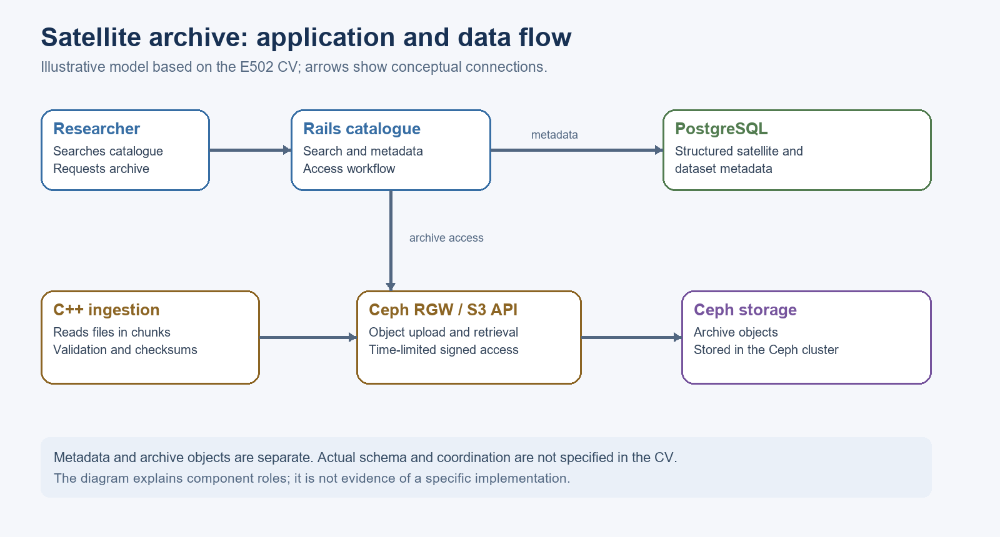
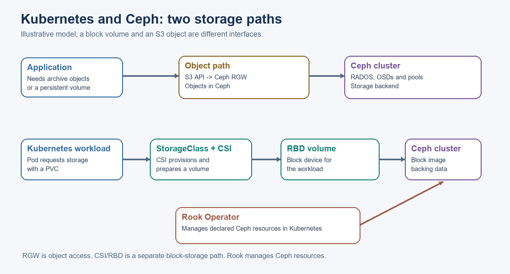

ЛЕГЕНДА ПРОЕКТОВ

1. SIP Desk Phone Platform for Audio and Video Communication

Период: 05.2024 — по настоящее время; роль: Software Engineer

КОНТЕКСТ ПРОДУКТА

SIP-телефоны с аудио и камерой, нативным приложением, провижинингом и embedded Linux.

АРХИТЕКТУРА И ПОТОК ДАННЫХ

Qt Widgets обрабатывает действия пользователя и callbacks SDK; liblinphone работает с SIP, WebRTC — с конференциями. Windows-утилита конфигурирует устройства через SNMP, DHCP, TFTP и SQLite. Yocto/BitBake собирает Linux для i.MX.

КОМАНДА И ВЗАИМОДЕЙСТВИЕ

Наша группа разработки выросла с трёх до четырёх C++-инженеров. Со стороны заказчика обычно участвовали PM, два–четыре C++-инженера, один веб-разработчик и два–четыре QA-инженера. Кандидат работал из Беларуси; продуктовая организация заказчика находилась в Казахстане. Нативные инженеры занимались C++/Qt и SDK, веб-разработчик — web/API, QA — сценариями устройства, PM — координацией. Рабочая модель взаимодействия сочетает middle- и senior-инженеров и не делает кандидата владельцем всех подсистем.

ЛИЧНАЯ ОТВЕТСТВЕННОСТЬ

Рефакторинг Qt-звонков, failover liblinphone, WebRTC-конференции телефона, провижининг .NET 8 и интеграция Yocto/i.MX.

ИСТОРИЯ ПОСТАВКИ: Единый владелец восстановления SIP

СИТУАЦИЯ

Телефон уже имел асинхронную регистрацию, конфигурацию аккаунтов и видимое состояние звонков. Поддержка основного/резервного сервера должна была вписаться в существующее поведение без конкурирующего источника истины.

ПРОБЛЕМА

Первоначальная ротация на стороне Qt дублировала решения жизненного цикла liblinphone. Смена адреса затрагивала домен аутентификации, фактически активный сервер, сохранённую конфигурацию и индикаторы UI.

ПОЧЕМУ ЭТО ВАЖНО

Телефон, показывающий регистрацию, но не способный аутентифицироваться или восстановиться, вводит эксплуатацию в заблуждение. Администратору также нужно одинаковое итоговое состояние аккаунта из провижининга и ручных настроек.

АЛЬТЕРНАТИВЫ

Варианты: сохранить таймеры и retry-правила Qt, исправлять отдельные callbacks отказа или поместить watchdog и переходы рядом с регистрацией SDK. Отдельное восстановление Qt сохраняло дублирование состояния.

ВЫБОР И КОМПРОМИССЫ

Владение SDK позволяет одной машине состояний определять регистрацию, а Qt — показывать фактическое состояние. Это требует сопровождения кастомизации SDK, но убирает независимое переключение одного аккаунта двумя слоями.

ДЕЙСТВИЯ И ВЗАИМОДЕЙСТВИЕ

Я отменил прикладной вариант, реализовал watchdog/failover/failback в SDK, интегрировал API резервного/активного сервера, добавил диагностику и совместимость прежней настройки backup, согласовал провижининг и внёс изменение AuthInfo резервного домена.

ПРОВЕРКА И РЕГРЕССИЯ

Я проверял потерю и восстановление основного сервера на физических телефонах и сравнивал SDK, SIP-логи, UI, сохранённые настройки и аутентификацию. Повтор последовательности проверяет больше, чем единичная успешная регистрация.

РЕЗУЛЬТАТ И УРОК

Поведение SDK и интеграция приложения реализованы, прикладная поддержка влита. Урок — держать управление жизненным циклом у владеющей подсистемы и согласовывать остальные представления с этим владельцем.

РАЗВЁРНУТЫЕ ОТВЕТЫ ПО ОБЯЗАННОСТЯМ CV

1.1. Рефакторил обработку SIP-звонков в направлении архитектуры MVC/MVVM, отделяя отображение интерфейса от состояния звонка, действий пользователя, согласования медиа и интеграции с Linphone-SDK.

Исходная проблема: Callback после перехода экрана может показать устаревшее состояние.

Архитектура и реализация: Подход к реализации — разделять состояние звонка, события интерфейса и callbacks SDK; сохранить сигналы и проверить переходы звонка.

Граница реализации: Qt Widgets обрабатывает действия пользователя и callbacks SDK; liblinphone работает с SIP, WebRTC — с конференциями. Windows-утилита конфигурирует устройства через SNMP, DHCP, TFTP и SQLite. Yocto/BitBake собирает Linux для i.MX.

Режимы отказа: Callback после перехода экрана может показать устаревшее состояние; сравнивать интерфейс до и после одинаковой последовательности звонка. Вывод — иметь ясный источник состояния звонка.

Проверка и диагностика: Я воспроизводил затронутый путь, проверял вход и выход владеющего компонента и повторял смежные сценарии: регистрация, failover/recovery, удержание, второй звонок, media и провижининг собранного телефона. Изменения согласовывались с владельцами интерфейсов, а не проверялись только компиляцией.

Результат и урок: Перечисленное поведение поставлено в рамках проекта. Вывод — иметь ясный источник состояния звонка.

1.2. Постепенно разделял унаследованный код обработки звонков Qt Widgets на предметную область, представление и интеграцию с SDK, сохраняя поведение интерфейса и совместимость сигналов QObject.

Исходная проблема: Изменение сигнатуры сигнала может нарушить подключённые слоты.

Архитектура и реализация: Подход к реализации — переносить ответственности между слоями Qt постепенно; проверять соединения QObject и прежнее поведение интерфейса.

Граница реализации: Qt Widgets обрабатывает действия пользователя и callbacks SDK; liblinphone работает с SIP, WebRTC — с конференциями. Windows-утилита конфигурирует устройства через SNMP, DHCP, TFTP и SQLite. Yocto/BitBake собирает Linux для i.MX.

Режимы отказа: Изменение сигнатуры сигнала может нарушить подключённые слоты; после каждого изменения проверять связанные сценарии. Вывод — сохранять контракты при переносе логики.

Проверка и диагностика: Я воспроизводил затронутый путь, проверял вход и выход владеющего компонента и повторял смежные сценарии: регистрация, failover/recovery, удержание, второй звонок, media и провижининг собранного телефона. Изменения согласовывались с владельцами интерфейсов, а не проверялись только компиляцией.

Результат и урок: Перечисленное поведение поставлено в рамках проекта. Вывод — сохранять контракты при переносе логики.

1.3. Улучшал поведение интерфейса видеозвонков и конференций в случаях удержания, второго звонка, удалённого завершения, устаревших оверлеев и переключения активного видеопотока.

Исходная проблема: Удалённое завершение удерживаемого звонка может оставить лишний оверлей.

Архитектура и реализация: Подход к реализации — проверять последовательности удержания, второго звонка, завершения и переключения видео; отслеживать оверлеи и активный поток после асинхронных событий.

Граница реализации: Qt Widgets обрабатывает действия пользователя и callbacks SDK; liblinphone работает с SIP, WebRTC — с конференциями. Windows-утилита конфигурирует устройства через SNMP, DHCP, TFTP и SQLite. Yocto/BitBake собирает Linux для i.MX.

Режимы отказа: Удалённое завершение удерживаемого звонка может оставить лишний оверлей; повторять последовательности событий и проверять элементы интерфейса. Вывод — проверять порядок событий, а не только отдельные экраны.

Проверка и диагностика: Я воспроизводил затронутый путь, проверял вход и выход владеющего компонента и повторял смежные сценарии: регистрация, failover/recovery, удержание, второй звонок, media и провижининг собранного телефона. Изменения согласовывались с владельцами интерфейсов, а не проверялись только компиляцией.

Результат и урок: Перечисленное поведение поставлено в рамках проекта. Вывод — проверять порядок событий, а не только отдельные экраны.

1.4. Расширял и настраивал бэкенд-логику Linphone-SDK (liblinphone) для переключения SIP и подключения к резервному серверу.

Исходная проблема: Отказ основного сервера при регистрации может нарушить состояние соединения.

Архитектура и реализация: Подход к реализации — связать работу резервного сервера с регистрацией liblinphone; проверить отказ, повторное подключение и конфигурацию приложения.

Граница реализации: Qt Widgets обрабатывает действия пользователя и callbacks SDK; liblinphone работает с SIP, WebRTC — с конференциями. Windows-утилита конфигурирует устройства через SNMP, DHCP, TFTP и SQLite. Yocto/BitBake собирает Linux для i.MX.

Режимы отказа: Отказ основного сервера при регистрации может нарушить состояние соединения; проверить восстановление и состояние приложения. Вывод — согласовывать переключение с состоянием регистрации.

Проверка и диагностика: Я воспроизводил затронутый путь, проверял вход и выход владеющего компонента и повторял смежные сценарии: регистрация, failover/recovery, удержание, второй звонок, media и провижининг собранного телефона. Изменения согласовывались с владельцами интерфейсов, а не проверялись только компиляцией.

Результат и урок: Перечисленное поведение поставлено в рамках проекта. Вывод — согласовывать переключение с состоянием регистрации.

1.5. Разрабатывал интерфейс и сигнализацию WebRTC-конференций: создание и присоединение, входящие приглашения, список участников, добавление по SIP/IP/телефонной книге, строку состояния, панель управления, раскладку видео и управление устройствами.

Исходная проблема: Уход участника во время изменения медиа может оставить устаревшую плитку.

Архитектура и реализация: Подход к реализации — связать сигнализацию конференции со списком участников, приглашениями и управлением медиа; проверить вход, выход и изменение состава.

Граница реализации: Qt Widgets обрабатывает действия пользователя и callbacks SDK; liblinphone работает с SIP, WebRTC — с конференциями. Windows-утилита конфигурирует устройства через SNMP, DHCP, TFTP и SQLite. Yocto/BitBake собирает Linux для i.MX.

Режимы отказа: Уход участника во время изменения медиа может оставить устаревшую плитку; проверять вход и выход вместе со списком участников и управлением устройствами. Вывод — согласовывать сигнализацию и отображение.

Проверка и диагностика: Я воспроизводил затронутый путь, проверял вход и выход владеющего компонента и повторял смежные сценарии: регистрация, failover/recovery, удержание, второй звонок, media и провижининг собранного телефона. Изменения согласовывались с владельцами интерфейсов, а не проверялись только компиляцией.

Результат и урок: Перечисленное поведение поставлено в рамках проекта. Вывод — согласовывать сигнализацию и отображение.

1.6. Мигрировал утилиту конфигурации WinForms с .NET Framework 4.8 на .NET 8, унифицировал форматы файлов проектов и реализовывал провижининг с SNMP, DHCP, TFTP и SQLite.

Исходная проблема: Старые файлы проекта или недоступные устройства могут прервать провижининг.

Архитектура и реализация: Подход к реализации — перенести WinForms-утилиту на .NET 8, сохранить совместимость файлов проектов и проверить сценарии SNMP, DHCP, TFTP и SQLite.

Граница реализации: Qt Widgets обрабатывает действия пользователя и callbacks SDK; liblinphone работает с SIP, WebRTC — с конференциями. Windows-утилита конфигурирует устройства через SNMP, DHCP, TFTP и SQLite. Yocto/BitBake собирает Linux для i.MX.

Режимы отказа: Старые файлы проекта или недоступные устройства могут прервать провижининг; проверять миграцию и ошибки каждого протокола. Вывод — сохранять совместимость конфигурации между версиями утилиты.

Проверка и диагностика: Я воспроизводил затронутый путь, проверял вход и выход владеющего компонента и повторял смежные сценарии: регистрация, failover/recovery, удержание, второй звонок, media и провижининг собранного телефона. Изменения согласовывались с владельцами интерфейсов, а не проверялись только компиляцией.

Результат и урок: Перечисленное поведение поставлено в рамках проекта. Вывод — сохранять совместимость конфигурации между версиями утилиты.

1.7. Участвовал в настройке Yocto/BitBake, интеграции i.MX embedded Linux и конфигурации сервисов устройства.

Исходная проблема: Отсутствие сервиса или пакета может проявиться только на устройстве.

Архитектура и реализация: Подход к реализации — согласовать изменения Yocto/BitBake, интеграцию i.MX и конфигурацию сервисов; проверить собранный образ и запуск устройства.

Граница реализации: Qt Widgets обрабатывает действия пользователя и callbacks SDK; liblinphone работает с SIP, WebRTC — с конференциями. Windows-утилита конфигурирует устройства через SNMP, DHCP, TFTP и SQLite. Yocto/BitBake собирает Linux для i.MX.

Режимы отказа: Отсутствие сервиса или пакета может проявиться только на устройстве; проверять состав образа и запуск на i.MX. Вывод — проверять интеграцию на границе устройства.

Проверка и диагностика: Я воспроизводил затронутый путь, проверял вход и выход владеющего компонента и повторял смежные сценарии: регистрация, failover/recovery, удержание, второй звонок, media и провижининг собранного телефона. Изменения согласовывались с владельцами интерфейсов, а не проверялись только компиляцией.

Результат и урок: Перечисленное поведение поставлено в рамках проекта. Вывод — проверять интеграцию на границе устройства.

ПРОВЕРКА, ПОСТАВКА И РЕЗУЛЬТАТ

Проверка сочетала компоненты, интеграционные сценарии и регрессию: регистрация, failover/recovery, удержание, второй звонок, media и провижининг собранного телефона. Выпуск и развёртывание согласовывались с владельцами компонентов. Результаты выражены функциональностью CV без добавленного численного улучшения.

ВЕРОЯТНЫЕ ВОПРОСЫ

- Почему выбрана эта архитектура, а не альтернативы?

- Как движутся данные и кто владеет границами?

- Какие отказы определяют стратегию проверки?

- Что вы реализовали лично и как это дошло до выпуска?

2. Remote Sensing Satellites Database

Период: 04.2022 — 04.2024; роль: Software Engineer

ПРОЕКТ ПРОСТЫМИ СЛОВАМИ

В CV описана система, в которой есть каталог спутниковых данных и архив больших файлов. Исследователю нужно найти подходящий набор данных, понять, что в нём содержится, и получить архив. Поэтому системе нужны и поиск по описаниям, и место для самих файлов.

PostgreSQL хранит структурированную информацию каталога. Ceph — распределённая платформа хранения, указанная для архивов. RGW — шлюз, через который приложение обращается к объектам Ceph по S3-совместимому API. Компоненты C++ подготавливают и проверяют большие файлы, а Rails предоставляет интерфейс каталога. Kubernetes, Rook и CSI относятся к развёртыванию и постоянным томам; они не заменяют S3-интерфейс.

Это поясняющая модель архитектуры из CV. CV не описывает каждое соединение компонентов и не подтверждает отдельные инциденты и результаты.

КАК ИССЛЕДОВАТЕЛЬ ПОЛУЧАЕТ ФАЙЛ

1. Исследователь ищет данные в каталоге Rails и открывает запись набора данных.
2. Приложение получает структурированные метаданные из PostgreSQL.
3. Путь доступа к архиву использует S3-совместимый интерфейс RGW, чтобы запросить объект в Ceph.
4. Pre-signed URL может дать право на определённую операцию на ограниченное время. Истёкшая ссылка, отсутствующий объект и отказ в доступе — разные случаи.

Точные вызовы, ключ объекта и схема базы не указаны. Шаги поясняют роли компонентов, а не воспроизводят подтверждённую последовательность production-запросов.

ПОЧЕМУ У CEPH ДВА ПУТИ ДОСТУПА

S3-объект и том Kubernetes решают разные задачи. RGW предоставляет приложениям архивные объекты через S3 API. RBD предоставляет блочное хранение; CSI связывает операции тома Kubernetes с драйвером хранения, а PVC запрашивает том. Rook управляет объявленными ресурсами Ceph в Kubernetes. PVC не является S3 bucket, а Rook не является S3-клиентом.

ЧТО ВХОДИЛО В РОЛЬ

CV описывает работу на уровне интеграции приложения и эксплуатации: приём и проверку данных на C++, доступ через RGW/S3, работу с Rook и CSI/RBD, исследование задержки и throughput. Разработка ядра Ceph и upstream-вклад в CV не заявлены. В ответах по задачам ниже указанный в CV объём отделён от примеров возможной проверки компонентов.

КОНТЕКСТ ПРОДУКТА

Каталог спутников и архивов, объединяющий метаданные, загрузку файлов и распределённое объектное хранилище.

АРХИТЕКТУРА И ПОТОК ДАННЫХ

Rails предоставляет каталог и поиск с PostgreSQL. C++ потоково обрабатывает и проверяет архивы; S3 API связывает систему с Ceph RGW. Kubernetes, Rook и CSI обеспечивают хранение; Python, Prometheus и Grafana — проверки и мониторинг.

АРХИТЕКТУРНОЕ ОБОСНОВАНИЕ: CEPH

Ceph выбрали, чтобы на одной платформе получить S3-совместимый доступ к большим архивам через RGW и блочные тома RBD для Kubernetes через CSI. PostgreSQL остаётся подходящим решением для структурированных метаданных каталога и поиска. Кластер можно масштабировать и настраивать для отказоустойчивости, но это требует эксплуатации: мониторинга OSD, ёмкости, восстановления и сети.

Альтернативы — управляемое S3-совместимое объектное хранилище с отдельным поставщиком блочных томов Kubernetes либо эксплуатация только того интерфейса хранения, который действительно нужен приложению. Управляемый сервис может уменьшить объём администрирования кластера, но его применимость зависит от ограничений развёртывания и требований к доступу.

КОМАНДА И ВЗАИМОДЕЙСТВИЕ

Команда из шести человек включает двух middle/senior C++-инженеров обработки данных, middle-инженера Rails/PostgreSQL, senior-инфраструктурного инженера Kubernetes/Rook/Ceph, QA automation-инженера Python/pytest и координатора продукта/анализа. Распределённая команда работает из Беларуси и Польши. Кандидат реализует приём данных и интеграционные изменения и взаимодействует с инфраструктурным инженером при диагностике кластера и развёртывании, не владея всеми компонентами платформы.

ЛИЧНАЯ ОТВЕТСТВЕННОСТЬ

Каталоги Rails, потоковый приём C++ и параллельная проверка, RGW/S3, интеграция Kubernetes/Rook/Ceph CSI и диагностика Python/Prometheus/Grafana.

ТЕХНИЧЕСКАЯ МОДЕЛЬ И ОБСУЖДЕНИЕ ПРОЕКТА

Следующая техническая модель поясняет проект из CV и показывает возможное взаимодействие перечисленных компонентов. Конкретные решения, отдельные инциденты и результаты не установлены одним только CV.

1. Границы приложения и хранилища. Исследователи ищут спутник или набор данных через интерфейс Rails. PostgreSQL содержит структурированные метаданные каталога и архивов. Конвейер загрузки на C++ постепенно читает большие файлы изображений или телеметрии, проверяет входные данные и вычисляет контрольные суммы без обязательной загрузки всего архива в память. RGW предоставляет S3-совместимый объектный API поверх Ceph; каталог хранит ссылку на объект, а не использует PostgreSQL как бинарный архив. Конкретные ключи объектов, схема и топология развёртывания не указаны.

2. Подготовка файлов. Ограниченный входной буфер и ограниченная очередь задач — возможный способ удерживать потребление памяти в пределах настроенного рабочего набора. Необходимо различать короткое чтение POSIX, конец файла и ошибки; частичная запись и прерывание операции требуют обработки. Результаты параллельных проверок должны относиться к правильному файлу, а сбой worker не должен приводить к сообщению об успехе. Контрольная сумма выявляет повреждение при сравнении с доверенным значением, но сама по себе не подтверждает отправителя.

3. Интеграция RGW/S3. Приложение использует аутентифицированный S3-запрос для загрузки или получения объекта через RGW. Для больших объектов возможен multipart upload при поддержке выбранной версии RGW и клиента. Неудачные и незавершённые multipart-загрузки требуют очистки. Pre-signed URL делегирует операцию на ограниченное время с полномочиями подписавшей стороны; обладание ссылкой даёт доступ, поэтому её не следует без необходимости журналировать или передавать. Истечение срока, ошибка авторизации, отсутствие объекта и прерывание клиента — разные результаты. Endpoint, region и механизм подписи проверяются по конкретному развёртыванию.

4. Согласованность метаданных и объектов. PostgreSQL и объектное хранилище не образуют автоматически общую транзакцию. Возможное решение — записывать загрузку как pending, публиковать ссылку в каталоге после проверки и согласовывать незавершённые записи и оставшиеся без ссылки объекты после прерывания. Для повторов нужны явное правило идемпотентности и обработка неизвестного результата загрузки. Проверка идёт в обе стороны: видимая запись ведёт к ожидаемому объекту, а неудачная операция не считается незаметно завершённой. Это вариант дизайна, а не утверждение о конкретной промышленной реализации.

5. Kubernetes, Rook и Ceph CSI. Rook согласует объявленные ресурсы Ceph с состоянием кластера. StorageClass указывает CSI provisioner; PVC запрашивает том и может инициировать динамическое создание при корректной настройке класса и драйвера. RBD-драйвер предоставляет блочные тома; доступ к объектам через RGW/S3 — отдельный путь, и S3 bucket не следует считать PVC. Причиной pending claim могут быть класс, учётные данные, драйвер, кластер или планирование. До изменения конфигурации проверяют события PVC, логи CSI controller/node и состояние Ceph.

6. Производительность и мониторинг. Задержку, throughput, частоту запросов и частоту ошибок оценивают вместе с описанием нагрузки и периода наблюдения. Замедление может возникнуть в клиенте, сети, RGW, при восстановлении кластера или на устройствах хранения; показатели OSD и BlueStore помогают сузить поиск, но сами по себе не определяют причину. Prometheus может собирать метрики, Grafana — отображать связанные показатели. Проверки на Python/pytest могут охватывать здоровье, передачу и целостность. Конкретные нагрузки, результаты benchmark, конфигурация кластера и эффект настройки не утверждаются.

7. Границы участия и интервью. CV описывает задачи интеграции и эксплуатации с RGW, Rook, CSI/RBD и исследованием производительности. Разработка ядра Ceph и upstream-вклад в CV не заявлены. Технические варианты в этом разделе — материал для подготовки; перед представлением отдельного действия как проверенного опыта следует обратиться к фактической сверке.

ИСТОРИЯ ПОСТАВКИ: Публикация архива после проверки

СИТУАЦИЯ

Исследователи находят большие объекты изображений и телеметрии через каталог. Rails/PostgreSQL и бинарное хранилище Ceph выполняют разные части одной пользовательской операции.

ПРОБЛЕМА

Прерванный приём может оставить объект без корректной записи или видимую запись с неполными данными. Параллельная проверка также увеличивает память при неограниченной очереди.

ПОЧЕМУ ЭТО ВАЖНО

Результат поиска полезен, только если архив по ссылке доступен и ему можно доверять. Оператор должен отличать неудачный приём от обычного отсутствующего объекта.

АЛЬТЕРНАТИВЫ

Загрузка целого файла упрощает код, но плохо масштабируется; публикация метаданных до проверки объекта сокращает видимый путь, но открывает частичный результат. Потоковое поэтапное завершение делает риски управляемыми.

ВЫБОР И КОМПРОМИССЫ

Ограниченный streaming и параллельная проверка checksum подходят большим файлам без предположения общей транзакции PostgreSQL и RGW. Публикация итоговой ссылки после проверки не выдаёт неполную работу за завершённую.

ДЕЙСТВИЯ И ВЗАИМОДЕЙСТВИЕ

Я связал подготовку и проверку файлов C++ с доступом RGW/S3, согласовал завершение и повтор с коллегами Rails и инфраструктуры, использовал Python-проверки и метрики для исследования отказов по пути.

ПРОВЕРКА И РЕГРЕССИЯ

Проверка сравнивает checksum загруженного и прочитанного, повторяет прерванные запросы, исследует ссылки и подписанный доступ. Регрессия развёртывания отдельно проверяет reconciliation Rook, binding томов CSI и прикладной доступ.

РЕЗУЛЬТАТ И УРОК

История поставки даёт согласованный путь приёма/чтения с ограниченными буферами и явной обработкой отказов. Численное улучшение latency, throughput или доступности сверх CV не заявляется.

РАЗВЁРНУТЫЕ ОТВЕТЫ ПО ОБЯЗАННОСТЯМ CV

2.1. Разрабатывал интерфейсы и сценарии Ruby on Rails для каталогов спутников, метаданных, поиска наборов данных и доступа к архивам.

Что означает эта задача: Rails предоставляет страницы и логику приложения, через которые можно найти спутниковые данные и посмотреть их описание. PostgreSQL хранит структурированные данные каталога, например информацию о спутниках и наборах данных. В CV указана работа с каталогом, метаданными, поиском и доступом к архивам.

Как это представить: исследователь ищет данные в каталоге, открывает запись и запрашивает связанный архив. Каталог объясняет, что это за данные; путь к хранилищу предоставляет сам файл. Полезно проверить, находится ли запись, корректны ли метаданные и что показывает интерфейс, если архив получить не удалось.

2.2. Разрабатывал компоненты загрузки на C++ с потоковым вводом-выводом POSIX и оптимизированными буферами для больших архивов изображений и телеметрии.

Что означает эта задача: компонент приёма получает большие файлы снимков или телеметрии и читает их через POSIX I/O. Вместо обязательной загрузки всего файла в память данные можно обрабатывать частями с ограниченным буфером. Тогда потребление памяти зависит от буфера и числа одновременно выполняемых задач, а не обязательно от размера всего архива.

Как это представить: последний блок может быть меньше буфера; чтение и запись могут вернуть меньше байтов, чем запрошено, или завершиться ошибкой. Код учитывает реально возвращённое число байтов и обрабатывает ошибки. Полезные проверки — пустой файл, файл больше буфера, прерванное чтение и потребление памяти при ожидаемом числе параллельных задач.

2.3. Реализовывал многопоточную валидацию данных, вычисление контрольных сумм и подготовку файлов к пакетной загрузке.

Что означает эта задача: валидация и вычисление контрольной суммы проверяют входные данные до их использования архивным процессом. Несколько обработчиков могут готовить и проверять файлы параллельно. Координатору нужен результат каждого файла, чтобы сбой обработчика или повреждённый вход не превращались незаметно в успешную пакетную загрузку.

Как это представить: контрольная сумма помогает обнаружить изменение данных при сравнении с доверенным ожидаемым значением. Она не доказывает подлинность отправителя. Полезно проверить корректные и повреждённые файлы, сбой обработчика и повторную обработку; ограниченная очередь — один из возможных способов не расходовать слишком много памяти.

2.4. Интегрировал Ceph RGW через S3 API для сохранения и получения спутниковых данных, включая pre-signed URLs.

Что означает эта задача: Ceph хранит объекты архивов, а RGW предоставляет приложению S3-совместимый HTTP-интерфейс. CV описывает интеграцию сохранения и получения объектов через этот интерфейс, включая pre-signed URLs. Подписанная ссылка даёт её владельцу право на определённую операцию на ограниченное время; сама ссылка не является объектом.

Как это представить: для получения файла клиенту нужны правильные bucket и key, доступный endpoint и действующая авторизация. Истёкшая ссылка, отказ в доступе, отсутствующий объект и сетевой timeout — разные проблемы. Полезно проверить успешное получение, запрещённый или истёкший доступ и прерванную передачу, не раскрывая подписанную ссылку в логах.

2.5. Разворачивал и поддерживал сервисы Ceph в Kubernetes с использованием Rook Operator.

Что означает эта задача: Kubernetes запускает сервисы, а Rook — оператор, который помогает управлять ресурсами Ceph, описанными в Kubernetes. CV указывает развёртывание и сопровождение сервисов Ceph с Rook. Легенда описывает взаимодействие с инфраструктурным инженером, а не владение всеми компонентами кластера.

Как это представить: Rook помогает привести фактические ресурсы к объявленной конфигурации. Работающий оператор не доказывает, что все OSD, пулы и запросы приложения здоровы. После изменения полезно проверить статус ресурса, события Kubernetes, логи оператора и здоровье Ceph. Конкретные манифесты, версии и шаги зависят от реального окружения.

2.6. Настраивал Ceph CSI для RBD и динамического выделения постоянных томов.

Что означает эта задача: RBD предоставляет блочный образ на базе Ceph. Ceph CSI связывает операции хранения с Kubernetes, а StorageClass и PVC описывают запрошенное хранилище. CV указывает настройку CSI для RBD и динамическое создание томов. Этот путь отличается от сохранения архивного объекта через RGW и S3.

Как это представить: PVC запрашивает том; настроенный provisioner может создать базовое хранилище, а Kubernetes — привязать PV. Затем драйвер подготавливает том для запланированной нагрузки. Статус Bound не доказывает успешные attachment, mount и доступ приложения. Нужно изучить события и логи controller или node-компонента именно на неисправном этапе.

2.7. Исследовал производительность Ceph, анализируя задержки ввода-вывода, пропускную способность, поведение OSD и использование BlueStore.

Что означает эта задача: CV описывает исследование задержки I/O, throughput, поведения OSD и использования BlueStore. Задержка — время выполнения операции; throughput — объём данных за единицу времени. OSD участвуют в хранении данных, а BlueStore — backend хранения OSD.

Как это представить: на медленный запрос могут влиять клиент, шлюз, сеть, восстановление или устройство хранения. Сопоставьте приложение, кластер и host за один интервал и при одной нагрузке, затем проверьте конкретную гипотезу. Один медленный OSD или занятый диск — повод исследовать проблему, но не самостоятельное доказательство причины или измеренного улучшения.

2.8. Разрабатывал скрипты Python для проверки состояния хранилища, развёртывания, целостности и производительности.

Что означает эта задача: скрипты Python могут автоматизировать проверки здоровья хранения, развёртывания, целостности и производительности. CV указывает работу в этих направлениях. Полезный скрипт выдаёт понятный успешный или ошибочный результат и достаточно контекста, чтобы определить неработающий этап.

Как это представить: проверка может завершиться ошибкой из-за недоступного сервиса, неожиданного ответа или timeout. Целостность можно проверять сравнением с известным ожидаемым результатом. Тесты, создающие объекты или тома, требуют выделенного окружения, ограниченных прав и очистки. Конкретные скрипты и их результаты здесь не установлены.

2.9. Мониторил инфраструктуру хранения через Prometheus и Grafana, выявляя узкие места и проблемы ресурсов.

Что означает эта задача: Prometheus собирает метрики, а Grafana показывает их на dashboards. CV указывает мониторинг инфраструктуры хранения и поиск узких мест и проблем ресурсов. Эти инструменты дают наблюдения; dashboard сам по себе не объясняет, почему операция стала медленной.

Как это представить: при росте задержки записи сначала проверьте затронутый интервал, частоту запросов, ошибки и throughput. Затем сопоставьте состояние OSD, восстановление, ёмкость, устройства и сеть с приложением или RGW. Убедитесь, что метрики доступны и сопоставимы, и изучите логи до предложения изменений. Конкретные dashboards и численные результаты не установлены.

ПРОВЕРКА, ПОСТАВКА И РЕЗУЛЬТАТ

Проверка сочетала компоненты, интеграционные сценарии и регрессию: обновление каталога, целостность, прерванный приём, чтение объектов, binding томов и здоровье хранилища. Выпуск и развёртывание согласовывались с владельцами компонентов. Результаты выражены функциональностью CV без добавленного численного улучшения.

ВЕРОЯТНЫЕ ВОПРОСЫ

- Почему выбрана эта архитектура, а не альтернативы?

- Как движутся данные и кто владеет границами?

- Какие отказы определяют стратегию проверки?

- Что вы реализовали лично и как это дошло до выпуска?

3. Software Modules for UAV

Период: 03.2020 — 03.2022; роль: Software Engineer

КОНТЕКСТ ПРОДУКТА

Модули обработки изображений оптических датчиков БПЛА: от сырых данных до стабилизированного и объединённого изображения.

АРХИТЕКТУРА И ПОТОК ДАННЫХ

MATLAB используется для прототипирования и оценки алгоритмов; C++ реализует производительные преобразования и обработку кадров. Проверка использует представительные данные датчиков.

КОМАНДА И ВЗАИМОДЕЙСТВИЕ

Работа идёт в приборостроительной организации Минска: алгоритмические задачи выполняются индивидуально или в паре с взаимодействием специалистов оптики, электроники, ПО и лётных испытаний. Рабочая группа — примерно восемь–двенадцать инженеров этих функций, middle/senior-специалисты и senior-руководители прибора. Кандидат отвечает за оценку MATLAB и модули C++, электронщики — за получение данных, программные инженеры — за целевую интеграцию, испытатели — за эталоны и лётные кампании.

ЛИЧНАЯ ОТВЕТСТВЕННОСТЬ

Оценка алгоритмов MATLAB и реализация C++ преобразования, предобработки, дебайеризации и стабилизации с эффективными буферами и интеграцией слияния.

ИСТОРИЯ ПОСТАВКИ: Обработка C++ по эталону

СИТУАЦИЯ

Сырые UAV-кадры требовали цепочки от формата датчика к цвету, стабилизации и слиянию. MATLAB поддерживал оценку алгоритмов, C++ — чувствительное к производительности выполнение.

ПРОБЛЕМА

Неверные Bayer-layout, stride или время жизни буфера портили вывод даже при правильном прототипе.

ПОЧЕМУ ЭТО ВАЖНО

Операторам нужны пригодные изображения при ограниченной памяти и недопустимых лишних копиях кадров.

АЛЬТЕРНАТИВЫ

Варианты — только MATLAB-прототип, полная нативная перепись или поэтапная интеграция C++ по эталону.

ВЫБОР И КОМПРОМИССЫ

MATLAB упрощал сравнение качества; выбранные C++-пути давали подходящее выполнение и контроль памяти.

ДЕЙСТВИЯ И ВЗАИМОДЕЙСТВИЕ

Я оценивал дебайеризацию/стабилизацию MATLAB, реализовывал преобразование/предобработку C++ и обсуждал владение кадром со специалистами датчика/интеграции.

ПРОВЕРКА И РЕГРЕССИЯ

Сырые datasets, детали границ, порядок каналов, размеры и повторы проверяли качество и буферы вместе.

РЕЗУЛЬТАТ И УРОК

Результат — интегрированный путь с проверенным выводом и меньшим количеством лишних копий без выдуманной метрики ускорения или памяти.

РАЗВЁРНУТЫЕ ОТВЕТЫ ПО ОБЯЗАННОСТЯМ CV

3.1. Разрабатывал модули цифровой обработки изображений для оптических датчиков БПЛА, сочетая алгоритмы MATLAB с производительными компонентами C++.

Исходная проблема: Реализация на C++ может отличаться от прототипа MATLAB.

Архитектура и реализация: Подход к реализации — прототипировать обработку в MATLAB и реализовывать производительные части на C++; сравнивать результаты.

Граница реализации: MATLAB используется для прототипирования и оценки алгоритмов; C++ реализует производительные преобразования и обработку кадров. Проверка использует представительные данные датчиков.

Режимы отказа: Реализация на C++ может отличаться от прототипа MATLAB; сравнивать представительные результаты до интеграции. Вывод — сохранять численное поведение между реализациями.

Проверка и диагностика: Я воспроизводил затронутый путь, проверял вход и выход владеющего компонента и повторял смежные сценарии: сырые/преобразованные datasets, качество, размеры, время жизни буфера и поведение обработки. Изменения согласовывались с владельцами интерфейсов, а не проверялись только компиляцией.

Результат и урок: Перечисленное поведение поставлено в рамках проекта. Вывод — сохранять численное поведение между реализациями.

3.2. Создавал и оценивал прототипы дебайеризации в MATLAB и реализовывал преобразование данных Bayer в цветное изображение на C++.

Исходная проблема: Неверная обработка шаблона Bayer меняет восстановленные цвета.

Архитектура и реализация: Подход к реализации — оценивать восстановление цвета Bayer в MATLAB и C++; сравнивать результаты на представительных сырых кадрах.

Граница реализации: MATLAB используется для прототипирования и оценки алгоритмов; C++ реализует производительные преобразования и обработку кадров. Проверка использует представительные данные датчиков.

Режимы отказа: Неверная обработка шаблона Bayer меняет восстановленные цвета; сравнивать каналы и результат на известных кадрах. Вывод — проверять предположения о формате датчика.

Проверка и диагностика: Я воспроизводил затронутый путь, проверял вход и выход владеющего компонента и повторял смежные сценарии: сырые/преобразованные datasets, качество, размеры, время жизни буфера и поведение обработки. Изменения согласовывались с владельцами интерфейсов, а не проверялись только компиляцией.

Результат и урок: Перечисленное поведение поставлено в рамках проекта. Вывод — проверять предположения о формате датчика.

3.3. Разрабатывал компоненты преобразования форматов и предварительной обработки на C++ для совместимости форматов датчиков.

Исходная проблема: Неверный шаг строки или порядок каналов может испортить изображение.

Архитектура и реализация: Подход к реализации — преобразовывать форматы датчиков на C++; проверять размеры, расположение каналов и совместимость следующего этапа.

Граница реализации: MATLAB используется для прототипирования и оценки алгоритмов; C++ реализует производительные преобразования и обработку кадров. Проверка использует представительные данные датчиков.

Режимы отказа: Неверный шаг строки или порядок каналов может испортить изображение; проверять размеры и расположение данных на границах компонентов. Вывод — явно задавать контракт формата.

Проверка и диагностика: Я воспроизводил затронутый путь, проверял вход и выход владеющего компонента и повторял смежные сценарии: сырые/преобразованные datasets, качество, размеры, время жизни буфера и поведение обработки. Изменения согласовывались с владельцами интерфейсов, а не проверялись только компиляцией.

Результат и урок: Перечисленное поведение поставлено в рамках проекта. Вывод — явно задавать контракт формата.

3.4. Оптимизировал обработку кадров на C++, управление буферами и сокращение лишнего копирования.

Исходная проблема: Удаление копирования может выявить ошибку времени жизни или изменения буфера.

Архитектура и реализация: Подход к реализации — проверять владение буферами и копирование кадров; измерять производительность и сохранять результат обработки.

Граница реализации: MATLAB используется для прототипирования и оценки алгоритмов; C++ реализует производительные преобразования и обработку кадров. Проверка использует представительные данные датчиков.

Режимы отказа: Удаление копирования может выявить ошибку времени жизни или изменения буфера; проверять владение вместе с временем обработки. Вывод — оптимизация должна сохранять корректность.

Проверка и диагностика: Я воспроизводил затронутый путь, проверял вход и выход владеющего компонента и повторял смежные сценарии: сырые/преобразованные datasets, качество, размеры, время жизни буфера и поведение обработки. Изменения согласовывались с владельцами интерфейсов, а не проверялись только компиляцией.

Результат и урок: Перечисленное поведение поставлено в рамках проекта. Вывод — оптимизация должна сохранять корректность.

3.5. Разрабатывал и оценивал алгоритмы стабилизации в MATLAB и реализовывал выбранные операции на C++.

Исходная проблема: Движение или слабые признаки могут выявить нестабильность.

Архитектура и реализация: Подход к реализации — оценивать стабилизацию в MATLAB и интегрировать операции C++; сравнивать результат на характерных движениях.

Граница реализации: MATLAB используется для прототипирования и оценки алгоритмов; C++ реализует производительные преобразования и обработку кадров. Проверка использует представительные данные датчиков.

Режимы отказа: Движение или слабые признаки могут выявить нестабильность; оценивать представительные последовательности в MATLAB и C++. Вывод — проверять поведение во времени.

Проверка и диагностика: Я воспроизводил затронутый путь, проверял вход и выход владеющего компонента и повторял смежные сценарии: сырые/преобразованные datasets, качество, размеры, время жизни буфера и поведение обработки. Изменения согласовывались с владельцами интерфейсов, а не проверялись только компиляцией.

Результат и урок: Перечисленное поведение поставлено в рамках проекта. Вывод — проверять поведение во времени.

3.6. Проектировал и проверял алгоритмы слияния данных нескольких датчиков в MATLAB и интегрировал модули в конвейер.

Исходная проблема: Разные входы датчиков могут привести к несогласованному слиянию.

Архитектура и реализация: Подход к реализации — разрабатывать алгоритмы слияния в MATLAB и интегрировать модули; сравнивать результаты на данных датчиков.

Граница реализации: MATLAB используется для прототипирования и оценки алгоритмов; C++ реализует производительные преобразования и обработку кадров. Проверка использует представительные данные датчиков.

Режимы отказа: Разные входы датчиков могут привести к несогласованному слиянию; сравнивать результаты на представительных данных. Вывод — проверять предположения на входах.

Проверка и диагностика: Я воспроизводил затронутый путь, проверял вход и выход владеющего компонента и повторял смежные сценарии: сырые/преобразованные datasets, качество, размеры, время жизни буфера и поведение обработки. Изменения согласовывались с владельцами интерфейсов, а не проверялись только компиляцией.

Результат и урок: Перечисленное поведение поставлено в рамках проекта. Вывод — проверять предположения на входах.

3.7. Тестировал модули на представительных данных датчиков, анализируя качество, точность и производительность.

Исходная проблема: Один качественный кадр может скрыть ошибки в других условиях.

Архитектура и реализация: Подход к реализации — прогонять представительные наборы через обработку и анализировать качество, точность и время.

Граница реализации: MATLAB используется для прототипирования и оценки алгоритмов; C++ реализует производительные преобразования и обработку кадров. Проверка использует представительные данные датчиков.

Режимы отказа: Один качественный кадр может скрыть ошибки в других условиях; использовать разные представительные наборы и проверять качество и время. Вывод — тестировать не только нормальный вход.

Проверка и диагностика: Я воспроизводил затронутый путь, проверял вход и выход владеющего компонента и повторял смежные сценарии: сырые/преобразованные datasets, качество, размеры, время жизни буфера и поведение обработки. Изменения согласовывались с владельцами интерфейсов, а не проверялись только компиляцией.

Результат и урок: Перечисленное поведение поставлено в рамках проекта. Вывод — тестировать не только нормальный вход.

ПРОВЕРКА, ПОСТАВКА И РЕЗУЛЬТАТ

Проверка сочетала компоненты, интеграционные сценарии и регрессию: сырые/преобразованные datasets, качество, размеры, время жизни буфера и поведение обработки. Выпуск и развёртывание согласовывались с владельцами компонентов. Результаты выражены функциональностью CV без добавленного численного улучшения.

ВЕРОЯТНЫЕ ВОПРОСЫ

- Почему выбрана эта архитектура, а не альтернативы?

- Как движутся данные и кто владеет границами?

- Какие отказы определяют стратегию проверки?

- Что вы реализовали лично и как это дошло до выпуска?

4. Software for Processing and Analysis of Satellite Earth Observation Images

Период: 01.2018 — 02.2020; роль: Software Engineer

КОНТЕКСТ ПРОДУКТА

ПО спутниковых изображений поддерживает оценку качества, прогноз квантования и сжатие.

АРХИТЕКТУРА И ПОТОК ДАННЫХ

Данные изображений поступают на коррекцию яркости, оценку разрешения по резкой границе и прогноз диапазона. Сжатие на базе ADPCM использует несколько квантователей. В окружение проекта входят MATLAB и C++.

КОМАНДА И ВЗАИМОДЕЙСТВИЕ

Алгоритмическая работа выполнялась индивидуально или в паре в исследовательском подразделении минского конструкторского бюро. Практическая межфункциональная группа включает примерно восемь–двенадцать специалистов электроники детекторов, оптики, механической юстировки, алгоритмов MATLAB, бортового ПО и испытаний. Middle/senior-специалисты взаимодействуют с senior-руководителями прибора. Кандидат участвует в поэтапных ревью, документации и передаче алгоритмов, не владея всем бортовым стеком.

ЛИЧНАЯ ОТВЕТСТВЕННОСТЬ

Нормализация яркости, анализ разрешения sharp edge, резкость/границы, прогнозирование/автоматизация диапазонов квантования по albedo и ADPCM с несколькими квантователями.

ИСТОРИЯ ПОСТАВКИ: Сжатие в жёстком бортовом бюджете

СИТУАЦИЯ

Объём спутниковых изображений превышал возможности радиолинии при ограниченных вычислениях и буферах бортового оборудования. Качество сжатия и стоимость реализации оценивались вместе.

ПРОБЛЕМА

Более сильный transform-codec мог дать лучшее rate-distortion, но не помещался в бортовой бюджет. Единая стратегия квантования также одинаково обрабатывала разные текстуры сцен.

ПОЧЕМУ ЭТО ВАЖНО

Прибору нужно передавать полезные изображения миссии, а не максимизировать коэффициент на простых примерах. Превышение вычислительного бюджета недопустимо даже при улучшении изображения.

АЛЬТЕРНАТИВЫ

Варианты — более сложное transform-кодирование, фиксированное дифференциальное квантование и адаптивное предиктивное кодирование. Компромисс — теоретическая эффективность против реальных ограничений бортовой реализации.

ВЫБОР И КОМПРОМИССЫ

Дизайн семейства ADPCM использовал предсказание, разность и адаптивное квантование с умеренными буферами. Последующее прогнозирование типа изображения улучшило качество при неизменном коэффициенте сжатия.

ДЕЙСТВИЯ И ВЗАИМОДЕЙСТВИЕ

Я проектировал и реализовывал эталон MATLAB, оценивал предиктор/квантователь, сравнивал типы сцен и документировал алгоритм и эталонные результаты для группы бортового ПО.

ПРОВЕРКА И РЕГРЕССИЯ

Проверка сравнивала восстановление эталонных и сложных сцен при одинаковом коэффициенте, разностные изображения и экспертную оценку артефактов. Целевая реализация должна совпадать с эталоном с учётом своей арифметики.

РЕЗУЛЬТАТ И УРОК

Дизайн сжатия поддерживал обработку в вычислительных ограничениях. Совместное сравнение качества и размера полезнее отдельной оптимизации одного показателя.

РАЗВЁРНУТЫЕ ОТВЕТЫ ПО ОБЯЗАННОСТЯМ CV

4.1. Разрабатывал алгоритмы нормализации яркости кадров и устранения оптических дефектов.

Исходная проблема: Различия яркости кадров могут сделать стыки заметными.

Архитектура и реализация: Подход к реализации — нормализовать яркость между кадрами и устранять оптические дефекты; проверять согласованность на изображениях.

Граница реализации: Данные изображений поступают на коррекцию яркости, оценку разрешения по резкой границе и прогноз диапазона. Сжатие на базе ADPCM использует несколько квантователей. В окружение проекта входят MATLAB и C++.

Режимы отказа: Различия яркости кадров могут сделать стыки заметными; сравнивать соседние исправленные кадры и оптические артефакты. Вывод — оценивать объединённое изображение.

Проверка и диагностика: Я воспроизводил затронутый путь, проверял вход и выход владеющего компонента и повторял смежные сценарии: типовые изображения, известные границы, яркостные переходы, прогноз диапазонов и сжатие/восстановление. Изменения согласовывались с владельцами интерфейсов, а не проверялись только компиляцией.

Результат и урок: Перечисленное поведение поставлено в рамках проекта. Вывод — оценивать объединённое изображение.

4.2. Проектировал и реализовывал анализ линейного разрешения спутниковых изображений методом резкой границы.

Исходная проблема: Неудачно выбранная граница может исказить оценку разрешения.

Архитектура и реализация: Подход к реализации — использовать метод резкой границы для оценки линейного разрешения; проверять измерения на характерных границах.

Граница реализации: Данные изображений поступают на коррекцию яркости, оценку разрешения по резкой границе и прогноз диапазона. Сжатие на базе ADPCM использует несколько квантователей. В окружение проекта входят MATLAB и C++.

Режимы отказа: Неудачно выбранная граница может исказить оценку разрешения; сравнивать измерения на представительных границах. Вывод — проверять предположения метода измерения.

Проверка и диагностика: Я воспроизводил затронутый путь, проверял вход и выход владеющего компонента и повторял смежные сценарии: типовые изображения, известные границы, яркостные переходы, прогноз диапазонов и сжатие/восстановление. Изменения согласовывались с владельцами интерфейсов, а не проверялись только компиляцией.

Результат и урок: Перечисленное поведение поставлено в рамках проекта. Вывод — проверять предположения метода измерения.

4.3. Создавал алгоритмы оценки резкости изображения и чёткости границ для измерения разрешения.

Исходная проблема: Шум может влиять на чёткость границы.

Архитектура и реализация: Подход к реализации — оценивать резкость и чёткость границ; сравнивать результаты для разных условий изображения.

Граница реализации: Данные изображений поступают на коррекцию яркости, оценку разрешения по резкой границе и прогноз диапазона. Сжатие на базе ADPCM использует несколько квантователей. В окружение проекта входят MATLAB и C++.

Режимы отказа: Шум может влиять на чёткость границы; сравнивать измерения на представительных изображениях. Вывод — оценивать резкость с учётом условий.

Проверка и диагностика: Я воспроизводил затронутый путь, проверял вход и выход владеющего компонента и повторял смежные сценарии: типовые изображения, известные границы, яркостные переходы, прогноз диапазонов и сжатие/восстановление. Изменения согласовывались с владельцами интерфейсов, а не проверялись только компиляцией.

Результат и урок: Перечисленное поведение поставлено в рамках проекта. Вывод — оценивать резкость с учётом условий.

4.4. Разрабатывал прогнозирование диапазонов квантования по данным наблюдений и оценке диапазона альбедо.

Исходная проблема: Неподходящий диапазон может отбросить полезные детали сигнала.

Архитектура и реализация: Подход к реализации — оценивать диапазоны альбедо по данным наблюдений и прогнозировать границы квантования; проверять покрытие диапазона.

Граница реализации: Данные изображений поступают на коррекцию яркости, оценку разрешения по резкой границе и прогноз диапазона. Сжатие на базе ADPCM использует несколько квантователей. В окружение проекта входят MATLAB и C++.

Режимы отказа: Неподходящий диапазон может отбросить полезные детали сигнала; сравнивать прогноз с представительными наблюдениями. Вывод — проверять покрытие ожидаемых входов.

Проверка и диагностика: Я воспроизводил затронутый путь, проверял вход и выход владеющего компонента и повторял смежные сценарии: типовые изображения, известные границы, яркостные переходы, прогноз диапазонов и сжатие/восстановление. Изменения согласовывались с владельцами интерфейсов, а не проверялись только компиляцией.

Результат и урок: Перечисленное поведение поставлено в рамках проекта. Вывод — проверять покрытие ожидаемых входов.

4.5. Автоматизировал прогнозирование диапазонов квантования.

Исходная проблема: Разные запуски не должны незаметно давать разные диапазоны.

Архитектура и реализация: Подход к реализации — автоматизировать расчёт диапазонов квантования; проверять повторяемость результатов на одинаковых данных.

Граница реализации: Данные изображений поступают на коррекцию яркости, оценку разрешения по резкой границе и прогноз диапазона. Сжатие на базе ADPCM использует несколько квантователей. В окружение проекта входят MATLAB и C++.

Режимы отказа: Разные запуски не должны незаметно давать разные диапазоны; повторять обработку одинаковых данных. Вывод — обеспечивать воспроизводимость расчёта.

Проверка и диагностика: Я воспроизводил затронутый путь, проверял вход и выход владеющего компонента и повторял смежные сценарии: типовые изображения, известные границы, яркостные переходы, прогноз диапазонов и сжатие/восстановление. Изменения согласовывались с владельцами интерфейсов, а не проверялись только компиляцией.

Результат и урок: Перечисленное поведение поставлено в рамках проекта. Вывод — обеспечивать воспроизводимость расчёта.

4.6. Проектировал и реализовывал алгоритм сжатия ADPCM с несколькими квантователями.

Исходная проблема: Выбор квантователя влияет на качество восстановления и размер результата.

Архитектура и реализация: Подход к реализации — реализовать ADPCM с несколькими квантователями; сравнивать сжатие и восстановление для разных размеров данных.

Граница реализации: Данные изображений поступают на коррекцию яркости, оценку разрешения по резкой границе и прогноз диапазона. Сжатие на базе ADPCM использует несколько квантователей. В окружение проекта входят MATLAB и C++.

Режимы отказа: Выбор квантователя влияет на качество восстановления и размер результата; сравнивать оба показателя на представительных данных. Вывод — оценивать компромисс сжатия.

Проверка и диагностика: Я воспроизводил затронутый путь, проверял вход и выход владеющего компонента и повторял смежные сценарии: типовые изображения, известные границы, яркостные переходы, прогноз диапазонов и сжатие/восстановление. Изменения согласовывались с владельцами интерфейсов, а не проверялись только компиляцией.

Результат и урок: Перечисленное поведение поставлено в рамках проекта. Вывод — оценивать компромисс сжатия.

ПРОВЕРКА, ПОСТАВКА И РЕЗУЛЬТАТ

Проверка сочетала компоненты, интеграционные сценарии и регрессию: типовые изображения, известные границы, яркостные переходы, прогноз диапазонов и сжатие/восстановление. Выпуск и развёртывание согласовывались с владельцами компонентов. Результаты выражены функциональностью CV без добавленного численного улучшения.

ВЕРОЯТНЫЕ ВОПРОСЫ

- Почему выбрана эта архитектура, а не альтернативы?

- Как движутся данные и кто владеет границами?

- Какие отказы определяют стратегию проверки?

- Что вы реализовали лично и как это дошло до выпуска?

5. Library System

Период: 01.2015 — 12.2017; роль: Software Engineer

КОНТЕКСТ ПРОДУКТА

Библиотечная платформа поддерживает библиографические каталоги и цифровые коллекции для учреждений.

АРХИТЕКТУРА И ПОТОК ДАННЫХ

Бэкенд на C, сервисы Java и endpoints Scala поддерживают сценарии каталога. MySQL и PostgreSQL хранят структурированные данные; AWS S3 — цифровые объекты, доступные через S3 API.

КОМАНДА И ВЗАИМОДЕЙСТВИЕ

Команда поставки включала трёх C-разработчиков, трёх Java-разработчиков, четырёх QA, BA и PM/Scrum Master. Со стороны заказчика участвовали три, затем четыре разработчика, development manager и product owner. Кандидат делил весь C-бэкенд с двумя коллегами; Java-специалисты владели сервисами данных и desktop-приложением, QA — регрессией. Сотрудничество охватывало Европу, США и Индию; нативные и прикладные роли сочетали middle- и senior-инженеров. Администрирование БД, инфраструктуры AWS и инфраструктуры сборки было отдельной ответственностью.

ЛИЧНАЯ ОТВЕТСТВЕННОСТЬ

C-бэкенд и socket-взаимодействие C/Java, Scala API, S3 и streaming/range-передачи, MySQL/PostgreSQL, совместимость и участие в релизах/ревью.

ИСТОРИЯ ПОСТАВКИ: Потоковая передача больших объектов

СИТУАЦИЯ

Библиотечные процессы предоставляли метаданные каталога и большие объекты digital collections в AWS S3.

ПРОБЛЕМА

Загрузка целого файла потребляла память пропорционально размеру; прерывание могло выглядеть завершением.

ПОЧЕМУ ЭТО ВАЖНО

Пользователям нужен надёжный доступ к сканам и media при сохранении работы каталожных сервисов.

АЛЬТЕРНАТИВЫ

Варианты — полный буфер, streaming-upload с полным чтением или streaming с byte-range-чтением.

ВЫБОР И КОМПРОМИССЫ

Streaming ограничивал память, ranges давали частичный доступ. Требовались явный прогресс и согласование реляционных ссылок объектов.

ДЕЙСТВИЯ И ВЗАИМОДЕЙСТВИЕ

Я интегрировал S3 в C-процесс, реализовывал streaming-upload и byte-range-чтение, согласовывал API/метаданные с Java/Scala- и DB-коллегами.

ПРОВЕРКА И РЕГРЕССИЯ

Большие объекты, прерывание, неверные ranges, отсутствие объекта и последующее чтение проверялись с регрессией каталога и логами.

РЕЗУЛЬТАТ И УРОК

Путь поддерживал большие объекты без полного чтения каждого файла в память. Урок — проверять объекты и записи каталога, ссылающиеся на них.

РАЗВЁРНУТЫЕ ОТВЕТЫ ПО ОБЯЗАННОСТЯМ CV

5.1. Разрабатывал и поддерживал бэкенд-модули на C для каталогов и цифровых коллекций, включая обработку и валидацию данных и бизнес-логику.

Исходная проблема: Некорректные данные каталога могут повлиять на последующие компоненты.

Архитектура и реализация: Подход к реализации — поддерживать логику каталогов и коллекций на C; проверять входные данные и сохранять существующие сценарии.

Граница реализации: Бэкенд на C, сервисы Java и endpoints Scala поддерживают сценарии каталога. MySQL и PostgreSQL хранят структурированные данные; AWS S3 — цифровые объекты, доступные через S3 API.

Режимы отказа: Некорректные данные каталога могут повлиять на последующие компоненты; проверять валидацию и существующие сценарии. Вывод — сохранять контракт унаследованной системы.

Проверка и диагностика: Я воспроизводил затронутый путь, проверял вход и выход владеющего компонента и повторял смежные сценарии: каталог, socket-сессии, загрузка S3, range-скачивание, доступ БД и legacy-регрессия. Изменения согласовывались с владельцами интерфейсов, а не проверялись только компиляцией.

Результат и урок: Перечисленное поведение поставлено в рамках проекта. Вывод — сохранять контракт унаследованной системы.

5.2. Проектировал и оптимизировал компоненты коммуникации через сокеты на C и Java для параллельных клиентских сеансов и обмена между сервисами.

Исходная проблема: Отключения или параллельные сеансы могут прервать обмен.

Архитектура и реализация: Подход к реализации — работать с сокетной коммуникацией C и Java; проверять параллельные сеансы, отключения и обмен данными.

Граница реализации: Бэкенд на C, сервисы Java и endpoints Scala поддерживают сценарии каталога. MySQL и PostgreSQL хранят структурированные данные; AWS S3 — цифровые объекты, доступные через S3 API.

Режимы отказа: Отключения или параллельные сеансы могут прервать обмен; проверять коммуникацию в этих условиях. Вывод — тестировать жизненный цикл соединения.

Проверка и диагностика: Я воспроизводил затронутый путь, проверял вход и выход владеющего компонента и повторял смежные сценарии: каталог, socket-сессии, загрузка S3, range-скачивание, доступ БД и legacy-регрессия. Изменения согласовывались с владельцами интерфейсов, а не проверялись только компиляцией.

Результат и урок: Перечисленное поведение поставлено в рамках проекта. Вывод — тестировать жизненный цикл соединения.

5.3. Расширял сервисные API и endpoints на Scala для сценариев каталога и интеграции модулей.

Исходная проблема: Изменение API может сломать существующий клиент.

Архитектура и реализация: Подход к реализации — расширять endpoints Scala и API сервисов; проверять совместимость существующих клиентов каталога.

Граница реализации: Бэкенд на C, сервисы Java и endpoints Scala поддерживают сценарии каталога. MySQL и PostgreSQL хранят структурированные данные; AWS S3 — цифровые объекты, доступные через S3 API.

Режимы отказа: Изменение API может сломать существующий клиент; проверять endpoints в прежних сценариях каталога. Вывод — сохранять совместимость сервиса.

Проверка и диагностика: Я воспроизводил затронутый путь, проверял вход и выход владеющего компонента и повторял смежные сценарии: каталог, socket-сессии, загрузка S3, range-скачивание, доступ БД и legacy-регрессия. Изменения согласовывались с владельцами интерфейсов, а не проверялись только компиляцией.

Результат и урок: Перечисленное поведение поставлено в рамках проекта. Вывод — сохранять совместимость сервиса.

5.4. Интегрировал AWS S3 через S3 API для цифровых коллекций с сохранением библиографических метаданных и ссылок на объекты в реляционных БД.

Исходная проблема: Запись может ссылаться на недоступный объект.

Архитектура и реализация: Подход к реализации — интегрировать объектное хранилище S3 и реляционные ссылки; проверять получение объектов и согласованность метаданных.

Граница реализации: Бэкенд на C, сервисы Java и endpoints Scala поддерживают сценарии каталога. MySQL и PostgreSQL хранят структурированные данные; AWS S3 — цифровые объекты, доступные через S3 API.

Режимы отказа: Запись может ссылаться на недоступный объект; проверять получение объекта и соответствующую реляционную ссылку. Вывод — проверять и хранение, и метаданные.

Проверка и диагностика: Я воспроизводил затронутый путь, проверял вход и выход владеющего компонента и повторял смежные сценарии: каталог, socket-сессии, загрузка S3, range-скачивание, доступ БД и legacy-регрессия. Изменения согласовывались с владельцами интерфейсов, а не проверялись только компиляцией.

Результат и урок: Перечисленное поведение поставлено в рамках проекта. Вывод — проверять и хранение, и метаданные.

5.5. Реализовывал потоковую загрузку и скачивание диапазонов байтов больших объектов для снижения использования памяти.

Исходная проблема: Частичная передача и большие объекты могут выявить ошибки ресурсов или получения.

Архитектура и реализация: Подход к реализации — выполнять потоковую загрузку и скачивание диапазонов; проверять большие файлы, память и неполные передачи.

Граница реализации: Бэкенд на C, сервисы Java и endpoints Scala поддерживают сценарии каталога. MySQL и PostgreSQL хранят структурированные данные; AWS S3 — цифровые объекты, доступные через S3 API.

Режимы отказа: Частичная передача и большие объекты могут выявить ошибки ресурсов или получения; проверять поток и запрошенные диапазоны. Вывод — проверять весь путь передачи.

Проверка и диагностика: Я воспроизводил затронутый путь, проверял вход и выход владеющего компонента и повторял смежные сценарии: каталог, socket-сессии, загрузка S3, range-скачивание, доступ БД и legacy-регрессия. Изменения согласовывались с владельцами интерфейсов, а не проверялись только компиляцией.

Результат и урок: Перечисленное поведение поставлено в рамках проекта. Вывод — проверять весь путь передачи.

5.6. Обновлял схемы MySQL и PostgreSQL и оптимизировал запросы к большим каталогам.

Исходная проблема: Изменение схемы или запроса может изменить прежние результаты.

Архитектура и реализация: Подход к реализации — обновлять схемы и запросы MySQL и PostgreSQL; проверять корректность и получение данных больших каталогов.

Граница реализации: Бэкенд на C, сервисы Java и endpoints Scala поддерживают сценарии каталога. MySQL и PostgreSQL хранят структурированные данные; AWS S3 — цифровые объекты, доступные через S3 API.

Режимы отказа: Изменение схемы или запроса может изменить прежние результаты; сравнивать получение каталога до и после изменения. Вывод — улучшать запросы без потери корректности.

Проверка и диагностика: Я воспроизводил затронутый путь, проверял вход и выход владеющего компонента и повторял смежные сценарии: каталог, socket-сессии, загрузка S3, range-скачивание, доступ БД и legacy-регрессия. Изменения согласовывались с владельцами интерфейсов, а не проверялись только компиляцией.

Результат и урок: Перечисленное поведение поставлено в рамках проекта. Вывод — улучшать запросы без потери корректности.

5.7. Улучшал обработку данных бэкенда и сохранял совместимость с унаследованными компонентами.

Исходная проблема: Локальное изменение обработки может повлиять на старый клиент.

Архитектура и реализация: Подход к реализации — менять обработку бэкенда C постепенно; проверять совместимость с унаследованными потребителями и сценариями.

Граница реализации: Бэкенд на C, сервисы Java и endpoints Scala поддерживают сценарии каталога. MySQL и PostgreSQL хранят структурированные данные; AWS S3 — цифровые объекты, доступные через S3 API.

Режимы отказа: Локальное изменение обработки может повлиять на старый клиент; проверять существующие входы и выходы. Вывод — учитывать прежних потребителей.

Проверка и диагностика: Я воспроизводил затронутый путь, проверял вход и выход владеющего компонента и повторял смежные сценарии: каталог, socket-сессии, загрузка S3, range-скачивание, доступ БД и legacy-регрессия. Изменения согласовывались с владельцами интерфейсов, а не проверялись только компиляцией.

Результат и урок: Перечисленное поведение поставлено в рамках проекта. Вывод — учитывать прежних потребителей.

5.8. Участвовал в подготовке релизов, улучшении развёртывания и code review.

Исходная проблема: Изменение, прошедшее локально, может отказать при релизе.

Архитектура и реализация: Подход к реализации — участвовать в подготовке релизов и ревью; проверять процесс развёртывания и стабильность изменённых компонентов.

Граница реализации: Бэкенд на C, сервисы Java и endpoints Scala поддерживают сценарии каталога. MySQL и PostgreSQL хранят структурированные данные; AWS S3 — цифровые объекты, доступные через S3 API.

Режимы отказа: Изменение, прошедшее локально, может отказать при релизе; проверять путь развёртывания и затронутые сценарии. Вывод — включать интеграцию в подготовку релиза.

Проверка и диагностика: Я воспроизводил затронутый путь, проверял вход и выход владеющего компонента и повторял смежные сценарии: каталог, socket-сессии, загрузка S3, range-скачивание, доступ БД и legacy-регрессия. Изменения согласовывались с владельцами интерфейсов, а не проверялись только компиляцией.

Результат и урок: Перечисленное поведение поставлено в рамках проекта. Вывод — включать интеграцию в подготовку релиза.

ПРОВЕРКА, ПОСТАВКА И РЕЗУЛЬТАТ

Проверка сочетала компоненты, интеграционные сценарии и регрессию: каталог, socket-сессии, загрузка S3, range-скачивание, доступ БД и legacy-регрессия. Выпуск и развёртывание согласовывались с владельцами компонентов. Результаты выражены функциональностью CV без добавленного численного улучшения.

ВЕРОЯТНЫЕ ВОПРОСЫ

- Почему выбрана эта архитектура, а не альтернативы?

- Как движутся данные и кто владеет границами?

- Какие отказы определяют стратегию проверки?

- Что вы реализовали лично и как это дошло до выпуска?

6. Corporate System for the Oil and Gas Industry

Период: 08.2012 — 12.2014; роль: Software Engineer

КОНТЕКСТ ПРОДУКТА

Внутренняя нефтегазовая информационная система обрабатывает операционные данные и предоставляет корпоративные сценарии через веб-интерфейс.

АРХИТЕКТУРА И ПОТОК ДАННЫХ

Сервисы C++11 обрабатывают бизнес-данные и данные датчиков. LevelDB хранит выбранные локальные данные key-value; Microsoft SQL Server и MySQL обеспечивают реляционное хранение. JavaScript и jQuery поддерживают веб-интерфейс.

АРХИТЕКТУРНОЕ ОБОСНОВАНИЕ: LEVELDB

LevelDB выбрали для хранения выбранных записей телеметрии и событий во встроенном постоянном key-value хранилище, доступном процессу C++ без отдельного сервера БД. Реляционные базы остаются подходящими для структурированных корпоративных записей и SQL-запросов. Доступ по ключу и упорядоченный обход могут подходить определённому локальному сценарию, но это не доказывает, что LevelDB была самым быстрым вариантом или что достигнут измеренный показатель производительности.

Альтернативы — оставить данные в существующей реляционной БД или использовать другое встроенное хранилище. LevelDB не предоставляет реляционную схему, SQL и встроенный клиент-серверный сервис; конкретную базу может открыть одновременно один процесс. Настройка кэша и compaction требует измерений на реальной нагрузке чтения и записи.

КОМАНДА И ВЗАИМОДЕЙСТВИЕ

Группу поставки составляли пять C++-разработчиков, взаимодействовавших с внешней QA-организацией в Индии и представителями заказчика в США. Кандидат работал из Беларуси. Практическое разделение ролей сочетает middle/senior-сопровождающих C++, прикладные изменения JavaScript и QA-инженеров функциональной/регрессионной проверки. Представители заказчика приоритизируют рабочее поведение; двухнедельные demo показывают готовые изменения. Администрирование облака и БД остаётся ответственностью платформы, а не личной зоной кандидата.

ЛИЧНАЯ ОТВЕТСТВЕННОСТЬ

Корпоративная обработка C++11, LevelDB с настройкой cache/compaction, реляционный доступ SQL Server/MySQL, интеграция JavaScript/HTML/jQuery и legacy-сопровождение.

ИСТОРИЯ ПОСТАВКИ: Встроенное хранение телеметрии рядом с реляционными данными

СИТУАЦИЯ

Корпоративные сервисы C++11 обрабатывали записи и частую телеметрию вместе с JavaScript/HTML/jQuery-интерфейсом.

ПРОБЛЕМА

Выбранной телеметрии нужен локальный устойчивый key-value-доступ; корпоративные записи оставались в Microsoft SQL Server, вспомогательные данные — MySQL.

ПОЧЕМУ ЭТО ВАЖНО

Приём и чтение должны сохранять пригодность под длительными записями без замены реляционного процесса.

АЛЬТЕРНАТИВЫ

Варианты — все события реляционно, внешний key-value-сервис или встроенный LevelDB в C++.

ВЫБОР И КОМПРОМИССЫ

LevelDB давал локальный persistent-доступ по ключу без отдельного сервера. Цена — диск, compaction и согласованность с реляционными записями.

ДЕЙСТВИЯ И ВЗАИМОДЕЙСТВИЕ

Я интегрировал LevelDB через backend access-layer, работал с cache/compaction и поддерживал реляционную/web-интеграцию с соответствующими инженерами.

ПРОВЕРКА И РЕГРЕССИЯ

Длительные записи, чтение после reopen, ошибки доступа и web-значения проверялись со старыми процессами. Настройки сравнивались на одной нагрузке вместо предположения ускорения.

РЕЗУЛЬТАТ И УРОК

Система объединила embedded-телеметрию и реляционные бизнес-данные. Численный выигрыш не добавляется; урок — настройка cache/compaction должна сохранять корректность и эксплуатацию.

РАЗВЁРНУТЫЕ ОТВЕТЫ ПО ОБЯЗАННОСТЯМ CV

6.1. Разрабатывал и поддерживал бэкенд-компоненты на C++11 для корпоративных процессов и обработки данных нефтегазовой отрасли.

Исходная проблема: Изменение бэкенда может повлиять на существующие сценарии.

Архитектура и реализация: Подход к реализации — поддерживать корпоративные сценарии и обработку данных на C++11; проверять изменения относительно существующего поведения.

Граница реализации: Сервисы C++11 обрабатывают бизнес-данные и данные датчиков. LevelDB хранит выбранные локальные данные key-value; Microsoft SQL Server и MySQL обеспечивают реляционное хранение. JavaScript и jQuery поддерживают веб-интерфейс.

Режимы отказа: Изменение бэкенда может повлиять на существующие сценарии; проверять затронутые входы и выходы. Вывод — сохранять поведение при изменении C++.

Проверка и диагностика: Я воспроизводил затронутый путь, проверял вход и выход владеющего компонента и повторял смежные сценарии: длительные записи телеметрии, чтение, cache/compaction, реляционный доступ и web-значения. Изменения согласовывались с владельцами интерфейсов, а не проверялись только компиляцией.

Результат и урок: Перечисленное поведение поставлено в рамках проекта. Вывод — сохранять поведение при изменении C++.

6.2. Интегрировал LevelDB как встроенное дисковое key-value хранилище для индексации телеметрии и событий наряду с Microsoft SQL Server.

Исходная проблема: Сбой локальной записи может привести к отсутствию события.

Архитектура и реализация: Подход к реализации — интегрировать LevelDB для локального хранения телеметрии и событий наряду с SQL Server; проверять сохранение и доступ по индексу.

Граница реализации: Сервисы C++11 обрабатывают бизнес-данные и данные датчиков. LevelDB хранит выбранные локальные данные key-value; Microsoft SQL Server и MySQL обеспечивают реляционное хранение. JavaScript и jQuery поддерживают веб-интерфейс.

Режимы отказа: Сбой локальной записи может привести к отсутствию события; проверять сохранение и чтение наряду с SQL-записями. Вывод — понимать границу между хранилищами.

Проверка и диагностика: Я воспроизводил затронутый путь, проверял вход и выход владеющего компонента и повторял смежные сценарии: длительные записи телеметрии, чтение, cache/compaction, реляционный доступ и web-значения. Изменения согласовывались с владельцами интерфейсов, а не проверялись только компиляцией.

Результат и урок: Перечисленное поведение поставлено в рамках проекта. Вывод — понимать границу между хранилищами.

6.3. Оптимизировал производительность LevelDB настройкой кэша блоков и compaction при потоковой записи.

Исходная проблема: Настройка, полезная для записи, может повлиять на чтение или ресурсы.

Архитектура и реализация: Подход к реализации — оценивать кэш блоков и compaction при постоянной записи; сравнивать поведение записи и чтения.

Граница реализации: Сервисы C++11 обрабатывают бизнес-данные и данные датчиков. LevelDB хранит выбранные локальные данные key-value; Microsoft SQL Server и MySQL обеспечивают реляционное хранение. JavaScript и jQuery поддерживают веб-интерфейс.

Режимы отказа: Настройка, полезная для записи, может повлиять на чтение или ресурсы; сравнивать поведение при длительной нагрузке. Вывод — измерять компромиссы перед выбором настроек.

Проверка и диагностика: Я воспроизводил затронутый путь, проверял вход и выход владеющего компонента и повторял смежные сценарии: длительные записи телеметрии, чтение, cache/compaction, реляционный доступ и web-значения. Изменения согласовывались с владельцами интерфейсов, а не проверялись только компиляцией.

Результат и урок: Перечисленное поведение поставлено в рамках проекта. Вывод — измерять компромиссы перед выбором настроек.

6.4. Разрабатывал и поддерживал слои доступа к встроенному key-value хранилищу и реляционным БД.

Исходная проблема: Ошибка хранилища может распространиться через слой доступа.

Архитектура и реализация: Подход к реализации — поддерживать слои доступа к key-value и реляционному хранению; проверять обработку ошибок и согласованность данных.

Граница реализации: Сервисы C++11 обрабатывают бизнес-данные и данные датчиков. LevelDB хранит выбранные локальные данные key-value; Microsoft SQL Server и MySQL обеспечивают реляционное хранение. JavaScript и jQuery поддерживают веб-интерфейс.

Режимы отказа: Ошибка хранилища может распространиться через слой доступа; проверять обработку ошибок и ожидаемые данные. Вывод — явно определять границы хранилищ.

Проверка и диагностика: Я воспроизводил затронутый путь, проверял вход и выход владеющего компонента и повторял смежные сценарии: длительные записи телеметрии, чтение, cache/compaction, реляционный доступ и web-значения. Изменения согласовывались с владельцами интерфейсов, а не проверялись только компиляцией.

Результат и урок: Перечисленное поведение поставлено в рамках проекта. Вывод — явно определять границы хранилищ.

6.5. Поддерживал MySQL для вспомогательных операционных данных и метаданных при использовании Microsoft SQL Server как основной реляционной БД.

Исходная проблема: Изменение доступа к вспомогательным данным может повлиять на метаданные.

Архитектура и реализация: Подход к реализации — поддерживать MySQL для вспомогательных записей и метаданных; сохранять роль SQL Server для бизнес-данных.

Граница реализации: Сервисы C++11 обрабатывают бизнес-данные и данные датчиков. LevelDB хранит выбранные локальные данные key-value; Microsoft SQL Server и MySQL обеспечивают реляционное хранение. JavaScript и jQuery поддерживают веб-интерфейс.

Режимы отказа: Изменение доступа к вспомогательным данным может повлиять на метаданные; проверять получение и совместимость записей. Вывод — учитывать роль каждой БД.

Проверка и диагностика: Я воспроизводил затронутый путь, проверял вход и выход владеющего компонента и повторял смежные сценарии: длительные записи телеметрии, чтение, cache/compaction, реляционный доступ и web-значения. Изменения согласовывались с владельцами интерфейсов, а не проверялись только компиляцией.

Результат и урок: Перечисленное поведение поставлено в рамках проекта. Вывод — учитывать роль каждой БД.

6.6. Поддерживал интеграцию бэкенд-сервисов и веб-интерфейса на JavaScript, HTML и jQuery.

Исходная проблема: Значение может измениться или потеряться между бэкендом и интерфейсом.

Архитектура и реализация: Подход к реализации — прослеживать данные между C++-сервисами и интерфейсом JavaScript/jQuery; проверять значения полей и обработку ошибок.

Граница реализации: Сервисы C++11 обрабатывают бизнес-данные и данные датчиков. LevelDB хранит выбранные локальные данные key-value; Microsoft SQL Server и MySQL обеспечивают реляционное хранение. JavaScript и jQuery поддерживают веб-интерфейс.

Режимы отказа: Значение может измениться или потеряться между бэкендом и интерфейсом; прослеживать поля через сценарий. Вывод — проверять данные между компонентами.

Проверка и диагностика: Я воспроизводил затронутый путь, проверял вход и выход владеющего компонента и повторял смежные сценарии: длительные записи телеметрии, чтение, cache/compaction, реляционный доступ и web-значения. Изменения согласовывались с владельцами интерфейсов, а не проверялись только компиляцией.

Результат и урок: Перечисленное поведение поставлено в рамках проекта. Вывод — проверять данные между компонентами.

6.7. Рефакторил компоненты C++, исправлял ошибки и удалял устаревший код.

Исходная проблема: Удаление старого кода может затронуть скрытую зависимость.

Архитектура и реализация: Подход к реализации — рефакторить существующие C++-компоненты и удалять устаревший код; проверять прежнее поведение и исправления.

Граница реализации: Сервисы C++11 обрабатывают бизнес-данные и данные датчиков. LevelDB хранит выбранные локальные данные key-value; Microsoft SQL Server и MySQL обеспечивают реляционное хранение. JavaScript и jQuery поддерживают веб-интерфейс.

Режимы отказа: Удаление старого кода может затронуть скрытую зависимость; проверять вызывающий код и существующие сценарии. Вывод — рефакторить контролируемыми шагами.

Проверка и диагностика: Я воспроизводил затронутый путь, проверял вход и выход владеющего компонента и повторял смежные сценарии: длительные записи телеметрии, чтение, cache/compaction, реляционный доступ и web-значения. Изменения согласовывались с владельцами интерфейсов, а не проверялись только компиляцией.

Результат и урок: Перечисленное поведение поставлено в рамках проекта. Вывод — рефакторить контролируемыми шагами.

6.8. Участвовал в оценке технических задач, code review и планировании разработки.

Исходная проблема: Оценка может упустить интеграцию или ревью.

Архитектура и реализация: Подход к реализации — оценивать и планировать задачи, проводить code review и координировать работу; учитывать объём и риски поставки.

Граница реализации: Сервисы C++11 обрабатывают бизнес-данные и данные датчиков. LevelDB хранит выбранные локальные данные key-value; Microsoft SQL Server и MySQL обеспечивают реляционное хранение. JavaScript и jQuery поддерживают веб-интерфейс.

Режимы отказа: Оценка может упустить интеграцию или ревью; учитывать зависимости и согласовывать объём. Вывод — планировать поставку вместе с реализацией.

Проверка и диагностика: Я воспроизводил затронутый путь, проверял вход и выход владеющего компонента и повторял смежные сценарии: длительные записи телеметрии, чтение, cache/compaction, реляционный доступ и web-значения. Изменения согласовывались с владельцами интерфейсов, а не проверялись только компиляцией.

Результат и урок: Перечисленное поведение поставлено в рамках проекта. Вывод — планировать поставку вместе с реализацией.

ПРОВЕРКА, ПОСТАВКА И РЕЗУЛЬТАТ

Проверка сочетала компоненты, интеграционные сценарии и регрессию: длительные записи телеметрии, чтение, cache/compaction, реляционный доступ и web-значения. Выпуск и развёртывание согласовывались с владельцами компонентов. Результаты выражены функциональностью CV без добавленного численного улучшения.

ВЕРОЯТНЫЕ ВОПРОСЫ

- Почему выбрана эта архитектура, а не альтернативы?

- Как движутся данные и кто владеет границами?

- Какие отказы определяют стратегию проверки?

- Что вы реализовали лично и как это дошло до выпуска?
