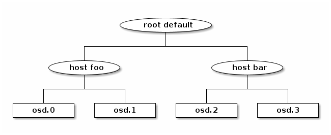
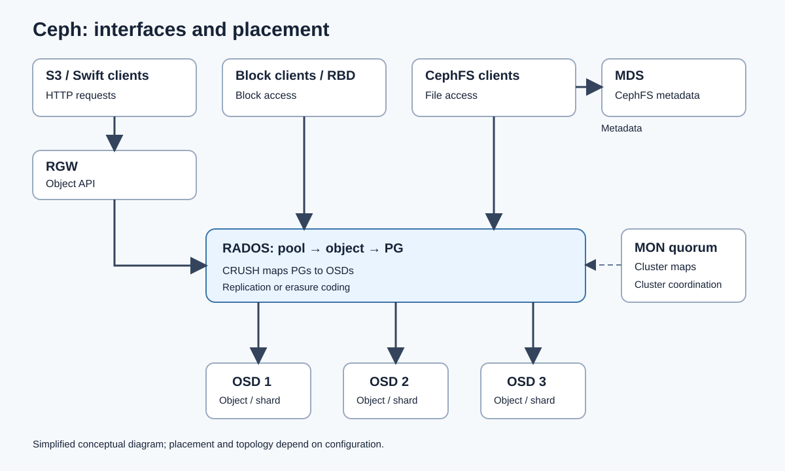

CEPH: SOURCE NOTES

The content below preserves the supplied Ceph.pdf, including its original page numbers, claims and examples. Some statements are outdated, configuration-dependent or technically incomplete. Read Ceph-Analysis.md, section 3, before using these notes as current technical guidance. This is preparation material, not evidence of project experience.

1. CEPH (RADOS) — ORIGINAL PAGE 1

Data pool | Metadata pool | Index pool

Object storage interface built on top of the librados library to provide applications with a RESTful gateway to Ceph storage clusters. A Ceph Storage Cluster requires the following: at least one Ceph Monitor and at least one Ceph Manager, and at least as many Ceph Object Storage Daemons (OSDs) as there are copies of a given object stored in the Ceph cluster (for example, if three copies of a given object are stored in the Ceph cluster, then at least three OSDs must exist in that Ceph cluster).

Before Ceph clients can directly read from or write to Ceph OSDs, they must connect to a Ceph Monitor first. With a current copy of the cluster map and the CRUSH algorithm, a Ceph client can compute the location for any object.

SERVICES

- OSDs
- Monitors
- Managers
- MDSes
- RGWs

OSD — OBJECT STORAGE DAEMON

Storage nodes store data as objects and handle all interaction with the physical drive or file system. OSDs are responsible for replication and recovery.

Adding:
- Provision disk.
- Install OSD.
- Add to CRUSH map.
- Mark in.

Removing:
- Mark out.
- Wait for Placement Groups rebalance.
- Remove from CRUSH map.
- Stop daemon. This final step appeared on original page 2.

2. MONITOR AND MANAGER — ORIGINAL PAGE 2

Ceph Monitors write all changes in the monitor services to a single Paxos instance, and Paxos writes the changes to a key-value store for strong consistency. Ceph Monitors can query the most recent version of the cluster map during synchronization operations. Ceph Monitors leverage the key-value store’s snapshots and iterators, using the RocksDB database, to perform store-wide synchronization.

Due to the nature of Paxos, Ceph requires a majority of monitors running to establish a quorum, thus establishing consensus. An odd number of monitors is more resilient. Monitors are the single source of truth for the cluster map. Ceph is able to operate only if a majority of monitors are active and able to communicate with each other.

Three monitors minimum; five best advised. Best run monitors not on the same host as OSD: fsync issues with the kernel might weaken performance.

Monitors maintain master maps of the cluster state:
- Monitor map: fixed addresses for monitors for discovery and communication with quorum.
- Manager map: status and capabilities of Ceph Managers, including which is active.
- OSD map: status and membership of OSDs.
- MDS map: status and filesystem metadata.
- CRUSH map: determines which OSDs should store an object’s data based on data location and the cluster’s topology.
- PG, placement group: where an object’s data and replicas are physically stored.

MANAGER

Administrative interface for the cluster. Managers keep track of runtime metrics and current cluster state: storage utilization, performance metrics and system load. They host Python-based modules that manage and expose cluster information, including a web Dashboard and REST API.

Two managers are normally required for high availability, but three are better. One is active; all others are standby.

3. MANAGER, MDS AND RGW — ORIGINAL PAGE 3

If the active manager fails, one standby is selected as active. The manager polls OSDs and monitors for health, metrics and performance and supports Prometheus and Grafana integration.

Modules:
- Dashboard.
- Balancer.
- Progress: progress of long-running operations, recovery, rebalancing and OSD removals or additions.
- Telemetry: anonymous cluster usage sent to Ceph developers.
- Prometheus.

MDS — METADATA SERVERS

- Directory structure and namespaces: Dynamic Subtree Partitioning to distribute them.
- File attributes: default POSIX.
- File layout and data-object mapping: which RADOS objects store file data.
- Extended attributes: arbitrary metadata key/value for special cases.
- Client capabilities: issues capabilities for clients.

Capabilities are tokens for permissions (read/write) and size, used for caching permissions. The client makes one request to MDS per file processed.

Granular capability categories:
- G, get: file size, mode, UID, GID.
- X, extend: cache and modify extended attributes.
- D, dir: contents of directory.
- W, write: write to file and data layout.
- R, read: read file.

RGW — RADOS GATEWAY

Bridge between HTTP clients using S3/Swift and the raw Ceph storage cluster, RADOS. Based on Beast; stateless; needs an external balancer.

Multi-site replication: Realm → zone groups → zones; each zone includes RGW and RADOS/Ceph.

4. RADOS POOLS AND ERASURE CODING — ORIGINAL PAGE 4

RADOS POOLS

Logical types describe what is stored; multiple instances are allowed, typically for data:
- Index.
- Data.
- Metadata.

Physical types describe how data is stored:
- Replicated: full objects in all replicas; hot storage.
- Erasure coded: cold storage.

Metadata: user and bucket records, including bucket entry points and user information.
Index: bucket index containing object metadata such as names, sizes and timestamps; bucket index sharding.
Data: actual object contents. Erasure coding can provide high space efficiency but adds latency.

Bucket index sharding: bucket → shards → separate RADOS objects. A key hash determines the shard index.

Resharding:
- Trigger when the average number of objects exceeds 100,000 per shard.
- Usually grows 1 → 16 → 32 → … → max_shards.
- Reads are mostly unaffected; writes can be blocked while writing metadata.
- Available in Luminous and later.
- Manual resharding is only available offline.

ERASURE CODING

- A mathematical algorithm splits data into K data chunks and M parity chunks.
- Requires K+M OSDs, but can tolerate loss of any up to M.
- Slower reads and writes, but better space/safety efficiency.
- If any data chunk is lost, the object is recreated using parity chunks.
- If all chunks are present, the object is assembled.

5. CRUSH AND CEPH CSI — ORIGINAL PAGE 5

CRUSH MAP

- Devices: OSDs.
- Buckets: hardware hierarchy such as hosts, racks, rows and data centres.
- Rules: how data is replicated or erasure-coded across the topology.

To address concurrent failures, replicas may need to be on devices in or relying on different shelves, racks, power supplies, controllers or physical locations.

Original CRUSH diagram: Ceph-CRUSH-Source.png. The root default contains host foo and host bar; the first holds osd.0 and osd.1, and the second holds osd.2 and osd.3.

Rules:
- Location.
- Replication factor.
- Failure domain.
- Erasure coding rules.
- Logical pool link: one-to-one.

CEPH CSI

Interface between Ceph and Kubernetes for provisioning and attachment. Two drivers:
- RBD: block storage, rbd.csi.ceph.com.
- CephFS: file storage, cephfs.csi.ceph.com.

Deployment:
- Controller plugin: Deployment with provisioner, attacher, resizer and snapshotter sidecars.
- Node plugin: DaemonSet that maps and mounts volumes on each node. Needs privileged mode and hostNetwork and mounts /dev and /sys.

Needs:
- clusterID = the Ceph FSID.
- Monitor addresses in the csi-config ConfigMap.
- A cephx user and key stored in Secrets.

6. CSI CONFIGURATION AND ROOK — ORIGINAL PAGE 6

Secrets:
- provisioner-secret: creates and deletes images or subvolumes.
- node-stage-secret: maps and mounts volumes on the node.

StorageClass parameters:
- clusterID, plus pool for RBD or fsName for CephFS.
- imageFeatures: layering, a safe default for the kernel RBD client.
- csi.storage.k8s.io/fstype: ext4 or xfs.
- csi.storage.k8s.io/*-secret-name and *-secret-namespace.

Access modes:
- RBD with Filesystem volumeMode: RWO.
- RBD with Block volumeMode: RWX, for raw devices such as KubeVirt disks.
- CephFS: RWX.

Features: volume expansion, VolumeSnapshotClass, clone and restore from snapshot. volumeBindingMode WaitForFirstConsumer gives topology-aware scheduling.

Gotchas:
- The node kernel RBD client does not support every image feature, so mapping can fail. Fix: imageFeatures: layering.
- The ceph-csi release must match the Ceph release. Check the compatibility matrix before upgrading either side.

ROOK

Kubernetes operator that deploys and manages Ceph. CRDs:
- CephCluster.
- CephBlockPool.
- CephFilesystem.
- CephObjectStore and CephObjectStoreUser.
- CephClient and CephNFS.

The operator spawns MON, MGR, OSD with prepare job followed by OSD pod, MDS, RGW and CSI drivers. OSDs can be PVC-backed through storageClassDeviceSets for clouds or nodes without raw disks. Automatic StorageClasses may be named rook-ceph-block and rook-cephfs; buckets come from ObjectBucketClaim. The toolbox pod provides a Ceph CLI, for example ceph -s and ceph osd tree.

Modes:
- Internal: Rook owns the cluster.
- External: connects Kubernetes to an existing Ceph cluster via create-external-cluster-resources.py; a usual choice when Ceph already serves OpenStack.

Upgrades: the operator rolls through MON, then MGR, then OSD. MON count and failure domain are set in CephCluster; changing them later is painful, so plan them up front.

7. OPENSTACK AND CEPH — ORIGINAL PAGE 7

Ceph is the default backend for all OpenStack storage:
- Cinder: RBD driver, pool volumes, thin-provisioned, copy-on-write clones.
- Glance: RBD store, pool images. Set show_image_direct_url = True so a boot volume is a clone of the image and starts fast.
- Nova ephemeral disks: libvirt images_type = rbd, pool vms. Live migration works without block migration.
- Manila: CephFS, through the native driver or NFS-Ganesha.
- Cinder backup: pool backups.
- RGW: S3 and Swift API with Keystone authentication, replacing Swift.
- One cephx user per service: client.cinder, client.glance, client.nova. Caps: profile rbd pool=volumes, plus pool=vms, and read-only on images.

Cinder RBD image naming: volume-<cinder-uuid>. Gotcha: the RBD backend does not support Cinder multi-attach.

8. OPENSTACK AND KUBERNETES — ORIGINAL PAGE 8

Magnum builds Kubernetes clusters on OpenStack VMs.

Two ways to get persistent storage for Kubernetes on OpenStack-backed Ceph:

Cinder CSI plugin: PVC goes through the Cinder API to RBD.
- Pro: stays inside OpenStack, so quotas, volume types, Horizon visibility and existing operations tooling apply.
- Con: an extra hop, and the Nova attach API makes it slower. RWO only, and no native RBD or CephFS features.

ceph-csi or Rook: PVC goes straight to Ceph.
- Pro: lower latency, CephFS RWX, native snapshots and clones, and no Cinder quotas to hit.
- Con: VMs need reachability to the Ceph public network, cephx keys sit on the nodes, and Cinder does not know the volumes exist.

Rule of thumb:
- Kubernetes is the main consumer: go direct to Ceph.
- OpenStack control, quotas or billing are needed: use Cinder CSI.
- Rook external mode fits when Ceph already runs for OpenStack.

Tracing a volume end to end:
- Cinder: volume-<uuid> in pool volumes.

9. VOLUME TRACE, OBJECT STORAGE AND LINKS — ORIGINAL PAGE 9

Tracing a volume end to end, continued:
- ceph-csi: PV pvc-<uuid>, RBD image csi-vol-<uuid>.
- Check mapping: kubectl get pv <pv> -o jsonpath='{.spec.csi.volumeAttributes}'

Object storage from Kubernetes:
- Rook: ObjectBucketClaim creates an RGW bucket, with credentials in a Secret.
- OpenStack: create an RGW user through Keystone, or with radosgw-admin user create.

Useful links from the source:
- https://forum.proxmox.com/threads/ceph-classes-rules-and-pools.60013/
- https://www.youtube.com/watch?v=O7zWbuH-XWc
- https://docs.ceph.com/en/latest/rados/

Architecture figure: Ceph-Architecture-EN.svg.

