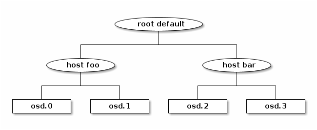
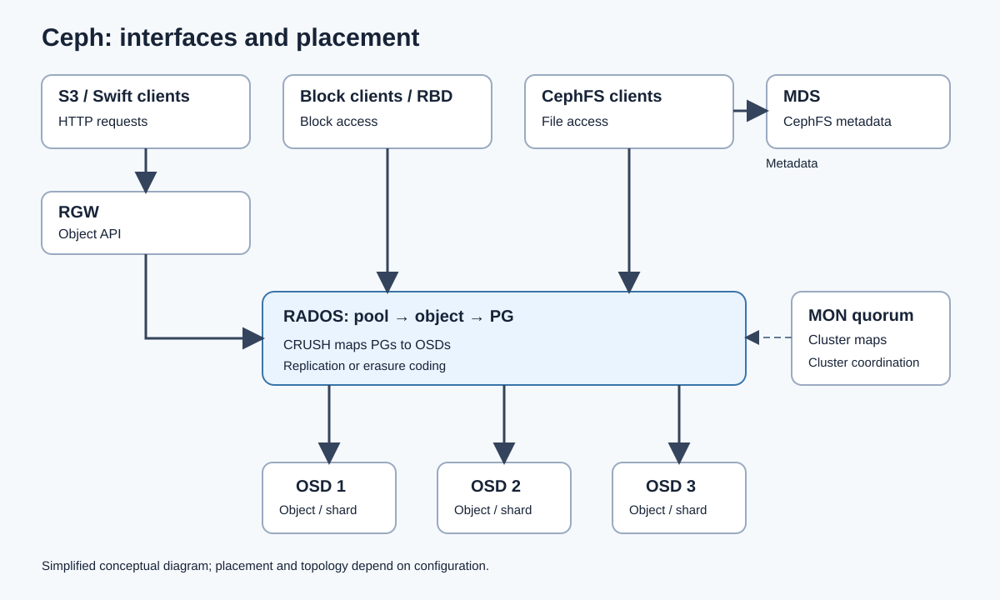

CEPH: ИСХОДНЫЙ КОНСПЕКТ

Ниже сохранено содержание предоставленного Ceph.pdf, включая исходные номера страниц, утверждения и примеры. Некоторые утверждения устарели, зависят от конфигурации или технически неполны. Прежде чем использовать конспект как актуальное техническое руководство, прочитайте раздел 3 файла Ceph-Analysis_RU.md. Это материал для подготовки, а не подтверждение проектного опыта.

1. CEPH (RADOS) — ИСХОДНАЯ СТРАНИЦА 1

Pool данных | Pool метаданных | Pool индекса

Интерфейс объектного хранения, построенный поверх библиотеки librados, предоставляет приложениям RESTful-шлюз к кластерам хранения Ceph. Кластеру Ceph необходим как минимум один Ceph Monitor, один Ceph Manager и не меньше Ceph Object Storage Daemon (OSD), чем число хранимых копий объекта. Например, если хранятся три копии объекта, в кластере должно быть как минимум три OSD.

Прежде чем клиенты Ceph смогут напрямую читать данные из OSD или записывать их в OSD, они должны подключиться к Ceph Monitor. Имея актуальную копию карты кластера и алгоритм CRUSH, клиент Ceph может вычислить расположение любого объекта.

СЕРВИСЫ

- OSD.
- Мониторы.
- Менеджеры.
- MDS.
- RGW.

OSD — OBJECT STORAGE DAEMON

Узлы хранения сохраняют данные как объекты и обрабатывают всё взаимодействие с физическим диском или файловой системой. OSD отвечают за репликацию и восстановление.

Добавление:
- Подготовить диск.
- Установить OSD.
- Добавить в CRUSH map.
- Отметить in.

Удаление:
- Отметить out.
- Дождаться перераспределения placement groups.
- Удалить из CRUSH map.
- Остановить daemon. Этот последний шаг находился на исходной странице 2.

2. МОНИТОР И МЕНЕДЖЕР — ИСХОДНАЯ СТРАНИЦА 2

Мониторы Ceph записывают все изменения сервисов монитора в единый экземпляр Paxos, а Paxos записывает изменения в key-value хранилище для строгой согласованности. Во время синхронизации мониторы могут запросить последнюю версию карты кластера. Для синхронизации всего хранилища мониторы используют snapshots и iterators key-value хранилища на базе RocksDB.

Из-за свойств Paxos для формирования кворума и достижения консенсуса требуется работа большинства мониторов. Нечётное число мониторов повышает отказоустойчивость. Мониторы — единый источник истины для карты кластера. Ceph может работать только при активности большинства мониторов и возможности обмениваться данными друг с другом.

Минимум три монитора; рекомендуется пять. Мониторы лучше не размещать на одном хосте с OSD: проблемы fsync в ядре могут ухудшать производительность.

Мониторы поддерживают основные карты состояния кластера:
- Monitor map: фиксированные адреса мониторов для обнаружения и связи с кворумом.
- Manager map: состояние и возможности менеджеров Ceph, включая активный менеджер.
- OSD map: состояние OSD и их членство в кластере.
- MDS map: состояние и метаданные файловой системы.
- CRUSH map: определяет, какие OSD хранят данные объекта, на основе расположения данных и топологии кластера.
- PG, placement group: место физического хранения данных объекта и его реплик.

МЕНЕДЖЕР

Административный интерфейс кластера. Менеджеры отслеживают метрики работы и текущее состояние кластера: использование хранилища, производительность и нагрузку системы. Они запускают модули на Python, управляющие информацией кластера и предоставляющие её, включая веб-Dashboard и REST API.

Для высокой доступности обычно нужны два менеджера, но три лучше. Один активен, остальные находятся в standby.

3. МЕНЕДЖЕР, MDS И RGW — ИСХОДНАЯ СТРАНИЦА 3

При отказе активного менеджера один из standby выбирается активным. Менеджер опрашивает OSD и мониторы о состоянии, метриках и производительности и поддерживает интеграцию с Prometheus и Grafana.

Модули:
- Dashboard.
- Balancer.
- Progress: отслеживание длительных операций, восстановления, перераспределения, удаления и добавления OSD.
- Telemetry: анонимные данные об использовании кластера, отправляемые разработчикам Ceph.
- Prometheus.

MDS — СЕРВЕРЫ МЕТАДАННЫХ

- Структура каталогов и пространства имён: распределение через Dynamic Subtree Partitioning.
- Атрибуты файлов: по умолчанию POSIX.
- Раскладка файлов и связь с объектами данных: какие объекты RADOS хранят данные файла.
- Расширенные атрибуты: произвольные пары ключ/значение для специальных случаев.
- Клиентские capabilities: выдача capabilities клиентам.

Capabilities — токены разрешений на чтение/запись и размер, используемые для кэширования разрешений. Клиент делает один запрос к MDS на каждый обработанный файл.

Категории capabilities:
- G, get: размер файла, режим доступа, UID и GID.
- X, extend: кэширование и изменение расширенных атрибутов.
- D, dir: содержимое каталога.
- W, write: запись в файл и раскладка данных.
- R, read: чтение файла.

RGW — RADOS GATEWAY

Шлюз между HTTP-клиентами S3/Swift и кластером хранения Ceph на уровне RADOS. Основан на Beast, не хранит состояние, требует внешний балансировщик.

Мультисайтовая репликация: Realm → группы зон → зоны; в зоне находятся RGW и RADOS/Ceph.

4. ПУЛЫ RADOS И ERASURE CODING — ИСХОДНАЯ СТРАНИЦА 4

ПУЛЫ RADOS

Логические типы описывают, что хранится; возможно несколько экземпляров, обычно для данных:
- Index.
- Data.
- Metadata.

Физические типы описывают способ хранения:
- Replicated: полные копии объектов во всех репликах; горячее хранение.
- Erasure coded: холодное хранение.

Metadata: записи пользователей и bucket, включая точки входа bucket и информацию пользователей.
Index: индекс bucket с метаданными объектов, например именами, размерами и временными метками; bucket index sharding.
Data: фактическое содержимое объектов. Erasure coding может обеспечить эффективное использование места, но добавляет задержку.

Шардирование индекса bucket: bucket → shards → отдельные объекты RADOS. Хеш ключа определяет индекс shard.

Resharding:
- Запускается, когда среднее число объектов превышает 100 000 на shard.
- Обычно растёт 1 → 16 → 32 → … → max_shards.
- Чтение почти не затрагивается; запись может блокироваться при записи метаданных.
- Доступен в Luminous и более поздних версиях.
- Ручной resharding доступен только offline.

ERASURE CODING

- Математический алгоритм разделяет данные на K фрагментов данных и M фрагментов чётности.
- Требуются K+M OSD; допускается потеря любых M фрагментов.
- Чтение и запись медленнее, но эффективность использования места и защиты данных выше.
- При потере любого фрагмента данных объект восстанавливается с помощью фрагментов чётности.
- Если все фрагменты доступны, объект собирается из них.

5. CRUSH И CEPH CSI — ИСХОДНАЯ СТРАНИЦА 5

CRUSH MAP

- Devices: OSD.
- Buckets: аппаратная иерархия, например хосты, стойки, ряды и дата-центры.
- Rules: правила репликации или erasure coding в топологии.

Чтобы снизить риск одновременных отказов, реплики могут размещаться на устройствах, находящихся в разных полках, стойках, физических локациях или использующих разные блоки питания и контроллеры.

Исходная схема CRUSH: Ceph-CRUSH-Source.png. Корень root default содержит хосты host foo и host bar; у первого — osd.0 и osd.1, у второго — osd.2 и osd.3.

Правила:
- Расположение.
- Количество реплик.
- Домен отказа.
- Правила erasure coding.
- Связь с логическим pool: один к одному.

CEPH CSI

Интерфейс между Ceph и Kubernetes для выделения и подключения ресурсов. Два драйвера:
- RBD: блочное хранение, rbd.csi.ceph.com.
- CephFS: файловое хранение, cephfs.csi.ceph.com.

Развёртывание:
- Controller plugin: Deployment с sidecar-компонентами provisioner, attacher, resizer и snapshotter.
- Node plugin: DaemonSet, который отображает и монтирует тома на каждом узле. Нужны privileged mode и hostNetwork, монтируются /dev и /sys.

Требования:
- clusterID = FSID Ceph.
- Адреса мониторов в ConfigMap csi-config.
- Пользователь cephx и ключ, сохранённые в Secrets.

6. КОНФИГУРАЦИЯ CSI И ROOK — ИСХОДНАЯ СТРАНИЦА 6

Secrets:
- provisioner-secret: создание и удаление образов или subvolume.
- node-stage-secret: отображение и монтирование томов на узле.

Параметры StorageClass:
- clusterID и pool для RBD либо fsName для CephFS.
- imageFeatures: layering, безопасное значение по умолчанию для kernel RBD client.
- csi.storage.k8s.io/fstype: ext4 или xfs.
- csi.storage.k8s.io/*-secret-name и *-secret-namespace.

Режимы доступа:
- RBD с volumeMode Filesystem: RWO.
- RBD с volumeMode Block: RWX, для raw-устройств, например дисков KubeVirt.
- CephFS: RWX.

Возможности: расширение тома, VolumeSnapshotClass, клонирование и восстановление из snapshot. volumeBindingMode WaitForFirstConsumer обеспечивает планирование с учётом топологии.

Нюансы:
- Kernel RBD client узла поддерживает не все возможности образов, поэтому отображение может завершиться ошибкой. Решение: imageFeatures: layering.
- Релиз ceph-csi должен соответствовать релизу Ceph. Перед обновлением любой стороны проверить матрицу совместимости.

ROOK

Kubernetes-оператор, который разворачивает Ceph и управляет им. CRD:
- CephCluster.
- CephBlockPool.
- CephFilesystem.
- CephObjectStore и CephObjectStoreUser.
- CephClient и CephNFS.

Оператор запускает MON, MGR, OSD с подготовительным job и последующим pod OSD, MDS, RGW и драйверы CSI. OSD могут использовать PVC через storageClassDeviceSets для облаков или узлов без raw-дисков. Автоматические StorageClass могут называться rook-ceph-block и rook-cephfs; bucket создаются через ObjectBucketClaim. Toolbox pod предоставляет Ceph CLI, например ceph -s и ceph osd tree.

Режимы:
- Internal: Rook владеет кластером.
- External: подключает Kubernetes к существующему кластеру Ceph через create-external-cluster-resources.py; обычный выбор, когда Ceph уже обслуживает OpenStack.

Обновление: оператор последовательно обновляет MON, затем MGR и OSD. Число MON и домен отказа задаются в CephCluster; менять их позднее сложно, поэтому их планируют заранее.

7. OPENSTACK И CEPH — ИСХОДНАЯ СТРАНИЦА 7

Ceph — backend по умолчанию для всего хранения OpenStack:
- Cinder: драйвер RBD, pool volumes, тонкое выделение и copy-on-write clones.
- Glance: RBD store, pool images. Установить show_image_direct_url = True, чтобы загрузочный том был клоном образа и быстро запускался.
- Временные диски Nova: libvirt images_type = rbd, pool vms. Live migration работает без переноса блоков.
- Manila: CephFS через нативный драйвер или NFS-Ganesha.
- Резервное копирование Cinder: pool backups.
- RGW: S3 и Swift API с аутентификацией Keystone, заменяющий Swift.
- Отдельный пользователь cephx для сервиса: client.cinder, client.glance, client.nova. Caps: profile rbd pool=volumes, дополнительно pool=vms и только чтение для images.

Именование образов Cinder RBD: volume-<cinder-uuid>. Нюанс: backend RBD не поддерживает Cinder multi-attach.

8. OPENSTACK И KUBERNETES — ИСХОДНАЯ СТРАНИЦА 8

Magnum создаёт кластеры Kubernetes на виртуальных машинах OpenStack.

Два способа получить постоянное хранилище Kubernetes на Ceph, используемом OpenStack:

Cinder CSI plugin: PVC проходит через Cinder API к RBD.
- Плюс: остаются применимы квоты OpenStack, типы томов, видимость в Horizon и существующие инструменты эксплуатации.
- Минус: дополнительный переход и Nova attach API замедляют работу. Только RWO, нет нативных возможностей RBD или CephFS.

ceph-csi или Rook: PVC направляется непосредственно в Ceph.
- Плюс: меньшая задержка, CephFS RWX, нативные snapshots и clones, отсутствие ограничения квотами Cinder.
- Минус: виртуальным машинам нужен доступ к публичной сети Ceph, ключи cephx находятся на узлах, а Cinder не знает о существовании томов.

Практическое правило:
- Основной потребитель — Kubernetes: подключаться напрямую к Ceph.
- Нужны управление OpenStack, квоты или биллинг: использовать Cinder CSI.
- Rook external mode подходит, когда Ceph уже работает для OpenStack.

Прослеживание тома от начала до конца:
- Cinder: volume-<uuid> в pool volumes.

9. ПРОСЛЕЖИВАНИЕ ТОМА, ОБЪЕКТНОЕ ХРАНЕНИЕ И ССЫЛКИ — ИСХОДНАЯ СТРАНИЦА 9

Прослеживание тома от начала до конца, продолжение:
- ceph-csi: PV pvc-<uuid>, образ RBD csi-vol-<uuid>.
- Проверка сопоставления: kubectl get pv <pv> -o jsonpath='{.spec.csi.volumeAttributes}'

Объектное хранение из Kubernetes:
- Rook: ObjectBucketClaim создаёт bucket RGW, учётные данные находятся в Secret.
- OpenStack: создать пользователя RGW через Keystone или командой radosgw-admin user create.

Полезные ссылки из источника:
- https://forum.proxmox.com/threads/ceph-classes-rules-and-pools.60013/
- https://www.youtube.com/watch?v=O7zWbuH-XWc
- https://docs.ceph.com/en/latest/rados/

Схема архитектуры: Ceph-Architecture.svg.

