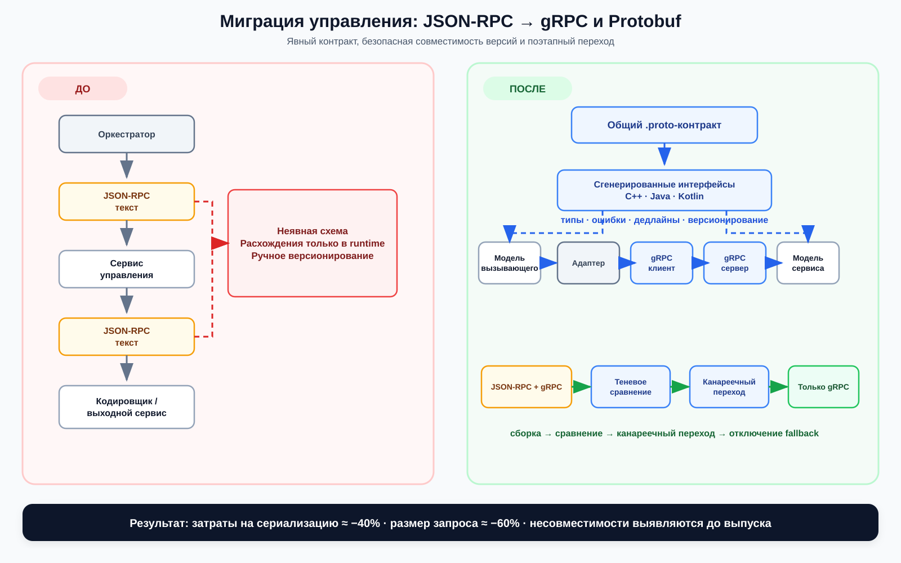
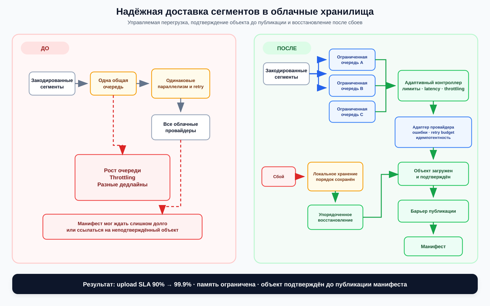
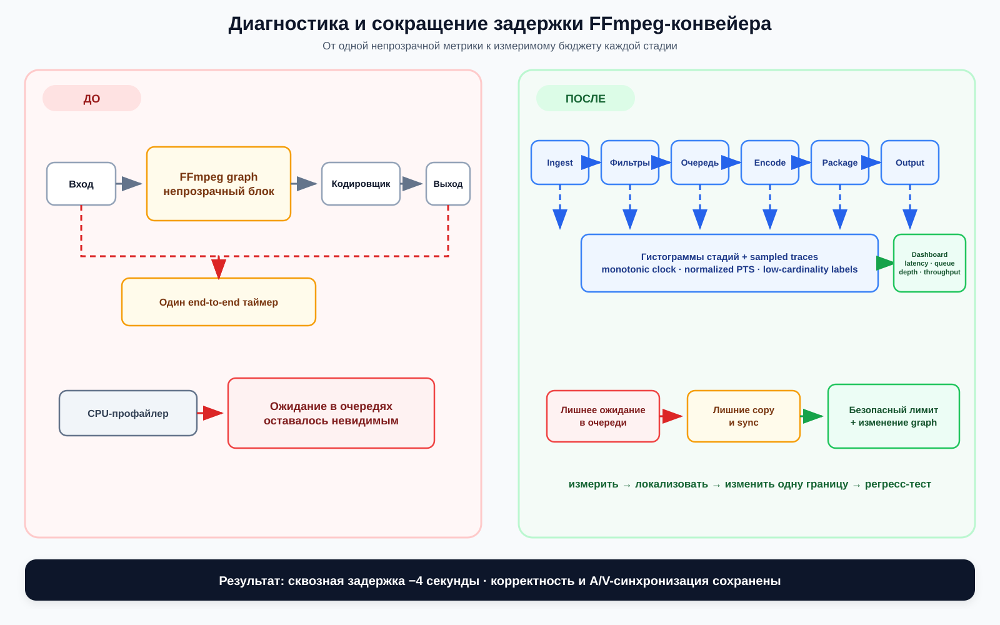
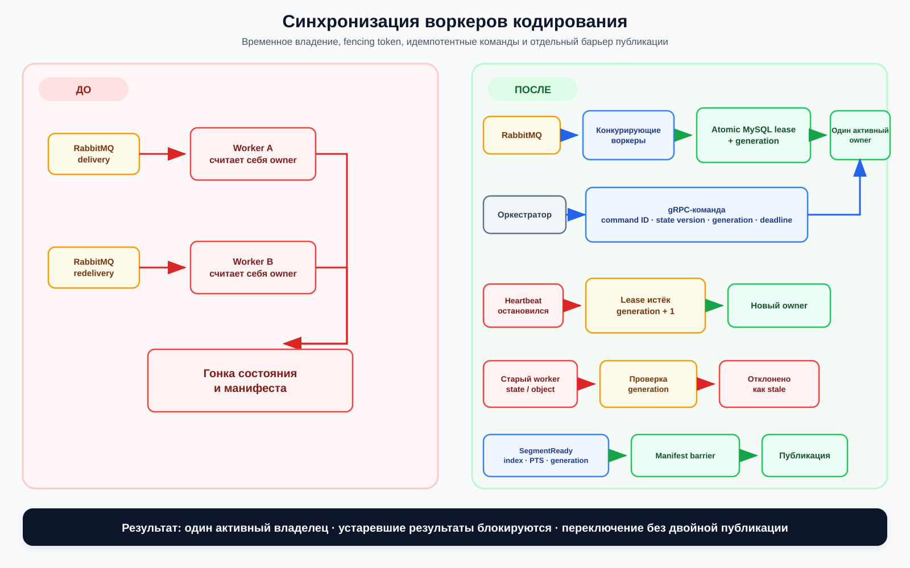

ЛЕГЕНДА ПРОЕКТОВ

ИНФОРМАЦИЯ О ДОКУМЕНТЕ

Идентификатор запроса: fake1
Кандидат: Alex I.
Целевая роль: C++ Software Engineer, общее позиционирование, поскольку запрос не предоставлен
Источник CV: !MODIFIED Aliaksei Ivanou (13, C++).pdf
Источник запроса: Не предоставлен
Язык подготовки: Русский
Статус документа: Готовая расширенная легенда для интервью

НАЗНАЧЕНИЕ

Документ содержит подробные рассказы о проектах и расширенные технические ответы по выполненным задачам. Это материал для подготовки ответов на дополнительные вопросы, а не единая непрерывная речь.

КАК ПОЛЬЗОВАТЬСЯ ЛЕГЕНДОЙ

Начните с краткого описания проекта. Затем раскрывайте бизнес-контекст, собственную ответственность, техническое решение, тестирование и результат. Для короткого ответа используйте первый абзац соответствующей задачи; для технического интервью добавляйте архитектурные детали из второго абзаца.

КАРТА ДОМЕНОВ

1. Облачное видео и телекоммуникации

Пример проекта: Cloud Native Encoding Platform.

Основные темы: кодирование в реальном времени, доставка прямых трансляций и видео по запросу, распределённые микросервисы, критичные к производительности сервисы на C++, мультиоблачный вывод, наблюдаемость, потоковые форматы и восстановление после сбоев.

2. Библиотечные системы

Пример проекта: Library System.

Основные темы: долгоживущий backend на C89 с сервисами на Java и Scala, собственные межсервисные протоколы, межъязыковая диагностика по логам, gdb и core dump на AWS Linux, PostgreSQL и MySQL, ревью кода между компаниями и безопасные изменения в унаследованном коде.

3. Нефтегазовая отрасль

Пример проекта: Corporate System for the Oil and Gas Industry.

Основные темы: обработка данных промышленных датчиков на C++17, клиентская часть на JavaScript и jQuery, MySQL и Microsoft SQL Server, развёртывание в Azure, согласованность данных между слоями и сопровождение унаследованной системы.

4. Настольные и финансовые приложения

Пример проекта: Home Accounting Software.

Основные темы: многослойное настольное приложение на C++20, FLTK, SQLite с подготовленными запросами, мультивалютная доменная модель, Google Test, plog и CMake.

5. Промышленная 3D-реконструкция

Пример проекта: 3D Reconstruction Software for Industrial Applications.

Основные темы: несколько двумерных лазерных датчиков, облака точек, PCL, Open3D, визуализация и производительность.

6. Беспилотные системы

Пример проекта: Software Modules for UAV.

Основные темы: обработка изображений в MATLAB, дебайеризация, стабилизация, слияние изображений, преобразование форматов, координаты центра кадра и калибровка IMU относительно камеры, лётные испытания.

7. Аэрокосмические системы и наблюдение Земли

Примеры проектов: Remote Sensing Satellites Database и Software for Processing and Analysis of Satellite Earth Observation Images.

Основные темы: справочные данные о спутниках, Ruby on Rails, PostgreSQL, проектирование алгоритмов на MATLAB для бортовой и наземной обработки, сшивка кадров, анализ разрешения, квантование, обработка качества изображений и сжатие ADPCM.

ПРОЕКТ 1. CLOUD NATIVE ENCODING PLATFORM

Период: апрель 2025 года – настоящее время
Роль: Streaming Engineer/Architect
Статус проекта: ТЕКУЩИЙ

Краткое описание проекта

Я работаю Streaming Engineer и Architect над распределённой облачной микросервисной платформой для кодирования и доставки видео в реальном времени. Платформа обрабатывает прямые трансляции и видео по запросу, рассчитана более чем на сто тысяч одновременных пользователей в трёх зонах доступности и сочетает C++ для критичных к производительности сервисов с Java и Kotlin для высокой скорости разработки. Моя работа охватывает взаимодействие сервисов, надёжность облачного вывода, наблюдаемость, конвейеры FFmpeg, субтитры, потоковые манифесты и AI-инструменты для разработки.

Продуктовый и бизнес-контекст

Продукт обеспечивает кодирование и доставку прямых трансляций и видео по запросу в реальном времени. Заявленные проектные цели — низкая задержка и высокая надёжность при большом числе одновременных пользователей.

Платформа не привязана к конкретному облаку и поддерживает мультиоблачные, гибридные и локальные конфигурации. Основные облачные и доставочные технологии — AWS, Azure, GCP и Akamai.

Архитектура системы и названные компоненты

- Распределённая микросервисная архитектура.
- C++20 для критичных к производительности сервисов.
- Java и Kotlin для сервисов, где основной акцент сделан на скорости разработки.
- Унаследованный JSON-RPC и заменивший его канал взаимодействия на gRPC и Protobuf.
- Компоненты обработки медиаданных FFmpeg, libavfilter, libavformat и libav.
- Docker, Kubernetes и minikube для контейнерных окружений.
- Prometheus, Grafana, OpenTelemetry и Google Cloud Monitoring для наблюдаемости.
- AWS S3, Google Cloud Storage, Azure Blob Storage, Akamai MSL4 и MSL5 как направления вывода.
- HLS, LL-HLS, MPEG-DASH, LL-DASH, SRT и Zixi в окружении проекта.
- Форматы субтитров CEA-608, CEA-708, TTML, IMSC и WebVTT.
- MySQL, RabbitMQ, REST API и Kong в более широком окружении платформы.
- GitHub Actions и CircleCI в инструментарии проекта.
- Claude, graphify, rag-code-mcp и mcp-on-demand в AI-процессах.

Состав команды и взаимодействие

Основная delivery-группа насчитывала около одиннадцати человек и была распределена между США и Польшей.

- Daniel — Principal Architect в США; отвечал за топологию сервисов, платформу Kubernetes и сквозную архитектуру.
- Maya — Senior Product Manager в США; отвечала за приоритеты live- и VOD-сценариев, пользовательские кейсы и приёмку релизов.
- Alex и ещё три backend-разработчика в Польше — Alex на уровне senior и три middle-инженера; отвечали за сервисы на C++20, Java и Kotlin, gRPC-контракты, манифесты и адаптеры облачного вывода.
- Victor — Senior Media Engineer в Польше; отвечал за интеграцию FFmpeg, поведение кодеков и ревью медиаформатов.
- Anna и Tomasz — middle QA Automation Engineers в Польше; отвечали за интеграционные сценарии с GTest, медиаданные для тестов, внедрение отказов и релизную регрессию.
- Michael — Senior SRE в США; отвечал за эксплуатацию Kubernetes, Prometheus, Grafana, OpenTelemetry и координацию инцидентов.

Я наиболее тесно работал с Victor по поведению FFmpeg и субтитров, с Michael по телеметрии и восстановлению после сбоев, а с Daniel — по миграции протокола и решениям о совместимости.

Моя роль и ответственность

В роли Streaming Engineer/Architect я отвечал за следующие направления:

- Миграция межпроцессного взаимодействия с JSON-RPC на gRPC и Protobuf.
- Анализ стоимости и скорости загрузки для облачных коннекторов.
- Повышение предсказуемости SLA загрузки сегментов.
- Проектирование инструментирования и мониторинга C++-кодировщика.
- Инструментирование конвейеров FFmpeg libavfilter.
- Разработка AI skills для команды.
- Полный процесс преобразования субтитров.
- Интеграция AI-инструментов разработки.
- Ответственность за внутренний форк rag-code-mcp на Go.
- Восстановление кодировщика при сбоях выходных систем.
- Диагностика рассинхронизации манифестов HLS и DASH и потерянных сегментов.

Основной вклад

1. Модернизация взаимодействия сервисов

Я заменил межпроцессное взаимодействие на устаревшем JSON-RPC на gRPC и Protobuf. Это снизило накладные расходы на сериализацию примерно на сорок процентов, а размер запросов — примерно на шестьдесят процентов.

2. Эффективность и надёжность облачного вывода

Я анализировал соотношение стоимости и скорости загрузки облачных коннекторов и повысил предсказуемость SLA загрузки сегментов с девяноста до 99,9 процента. Также я реализовал восстановление кодировщика при сбоях S3, Google Cloud Storage, Azure Blob Storage, Akamai MSL4 и MSL5.

3. Наблюдаемость и задержка

Я спроектировал систему инструментирования и мониторинга C++-кодировщика с поддержкой Google Cloud, Prometheus и OpenTelemetry. Я добавил инструментирование конвейеров FFmpeg libavfilter и сократил сквозную задержку на четыре секунды.

4. Субтитры

Я реализовал полный процесс преобразования CEA-608 и CEA-708 в TTML с профилем IMSC и в WebVTT.

5. Надёжность HLS, DASH и Live-to-VOD

Я диагностировал и устранил рассинхронизацию манифестов HLS и DASH в процессах Live-to-VOD, а также предотвратил появление потерянных сегментов при удалении входного потока.

6. Разработка с применением AI

Я создавал AI skills для команды, интегрировал mcp-on-demand, graphify и rag-code-mcp в рабочие процессы и отвечал за внутренний форк rag-code-mcp на Go с добавленной поддержкой C, C++, Java и Kotlin.

Пример истории 1 — переход с JSON-RPC на gRPC и Protobuf

Ситуация:

- Платформа использовала JSON-RPC для обмена управляющими сообщениями между сервисами на C++, Java и Kotlin.
- По мере роста платформы добавлялись оркестрация заданий, настройка кодировщика, отчётность о состоянии и управление выводом. Вместе с этим росли количество и сложность контрактов.
- Похожие сообщения развивались в разных сервисах по-разному. Ошибки типов и совместимости обычно обнаруживались только при взаимодействии двух уже развёрнутых версий.
- Повторяющиеся имена JSON-полей, преобразование строк и динамический разбор увеличивали размер сообщений и нагрузку на CPU в пути запуска и восстановления live-заданий.
- Сервисы независимо развёртывались в трёх зонах доступности, поэтому старые и новые версии должны были работать вместе во время миграции.

Проблема:

- Заменить наиболее часто используемые JSON-RPC вызовы компактным, типизированным и версионируемым контрактом.
- Сохранить существующее поведение, семантику ошибок и сигналы мониторинга при смене транспорта.
- Избежать одномоментного переключения. Один несовместимый метод мог заблокировать запуск задания или оставить его состояние несогласованным.
- Поддержать постепенное развёртывание, потому что одновременный релиз всех зависимых сервисов создавал ненужный риск.

Почему это было важно:

- Управляющий запрос проходил через несколько сервисов до запуска или изменения состояния медиаконвейера. Накладные расходы на сериализацию повторялись на каждом переходе.
- Корректность была важнее скорости. Если две версии по-разному понимали одно поле, правильная конфигурация кодировщика могла завершиться сбоем далеко от создавшего её сервиса.
- Типизированные контракты давали C++, Java и Kotlin одну модель и выявляли несовместимые изменения во время сборки или ревью.
- Команды могли независимо изменять сервисы и не зависеть от неформальных знаний о структуре JSON-сообщений.

Альтернативы:

- Оптимизировать JSON-RPC, сократив аллокации и дублирование данных. Это было самым дешёвым изменением, но контракты по-прежнему проверялись бы только во время исполнения, а версионирование оставалось бы неформальным.
- Создать собственный бинарный протокол. Он давал полный контроль над форматом передачи, но поддержку эволюции схем, генерации кода, инструментов и трёх языков пришлось бы выполнять самостоятельно.
- Использовать Protobuf-схемы и генерируемые gRPC-интерфейсы. На время миграции требовалось два транспорта, зато мы получали стандартную модель совместимости и зрелый инструментарий.

Почему были выбраны gRPC и Protobuf:

- Protobuf давал компактные сообщения, явные опциональные поля и документированные правила совместимого изменения схем.
- gRPC генерировал согласованные клиентские и серверные интерфейсы для C++, Java и Kotlin.
- Он также стандартизировал коды состояния, дедлайны, отмену и метаданные, включая correlation ID.
- Многие ошибки контрактов переносились из production на этап компиляции или автоматических тестов.
- Стандартный стек было проще поддерживать, чем собственный бинарный протокол, небольшая экономия которого не оправдывала долгосрочные затраты.

Графическая схема «до и после»

Действия:

- Собрал реальные JSON-RPC методы и варианты сообщений по коду, тестам и репрезентативному трафику. Только документации было недостаточно: она описывала не все сообщения, которые использовались в production.
- Разделил методы на три группы: операции чтения, идемпотентные команды и операции изменения состояния. Это определило безопасный порядок миграции и правила повторных попыток.
- Описал общие Protobuf-типы для идентификаторов заданий, состояния кодировщика, конфигурации и структурированных ошибок. Также зафиксировал правила именования, смысл отсутствующих значений и значений по умолчанию и зарезервировал номера удалённых полей.
- Сопоставил доменные ошибки со стабильными кодами gRPC и обеспечил передачу дедлайнов и correlation ID. Явные преобразователи не позволяли транспортным Protobuf-объектам проникать в основную бизнес-модель.
- Реализовал параллельную работу JSON-RPC и gRPC через двухконтурный адаптер. Для каждого переносимого метода одинаковый запрос проходил по обоим путям, после чего сравнивались нормализованные результаты.
- Сначала переносил операции чтения, затем идемпотентные команды и только после них операции изменения состояния. Перед увеличением gRPC-трафика сравнивал задержку, частоту ошибок, размер сообщений и переходы состояний с исходным JSON-RPC.
- Скоординировал работу команды: Daniel проверял совместимость схем, Alex и backend-инженеры переносили клиентов на C++, Java и Kotlin, Anna и Tomasz автоматизировали тесты смешанных версий, а Michael контролировал canary-телеметрию.
- На каждом шаге оставлял откат через feature flag. Старый endpoint удалялся только после переноса всех клиентов и исчезновения fallback-трафика; затем я документировал правила ревью будущих изменений схемы.

Проверка:

- Покрыл round-trip преобразования, отсутствующие опциональные поля, значения по умолчанию, неизвестные поля, повреждённые сообщения, отображение ошибок, отмену и истёкшие дедлайны.
- Выполнял одинаковые эталонные запросы через JSON-RPC и gRPC и сравнивал полученные доменные объекты, а не бинарное представление.
- Проверял новые клиенты со старыми серверами и старые клиенты с новыми серверами, включая rolling restart.
- Отдельно измерял CPU-время сериализации, размер сообщения и p50/p95/p99 задержки запроса без смешивания с сетевой задержкой.
- Перед окончательным переключением каждого метода сравнивал ошибки и переходы состояния canary-трафика с исходным JSON-RPC по панелям мониторинга.

Результат:

- Накладные расходы на сериализацию сократились примерно на сорок процентов.
- Размер запросов сократился примерно на шестьдесят процентов.
- Миграция прошла постепенно, без остановки всей платформы и одного большого согласованного релиза.
- Контракты стали типизированными и управляемыми по версиям, а смешанное развёртывание превратилось в обычный тестируемый сценарий.
- Последующие дефекты стало проще диагностировать благодаря раздельному представлению транспортных, доменных ошибок и нарушений дедлайна.
- Результат обеспечили обе части решения: более эффективный протокол и процесс развёртывания, рассчитанный на совместимость и откат.

Пример истории 2 — надёжность облачной загрузки

Ситуация:

- Live-платформа непрерывно создавала медиасегменты и загружала их в S3, Google Cloud Storage, Azure Blob Storage и Akamai.
- На уровне API провайдеры выглядели похоже, но различались по параллелизму, повторному использованию соединений, подтверждению записи, throttling, стоимости и восстановлению после оборванной передачи.
- Нагрузка приходила короткими всплесками, потому что несколько вариантов потока завершали один интервал сегмента почти одновременно.
- Конфигурация, стабильная при средней нагрузке, могла накопить очередь во время короткого ухудшения сети.
- Одна агрессивная настройка workers ускоряла одного провайдера, но увеличивала throttling, число повторов и стоимость другого.

Проблема:

- Доставлять каждый сегмент до дедлайна публикации через единый интерфейс платформы.
- Ограничить потребление памяти при замедлении провайдера или сети.
- Предсказуемо восстанавливаться после перезапуска процесса или обрыва сети без потери порядка сегментов.
- Повторять временные сбои, но сразу останавливать постоянные ошибки конфигурации или аутентификации.
- Не публиковать запись в манифесте до подтверждения соответствующего объекта провайдером.

Почему это было важно:

- В live-потоке дедлайн загрузки был частью контракта воспроизведения.
- При слишком ранней публикации манифеста плеер мог запросить ещё не существующий объект и показать пропуск воспроизведения.
- При слишком поздней публикации увеличивалась сквозная задержка.
- Неограниченная очередь только скрывала замедление, пока не начинала расти память, а старые сегменты не вступали в конкуренцию с актуальными.
- Среднее время загрузки вводило в заблуждение: требовалось контролировать хвост распределения, порядок и backpressure во время сбоев.

Альтернативы:

- Использовать одно глобальное значение параллелизма. Это было просто, но настройку пришлось бы ограничить возможностями самого слабого направления.
- Использовать фиксированные настройки для каждого провайдера. Они учитывали известные различия, но не реагировали на изменение полосы, региональный throttling и временную деградацию.
- Использовать полностью динамический контроллер. Он быстро реагировал, но мог войти в колебания, усилить throttling и сделать стоимость запросов непредсказуемой.
- Объединить ограниченную адаптацию, правила для каждого провайдера и жёсткие защитные пределы.

Почему был выбран адаптивный подход:

- Единый интерфейс коннектора сохранял независимость планировщика и логики манифеста от конкретного облака.
- Адаптеры провайдеров по-прежнему отвечали за аутентификацию, подтверждение, тайм-ауты и классификацию ошибок.
- Параллелизм мог меняться в безопасных минимальных и максимальных пределах в зависимости от текущей задержки и throttling.
- Ограниченные очереди превращали перегрузку в видимый backpressure, а не в скрытый рост памяти.
- Экспоненциальная задержка и jitter распределяли повторы во времени, а retry budget не позволял одному неисправному направлению занять всех workers.

Графическая схема «до и после»

Действия:

- Точно определил SLA: хранилище должно подтвердить объект до дедлайна публикации манифеста. Общее время разбил на ожидание в очереди, установление соединения, передачу и подтверждение провайдера, чтобы видеть источник задержки.
- Представил каждую загрузку как небольшую машину состояний: в очереди, загружается, ожидает подтверждения, подтверждена, ожидает повтора или завершилась постоянной ошибкой. Так логика восстановления стала явной и не была разбросана по отдельным обработчикам.
- Разделил ошибки провайдеров на понятные группы: тайм-аут, throttling, сетевой сбой, ошибка аутентификации, исчерпание квоты и некорректный запрос. Повторялись только временные ошибки; проблемы конфигурации и доступа сразу завершались с ясной причиной.
- Сделал ключи объектов и обработку завершения идемпотентными. Если ответ терялся уже после сохранения объекта провайдером, повторная операция не создавала дубликат и не портила состояние.
- Добавил ограниченные очереди и отдельные тайм-ауты и пределы параллелизма для каждого направления. Параллелизм медленно увеличивался после стабильной работы и быстро уменьшался при росте хвостовой задержки или throttling.
- Добавил экспоненциальную задержку, jitter и retry budget, связанный с дедлайном сегмента. Планировщик не начинал ещё одну попытку, если времени на полезное завершение уже не оставалось.
- Во время короткого сбоя сохранял сегменты локально вместе с информацией об их порядке. После восстановления планировщик возобновлял отправку с учётом зависимостей, не позволяя старым сегментам блокировать актуальные.
- Добавил барьер публикации: манифест мог ссылаться на сегмент только после подтверждения всех требуемых объектов. Плеер больше не получал URI объекта, который ещё недоступен.
- Скоординировал продуктовую, инженерную, тестовую и эксплуатационную части: Maya определила приоритеты live- и VOD-сценариев, Alex и его группа согласовали адаптеры и логику манифестов, Anna и Tomasz автоматизировали матрицу отказов, а мы с Michael создали панели и оповещения о восстановлении.
- Вывел возраст очереди, причину повтора, текущий параллелизм, задержку подтверждения и результат относительно дедлайна. По этим сигналам было видно, находится ли проблема в локальном планировщике, сети или облачном провайдере.

Проверка:

- Выполнял одинаковую матрицу отказов для каждого провайдера: высокая задержка, ограниченная полоса, разрыв соединения, тайм-аут после загрузки, throttling, ошибки 5xx, неверные credentials, исчерпание квоты, перезапуск процесса и восстановление.
- Длительными и импульсными тестами проверял ограниченность памяти, устойчивость адаптации и полное опустошение очереди.
- Контролировал p50/p95/p99 задержки подтверждения, возраст очереди, повторы по классам ошибок и долю сегментов, уложившихся в дедлайн.
- Добавил инвариантную проверку, отклонявшую любой манифест с неподтверждённым объектом.
- После перезапуска проверял возобновление сохранённых сегментов без дублирующей публикации, изменения порядка и скрытой потери.

Результат:

- Доля загрузок сегментов, соответствующих SLA, выросла с девяноста до 99,9 процента.
- Платформа автоматически восстанавливалась после временных сбоев каждого поддерживаемого направления.
- При деградации потребление памяти оставалось ограниченным, а после восстановления сохранялся порядок сегментов.
- Система соблюдала необходимое для непрерывного воспроизведения правило «сначала объект, затем манифест».
- Улучшение обеспечили измеримые дедлайны, правильная классификация отказов, адаптивная пропускная способность, backpressure и инварианты публикации, а не простое увеличение числа workers.

Пример истории 3 — задержка FFmpeg и наблюдаемость

Ситуация:

- Кодировщик показывал одно значение сквозной задержки для ingest, нормализации временных меток, декодирования, libavfilter, очередей кадров, кодирования, упаковки и вывода.
- Число показывало избыточную задержку, но не объясняло, где именно тратится время.
- Возможными причинами были выполнение фильтра, ожидание соседних кадров, рост очереди и синхронизация временных меток.
- CPU-профилирование показывало дорогие функции, но не видело время ожидания в асинхронных очередях.
- Логи разных компонентов не использовали единые точки измерения и correlation ID.

Проблема:

- Разложить накопившиеся четыре секунды задержки по отдельным этапам.
- Удалить только лишнюю задержку, сохранив корректность вывода и синхронизацию аудио и видео.
- Сохранить минимальную историю кадров, необходимую временным фильтрам и encoder look-ahead.
- Сделать инструментирование достаточно лёгким для постоянной работы в production, где проявлялась реальная проблема.

Почему это было важно:

- Дополнительная буферизация напрямую увеличивала задержку live-потока, время переключения каналов и восстановление после сбоя.
- Слепое уменьшение всех очередей было небезопасным: временным фильтрам, переупорядочиванию кадров и encoder look-ahead требовалась часть буферов.
- Удаление необходимых буферов могло вызвать потерю кадров, нестабильную производительность или проблемы синхронизации.
- До изменения конвейера требовалось отделить необходимую алгоритмическую задержку от случайного ожидания.

Альтернативы:

- Использовать sampling profiler. Он находил CPU-hotspots, но не измерял ожидание в очередях.
- Поставить один таймер вокруг всего графа фильтров. Накладные расходы были небольшими, но источник задержки внутри графа оставался неизвестным.
- Включить подробные покадровые логи. Они давали детали, но создавали слишком много I/O для постоянной работы в production.
- Добавить структурированные метрики на границах этапов и выборочные трассы для отдельных кадров и сегментов. Это требовало больше проектирования, зато измеряло и обработку, и ожидание.

Почему было выбрано инструментирование по этапам:

- Оно давало полный бюджет задержки: общее время должно было равняться обработке, ожиданию в очередях и передаче между этапами с известной погрешностью.
- Монотонные часы измеряли длительность независимо от коррекции системного времени.
- Нормализованный PTS сохранял единую медиашкалу времени между компонентами.
- Стабильные агрегированные метки ограничивали кардинальность в Prometheus и Google Cloud Monitoring.
- Выборочные трассы OpenTelemetry связывали подробные события одного сегмента без превращения каждого кадра в отдельную метку метрики.

Графическая схема «до и после»

Действия:

- Отметил вход и выход для ingest, фильтрации, очередей, кодирования, упаковки и вывода. Для каждого измерения явно описал, какое событие запускает и останавливает таймер.
- Использовал монотонные часы для длительности и нормализованный PTS для медиашкалы времени. Поэтому коррекция системных часов и различия входных временных меток не искажали измерение задержки.
- Реализовал единый C++-интерфейс телеметрии с лёгкими scoped timers и асинхронным экспортом. Потоки обработки медиаданных не ожидали ответа системы мониторинга.
- Ограничил кардинальность метрик: в метках гистограмм оставил только стабильные значения, например этап и тип конвейера, а детали задания, сегмента и кадра перенёс в выборочные трассы. Michael проверил набор меток и поведение экспортера.
- Построил панели, на которых задержка каждого этапа показывалась рядом с глубиной очереди и пропускной способностью. Victor проверил, что точки измерения соответствуют реальному жизненному циклу FFmpeg, а не предполагаемой последовательности вызовов.
- По данным увидел, что кадры ожидают перед одной из границ графа, а затем проходят лишний этап копирования и синхронизации. Основная задержка находилась в очереди, а не в CPU-времени фильтра.
- Вместе с Victor определил минимальное безопасное окно кадров для временных фильтров. Затем сократил очередь до этого предела и удалил из графа лишнюю границу копирования и синхронизации.
- Вносил изменения по одному и после каждого повторял измерения, чтобы видеть вклад каждого решения. Anna и Tomasz добавили затронутые live-данные и ограничения очередей в регрессионные тесты.
- Оставил явный предел очереди в production-конфигурации. При будущем замедлении система создавала видимый backpressure и оповещение, а не незаметно накапливала секунды задержки.

Проверка:

- Запускал исходную и изменённую сборки на одном оборудовании, одинаковых записанных потоках, настройках кодировщика, точках измерения и периоде прогрева.
- Сравнивал p50/p95/p99 времени пребывания на этапах, сквозную задержку, глубину очередей, пропускную способность, CPU и память, а не одно среднее значение.
- Проверял число кадров, временные метки, синхронизацию аудио и видео, визуальную и битстрим-корректность, чтобы задержка не сокращалась за счёт пропуска работы.
- Сравнивал включённую и выключенную телеметрию под нагрузкой и во время длительных прогонов.
- Намеренно замедлял exporter и проверял, что ограниченный асинхронный вывод не создаёт новую очередь в медиапути.
- Добавил регрессионные пороги, чтобы последующая сборка отклонялась до возвращения всех четырёх секунд задержки.

Результат:

- Сквозная задержка сократилась на четыре секунды без нарушения корректности вывода и синхронизации.
- Инструментирование осталось в платформе и использовалось для последующих регрессий.
- Безопасные для production метрики и выборочные трассы показывали конкретный этап или очередь без включения тяжёлого отладчика.
- Улучшение было достигнуто измерением времени в очередях вместе с CPU-временем, удалением лишней буферизации и одного избыточного перемещения данных.
- Необходимая буферизация сохранилась: решение не сводилось к слепому уменьшению всех очередей.

Пример истории 4 — синхронизация воркеров кодирования

Ситуация:

- Воркеры кодирования работали как заменяемые Kubernetes pods в трёх зонах доступности.
- Live-задание могло быть передано другому воркеру после перезапуска pod, потери heartbeat или сетевого сбоя.
- RabbitMQ использовал доставку at least once, поэтому команда могла прийти повторно при потере подтверждения.
- gRPC-вызовы также могли повторяться, задерживаться или приходить после передачи задания другому воркеру.
- Разные воркеры могли создавать bitrate representations, относящиеся к одной HLS- или DASH-презентации.
- Требовалось согласовать владение заданием и медиарезультаты без прямого взаимодействия между воркерами.

Проблема:

- Гарантировать одного актуального владельца каждого задания кодирования и при этом сохранить автоматическое восстановление.
- Не позволить старому воркеру публиковать состояние или медиаданные после передачи задания другому воркеру.
- Сделать повторные команды запуска, остановки и перенастройки безопасными.
- Сохранять правильный порядок переходов состояния при дублировании или задержке сообщений.
- Согласовывать границы сегментов между representations до публикации общего манифеста.

Почему это было важно:

- Два воркера, выполняющие одно задание, дублировали бы вычислительные затраты и записывали конфликтующие объекты или состояния.
- Восстановившийся, но устаревший воркер мог перезаписать новое состояние и создать split-brain.
- Манифест с сегментами из разных поколений задания мог вызвать пропуски, discontinuity или неправильное воспроизведение.
- Подтверждение RabbitMQ само по себе не доказывало владение, потому что сообщение могло быть доставлено повторно после сбоя.
- Медиасинхронизацию нельзя было строить на системных часах: воркеры должны были согласовываться по segment index и нормализованному PTS.

Альтернативы:

- Полагаться только на competing consumers в RabbitMQ. Это распределяло работу, но повторная доставка всё равно позволяла двум воркерам обрабатывать одно логическое задание в разное время.
- Использовать долгоживущую распределённую блокировку. В штатной ситуации это было просто, но безопасное восстановление после сетевого разделения или зависшего процесса становилось сложнее.
- Организовать выбор лидера и координацию между самими воркерами. Это добавляло управление составом, leader election и восстановление в компоненты, которые должны оставаться заменяемыми.
- Оставить координацию в orchestrator и объединить устойчивый lease, fencing по поколению, идемпотентные команды и отдельный барьер манифеста.

Почему была выбрана схема с orchestrator и lease:

- Orchestrator уже отвечал за желаемое состояние задания и был естественной точкой координации.
- Воркеры оставались заменяемыми и не должны были обнаруживать друг друга или общаться напрямую.
- Атомарный lease в MySQL давал одному воркеру временное владение и позволял восстановиться после его истечения.
- Монотонно возрастающее поколение служило fencing token: состояние и вывод старого поколения отклонялись.
- RabbitMQ обеспечивал асинхронную доставку и повтор, а идемпотентность учитывала семантику at least once.
- gRPC передавал типизированные команды, дедлайны и обновления состояния между orchestrator и активным воркером.
- Отдельный барьер сегментов согласовывал медиавывод, не смешивая владение заданием с публикацией манифеста.

Графическая схема «до и после»

Действия:

- Добавил в MySQL устойчивые поля координации задания: желаемое состояние, текущего владельца, срок lease, версию состояния и поколение.
- Использовал competing consumers RabbitMQ для распределения работы, но учитывал доставку at least once и не предполагал, что каждое сообщение придёт ровно один раз.
- Требовал, чтобы воркер получал задание одним атомарным условным обновлением. Успешный захват назначал владельца и увеличивал поколение.
- Воркер продлевал lease через heartbeat. Если продление было невозможно, он прекращал создавать данные для публикации, а не продолжал работу с неопределённым владением.
- Передавал в управляющих gRPC-командах job ID, command ID, ожидаемую версию состояния, поколение и deadline.
- Сохранял обработанные command ID и делал переходы состояния идемпотентными, поэтому повторные start, stop или reconfigure не создавали второй конвейер и не применялись дважды.
- Добавлял поколение в обновления состояния, временные ключи объектов и события завершения. Управляющий контур отклонял старое состояние, барьер манифеста игнорировал объекты прежних поколений, а очистка затем удаляла эти объекты.
- Отправлял события SegmentReady с job ID, representation, segment index, нормализованным диапазоном PTS, discontinuity sequence, поколением и состоянием подтверждения хранилища.
- Добавил барьер манифеста, ожидавший все обязательные representations для одного segment index. При истечении дедлайна применялась настроенная политика: ожидание, временное исключение опоздавшей representation или перевод задания в degraded state.
- Реализовал draining в Kubernetes: завершающийся воркер переставал принимать задания, завершал или сохранял текущий сегмент, сообщал финальное состояние и освобождал lease.
- Скоординировал проектирование в команде: Daniel проверял владение и fencing, группа Alex реализовывала очередь, базу данных и gRPC, Victor проверял PTS и согласование сегментов, Michael отвечал за Kubernetes и heartbeat, а Anna и Tomasz автоматизировали сценарии отказов.
- Вывел в метрики и трассы владельца, поколение, возраст lease, состояние heartbeat, количество повторных доставок, отклонённые устаревшие обновления и время ожидания барьера.

Проверка:

- Останавливал воркер посередине сегмента и проверял, что другой воркер принимает задание только с новым поколением.
- Дублировал, задерживал и менял порядок команд RabbitMQ и gRPC, проверяя идемпотентность и монотонность переходов состояния.
- Задерживал heartbeat и имитировал сетевое разделение, после чего возвращал старый воркер и проверял отклонение его обновлений.
- Перезапускал orchestrator и масштабировал воркеры вверх и вниз, проверяя сохранение владения при изменениях управляющего контура.
- Задерживал одну representation и создавал discontinuity PTS, проверяя дедлайны барьера и политики манифеста.
- Терял ответ загрузки после создания объекта и проверял, что повтор не приводит к дублирующей публикации.
- Проверял инварианты: один действующий владелец поколения, отсутствие второго активного конвейера, отклонение устаревшего вывода, отсутствие ссылки в манифесте до подтверждения хранилищем и согласованные segment index и PTS обязательных representations.

Результат:

- Каждое задание кодирования имело одного действующего владельца без постоянных распределённых блокировок или прямого взаимодействия между воркерами.
- Сбой воркера и перераспределение Kubernetes автоматически приводили к передаче задания через истечение lease и новое поколение.
- Запоздалый вывод старого воркера исключался из актуального манифеста и удалялся, не повреждая текущее состояние и воспроизведение.
- Повторная доставка была безопасной благодаря идемпотентности команд и переходов состояния.
- Манифесты HLS и DASH использовали сегменты текущего поколения с согласованными segment index и границами PTS.
- Пул воркеров можно было независимо масштабировать, сохраняя детерминированное владение, восстановление и публикацию медиаданных.

Тестирование, проверка, диагностика, развёртывание и поддержка

Модульные и компонентные проверки выполнялись с GTest, качество кода контролировалось SonarQube, а сборки запускались в GitHub Actions и CircleCI. Для диагностики использовались метрики и трассировки OpenTelemetry, панели Grafana, Prometheus и Google Cloud Monitoring. Эксперименты с производительностью выполнялись на одинаковых входных потоках и конфигурациях, а сбои облачных направлений воспроизводились управляемыми сетевыми отказами и ограничением пропускной способности. Координация воркеров проверялась сценариями повторной доставки, потери heartbeat, завершения pod, сетевого разделения, возвращения устаревшего поколения и задержки representation.

Результат и основной вывод

Проект демонстрирует сочетание производительного C++, распределённых систем, облачной доставки, наблюдаемости и работы с медиаданными. Повторяющаяся тема — обеспечение измеримости и восстановления процессов кодирования и доставки на границах сервисов и провайдеров.

Эксплуатационные характеристики

- Платформа поддерживала более ста тысяч одновременных пользователей в трёх зонах доступности.
- Производительность измерялась на воспроизводимых наборах медиаданных с фиксированными точками начала и окончания замера.
- Наблюдаемость объединяла метрики, трассировки и структурированные события для кодировщика, фильтров и выходных коннекторов.
- Архитектура поддерживала AWS, Azure, GCP, Akamai и локальную инфраструктуру через единые абстракции сервисов и вывода.
- Для координации заданий использовались orchestrator, RabbitMQ, lease и поколения в MySQL и управляющие gRPC-сообщения; воркерам не требовалось общаться напрямую.

Вероятные дополнительные вопросы

- Как измерялись накладные расходы на сериализацию и размер запросов?
- Как gRPC и Protobuf внедрялись без нарушения работы существующих сервисов?
- Что именно измеряет предсказуемый SLA загрузки сегментов?
- Чем отличалось восстановление для S3, GCS, Azure и Akamai?
- Где располагались точки измерения задержки в конвейере FFmpeg?
- Почему рассинхронизировались манифесты HLS и DASH?
- Почему при удалении входного потока появлялись потерянные сегменты?
- Почему подтверждения RabbitMQ было недостаточно для гарантии владения заданием?
- Как lease и fencing по поколению предотвращали split-brain между воркерами?
- Как segment index и PTS согласовывались между representations до публикации манифеста?
- Что было добавлено во внутренний форк на Go для поддержки четырёх языков?
- Какие архитектурные решения находились в моей личной зоне ответственности?

ПРОЕКТ 2. LIBRARY SYSTEM

Период: март 2022 года – апрель 2025 года
Роль: Software Engineer
Статус проекта: ЗАВЕРШЁННЫЙ

Краткое описание проекта

Я работал над зрелой интегрированной библиотечной системой американского разработчика библиотечного ПО в составе международной аутсорсинговой инженерной команды, которая напрямую взаимодействовала с собственными разработчиками вендора. Моей основной областью был backend на C89: вместе с двумя другими C-разработчиками я разделял ответственность за всю кодовую базу на C, реализуя новое поведение, исправляя дефекты и рефакторя многолетние модули. Архитектура пересекала несколько языковых границ: сервисы Scala API вызывали функциональность на C, зависящий от базы данных C-код обращался через Java data services к PostgreSQL и оставшимся моделям в MySQL, а Java desktop application обслуживало сотрудников библиотек. Иногда я менял код на Java и Scala, когда задача пересекала эти границы, и диагностировал сбои на Linux-машинах в AWS через журналы сервисов, SSH, gdb и core dumps.

Продуктовый и бизнес-контекст

Система поддерживает операционные процессы библиотек: выдачу и возврат, каталогизацию, комплектование, работу с периодикой, управление электронными ресурсами и интеграции с поисковыми системами и системами самообслуживания. Её REST API предоставляет операции с библиографическими записями, экземплярами, читателями, бронированиями, выдачами, штрафами, заказами и другими записями. Продукт включал веб-клиент и desktop-приложение на Java для сотрудников библиотек и обслуживал академические, публичные, национальные, консорциальные, корпоративные и специальные библиотеки.

Линейка продуктов вендора уходит корнями более чем на сорок лет назад, и ядро на C89 несёт эту историю. Установленная база библиотечного ПО вендора обслуживала более 9000 библиотек по всему миру. Этот масштаб объясняет, почему совместимость определяла каждое решение: изменение поведения, удобное одной библиотеке, могло стать инцидентом поддержки в тысячах организаций, у каждой из которых свои процессы, интеграции и десятилетия накопленных данных. Продукт был устоявшимся и сопровождался в рамках регулярного процесса выпуска, примерно с двумя релизами продукта в год.

Архитектура, поток данных и интеграции

- Java desktop application: рабочие процессы сотрудников, взаимодействие с сервисами проекта и данными backend.
- Сервисы Scala API с документацией Swagger: точки входа API и обработка запросов; Scala переиспользовала доменное поведение, вызывая функции на C, а не дублируя его.
- Backend-сервисы на C89: серверное поведение и доменная логика всего продукта.
- Java data services на Java 8, позднее Java 11: посредники доступа к базе данных для C; зависящее от базы поведение C отправляло запросы им, а не обращалось к базе напрямую.
- PostgreSQL как основная база данных после более ранней миграции; менее используемые модели остались в MySQL.
- Собственные протоколы между независимо запущенными сервисами проекта; формат содержимого, смысл полей и обработка ошибок входили в контракт совместимости.
- Цепочка поставки: исходный код в Bitbucket, сборки в Jenkins на Linux-машинах в AWS, автоматические ночные развёртывания и внутренняя панель развёртывания по запросу, отдельные пулы машин разработчиков и QA на CentOS и Red Hat Enterprise Linux; Apache входил в развёрнутый стек сервисов.
- Диагностика: сопоставление журналов сервисов, точечное логирование, SSH, gdb, core dumps и Valgrind для дефектов недопустимой памяти и инициализации в C.

Одна видимая пользователю операция могла проходить через несколько процессов и сред выполнения: одна операция API могла пересекать Scala и C, а одна зависящая от базы операция — C, Java и базу данных. Поэтому видимая ошибка в desktop-приложении или API могла возникать в другом процессе или языковом слое. Данные читателей и операционные данные оставались внутри установленных в продукте средств контроля доступа и инфраструктуры.

Состав команды и взаимодействие

В нашей команде поставки было двенадцать человек, и она работала с группой разработчиков и руководителей со стороны заказчика. Команда была географически распределённой: я работал сначала из Беларуси, а затем из Варшавы, Польша; несколько коллег переехали из Санкт-Петербурга в Грузию, Литву и Турцию, а ещё несколько остались в Украине. Участники со стороны заказчика также работали из разных мест.

- Alex (я), Piotr и Oksana — три C-разработчика; мы совместно отвечали за весь backend на C89, а не за отдельные модули.
- Julia, Mark и Taras — Java-разработчики; отвечали за Java data services и desktop-приложение; переход платформы с Java 8 на Java 11 прошёл во время проекта без моего участия.
- Eva, John, Hanna и Levan — QA-инженеры; выполняли функциональное и регрессионное тестирование на отдельных QA-машинах в AWS.
- Katarzyna — Business Analyst; обладала глубоким функциональным знанием библиотечных процессов и иногда участвовала в тестировании вместе с QA.
- Roman — совмещал роли Project Manager и Scrum Master; вёл процесс спринтов и координацию поставки.
- Сторона заказчика — три разработчика, позднее четыре, их development manager Robert и Product Owner Susan.

Я работал с Piotr и Oksana над общей кодовой базой на C, с Julia, Mark и Taras — когда задача переходила в Java, а с Eva, John, Hanna, Levan и Katarzyna — над воспроизведением и регрессионной проверкой. Каждое изменение проходило ревью и в нашей команде, и у разработчиков заказчика, и требовалось одобрение всех добавленных ревьюеров.

Моя роль и ответственность

Моей основной ответственностью была разработка backend на C89 по всей общей кодовой базе: функции, исправления дефектов и рефакторинг. Вторичными были изменения в Java data services, Java desktop application и коде Scala API под конкретные задачи, когда полная задача пересекала границу C. С PostgreSQL, MySQL, Linux в AWS и конвейером поставки я интегрировался как пользователь этих систем.

Вне моей ответственности находились общая архитектура и roadmap продукта, основное владение подсистемами на Java и Scala, миграция Java, более ранняя миграция с MySQL на PostgreSQL, администрирование баз данных, администрирование Jenkins и инфраструктуры AWS, а также конфигурация библиотек-заказчиков. Помимо своих задач я участвовал в обязательном межкомпанийном ревью кода, помогал onboarding новых разработчиков, выступал на sprint demos перед группой заказчика и проводил технические интервью с новыми кандидатами.

Основной вклад и инженерные сложности

- Реализовывал новое поведение, исправлял дефекты и рефакторил код в модулях backend на C89, поставив на этом проекте 12+ функций по запросам пользователей.
- Сохранял контракты, используемые Scala API и Java data services, при изменении кода на C.
- Диагностировал сбои на границах Scala, C, Java и баз данных, сопоставляя журналы сервисов до выбора места исправления и добавляя точечное логирование там, где не хватало данных.
- Использовал gdb и core dumps через SSH для native-падений и ошибок работы с недопустимой памятью.
- Исправлял дефекты на C, связанные с переходом на летнее время в США, массивами символов фиксированного размера, многоязычным выводом, подсветкой поиска для японского текста и генерируемым на C веб- и PDF-выводом.
- Добавил запрос Scala API с документацией Swagger, обрабатываемый на C, и столбец таблицы в Java desktop application, заполняемый данными, подготовленными на стороне C.
- Собирал и проверял изменения через сборки Jenkins и ночные и выполняемые по запросу развёртывания в AWS.

Основными инженерными сложностями были безопасная работа в многолетней кодовой базе C89, где буферы фиксированного размера усиливали небольшие ошибки длины, завершения строки и инициализации; диагностика по журналам в микросервисах, где симптом и первопричина находились в разных процессах; сохранение границы Scala-to-C API между двумя средами выполнения и документацией Swagger; прослеживание запросов к двум базам данных за границей Java-сервиса; координация изменений в кодовых базах, которые сопровождали разные специалисты; и корректность при работе с часовыми поясами, системами письма и генерируемым выводом.

Пример истории 1 — исправление срочного дефекта перехода на летнее время в США

Ситуация: дефект обработки времени на стороне C приводил бы к неверному поведению во время ближайшего перехода на летнее время в США. Функция находилась на пути, используемом устоявшимися библиотечными процессами, а дата перехода была фиксированной.

Проблема: дефект нужно было найти и исправить до того, как переход затронет production-процессы, не меняя поведение времени в других местах.

Почему это было важно: логика даты и времени лежит в основе многих операций с библиотечными записями. Неверный результат на календарной границе проявился бы сразу во многих библиотеках, а перенести срок было невозможно.

Альтернативы: варианты включали обходное решение в потребляющем слое, более широкое переписывание кода обработки времени или поиск точной ошибки в C-функции и её исправление там.

Почему выбран этот подход: обходное решение в потребителе скрыло бы дефект в одном пути, оставив его в других, а переписывание было слишком рискованным при фиксированном сроке в многолетнем коде C89. Исправление функции-владельца было наименьшим изменением с предсказуемым эффектом.

Действия: я проследил затронутую функцию обработки времени и обнаружил, что инкремент выполнялся не в той точке потока управления. Я перенёс инкремент в правильную ветку и место, развернул сборку на назначенной мне машине в AWS и проверил сценарий перехода.

Проверка: сценарий перехода повторялся на развёрнутой сборке, а изменение прошло обязательное межкомпанийное ревью и регрессию QA на отдельных QA-машинах.

Результат: поведение было исправлено до перехода на летнее время в США. Вывод: обновление состояния в одну строку может быть операционно критичным, если оно находится на календарной границе.

Пример истории 2 — исправление подсветки поиска для японского текста

Ситуация: поиск и подсветка работали для поддерживаемых путей китайского и корейского языков, но не работали для японского иероглифического текста: введённый пользователем текст не находился и не подсвечивался в соответствующем содержимом страницы.

Проблема: сопоставление на стороне C опиралось на собственную систему локалей и отображения символов продукта и применяло границы слов к тексту, который составляется и ищется по символьным и слоговым единицам.

Почему это было важно: библиотеки с японскими фондами зависели от поиска и подсветки нужного текста, а любое исправление в общем пути локалей могло сломать уже работающие языки.

Альтернативы: можно было добавить частный случай для сообщённого запроса, изменить общие таблицы отображения или исправить выбор границ в пути сопоставления для этой системы письма.

Почему выбран этот подход: частный случай не обобщался бы, а изменение общих таблиц грозило поведению китайского и корейского языков. Исправление логики границ устраняло настоящую причину: сегментация должна следовать системе письма, а не предполагать слова, разделённые пробелами.

Действия: я проследил на стороне C путь собственной системы локалей и отображения символов, нашёл, где применялись границы слов, и исправил их использование для текста, представленного символьными и слоговыми единицами.

Проверка: я проверил затронутые японские случаи от начала до конца и повторил сценарии для китайского и корейского языков, чтобы подтвердить сохранение существующей поддержки, до регрессии QA.

Результат: поиск и подсветка нужного текста на странице были восстановлены для затронутого языкового пути, а поддержка китайского и корейского продолжила работать. Вывод: поиск по тексту должен использовать правила сегментации, соответствующие системе письма.

Пример истории 3 — исправление ошибок памяти в массивах символов

Ситуация: массивы char фиксированного размера в backend на C приводили к обрезанному тексту на веб-страницах, а в других случаях — к падениям приложения.

Проблема: обработку длины, границ и инициализации нужно было исправить, не меняя ожидаемый формат вывода, на который опирались другие компоненты и генерируемые страницы.

Почему это было важно: обрезанный текст показывал пользователям библиотек неполную информацию, а падения после обращения к недопустимой или неинициализированной памяти прерывали работу сотрудников.

Альтернативы: варианты включали увеличение буферов, переписывание затронутой обработки текста или прослеживание размеров буферов и инициализации по пути данных с исправлением недопустимых обращений.

Почему выбран этот подход: простое увеличение буферов сдвинуло бы точку обрезки и оставило ошибки инициализации, а переписывание несло слишком большой риск для совместимости. Прослеживание пути данных исправляло сам контракт между ёмкостью, длиной содержимого и завершением строки.

Действия: я проследил размеры буферов и инициализацию, с помощью gdb, core dumps и Valgrind нашёл недопустимые и неинициализированные обращения, исправил их и обеспечил, чтобы полный текст доходил до пути отрисовки.

Проверка: затронутые страницы генерировались заново и проверялись на полноту текста, сценарии падений повторялись на развёрнутой сборке, а QA проводила регрессию на отдельных машинах.

Результат: полный вывод был восстановлен, а пути падений из-за недопустимой или неинициализированной памяти устранены. Вывод: ёмкость буфера, длина содержимого и завершающий нулевой символ должны передаваться как единый контракт.

Пример истории 4 — запрос Scala API, обрабатываемый на C

Ситуация: продукту требовалась ещё одна операция API, а устоявшаяся доменная обработка для неё уже существовала на C.

Проблема: операцию нужно было опубликовать через Scala и Swagger, не дублируя серверную логику.

Почему это было важно: дублированная доменная логика на Scala со временем разошлась бы с поведением на C, а интеграционные потребители опирались на задокументированную и согласованную семантику API.

Альтернативы: варианты включали повторную реализацию логики на Scala или добавление обработки запроса на Scala с переиспользованием существующих функций на C.

Почему выбран этот подход: переиспользование поведения на C сохраняло единый источник доменной логики. Ценой была сложность интеграции между средами выполнения, из-за которой отображение запроса, возвращаемые значения и семантика ошибок становились частью функции.

Действия: я добавил обработку запроса на Scala, подключил её к пути обработки на C, отобразил возвращаемые данные и обновил документацию Swagger.

Проверка: тесты API и интеграции на стороне Scala вызывали C-сервисы и косвенно проверяли native-поведение, а операция сверялась с контрактом Swagger до регрессии QA.

Результат: была поставлена задокументированная операция API, переиспользующая устоявшееся native-поведение. Вывод: межъязыковое переиспользование избавляет от дублирования доменной логики, но делает семантику интерфейса и ошибок частью работы.

Тестирование, проверка, диагностика, развёртывание и поддержка

Unit-тестов для кода на C не было, поэтому проверка сочетала воспроизведение разработчиком, интеграционную автоматизацию на стороне Scala, ночные и выполняемые по запросу интеграционные развёртывания, функциональное и регрессионное тестирование силами четырёх QA-инженеров на отдельных машинах в AWS, периодическую бизнес-проверку силами Business Analyst и обязательное ревью кода. Как C-разработчик я собирал изменения, разворачивал их на назначенной машине в AWS, воспроизводил сценарий и изучал журналы и состояние выполнения.

Моя последовательность диагностики: воспроизвести сценарий пользователя или QA; найти первый сервис с неверным состоянием; сопоставить запрос и данные по журналам остальных сервисов; изучить C-процесс через gdb или core dump на предмет ошибок памяти и потока управления; исправить компонент, которому принадлежала ошибка; развернуть изменённую сборку и повторить сквозной сценарий; передать проверенный случай в QA. Jenkins собирал на Linux в AWS, сборки развёртывались автоматически ночью или по запросу через внутреннюю панель, а машины разработчиков и QA были разделены, чтобы исследование и независимая проверка не мешали друг другу.

Работа шла двухнедельными Scrum-спринтами с ежедневными stand-ups, еженедельным grooming, отслеживанием в Jira, демонстрацией и ретроспективой в каждом спринте и периодическими техническими встречами с разработчиками заказчика.

Результат и основные выводы

Я поставлял функции, исправления и рефакторинг в backend на C, сохраняя устоявшиеся библиотечные процессы, исправил дефекты, связанные со временем, памятью, многоязычностью и генерируемым выводом, расширил API и desktop-приложение скоординированными межъязыковыми изменениями и вносил вклад через ревью, onboarding, демонстрации и технические интервью по мере изменения состава команды.

Основные выводы: прослеживать распределённый запрос по журналам до выбора компонента для изменения; относиться к содержимому протоколов и межъязыковым отображениям как к версионированным контрактам; отделять видимый симптом от сервиса, которому принадлежит первопричина; обрабатывать ёмкость буфера, длину содержимого, инициализацию и завершение строки в C вместе; применять узкие изменения модернизации в системе с большой поверхностью регрессии. Сегодня я бы добавил точечные unit-тесты на C для буферов, переходов времени, логики локалей и пагинации, контрактные тесты для отображений Scala-to-C и C-to-Java, регрессионный корпус многоязычного поиска, golden-output-тесты для генерируемых страниц и PDF и лучшие идентификаторы корреляции между сервисами.

Вероятные дополнительные вопросы

- Какой была ваша основная роль и как делилась ответственность за C?
- Как взаимодействовали слои Scala, C, Java и баз данных?
- Как вы отлаживали сбой, проходивший через несколько сервисов?
- Как проверялся код на C без unit-тестов?
- Какой была первопричина дефекта перехода на летнее время в США?
- Почему подсветка поиска для японского текста не работала, а для китайского и корейского работала?
- Как были устроены сборка и развёртывание в AWS?
- Как было устроено межкомпанийное ревью кода?
- Что было вне вашей роли и что бы вы улучшили сегодня?

ПРОЕКТ 3. CORPORATE SYSTEM FOR THE OIL AND GAS INDUSTRY

Период: октябрь 2021 года – декабрь 2021 года
Роль: Software Engineer
Статус проекта: ЗАВЕРШЁННЫЙ

Краткое описание проекта

Я работал над устоявшейся корпоративной системой обработки промышленных данных для нефтесервисного заказчика из списка Fortune 500 в составе международной аутсорсинговой инженерной команды. Приложение получало данные промышленных датчиков, разбирало и анализировало их в backend на C++17, сохраняло исходную и обработанную информацию в MySQL и показывало её пользователям через страницы на JavaScript, HTML и jQuery, которые обслуживал Nginx; всё приложение размещалось в Microsoft Azure. Моей основной работой были изменения на C++ по запросам заказчика, исправление дефектов, упрощение унаследованного кода и удаление устаревших компонентов, а также изменения на JavaScript, когда задача переходила из серверной обработки в пользовательский слой. Систему тестировала отдельная QA-компания в Индии.

Продуктовый и бизнес-контекст

Заказчик — нефтесервисная корпорация из списка Fortune 500, работающая более чем в 120 странах и разрабатывающая технологии и цифровые решения для энергетических операций, включая системы сбора, управления и анализа больших объёмов операционных данных. Размещение проекта в Azure соответствовало более широкому направлению заказчика на энергетические платформы на базе Azure. Это было внутреннее корпоративное ПО в организации такого масштаба, поэтому главным ограничением была не новизна, а то, что устоявшиеся процессы в очень большой компании должны были продолжать работать после каждого изменения.

Пользователями были специалисты нефтегазовой отрасли, работавшие с операционными данными, данными датчиков и результатами анализа, а не с внутренним устройством приложения. Поэтому ПО должно было сохранять корректность данных на этапах приёма, обработки, хранения и отображения: разобранные, рассчитанные, сохранённые и показанные значения должны были описывать одно и то же операционное событие. Дефекты обработки могли приводить к неверной или отсутствующей операционной информации в приложении. Система была устоявшейся и находилась в активном сопровождении и развитии, а работа поступала в виде запрошенных заказчиком улучшений и дефектов.

Архитектура, поток данных и интеграции

- Промышленные датчики или вышестоящие системы сбора данных формировали операционные измерения.
- Путь приёма данных внутри кодовой базы продукта на C++17 принимал и разбирал входящие измерения.
- Ядро на C++17 реализовывало обработку, анализ и бизнес-логику приложения и вычисляло нужные приложению значения.
- MySQL хранила исходную и обработанную информацию и обслуживала процессы обработки, с которыми я работал; в реляционное хранилище входил также Microsoft SQL Server.
- Функциональность на JavaScript, встроенная в кодовую базу продукта, с HTML и jQuery на клиентской стороне, показывала данные в пользовательских сценариях.
- Nginx обслуживал пользовательский слой.
- Microsoft Azure предоставлял среду выполнения; изменения интегрировались в существующий процесс поставки и проверялись в размещённой среде.
- Внешняя QA-компания выполняла функциональную и регрессионную проверку поставленных сборок.

Одно измерение существовало в нескольких формах: входные данные, разобранное состояние C++, рассчитанные значения, записи в базе данных и вывод, видимый в JavaScript. Поэтому видимый дефект мог возникать при разборе, расчёте, хранении, отображении или представлении. Недопустимые или неполные входные данные нужно было обрабатывать, не повреждая сохранённые данные и не выдавая вводящих в заблуждение результатов, а межслойные изменения требовали проверки всего сценария, а не только изменённого файла. Исходный код, схемы баз данных, содержимое данных датчиков, учётные данные и идентификаторы инфраструктуры остаются конфиденциальными.

Состав команды и взаимодействие

Разработка, тестирование и общение с заказчиком проходили через три организации и несколько часовых поясов.

- Alex (я), Marek, Daria, Artem и Yana — пять C++-разработчиков нашей инженерной команды; я работал из Беларуси. Каждый из нас реализовывал запрошенные функции и исправления в унаследованной кодовой базе на C++17 и менял JavaScript, когда этого требовала задача.
- Agnieszka и Priya — наши основные контакты в отдельной QA-команде другой компании в Индии; команда отвечала за выполнение функционального и регрессионного тестирования.
- Stefan и Thomas — представители заказчика в США; они передавали запрошенное поведение и дефекты и уточняли ожидаемые результаты.
- Руководители подразделений заказчика — присутствовали на sprint demos раз в две недели.

Я работал с другими C++-разработчиками над общей кодовой базой и ревью, с Agnieszka и Priya — над воспроизведением и проверкой дефектов, а со Stefan и Thomas — когда требовалось уточнить запрошенное поведение или ожидания приёмки. Поскольку QA и заказчик находились в разных местах, понятные шаги воспроизведения и ожидаемое поведение были обязательны при каждой передаче работы.

Моя роль и ответственность

Моей основной областью была разработка приложения на C++17: функции по запросам заказчика, исправление дефектов, точечный рефакторинг и упрощение, а также удаление устаревшего кода и компонентов. JavaScript был вторичной областью, которую я использовал, когда полная функция или исправление пересекали границу между серверной обработкой и пользовательским слоем. С поведением, зависящим от MySQL, я работал со стороны приложения и разрабатывал для среды, размещённой в Azure.

Вне моей ответственности находились облачная архитектура и администрирование Azure, датчики и инфраструктура сбора данных, архитектура уровня продукта, администрирование баз данных, а также выполнение QA и управление им. Основные архитектурные и технологические решения были унаследованы, и я работал в их рамках.

Основной вклад и инженерные сложности

- Реализовывал запрошенное заказчиком поведение в основной кодовой базе на C++, разработав и интегрировав за время проекта 4+ функции по запросам пользователей.
- Исправил 20+ дефектов на C++ и JavaScript в логике обработки и приложения.
- Упрощал сложные пути реализации на C++ и удалял устаревшие компоненты и код, которые больше не участвовали в поддерживаемом поведении.
- Обновлял JavaScript, когда функция или дефект пересекали native- и пользовательский слои, сохраняя соответствие отображаемого поведения значениям, вычисленным на C++.
- Сопровождал поведение приложения, обрабатывавшего и сохранявшего промышленные данные в MySQL, прослеживая данные через обработку, хранение и чтение при расследовании дефектов.
- Поддерживал внешнюю команду QA информацией для воспроизведения, исправлениями и сборками для проверки.

Основными инженерными сложностями были быстрое погружение в устоявшуюся систему на C++ на коротком проекте, требовавшее быстро восстановить поток управления, владение данными и зависимости модулей; сохранение корректности данных, когда локально правильная правка всё равно могла дать неверное сохранённое или отображаемое значение; пересечение границы C++ и JavaScript с сохранением единого согласованного сценария; безопасная модернизация унаследованного кода с проверкой вызовов, путей данных и видимого поведения до любого удаления; отладка поведения, зависящего от базы данных, причина которого могла находиться в обработке на C++, состоянии MySQL или отображении на JavaScript; и распределённое взаимодействие с внешним поставщиком QA и американской организацией заказчика.

Пример истории 1 — безопасная модернизация унаследованной области на C++

Ситуация: назначенная область кодовой базы на C++17 содержала сложную унаследованную логику и устаревшие компоненты, а в этой же области нужно было реализовать изменение по запросу заказчика.

Проблема: запрошенное поведение нужно было добавить, улучшив сопровождаемость и сохранив работу существующих процессов заказчика. Расширение старой логики новыми частными случаями сделало бы область ещё сложнее для следующего изменения.

Почему это было важно: от этого кода зависели устоявшиеся процессы в очень большой организации заказчика, а короткий проект не позволял провести широкую переработку. Ритм спринтов также требовал законченного демонстрируемого изменения, а не рефакторинга без чёткого конца.

Альтернативы: варианты включали переписывание затронутой подсистемы, сохранение неиспользуемого кода с добавлением нового поведения вокруг него или трассировку зависимостей и удаление того, что больше не требовалось сценарию, одновременно с реализацией изменения.

Почему выбран этот подход: переписывание несло риск миграции, который короткий проект не мог выдержать, а сохранение устаревших путей продолжало бы увеличивать поверхность сопровождения. Точечные изменения внутри существующей архитектуры сохраняли совместимость и делали активную логику понятнее ценой сохранения части унаследованной структуры.

Действия: я проследил зависимости в области, отделил требуемое поведение от неиспользуемых путей, упростил активную логику, удалил устаревший код точечными изменениями и реализовал запрошенное поведение поверх упрощённого пути.

Проверка: я сам проверил изменённый путь через C++, MySQL и JavaScript, а внешняя команда QA провела регрессионную проверку вокруг отрефакторенного и удалённого кода.

Результат: запрошенное поведение было поставлено с меньшей и более понятной поверхностью сопровождения, а устоявшиеся процессы продолжили работать. Вывод: инкрементальная модернизация работает лучше всего, когда сохранение поведения задано явно, а очистка привязана к реальной задаче поставки.

Пример истории 2 — межслойное изменение на C++ и JavaScript

Ситуация: функция или дефект затрагивали и серверную обработку, и поведение, которое пользователи видели в JavaScript-части продукта.

Проблема: значения и сценарий должны были оставаться согласованными между частями на C++ и JavaScript; исправление только одной стороны оставило бы частично исправленную реализацию.

Почему это было важно: пользователи доверяли отображаемым значениям как операционной информации. Результат backend, отличающийся от показанного на странице, был бы хуже явной ошибки, потому что выглядел бы правдоподобно.

Альтернативы: я мог ограничить работу C++ и позже передать сторону JavaScript кому-то другому или изменить обе стороны границы в рамках одной задачи.

Почему выбран этот подход: изменение обеих сторон в одной задаче давало согласованное сквозное поведение ценой более широкого объёма отдельной задачи. Отношение к языковой границе как к продуктовому контракту делало проверку понятной.

Действия: я проследил данные от обработки на C++ до представления, видимого в JavaScript, изменил обе стороны границы и сохранил соответствие отображаемого поведения значениям, вычисленным на C++.

Проверка: я проверил полный сценарий от обработки до результата в пользовательском слое и передал сценарий команде QA для независимого функционального и регрессионного тестирования.

Результат: сценарий работал согласованно от начала до конца, а не был корректен только в одном слое. Вывод: языковые границы — это продуктовые контракты, и проверять их нужно соответственно.

Пример истории 3 — исправление данных, зависящих от базы данных

Ситуация: поведение приложения зависело от промышленных данных, обработанных на C++ и сохранённых в MySQL, и значение в пользовательском слое было неверным.

Проблема: было неочевидно, возникало ли неверное поведение при обработке, хранении или отображении.

Почему это было важно: исправление видимого слоя скрыло бы симптом, оставив сохранённые данные неверными, и другие процессы, читающие те же записи, всё равно были бы затронуты.

Альтернативы: варианты включали рассмотрение проблемы как ошибки SQL или базы данных, корректировку отображения или прослеживание значения от источника через все слои.

Почему выбран этот подход: прослеживание от исходного значения было единственным способом найти слой, которому принадлежала ошибка. Симптомы в базе данных часто возникают выше по потоку, при обработке, поэтому предположение об ошибке SQL было бы догадкой.

Действия: я воспроизвёл сценарий на представительных входных данных, сравнил результат C++ с данными, сохранёнными в MySQL, и со значением в пользовательском слое, исправил ответственный слой и повторил весь поток.

Проверка: полный сценарий повторялся от обработки через хранение до отображения, а команда QA проверила исправленное поведение и его регрессионный охват.

Результат: обработка, хранение и отображение затронутых данных снова стали согласованными. Вывод: симптомы в базе данных нужно прослеживать от исходного значения, а не автоматически считать дефектами SQL.

Тестирование, проверка, диагностика, развёртывание и поддержка

Проверка состояла из четырёх уровней: проверка разработчиком, при которой я воспроизводил исходное поведение и прогонял изменённый путь через C++, JavaScript и данные; интеграционная проверка через обработку, хранение в MySQL и пользовательское поведение; независимое функциональное и регрессионное тестирование командой QA в Индии; и регрессионный фокус на существующем поведении вокруг отрефакторенного или удалённого унаследованного кода.

Мой подход к отладке: воспроизвести видимую пользователю проблему на представительных входных данных, проследить затронутое значение через обработку на C++, проверить соответствующее состояние MySQL, если участвовало хранение, проверить поведение JavaScript, если симптом проявлялся в пользовательском слое, внести исправление в слой, которому принадлежала ошибка, и повторить весь сценарий перед передачей его в QA. Основным инструментом диагностики были журналы приложения; gdb и Valgrind были доступны в наборе native-инструментов при необходимости.

Приложение работало в Microsoft Azure. Изменения интегрировались в существующий процесс поставки и проверялись в размещённой среде, а поставка шла циклом спринтов с демонстрациями раз в две недели руководителям подразделений заказчика. Поскольку каждый спринт должен был дать что-то демонстрируемое людям, не являющимся инженерами, предпочтение отдавалось законченным видимым изменениям, а не длительному рефакторингу.

Результат и основные выводы

Я поставлял изменения на C++ по запросам заказчика, расширявшие устоявшуюся промышленную систему без нарушения существующих процессов, исправлял дефекты на C++ и JavaScript, чтобы поведение backend и пользовательского слоя совпадало, упрощал унаследованный код и удалял устаревшие компоненты для снижения сложности сопровождения и сохранял согласованность обработанных и сохранённых данных в процессах на основе MySQL. Каждое изменение проходило через независимую QA-организацию.

Основные выводы: как быстро стать продуктивным в незнакомой коммерческой кодовой базе на C++, как проследить одно значение через native-обработку, хранение и пользовательское поведение, как улучшать сопровождаемость, не превращая задачу по функции в рискованное переписывание, и как готовить воспроизводимые сценарии для отдельной QA-организации. Сегодня я бы добавил точечные unit-тесты для разборщиков и расчётов, контрактные тесты для данных, переходящих из C++ в JavaScript, обезличенные наборы данных для реальных граничных случаев данных датчиков, повторяемые интеграционные тесты базы данных для критичных путей чтения и записи, задокументированную родословную данных от входящего измерения до отображаемого результата и сопоставление версий приложения, журналов и развёртываний в Azure в каждом отчёте QA.

Вероятные дополнительные вопросы

- Что делала система и как через неё проходили данные?
- Каким был ваш основной язык и когда вы работали с JavaScript?
- Как вы сохраняли согласованность разобранных, сохранённых и отображаемых значений?
- Как вы доказывали, что устаревший код безопасно удалить?
- Как вы отлаживали дефект, который мог находиться в C++, MySQL или JavaScript?
- Как обеспечивалось качество с внешней командой QA?
- Как развёртывалась система и что было вне вашей роли?
- Что бы вы улучшили в стратегии тестирования сегодня?

ПРОЕКТ 4. HOME ACCOUNTING SOFTWARE

Период: июль 2020 года – июль 2021 года
Роль: Software Engineer
Статус проекта: ЗАВЕРШЁННЫЙ

Краткое описание проекта

Я самостоятельно спроектировал и создал с нуля desktop-приложение для домашнего бухгалтерского учёта под Windows на C++20. Приложение учитывает личные финансовые операции по нескольким счетам, у каждого из которых своя валюта поверх одной базовой, и анализирует доходы и расходы. Оно построено из четырёх слоёв — доменных моделей, слоя доступа к данным над SQLite, фасада бизнес-логики и интерфейса на FLTK — с покрытием GoogleTest, зарегистрированным в CTest, логированием plog и сборкой CMake. Исходный код опубликован на GitHub: 305 коммитов и 7 pull requests. Этот проект был моим осознанным переходом от алгоритмических исследований в MATLAB к разработке приложений на C++: одно полноценное приложение со всеми частями, которые алгоритмическая работа никогда не требует.

Продуктовый и бизнес-контекст

Приложение — это бухгалтерская программа для человека, который хочет лучше контролировать личный бюджет. Оно учитывает операции — счета, выписки по кредитным картам, чеки — и превращает их в балансы и анализ расходов. Предметная область была выбрана как знакомая, а не впечатляющая, чтобы сложность находилась в архитектуре, хранении, тестировании и инструментах, а не в необычных бизнес-правилах.

Приложение вышло за рамки простого реестра. Пользователь ведёт несколько счетов, у каждого своя валюта, а за ними стоит одна базовая валюта; каждая сумма пересчитывается в базовую валюту для балансов и отчётов. Переводы между счетами применяют курсовую корректировку и должны оставлять оба баланса корректными. Транзакции хранят дату, время, место, количество, скидку и заметки наряду с суммой и классифицируются по категории, тегу, получателю платежа, описанию, комментарию, статусу и типу. Анализ включает суммы расходов и доходов за сегодня, текущий месяц и всё время, а также статистику по типам дней и по месяцам со средними значениями.

Пользователь запускает приложение на desktop-компьютере с Windows. Хранилище — локальный файл SQLite, поэтому приложение носит свои данные с собой и не требует сервера базы данных или другого установленного ПО.

Архитектура, поток данных и интеграции

- 3_GUI — окна FLTK: Window_Main, Window_AddAccount и три окна ввода транзакций — расходов, доходов и переводов.
- 2_BusinessLogic — один класс-фасад FinanceRepository: add, remove, get, set и find по всем сущностям, где find возвращает кортеж из результата, индекса и объекта, а также SumExpenses и SumIncomes за сегодня, текущий месяц и всё время.
- 1_DataAccess — класс Database для каждой сущности, выполняющий prepared SQL через sqlite3 C API, класс Repository для каждой сущности над ним и общий DatabaseManager, владеющий соединением.
- 0_Models — двенадцать доменных типов на общей базе Model, среди них Account, Transaction, Currency, Category, Tag, Payee, Description, Comment, Status, Type и TimeDate.
- SQLite — встроенное реляционное хранилище из восьми таблиц; Transactions содержит пятнадцать столбцов и внешние ключи на семь из них.
- magic_enum — категории, валюты и виды транзакций преобразуются в текст и обратно без поддерживаемой вручную таблицы соответствий.
- graph и constants — слой отрисовки FLTK из графической библиотеки PPP Страуструпа (Point, gui_main()), перенесённый из упражнений книги, и общие константы.
- plog — PLOG_INFO при открытии базы и при каждой вставке или выборке, PLOG_ERROR с текстом ошибки SQLite при сбое.
- GoogleTest 1.10 и CTest — target tests, подтягиваемый сборкой и регистрируемый через gtest_discover_tests.
- CMake — каждый слой является отдельным library target; runtime-библиотеки закреплены как Git submodules, а GoogleTest подтягивается через FetchContent.

Данные идут от пользователя через окно FLTK в FinanceRepository, который работает с доменными моделями и вызывает repositories отдельных сущностей; те, в свою очередь, выполняют prepared statements через классы Database на единственном соединении, которым владеет DatabaseManager. main.cpp состоит из семи строк: он создаёт FinanceRepository, передаёт его в Window_Main как shared_ptr и запускает цикл FLTK.

Граница между интерфейсом и логикой — решение, на котором держится весь проект. Каталоги пронумерованы 0_Models, 1_DataAccess, 2_BusinessLogic и 3_GUI, поэтому задуманное направление зависимостей видно по самой структуре. Это соглашение, а не правило, которое обеспечивает сборка: исполняемый файл линкует все четыре target напрямую, поэтому ничто не мешает окну обратиться в обход фасада.

FLTK был выбран вместо Qt как намного более компактный фреймворк без навязанной архитектуры, который мало делает за разработчика; это сохраняло архитектуру на виду и под моим контролем ценой большего объёма ручного кода. SQLite был выбран вместо файлов или клиент-серверной базы ради реляционного хранения с транзакциями без установки; он не подходит для конкурентного многопользовательского доступа, но приложению он и не нужен. Git submodules и FetchContent были выбраны вместо менеджера пакетов вроде vcpkg или Conan, чтобы каждая зависимость была закреплена, а checkout был самодостаточным, ценой ручных обновлений и двух механизмов вместо одного.

Состав команды и взаимодействие

Это был самостоятельный проект с командой из одного человека.

- Alex (я) — единственный проектировщик и разработчик, работал из Беларуси; отвечал за архитектуру, хранение, интерфейс, тесты, логирование и сборку.

Команды, ревьюера кода внутри проекта и требований от кого-либо ещё не было: каждое решение было моим, включая неудачные. Внешний стандарт давала структурированная программа менторства по C++, шедшая параллельно с проектом: на регулярных индивидуальных встречах опытный коммерческий C++-инженер разбирал мой код и решения, а по главам книги Страуструпа Programming: Principles and Practice Using C++ проводились сессии вопросов и ответов о проектировании классов, памяти и владении, семантике копирования и перемещения, RAII, безопасности исключений и модели STL. В последние месяцы я также проходил курс C++-лаборатории. Ментор задавал направление и давал обратную связь, но не писал код и не принимал решений по проекту. Работая один, я компенсировал это тем, что делал код пригодным для ревью: разделяемые компоненты, тесты, документирующие намерение, и сборка, которую может запустить любой.

Моя роль и ответственность

Я отвечал за всё: доменную модель, схему SQLite и слой доступа к данным, фасад бизнес-логики и аналитику, окна FLTK, набор тестов GoogleTest, логирование plog и сборку CMake с закреплёнными зависимостями. Параллельно с приложением я систематически проходил книгу Страуструпа, выполняя графические упражнения на FLTK, — оттуда и появился слой graph, повторно использованный в приложении.

За пределами реализованного объёма оставались непрерывная интеграция, установщик или упакованный дистрибутив, кроссплатформенная сборка и многопользовательский или конкурентный доступ; приложение — однопользовательская desktop-программа под Windows, распространяемая в виде исходного кода.

Основной вклад и инженерные сложности

- Спроектировал четырёхслойную архитектуру на C++20, в которой каждый слой — отдельный library target CMake.
- Построил доменную модель из двенадцати типов на общей базе Model, включая мультивалютные счета поверх базовой валюты.
- Реализовал двухуровневый слой доступа к данным через sqlite3 C API с вручную написанными prepared statements и схемой из восьми таблиц.
- Реализовал FinanceRepository как единый фасад для интерфейса, включая суммы расходов и доходов и переводы с курсовой корректировкой.
- Разработал окна FLTK для управления счетами и ввода расходов, доходов и переводов.
- Внедрил GoogleTest с первой функции и подключил его к CTest, с отдельным файлом тестов для каждого из семи типов моделей.
- Добавил логирование plog, сосредоточенное в слое доступа к данным, где возникают сбои.
- Сделал сборку CMake воспроизводимой из чистого checkout с runtime-библиотеками, закреплёнными как Git submodules.

Инженерные сложности в основном не касались отдельного алгоритма. После MATLAB мои интуитивные представления о памяти, копировании, владении и времени жизни пришлось перестраивать, а не дополнять. Ничто не заставляет поддерживать качество в личном проекте, поэтому дисциплину — тесты с первой функции, логирование так, будто программу запустит кто-то другой, сборку из чистого checkout — приходилось вводить самому и считать обязательной. Проектирование всей системы означало решать, где проходят границы: что знает интерфейс, чем владеет логика и что скрывает хранилище. Тестирование стало инструментом проектирования: каждый компонент, который было неудобно тестировать, делал слишком много. А деньги в разных валютах несли единственное по-настоящему сложное правило: перевод — это две суммы, связанные курсом, и ошибка проявляется лишь как баланс, который тихо расходится с реальностью.

Пример истории 1 — тесты определяют архитектуру

Ситуация: я начинал приложение без команды и без внешнего стандарта того, как должна выглядеть хорошая структура внутри проекта.

Проблема: нужна была архитектура, которая выдержит расширение, без ревьюера, способного сказать, когда она идёт не туда.

Почему это было важно: в алгоритмической работе окружающая структура задана. Здесь её не было, а неверная граница остаётся невидимой, пока дизайн не начинает сопротивляться изменению, и к этому моменту переносить её уже дорого.

Альтернативы: можно было добавить тесты после того, как дизайн устоится, полагаться на собственную оценку структуры или внедрить GoogleTest с первой функции и позволить тестируемости формировать дизайн.

Почему выбран этот подход: тесты с первой функции замедляли начало, но вынуждали делать логику доступной без интерфейса. Это давление было самой полезной обратной связью по дизайну, доступной при работе в одиночку.

Действия: я внедрил GoogleTest с первой функции и завёл отдельный target tests, который линкует Models, DataAccess и BusinessLogic, но не GUI. Каждый раз, когда часть логики оказывалась трудной для тестирования, я считал это сигналом о дизайне, а не неудобством тестирования, и переносил границу, что неизменно означало вынос логики из интерфейса и сокрытие деталей хранения за repositories.

Проверка: то, что target tests собирается и запускается без библиотеки GUI, практически доказывает независимость логики от интерфейса. Каждый тест обнаруживается через gtest_discover_tests и запускается через CTest.

Результат: интерфейс стал тонким, логика — независимо тестируемой, а особенности SQLite не просачивались наверх. При этом само покрытие следовало за тем, что легко тестировать, — семью типами моделей, — а Transaction и фасад FinanceRepository остались без тестов, и именно это я теперь считаю главным уроком проекта: тесты в первую очередь нужны там, где ошибка незаметна.

Пример истории 2 — сборка для пользователя, который не я

Ситуация: приложение до сих пор запускалось только на моём компьютере, где любая проблема воспроизводилась, а отладчик всегда был под рукой.

Проблема: его нужно было превратить в то, что другой человек сможет собрать, запустить и о проблемах в чём сможет сообщить.

Почему это было важно: разница между скриптом и приложением в основном состоит из частей, которые важны только тогда, когда программу запускаете не вы. О проблеме, обнаруженной другим человеком, мне бы рассказали, а не показали, и подключить отладчик к его компьютеру я бы не смог.

Альтернативы: для диагностики — отладочный вывод во время разработки или структурированное логирование везде; для сборки — файлы проекта Visual Studio или CMake; для хранения — обычные файлы, клиент-серверная база или встроенный движок.

Почему выбран этот подход: plog требовал дополнительной настройки, зато делал приложение диагностируемым за пределами моего компьютера. CMake требовал больше работы вначале, но давал сборку, не привязанную к одной IDE или станции. SQLite давал настоящее реляционное хранение с транзакциями без установки.

Действия: я добавил логирование plog туда, где возникают сбои, — в слой доступа к данным: DatabaseManager записывает открытие базы и текст ошибки SQLite при сбое, а каждый класс Database записывает свою вставку или выборку и пишет PLOG_ERROR с ошибкой SQL, когда выражение не выполняется. Я перевёл сборку на CMake с enable_testing(), закрепил runtime-библиотеки как Git submodules, подтягивал GoogleTest через FetchContent и держал хранилище самодостаточным в одном файле SQLite.

Проверка: сборка проверялась из чистого checkout, чтобы не зависеть от состояния моего компьютера, а набор тестов запускался через CTest как часть этой сборки.

Результат: приложение собирается и запускается на других машинах и оставляет доказательства, когда ведёт себя неправильно: лог показывает, какое выражение не выполнилось и почему. Вывод — именно в этом конкретная разница между исследовательским и production-кодом.

Пример истории 3 — SQL вручную вместо ORM

Ситуация: слою хранения нужно было отобразить восемь сущностей на SQLite, причём Transactions ссылалась на семь других таблиц.

Проблема: нужно было выбрать между ORM над SQLite и самостоятельным написанием SQL и привязки через sqlite3 C API.

Почему это было важно: в слое доступа к данным находятся корректность приложения и диагностика его сбоев, и выбор определял, какую часть этого слоя я смогу видеть и контролировать.

Альтернативы: шаблонно-тяжёлый слой ORM или sqlite3 C API с prepared statements, написанными вручную внутри слоя доступа к данным.

Почему выбран этот подход: C API давал полный контроль без тяжёлой зависимости и заставлял разобраться, что база данных делает на самом деле, а это было частью цели проекта.

Действия: я построил два уровня: класс Database для каждой сущности, который подготавливает и выполняет SQL, и класс Repository для каждой сущности над ним, оба поверх общего DatabaseManager, владеющего соединением. Ничто выше слоя доступа к данным не видит SQLite. После восьми сущностей с ручной привязкой однообразие стало достаточно ощутимым, чтобы я запланировал переход на sqlite_orm и добавил его как Git submodule.

Проверка: каждое выражение записывало в лог свою операцию, а при сбое — текст ошибки SQLite, поэтому ошибки в вручную написанном SQL или привязке проявлялись в логе, а не как незаметные проблемы с данными.

Результат: слой доступа к данным работает и держит детали SQLite вне бизнес-логики, но миграция на sqlite_orm так и не была выполнена, и в сборке остался неиспользуемый submodule. Мой вывод — неиспользуемая зависимость является заявлением о намерении, которое код не подтверждает; правильное решение — завершить миграцию или удалить submodule, а не объяснять его.

Пример истории 4 — сознательно простая предметная область

Ситуация: мне нужен был проект, который продемонстрирует инженерные возможности во время перехода к разработке приложений на C++.

Проблема: проект должен был показать архитектуру, хранение, тестирование и инструменты, а не новизну предметной области.

Почему это было важно: амбициозная предметная область в проекте одного человека обычно прячет слабую инженерию за интересным описанием. Простой предметной области спрятать нечего.

Альтернативы: что-то технически впечатляющее или знакомая область с бесспорными правилами.

Почему выбран этот подход: у личных финансов — ввода транзакций, категоризации и анализа расходов — правила, понятные всем, поэтому сложность переходила в инженерные решения.

Действия: я смоделировал счета, транзакции, категории, теги, получателей платежей и другие вспомогательные типы, а затем расширил предметную область там, где этого требовало реальное использование: счета в собственных валютах поверх базовой, переводы с курсовой корректировкой и статистика по типам дней и месяцам.

Проверка: типы моделей были покрыты unit-тестами. Мультивалютная арифметика в Transaction и FinanceRepository была той частью, где тихая ошибка действительно возможна, и именно она осталась без тестов.

Результат: интересными частями проекта стали инженерные решения, а это и требовалось показать. В простой предметной области всё же нашлось одно по-настоящему сложное правило, и осознание того, что мои усилия по тестированию пошли туда, где тестировать легко, а не туда, где ошибка незаметна, ценнее написанного покрытия.

Тестирование, проверка, диагностика, развёртывание и поддержка

Unit-тесты покрывают слой моделей: по одному файлу тестов для Account, Currency, Category, Tag, Payee, Description и Comment. Отдельный target tests линкует Models, DataAccess и BusinessLogic, но не GUI. GoogleTest 1.10 подтягивается через CMake FetchContent, а gtest_discover_tests регистрирует каждый тест в CTest с меткой unit. Покрытие не доходит до самого рискованного кода: Transaction и фасад FinanceRepository, включая арифметику переводов и пересчёта в базовую валюту, не имеют тестов, а слой доступа к данным не тестируется на fixture-базе. Следующие шаги — сначала протестировать Transaction, переводы и пересчёт в базовую валюту, а затем отделить SQL и код привязки от управления соединением, чтобы слой доступа к данным можно было запускать на fixture-базе.

Диагностика опирается на plog в слое доступа к данным, исходя из того, что о проблеме сообщит человек, который не может воспроизвести её по запросу. Сборка — CMake, проверенная из чистого checkout; C++20 включается флагом /std:c++latest — единственным способом получить C++20 в Visual Studio 2019 до появления /std:c++20 в версии 16.11. Распространение — открытый исходный код на GitHub; установщика и непрерывной интеграции нет. Поддержка состояла в чтении лога для определения неудачного выражения и его причины.

Результат и основные выводы

Проект дал полноценное работающее desktop-приложение на C++20 из четырёх слоёв, опубликованное открыто, с архитектурой, разделяющей интерфейс, логику и хранение, покрытием GoogleTest, написанным вместе с кодом, структурированным логированием и воспроизводимой сборкой CMake. Он стал моим конкретным мостом от исследовательского кода в MATLAB к коммерческой разработке на C++, а привычка использовать тестируемость как показатель хороших границ напрямую перешла в последующую коммерческую работу.

Главные выводы — чем исследовательский код отличается от кода приложения: памятью, временем жизни, обработкой сбоев, диагностируемостью и сборкой для чужой машины, — и то, что тестируемость является самым надёжным показателем хороших границ при работе в одиночку. Сегодня я бы сначала протестировал рискованную арифметику, завершил бы или удалил submodule sqlite_orm, заставил бы граф линковки обеспечивать слоистость, чтобы GUI линковался только с BusinessLogic, настроил бы непрерывную интеграцию с самого начала, фиксировал бы проектные решения рядом с кодом, с самого начала выбрал бы кроссплатформенную цель сборки и закрепил бы именованный стандарт /std:c++20.

Вероятные дополнительные вопросы

- Что делало приложение и как оно было устроено?
- Почему FLTK, а не Qt?
- Почему sqlite3 C API, а не ORM, и почему в сборке есть неиспользуемый submodule sqlite_orm?
- Как работали мультивалютные счета и переводы?
- Что покрывал набор GoogleTest и что осталось непокрытым?
- Как тестирование формировало архитектуру без ревьюера?
- Где логировал plog и почему именно там?
- Как была обеспечена воспроизводимость сборки?
- Что бы вы изменили в проекте сегодня?

ПРОЕКТ 5. 3D RECONSTRUCTION SOFTWARE FOR INDUSTRIAL APPLICATIONS

Период: 23 марта 2020 года – 19 мая 2020 года
Роль: C++ Software Engineer
Статус проекта: ЗАВЕРШЁННЫЙ R&D-ПРОТОТИП

Краткое описание проекта

Около восьми недель я работал в небольшой R&D-группе продуктовой компании над программным обеспечением для построения 3D-моделей по данным нескольких стандартных двумерных лазерных профилометров собственного производства компании. Я реализовал нативный desktop-прототип на C++17 и Qt, который принимал профили от подключённых сканеров или из записанных наборов данных, преобразовывал их в общую систему координат, собирал и обрабатывал облако точек и формировал доступную для анализа 3D-модель. PCL была основной библиотекой обработки, а Open3D использовалась для сравнения и визуализации. Это был мой первый коммерческий C++-проект после нескольких лет алгоритмической работы в MATLAB.

Продуктовый и бизнес-контекст

Прототип предназначался для внутренних R&D- и measurement-инженеров, которые проверяли, можно ли объединить серийные сканеры в программно управляемую систему 3D-метрологии. Геометрическая корректность была важнее визуальной гладкости: правдоподобная, но размерно неверная поверхность не имела измерительной ценности. В scope также входило ограниченное экспериментальное применение того же конвейера к медицинской конфигурации из двух сканеров для протезирования, но я участвовал только со стороны ПО реконструкции и не отвечал за медицинские требования.

Это была неформальная коммерческая работа без оформления в штат. Результатом был внутренний прототип для проверки реализуемости, а не сертифицированный измерительный продукт или выпущенная продуктовая линия.

Архитектура, поток данных и интеграции

- Серийные двумерные лазерные профилометры компании или записанные наборы данных предоставляли профили каждого датчика в локальной системе координат.
- Слой загрузки на C++17/Qt принимал профили и сохранял идентификатор датчика и геометрию съёмки.
- Этап преобразования применял внешние параметры положения и калибровки и переводил каждый профиль в общую трёхмерную систему координат.
- Сборщик облака точек накапливал преобразованные точки в структурах PCL.
- Конвейер PCL выполнял фильтрацию, voxel downsampling, удаление выбросов, уточнение выравнивания, расчёт нормалей и реконструкцию поверхности.
- Open3D обеспечивала дополнительный путь сравнения и визуализации на тех же записанных данных.
- Desktop-интерфейс на Qt показывал каждый промежуточный этап, позволял включать и исключать отдельные датчики и экспортировать модели и облака.
- CMake и Visual Studio обеспечивали сборку под Windows с тяжёлыми нативными зависимостями; исходный код хранился в Git/GitHub.

Между загрузкой, преобразованием, сборкой облака, обработкой и реконструкцией сохранялись наблюдаемые границы. Это позволяло отличить плохие входные данные, неверное положение датчика, агрессивную фильтрацию и проблему параметров реконструкции, а не определять причину только по финальной mesh-модели.

Состав команды и взаимодействие

В R&D-работе участвовало около шести человек из инженерного подразделения компании в Беларуси.

- Dmitry — Senior R&D Lead; отвечал за цели проверки реализуемости, ревью методов реконструкции и решение о дальнейшем подходе.
- Igor — Senior Hardware and Optics Engineer; отвечал за поведение сканеров, физическое размещение и методику калибровки.
- Elena — Senior Algorithm and Research Engineer; отвечала за ревью геометрических методов и анализ качества измерений.
- Alex — C++ Software Engineer на своём первом коммерческом C++-проекте; отвечал за приложение на C++17/Qt и конвейер на PCL.
- Kirill — Middle Software Engineer; поддерживал интеграцию данных сканеров и настройку нативных зависимостей.
- Marina — Domain Specialist; предоставляла требования для ограниченной медицинской конфигурации из двух сканеров.

Я напрямую работал с Igor и Elena, когда дефект мог относиться к калибровке, оптике или ПО, и с Dmitry при сравнении результатов PCL и Open3D. Аппаратная часть, firmware, механическая оснастка, владение методикой калибровки и решения медицинского домена оставались вне моей ответственности.

Моя роль и ответственность

Моя основная ответственность охватывала приложение на C++17/Qt, загрузку профилей от нескольких датчиков, преобразование координат, сборку общего облака, обработку с PCL, реконструкцию поверхности, поэтапную визуализацию и экспорт. Оценка Open3D, интеграция сборки и эксперимент с двумя медицинскими сканерами были вторичными направлениями. Я использовал выходные данные сканеров и геометрические параметры, но не проектировал сканеры, оптику, оснастку или методику калибровки.

Основной вклад и инженерные сложности

- Реализовал загрузку данных от нескольких сканеров и сделал положения датчиков явными данными, а не константами в коде.
- Преобразовал профили в единую абсолютную систему координат и собрал общее облако точек.
- Построил разделённый конвейер PCL для фильтрации, downsampling, удаления выбросов, расчёта нормалей, уточнения выравнивания и реконструкции.
- Сравнил PCL и Open3D на реальных записанных данных вместо выбора библиотеки по предпочтениям.
- Разработал Qt-интерфейс для загрузки наборов данных, просмотра этапов, изоляции датчиков и экспорта результатов.
- Сделал записанные наборы данных полноценным входом, чтобы регрессия не зависела от доступности лабораторного стенда.
- Настроил CMake, Visual Studio и тяжёлые сторонние нативные зависимости.
- Применил конвейер к ограниченной медицинской конфигурации из двух сканеров и сохранил явную границу своего вклада.

Пример истории 1 — диагностика двойной поверхности

Ситуация: в области перекрытия объединённое облако показывало одну физическую поверхность дважды с небольшим постоянным смещением.

Проблема: требовалось определить, искажает ли один сканер профили, неверно ли конвейер перемещает точки или ошибочно задано взаимное положение сканеров.

Почему это было важно: сглаживание или регистрация могли скрыть раздвоение, оставив абсолютную геометрию неверной. Для метрологического ПО это превратило бы измерительную ошибку в правдоподобную, но непригодную модель.

Альтернативы: рассматривались усиленная фильтрация, несвязанная регистрация двух облаков и диагностика параметров преобразования конкретного датчика.

Почему выбран этот подход: раздельное отображение каждого датчика сохраняло данные для локализации. Если каждое облако было внутренне согласованным, но их перекрытие смещалось, наиболее вероятной причиной становилось положение датчика, а не шум или реконструкция.

Действия: я добавил разные цвета и управление включением датчиков, сравнил отдельные облака, измерил область перекрытия и проследил параметры преобразования. Известная геометрия монтажа оставалась основным преобразованием, а регистрация использовалась только для уточнения.

Проверка: я повторно обработал тот же записанный набор, убедился, что перекрывающиеся поверхности совпадают, измерил известные расстояния и проверил, что исправление не искажает области, видимые только одним датчиком.

Результат: расхождение было локализовано в предполагаемой геометрии датчика и исправлено на этой границе. Абсолютный смысл облака сохранился, а диагностические элементы стали повторно использоваться.

Пример истории 2 — выбор параметров фильтрации

Ситуация: исходные накопленные облака были большими и шумными, а усиленные downsampling и фильтрация давали более чистые и быстрые модели.

Проблема: агрессивная конфигурация могла удалить тонкие элементы или усреднить смещённые поверхности в одну, улучшив внешний вид и снизив измерительную ценность.

Почему это было важно: прототип создавался для оценки геометрии, поэтому красивый результат не доказывал точность. При этом требовалась интерактивная работа на обычных станциях.

Альтернативы: минимальная фильтрация с большим рабочим набором, агрессивная фильтрация ради скорости и внешнего вида либо поэтапный консервативный конвейер с проверкой на известной геометрии.

Почему выбран этот подход: разделённый конвейер делал эффект каждой операции наблюдаемым и позволял оставить только сокращения данных, сохранявшие измеримые элементы.

Действия: я разделил удаление выбросов, voxel downsampling, расчёт нормалей и уточнение выравнивания; провёл серии запусков на фиксированных наборах; сравнил обработанные и исходные облака и перенёс недорогие сокращения данных перед реконструкцией.

Проверка: объекты с известной геометрией выявляли искажения, для каждого этапа сравнивались количество точек и интерактивность, а одинаковые наборы проходили через PCL и Open3D.

Результат: выбранные параметры сохранили интерактивность и важные для измерений элементы. Главный вывод — фильтры в метрологии нужно настраивать по геометрии, а не по визуальной гладкости.

Пример истории 3 — наблюдаемость в Qt-интерфейсе

Ситуация: ранний прототип формировал финальную модель, но почти не показывал этапы, которые к ней привели.

Проблема: по плохой mesh-модели нельзя было понять, находится ли причина в загрузке, преобразовании, фильтрации, выравнивании или реконструкции.

Почему это было важно: прототипом должны были пользоваться инженеры, не писавшие код, а короткие R&D-итерации зависели от быстрой локализации проблемной границы.

Альтернативы: оставить command-line pipeline с отладочными экспортами, добавить только финальный viewer или построить desktop-процесс вокруг просмотра промежуточных этапов.

Почему выбран этот подход: прямое отображение данных каждого датчика и этапа соответствовало геометрической природе ошибок и снижало зависимость от автора программы.

Действия: я разделил конвейер на запускаемые этапы, добавил загрузку записанных наборов, показ количества точек, переключатели датчиков и Qt-представления профилей, облаков и реконструированных поверхностей.

Проверка: другие инженеры воспроизводили фиксированные наборы, изолировали намеренно смещённый датчик и находили ошибочное преобразование без чтения кода. Экспорты также проверялись через Open3D.

Результат: диагностика перешла от «модель выглядит неверно» к конкретному объяснению по этапу и датчику. Интерфейс стал инженерным инструментом оценки реализуемости, а не демонстрацией только для автора.

Пример истории 4 — медицинская конфигурация из двух сканеров

Ситуация: экспериментальная установка использовала два сканера в разных плоскостях для реконструкции органической поверхности в задаче, связанной с протезированием.

Проблема: требовалось понять, переносится ли промышленный конвейер на минимальное число датчиков и поверхность с другой кривизной, отражательной способностью и окклюзиями.

Почему это было важно: алгоритмы не могли восстановить область, которую не видел ни один датчик. Эксперимент должен был отделить ограничения размещения и покрытия от ограничений ПО.

Альтернативы: добавить движение при сканировании, увеличить число датчиков или сначала оценить существующую фиксированную геометрию.

Почему выбран этот подход: применение готового конвейера сначала давало быстрый и недорогой результат и показывало, находится ли ограничение в ПО или физическом покрытии.

Действия: я загрузил данные двухдатчиковой установки, применил существующие преобразования и этапы обработки, отдельно визуализировал вклад каждого сканера и сравнил ошибки с промышленными наборами.

Проверка: пробелы покрытия были связаны с ограничениями line of sight, перекрывающиеся области проверялись на согласованность, а результат обсуждался со специалистами по установке и приложению.

Результат: конвейер перенёсся, а эксперимент показал, что основным ограничением были размещение и покрытие. Мой вклад остался краткой работой над ПО реконструкции, а не владением медицинским приложением.

Тестирование, проверка, диагностика, развёртывание и поддержка

Проверка сочетала поэтапный просмотр, объекты с известной геометрией, регрессию на фиксированных наборах, сравнение PCL/Open3D, визуальный анализ и hardware-in-the-loop. Двойные поверхности, смещённые участки, отверстия и шум служили диагностическими признаками. Консервативная фильтрация и voxel reduction контролировали размер облака, а записанные данные делали оценку независимой от оборудования.

Результатом был нативный Windows-прототип, собираемый CMake и Visual Studio и запускаемый внутренними инженерами. Production deployment и on-call-поддержки не было. Поддержка включала настройку зависимостей, воспроизведение наборов, настройку параметров и совместную диагностику с инженерами аппаратуры и оптики.

Результат и основные выводы

Проект дал рабочий прототип на C++17/Qt, который объединял несколько стандартных 2D-сканеров в единое 3D-представление, реконструировал поверхности, показывал промежуточные этапы и позволял другим инженерам оценивать реализуемость. Было проведено основанное на данных сравнение PCL и Open3D. Проект стал моим переходом от исследовательских алгоритмов в MATLAB к коммерческой разработке на C++.

Основные выводы: сохранять абсолютную геометрию важнее визуальной привлекательности, каждая граница преобразования должна быть наблюдаемой, физическое покрытие является системным ограничением, а границы роли нужно сохранять, когда ПО зависит от калибровки и аппаратуры.

Вероятные дополнительные вопросы

- Как профили в локальных координатах переводились в общую систему?
- Как ошибка положения датчика отличалась от шума или сбоя регистрации?
- Какие этапы PCL использовались и как выбирались параметры?
- Почему PCL была основным путём, а Open3D — дополнительным?
- Как записанные данные обеспечивали регрессию и работу без оборудования?
- Что Qt-интерфейс показывал на каждом этапе?
- Какие обязанности принадлежали инженерам аппаратуры, оптики и калибровки?
- Что показала медицинская конфигурация из двух сканеров?
- Как балансировались точность и интерактивность без выдуманной метрики?

ПРОЕКТ 6. SOFTWARE MODULES FOR UAV

Период: август 2018 года – декабрь 2019 года
Роль: Software Engineer
Статус проекта: ЗАВЕРШЁННЫЙ

Краткое описание проекта

Я работал в исследовательском отделе космического научно-конструкторского подразделения производителя оптоэлектроники в Минске над цепочкой обработки изображений оптической системы для беспилотных летательных аппаратов. Я спроектировал и реализовал в MATLAB модули обработки: дебайеризацию, стабилизацию, слияние изображений и преобразование форматов. Я также разработал модуль вычисления координат центра кадра и откалибровал IMU относительно камеры, чтобы эти координаты совпадали с реальным положением на земле. Во время испытательных кампаний я работал оператором оптической полезной нагрузки в более чем тридцати полётах БПЛА, что позволило видеть реальное поведение прибора, а не только подобранные наборы данных. Работа напрямую опиралась на мои более ранние алгоритмы обработки спутниковых изображений в том же отделе.

Продуктовый и бизнес-контекст

Организация создаёт приборы, а не программные продукты: оптоэлектронную аппаратуру съёмки для спутников дистанционного зондирования Земли и, как отдельное направление на близкой технологии, оптическую систему для БПЛА. Программы, которые я писал, существовали для того, чтобы прибор выдавал пригодные изображения. Цель работы по БПЛА — дать изображениям с воздушного носителя ту же основу обработки, что и спутниковым, при ограничениях, гораздо более близких к реальному времени: изображения должны были корректно дебайеризоваться, стабилизироваться и объединяться, а вычисленные координаты центра кадра — совпадать с фактическим положением на земле.

Непосредственными пользователями были собственные конструкторы приборов, специалисты по качеству изображений и инженеры-испытатели организации. Конечные потребители изображений находились на стороне заказчика; они задавали планку «достаточно хорошо», но были вне моего прямого взаимодействия. Работа шла по поэтапному процессу конструкторского бюро с обширной документацией, формальными стадиями проектирования и поэтапным согласованием вместо циклов выпуска ПО.

Архитектура, поток данных и интеграции

- Оптическая полезная нагрузка БПЛА: выход датчика с Bayer-шаблоном; оптика и детекторы задавались конструкцией прибора.
- Дебайеризация: восстановление полного цвета из матрицы цветовых фильтров.
- Стабилизация: компенсация движения платформы, которое у БПЛА гораздо агрессивнее, чем у спутника.
- Слияние изображений и данных датчиков: объединение кадров или выходов датчиков в изображение, более информативное, чем любой источник по отдельности.
- Преобразование форматов: перевод обработанных изображений в требуемый выходной формат.
- IMU и навигационная плата: ориентация и положение платформы — аппаратная граница, принадлежавшая другой группе.
- Вычисление координат центра кадра: объединяло преобразованные кадры с навигационными данными и откалиброванным взаимным положением IMU и камеры.
- ПО полезной нагрузки: назначение модулей, спроектированных в MATLAB; принадлежало группе бортового ПО.
- Испытательные полётные кампании: итоговая проверка с реальным прибором, платформой и условиями.
- Рабочая среда: MATLAB как основная алгоритмическая среда и Git с GitHub для исходного кода; справочная база PostgreSQL отдела существовала рядом, но не входила в цепочку БПЛА.

По сравнению с наземной обработкой спутниковых данных цепочка была короткой и близкой к реальному времени. Важнее всего были две границы. Передача MATLAB-проекта в ПО полезной нагрузки была точкой, где допущения о точности, памяти и времени нужно было сформулировать явно. Отношение между камерой и IMU было самостоятельной границей доверия: небольшое угловое рассогласование между двумя исправными подсистемами превращалось в большую ошибку на земле.

Состав команды и взаимодействие

Организующей единицей был прибор, а не программный проект. Над прибором работали оптики-конструкторы, инженеры-электронщики и механики, программисты и специалисты по испытаниям — все в Минске, Беларусь. Алгоритмическая работа в исследовательском отделе выполнялась индивидуально или в парах, а ревью проходило через поэтапное согласование проекта, а не через code review в программном смысле.

- Sergei — Senior Systems Engineer в системном проектировании прибора; отвечал за требования уровня прибора, геометрию датчиков и целевые показатели качества изображений для цепочки.
- Natalia — Senior Research Engineer исследовательского отдела; периодически работала со мной в паре над алгоритмами и выступала рецензентом при согласовании стадий проекта.
- Andrei — инженер группы бортового ПО; отвечал за то, что работало на полезной нагрузке, и принимал MATLAB-модули для реализации.
- Olga — Test Engineer; отвечала за испытательные стенды, калибровочные установки, эталонные изображения и известные наземные ориентиры для проверки.
- Yuri — Flight Crew Lead; отвечал за лётную эксплуатацию и планер во время испытательных кампаний.
- Alex — Software Engineer исследовательского отдела; спроектировал и реализовал модули обработки и вычисление координат центра кадра, откалибровал IMU относительно камеры и работал оператором оптической полезной нагрузки в испытательных полётах.

С Sergei я согласовывал требования и критерии приёмки, с Natalia обсуждал выбор алгоритмов, для Andrei описывал модули так, чтобы реализация на полезной нагрузке вела себя как MATLAB-проект, а результаты проверял по эталонным изображениям и наземным ориентирам Olga. Во время кампаний я работал вместе с экипажем Yuri и инженерами-испытателями.

Моя роль и ответственность

Я отвечал за проектирование и реализацию алгоритмов цепочки БПЛА: дебайеризации, стабилизации, слияния, преобразования форматов и вычисления координат центра кадра, а также за калибровку IMU относительно камеры и работу оператором полезной нагрузки в полётах. Оптика, выбор детекторов, механическая конструкция, бортовая электроника, платформа бортового ПО, планер и лётная эксплуатация принадлежали другим группам. Требования уровня прибора и целевые показатели качества изображений приходили от системного проектирования и заказчика, а не от меня.

Основной вклад и инженерные сложности

- Реализовал дебайеризацию, восстанавливающую полный цвет из Bayer-матрицы без цветных ореолов, которые наивная интерполяция создаёт на границах.
- Реализовал стабилизацию при агрессивном движении платформы БПЛА в цепочке, близкой к реальному времени.
- Реализовал слияние кадров или выходов датчиков для получения более информативных изображений, поддерживающих распознавание целей.
- Реализовал преобразование обработанных изображений в требуемый выходной формат для вычисления координат и дальнейшего использования.
- Разработал модуль координат центра кадра и откалибровал фактическое взаимное положение IMU и камеры вместо номинальных значений.
- Работал оператором оптической полезной нагрузки в более чем тридцати испытательных полётах БПЛА и возвращал реальное поведение в полёте в алгоритмы.
- В апреле 2019 года написал короткий аналитический текст для конференции об интегрированных системах космического мониторинга как развитии геоинформационных систем — о сочетании дистанционного зондирования Земли с позиционированием GLONASS/GPS и группировках малых спутников.

Главными сложностями были ошибки, живущие между исправными подсистемами, ограничение, близкое к реальному времени, для алгоритмов, спроектированных в MATLAB, редкие возможности лётных испытаний и необходимость сводить каждый видимый артефакт к его физической или алгоритмической причине.

Пример истории 1 — координаты были неверны, хотя всё работало

Ситуация: в оптической системе БПЛА вычисленные координаты центра кадра не совпадали с фактическим положением на земле, хотя камера и навигационная плата по отдельности проходили проверки корректно.

Проблема: изображения должны были надёжно привязываться к местности, а собственные проверки ни одной из подсистем не показывали неисправности, которую можно было бы устранить.

Почему это было важно: изображения с неверными координатами непригодны для работы с геопривязкой независимо от их визуального качества. Доля градуса неучтённого рассогласования визирной оси превращается в существенное смещение на земле на рабочей высоте.

Альтернативы: первым побуждением было искать неисправность внутри тракта камеры или в навигационных данных. Другими вариантами были принять номинальное взаимное положение IMU и камеры или измерить фактическое положение и учесть его в вычислении.

Почему выбран этот подход: обе подсистемы по отдельности работали корректно, поэтому ошибка должна была находиться в отношении между ними. Поиск внутри любой из них её бы не нашёл, а номинальные значения взаимного положения как раз и оказались неточными.

Действия: я откалибровал фактическое положение датчиков IMU относительно камеры и встроил эту поправку в модуль координат центра кадра, чтобы вычисление использовало измеренное отношение, а не проектное значение.

Проверка: вычисленные координаты центра кадра сравнивались с известными координатами на земле, а не с внутренней согласованностью, на полётных данных, записанных в испытательных кампаниях.

Результат: координаты центра кадра совпали с фактическим положением на земле, и изображения БПЛА стали пригодны для работы с геопривязкой. Вывод: корректность интеграции — отдельное свойство, не равное корректности компонентов, а малый угол на стыке невидим для проверок, которые испытывают подсистемы по отдельности.

Пример истории 2 — подготовка цепочки обработки к реальным полётам

Ситуация: модули дебайеризации, стабилизации, слияния и преобразования были спроектированы и проверены в MATLAB на эталонных изображениях, но полезная нагрузка должна была работать в полёте, где движение, освещение и содержание сцены никто не подбирает.

Проблема: условия, ломающие алгоритм, обычно впервые появляются в лётных испытаниях, а испытательные полёты шли по графику, который я не контролировал и не мог просто повторить.

Почему это было важно: дефект, обнаруженный только после кампании, мог стоить следующей редкой возможности полёта, а видимый артефакт в итоговом изображении мог прийти с любого этапа цепочки.

Альтернативы: опираться на подобранные наборы и ждать отзывов по итогам кампании, анализировать полётные данные только после окончания каждой кампании или заранее подготовить инструменты анализа и рассматривать каждый записанный полёт как повторно используемый тестовый ресурс.

Почему выбран этот подход: заранее подготовленные инструменты и повторное использование записанных данных давали максимум от каждой кампании, а работа оператором полезной нагрузки позволяла мне напрямую видеть условия, которые алгоритмы должны были выдерживать.

Действия: я планировал, что должен снять каждый полёт, управлял полезной нагрузкой в полётах и прогонял записанные данные через цепочку в MATLAB с видимостью каждого промежуточного этапа. Артефакты я относил к этапу по их признакам: цветные ореолы на границах указывали на дебайеризацию, смаз вдоль направления полёта — на стабилизацию или движение платформы, а смещённые кадры — на вычисление координат.

Проверка: эталонные мишени подтверждали, что дебайеризация не добавляет ложных деталей на границах, известные наземные координаты проверяли геопривязку, а те же записанные полёты повторно прогонялись после каждого изменения.

Результат: оптическая полезная нагрузка БПЛА получила работающую цепочку обработки изображений, а наблюдения из полётов напрямую возвращались в проектирование алгоритмов. Вывод: работа с аппаратурой во время испытаний исправляет допущения разработчика алгоритмов быстрее, чем любой объём анализа наборов данных.

Тестирование, проверка, диагностика, развёртывание и поддержка

Алгоритмы проверялись на эталонных изображениях с известными свойствами, синтетических случаях, изолирующих одно поведение, физической истине — известных мишенях и координатах — и в итоге в лётных испытаниях с реальным прибором, платформой и условиями. Специалисты по качеству изображений оценивали результат там, где критерий был перцептивным. Отладка была сначала визуальной, затем численной: MATLAB позволял смотреть каждый промежуточный этап и вычислять difference images относительно эталона, что превращало «выглядит неправильно» в «виноват этот этап».

Развёртывания в смысле программного продукта не было. Модули передавались группе бортового ПО, и описание при передаче должно было задавать алгоритм достаточно точно, чтобы реализация вела себя как проект. Поддержка означала участие в испытательных кампаниях, анализ записанных полётов и проектную документацию на каждой стадии.

Результат и основные выводы

Оптическая полезная нагрузка БПЛА получила работающую цепочку дебайеризации, стабилизации, слияния и преобразования форматов, а также надёжно привязанные к местности изображения благодаря откалиброванному вычислению координат центра кадра. Главные выводы: целый класс дефектов живёт на стыках между подсистемами, каждая из которых исправна; признак артефакта указывает на его источник; измерение должно идти раньше спецификации, потому что спецификация описывает проект, а измерение — устройство. Сегодня я добавил бы автоматическую регрессию для алгоритмов, проверяемый контракт передачи с эталонными входами и ожидаемыми выходами и систематическое происхождение вариантов алгоритмов и наборов данных, на которых они проверялись.

Вероятные дополнительные вопросы

- В каком порядке цепочка БПЛА обрабатывала изображения и почему?
- Почему дебайеризация сложнее всего на границах?
- Что делает стабилизацию для БПЛА сложнее спутниковой обработки?
- Что объединяло слияние и как оно поддерживало распознавание целей?
- Как малое рассогласование IMU и камеры превращалось в большую ошибку на земле и как оно калибровалось?
- Как MATLAB-проект передавался группе бортового ПО?
- Что изменила в алгоритмах работа оператором полезной нагрузки в полётах?
- Что было вне вашей ответственности?

ПРОЕКТ 7. REMOTE SENSING SATELLITES DATABASE

Период: март 2016 года – март 2017 года
Роль: Software Engineer
Статус проекта: ЗАВЕРШЁННЫЙ

Краткое описание проекта

В исследовательском отделе производителя оптоэлектроники, создающего аппаратуру съёмки для спутников дистанционного зондирования Земли, я спроектировал и реализовал базу данных спутников дистанционного зондирования и их параметров с веб-интерфейсом на Ruby и Ruby on Rails поверх PostgreSQL. До её появления эти справочные данные были разбросаны по документам и личным файлам инженеров. База дала отделу один общий источник для запросов при планировании и анализе. Это был и мой первый серьёзный опыт реляционного моделирования и веб-разработки за пределами основной алгоритмической работы в MATLAB.

Продуктовый и бизнес-контекст

Результатом работы организации являются приборы, а не программы, и инженерам отдела постоянно была нужна справочная информация о спутниках дистанционного зондирования: миссиях, платформах, приборах, спектральных каналах и орбитальных параметрах. Эта информация поддерживала планирование съёмки, сравнение с другими системами и анализ результатов испытаний. Пока она хранилась в документах и личных файлах, одни и те же факты приходилось каждый раз собирать вручную без гарантии, что два инженера работают с одинаковыми значениями.

Пользователями были собственные инженеры организации: конструкторы приборов, специалисты по качеству изображений и инженеры-испытатели. Критерий успеха был простым и практичным: справочные данные о спутниках должны запрашиваться из базы, а не собираться вручную.

Архитектура, поток данных и интеграции

- Веб-приложение Ruby on Rails: каталог, поиск, просмотр записей и формы для ввода и сопровождения справочных данных.
- Реляционная база PostgreSQL: общее хранилище миссий, платформ, приборов, спектральных каналов и орбитальных параметров.
- Развёртывание в отделе: одно Rails-приложение поверх PostgreSQL, обслуживающее отдел, — единственный проект моего периода с обычным развёртыванием.
- Последующее использование: справочные параметры для планирования съёмки в Systems Tool Kit и для аналитической работы.
- MS Access: использовался в организации для более ранних и небольших внутренних баз данных — отдельный инструмент, а не часть этой системы.
- Контроль версий: Git с GitHub.

Данные переходили из существующих документов и файлов в реляционную модель, а оттуда к пользователям через веб-интерфейс. Важнейшим архитектурным решением была сама реляционная модель: она сохраняла связи между миссией, её платформой, приборами на ней, их спектральными каналами и орбитой, которые плоские документы теряли.

Состав команды и взаимодействие

Проект находился внутри того же исследовательского отдела в Минске, Беларусь, где работа обычно выполнялась индивидуально или в парах. Базу данных и интерфейс я спроектировал и реализовал сам; коллеги были источником предметных знаний и основными пользователями.

- Sergei — Senior Systems Engineer в системном проектировании прибора; определял, какие параметры миссий, приборов и орбит важны для работы на уровне прибора.
- Irina — Research Engineer и специалист по качеству изображений исследовательского отдела; одной из первых пользователей вносила и проверяла справочные данные и терминологию.
- Pavel — Senior Test Engineer по лётным и орбитальным испытаниям; использовал справочные параметры для планирования съёмки в Systems Tool Kit.
- Olga — Test Engineer; использовала справочные данные при подготовке испытательных кампаний.
- Alex — Software Engineer исследовательского отдела; спроектировал схему, реализовал Rails-приложение и базу PostgreSQL и сопровождал её в отделе.

Я переводил представление Sergei и Irina о предметной области в сущности и связи, проверял с Pavel и Olga, что данные отвечают на их вопросы планирования, и поддерживал работу базы для отдела после сдачи.

Моя роль и ответственность

Я отвечал за всю систему: реляционную схему, Rails-приложение, базу PostgreSQL и её развёртывание для отдела. Справочное содержание приходило из существующих документов и опыта коллег, а решения о том, какие параметры важны для приборов, принадлежали системному проектированию. База обслуживала внутреннюю инженерную работу и не распространяла данные за пределы организации.

Основной вклад и инженерные сложности

- Спроектировал реляционную схему для миссий, платформ, приборов, спектральных каналов и орбитальных параметров.
- Реализовал веб-интерфейс на Ruby on Rails для поиска, просмотра и сопровождения записей о спутниках.
- Свёл справочные данные из разрозненных документов и файлов инженеров в одно общее хранилище.
- Развернул приложение поверх PostgreSQL для обслуживания отдела.
- Освоил незнакомый стек, пройдя обучение Ruby on Rails непосредственно перед проектом.

Главным инженерным интересом была схема: у предметной области естественная реляционная структура, которую таблицы-списки сплющивают и теряют. Главной сложностью поставки было вложить усилия на настройку и время на обучение новому стеку в обмен на инфраструктуру, пережившую любой отдельный проект.

Пример истории 1 — замена разрозненных справочных документов общей базой

Ситуация: справочные данные о спутниках дистанционного зондирования хранились в документах и личных файлах инженеров, и каждый вёл нужную ему часть.

Проблема: каждая задача планирования или анализа начиналась с повторного сбора одних и тех же фактов, и не было единого места, где можно было бы проверить, используют ли два человека одинаковые значения.

Почему это было важно: справочные параметры поступали в планирование съёмки и анализ. Несогласованные или устаревшие значения вели к повторной работе и к решениям на основе разных версий одних и тех же фактов.

Альтернативы: продолжать работать с документами и таблицами у каждого инженера, создать ещё одну небольшую внутреннюю базу того типа, для которого в организации использовали MS Access, или построить реляционную базу с веб-интерфейсом, доступную всему отделу.

Почему выбран этот подход: только общее реляционное хранилище с веб-интерфейсом давало всем одинаковые данные для запросов. Это требовало усилий на настройку и незнакомого стека, но личные файлы никогда не стали бы согласованными, а небольшая файловая база не обслужила бы весь отдел.

Действия: я прошёл обучение Ruby on Rails, спроектировал схему, реализовал Rails-приложение поверх PostgreSQL, перенёс в него справочные данные и развернул его для отдела.

Проверка: коллеги сверяли записи с исходными документами и использовали интерфейс для своих реальных вопросов планирования и анализа.

Результат: отдел получил общие, доступные для запросов справочные данные, заменившие ручной сбор той же информации, а база пережила любой отдельный проект. Вывод: общая инфраструктура оправдывает затраты на настройку, когда убирает повторную ручную работу у многих людей.

Пример истории 2 — реляционная модель предметной области спутников

Ситуация: исходные документы описывали спутники плоскими списками характеристик, смешивая в одном месте данные о миссии, платформе, приборе, каналах и орбите.

Проблема: плоская структура дублировала значения и теряла связи: какой прибор стоял на какой платформе, какие спектральные каналы принадлежали какому прибору и какая орбита обслуживала какую миссию.

Почему это было важно: вопросы инженеров проходили через эти связи, например сравнение приборов по спектральным каналам в разных миссиях. Без связей на такие вопросы приходилось отвечать вручную.

Альтернативы: одна широкая таблица на спутник строилась быстро, но дублировала данные. Универсальная структура «атрибут–значение» была гибкой, но затрудняла запросы и проверки согласованности. Нормализованная реляционная модель требовала больше проектирования заранее.

Почему выбран этот подход: сама предметная область была реляционной, поэтому модель с отдельными сущностями для миссий, платформ, приборов, спектральных каналов и орбитальных параметров отражала её напрямую и хранила каждый факт в одном месте.

Действия: я спроектировал сущности и их связи, реализовал их в PostgreSQL через Rails-приложение и построил поиск и просмотр записей вокруг этих связей.

Проверка: записи сверялись с исходными документами, а типичные вопросы коллег, проходящие через несколько сущностей, выполнялись через интерфейс.

Результат: справочные данные сохранили естественную структуру, и к ним можно было обращаться с запросами через связи. Вывод: главная ценность базы данных — в её модели; как только связи стали явными, многие вопросы превратились в простые запросы.

Тестирование, проверка, диагностика, развёртывание и поддержка

Проверка была практической: записи сравнивались с исходными документами, коллеги проверяли интерфейс на реальных вопросах планирования и анализа, а исправления данных вносились в одном месте, а не в нескольких личных файлах. Система была развёрнута как Rails-приложение поверх PostgreSQL, обслуживающее отдел, исходный код хранился в Git с GitHub, а после сдачи я поддерживал её в рамках работы отдела.

Результат и основные выводы

Отдел получил общую, доступную для запросов базу данных спутников дистанционного зондирования и их параметров, сданную и используемую в отделе для планирования и анализа. Для меня это был первый серьёзный опыт реляционного моделирования и веб-разработки. Главные выводы: инженерная ценность находится в схеме, а освоение незнакомого стека — разумная цена за инфраструктуру, которая переживает отдельные проекты.

Вероятные дополнительные вопросы

- Какую проблему решала база данных?
- Какие сущности содержала схема и почему она реляционная?
- Кто ею пользовался и для каких задач?
- Как она развёртывалась и сопровождалась?
- Как вы освоили Ruby on Rails для проекта?
- Как эта система соотносилась с MS Access?

ПРОЕКТ 8. SOFTWARE FOR PROCESSING AND ANALYSIS OF SATELLITE EARTH OBSERVATION IMAGES

Период: август 2012 года – март 2016 года
Роль: Software Engineer
Статус проекта: ЗАВЕРШЁННЫЙ

Краткое описание проекта

Я работал в исследовательском отделе космического научно-конструкторского подразделения минского производителя оптоэлектроники, который разрабатывает аппаратуру съёмки для спутников дистанционного зондирования Земли. Я проектировал и реализовывал в MATLAB алгоритмы обработки изображений по всей цепочке съёмки: сшивку сегментов спутникового кадра от нескольких детекторов в одно непрерывное изображение, бортовой алгоритм сжатия с потерями семейства ADPCM с коэффициентом 3–4x, прогнозирование типа изображения с адаптацией квантования для повышения качества при том же коэффициенте и программу, определяющую фактически достигнутое линейное разрешение на снимках лётных испытаний. Вокруг этих алгоритмов я работал над коэффициентами радиометрической коррекции линеек детекторов, юстировкой датчиков изображения, планированием съёмки в Systems Tool Kit и лётными испытаниями. Бортовая реализация моих проектов принадлежала группе бортового ПО.

Продуктовый и бизнес-контекст

Организация создаёт приборы, а не программные продукты: оптоэлектронную аппаратуру съёмки, звёздные датчики и связанное оборудование для спутников дистанционного зондирования Земли, которые поставляются головным разработчикам спутников и национальным космическим программам. Программы, которые я писал, заставляли эти приборы выдавать пригодные изображения — либо работая на борту, либо поддерживая проектирование, калибровку и испытания. Спутниковая камера не выдаёт готовую картинку: её фокальная плоскость собрана из нескольких линеек детекторов, у каждой свой отклик, а данные должны пройти через узкую радиолинию, прежде чем кто-то увидит их на земле.

Работа обслуживала четыре точки этой цепочки: проектирование и калибровку прибора, бортовую обработку, наземную обработку, испытания и проверку. Непосредственными пользователями были конструкторы приборов, специалисты по качеству изображений и инженеры-испытатели организации; операторы миссий и потребители данных на стороне заказчика задавали стандарт качества, но были вне моего прямого взаимодействия. Процесс был поэтапным, с обширной документацией и формальными стадиями проектирования, а типичный алгоритмический проект шёл от шести до восемнадцати месяцев — от требования до передачи.

Архитектура, поток данных и интеграции

- Фокальная плоскость из нескольких линеек детекторов: выдавала сырые сегменты изображения; оптика и детекторы задавались конструкцией прибора.
- Радиометрическая коррекция: калибровочные коэффициенты компенсировали отклик каждого детектора, чтобы сегменты стали сопоставимыми.
- Бортовое сжатие с потерями семейства ADPCM: уменьшало объём данных в рамках бортового вычислительного бюджета; необратимо.
- Прогнозирование типа изображения и адаптивное квантование: часть цепочки сжатия, выбирающая квантование под сцену.
- Радиолиния и наземная декомпрессия: восстановление без внесения дополнительной ошибки.
- Сшивка сегментов кадра: объединение сегментов детекторов в одно непрерывное изображение на земле.
- Оценка линейного разрешения: измерение достигнутого разрешения на местности по снимкам лётных испытаний.
- Systems Tool Kit: моделирование орбиты и зон доступа для планирования съёмки при лётных испытаниях.
- Справочные данные: спутниковая база отдела на PostgreSQL в более поздние годы; MS Access для более ранних и небольших внутренних баз.
- Бортовое ПО полезной нагрузки: назначение алгоритмов, спроектированных в MATLAB; сторона реализации, включая код на C++, собираемый через CMake и Visual Studio, принадлежала группе бортового ПО, которую я поддерживал эталонными моделями и проверкой.
- Контроль версий: Git с GitHub.

Жёсткость ограничений снижалась вдоль цепочки. На борту вычисления были дорогими, малыми и радиационно-стойкими по замыслу, а решения после запуска становились необратимыми; на земле обработка могла быть настолько сложной, насколько требовал анализ. Две самые значимые границы — сжатие, после которого всё работает с тем, что уцелело, и передача из MATLAB в бортовое ПО, где допущения о точности, арифметике и памяти могли изменить поведение.

Состав команды и взаимодействие

Организующей единицей был прибор. Над аппаратурой съёмки работали оптики-конструкторы, механики и электронщики, программисты и специалисты по испытаниям — все в Минске, Беларусь. Алгоритмические проекты, такие как сшивка или сжатие, проектировались, реализовывались и проверялись одним инженером, иногда в паре, по требованиям уровня прибора, а ревью проходило через поэтапное согласование проекта, а не через code review. Взаимодействие было самым тесным на границах.

- Sergei — Senior Systems Engineer в системном проектировании прибора; отвечал за требования уровня прибора, ограничения радиолинии и вычислений для алгоритмической работы и целевые показатели качества изображений.
- Natalia — Senior Research Engineer исследовательского отдела; периодически работала в паре и рецензировала проекты алгоритмов при согласовании стадий.
- Andrei — инженер группы бортового ПО; реализовывал алгоритмы на борту по моим проектам и отвечал за то, что работало на аппаратуре.
- Olga — Test Engineer; вела испытательные стенды и калибровочные установки, характеризовала отклик детекторов и поддерживала эталонные изображения.
- Irina — Research Engineer и специалист по качеству изображений; оценивала перцептивное качество, особенно артефакты сжатия, и до автоматизации выполняла анализ разрешения вручную.
- Pavel — Senior Test Engineer по лётным и орбитальным испытаниям; вместе со мной планировал съёмку в Systems Tool Kit и предоставлял снимки лётных испытаний.
- Alex — Software Engineer исследовательского отдела; проектировал, реализовывал и проверял алгоритмы в MATLAB и поддерживал их передачу.

С Sergei я работал над требованиями и ограничениями, с Natalia — над ревью алгоритмов, с Andrei — над передачей на борт, с Olga — над данными детекторов и эталонными изображениями, с Irina — над экспертной оценкой качества, а с Pavel — над планированием испытаний и анализом лётных данных.

Моя роль и ответственность

Я отвечал за проектирование и реализацию алгоритмов в MATLAB, их проверку на эталонных и реальных изображениях, поддержку передачи на бортовую реализацию, работу над коэффициентами коррекции линеек детекторов и проектную документацию на каждой стадии. Я участвовал в юстировке датчиков изображения, планировании съёмки и лётных испытаниях. Оптика, выбор детекторов, механическая конструкция, бортовая электроника, платформа бортового ПО, спутниковая платформа, управление миссией и требования заказчика были вне моей ответственности; бортовая реализация была совместной границей, где я отвечал за алгоритм и его проверку, а группа бортового ПО — за код, работавший на аппаратуре.

Основной вклад и инженерные сложности

- Сшивка кадров: геометрическое совмещение по признакам в зоне перекрытия в сочетании с радиометрическим согласованием через шов, устранение дефектов на стыках.
- Бортовое сжатие с потерями семейства ADPCM: предсказание, вычитание и адаптивное квантование на каждый отсчёт с коэффициентом 3–4x в рамках бортового вычислительного бюджета.
- Прогнозирование типа изображения для адаптивного квантования: классификация содержания сцены — открытая вода, однородные сельхозугодья, лес, городская застройка, облака — и адаптация квантования для повышения качества при одинаковых коэффициентах.
- Оценка линейного разрешения: программа на MATLAB, заменившая ручной экспертный анализ снимков лётных испытаний воспроизводимым измерением, не зависящим от оператора.
- Радиометрическая коррекция: работа над калибровочными коэффициентами, подавляющими шум фиксированного шаблона, полосы и дефектные пиксели.
- Участие в юстировке датчиков изображения в одной плоскости, планировании съёмки в Systems Tool Kit, лётных испытаниях и управлении на орбите, а также в проектной документации.

Инженерными сложностями были проектирование в рамках бортового вычислительного бюджета, необратимость бортовых решений, превращение экспертного суждения в измерение, дефекты, живущие между исправными подсистемами, физическая реальность как не обсуждаемый вход, передача из MATLAB в бортовое ПО и редкие возможности проверки.

Пример истории 1 — намеренный выбор более слабого алгоритма сжатия

Ситуация: спутниковые изображения нужно было сжимать примерно в 3–4 раза для радиолинии, а бортовой вычислительный бюджет был очень мал.

Проблема: алгоритм должен был достичь коэффициента с приемлемым качеством и при этом реально поместиться в аппаратуру.

Почему это было важно: бортовое сжатие необратимо вдвойне — отброшенная информация не возвращается, а алгоритм нельзя изменить после запуска. Дефект сжатия становится качеством изображений миссии на весь срок работы прибора.

Альтернативы: кодеки на основе преобразований дают лучшее соотношение скорость–искажение. Дифференциальное предиктивное кодирование с адаптивным квантованием слабее на бумаге, но требует лишь предсказания, вычитания и шага квантования на отсчёт, без преобразования и больших буферов.

Почему выбран этот подход: бортовой бюджет был определяющим ограничением, и подходы на основе преобразований в него не помещались. Сначала я ранжировал подходы по соотношению скорость–искажение и считал стоимость вторичным фильтром; бюджет показал, что стоимость должна быть основным критерием при выборе семейства алгоритмов.

Действия: я оценил семейства и по качеству, и по вычислительной стоимости, выбрал семейство ADPCM и сосредоточил проектирование на предсказателе и адаптации квантования, чтобы биты тратились там, где этого требовало содержание изображения. Затем я описал алгоритм для группы бортового ПО Andrei.

Проверка: алгоритм проверялся на эталонных изображениях, оценивался на сценах худшего случая, а не только на типичных, Irina и другие специалисты по качеству изображений оценивали поведение артефактов, а результат реализации сравнивался с эталонным проектом.

Результат: объём данных для радиолинии сократился в 3–4 раза в рамках бортового вычислительного бюджета при сохранении целостности изображения, и проект был передан на бортовую реализацию. Вывод: выбор, продиктованный ограничением, — законное инженерное решение, а не компромисс, за который нужно извиняться.

Пример истории 2 — повышение качества без дополнительной пропускной способности

Ситуация: коэффициент сжатия был зафиксирован бюджетом радиолинии, а ограничивающим фактором было качество изображения при этом коэффициенте.

Проблема: качество нужно было повысить, не меняя коэффициент и не выходя за вычислительный бюджет.

Почему это было важно: единая стратегия квантования — компромисс для очень разных сцен дистанционного зондирования, поэтому часть сцен всегда теряла больше, чем нужно.

Альтернативы: поднять коэффициент, оставить единую стратегию квантования или прогнозировать тип изображения и адаптировать к нему квантование.

Почему выбран этот подход: пропускная способность была не моим ресурсом, поэтому продуктивный вопрос звучал так: что ещё в задаче остаётся свободным. Сцены с преобладанием гладких малоконтрастных областей и сцены с плотной высокочастотной текстурой очень по-разному распределяют цену ошибки.

Действия: я проанализировал, как типы сцен распределяют цену ошибки квантования, построил прогнозирование типа изображения для классификации содержания и адаптировал квантование к прогнозируемому типу.

Проверка: новый подход сравнивался с прежним при одинаковых коэффициентах сжатия на эталонных изображениях, поэтому улучшение измерялось относительно фиксированной базы, а не заявлялось.

Результат: качество изображения на эталонных снимках выросло при том же коэффициенте сжатия. Вывод: заявлению об улучшении нужна сопоставимая точка сравнения, иначе это просто другой результат.

Пример истории 3 — шов, который не был геометрической задачей

Ситуация: фокальная плоскость была собрана из нескольких линеек детекторов, и объединение их сегментов в один кадр давало видимые артефакты на границах.

Проблема: изображение должно было быть непрерывным — без видимого шва, геометрического разрыва или ступеньки яркости между сегментами.

Почему это было важно: качество изображения и есть продукт, а видимый шов уничтожает ценность аппаратуры, которую годами создавали и выводили на орбиту.

Альтернативы: простое геометрическое стыкование по номинальным положениям, одно только геометрическое совмещение по признакам или совмещение в сочетании с радиометрическим согласованием через шов.

Почему выбран этот подход: реальное смещение отличалось от проектного значения и дрейфовало с тепловыми и механическими условиями, поэтому номинальных положений было недостаточно. Сначала я рассматривал шов как чисто геометрический; когда геометрия была исправлена, оставшаяся ступенька яркости стала заметнее, потому что два физически разных детектора по-разному откликаются на одну и ту же яркость.

Действия: я реализовал совмещение по признакам с сопоставлением ключевых точек в зоне перекрытия и добавил радиометрическое согласование через шов как полноправную часть алгоритма, опираясь на скорректированные данные детекторов из калибровочных измерений Olga.

Проверка: стыки проверялись визуально и численно через шов на эталонных и реальных изображениях.

Результат: сшитые изображения стали непрерывными и геометрически, и радиометрически, а алгоритм был передан в рабочий процесс обработки изображений организации. Вывод: у видимого артефакта часто больше одной причины, и устранение очевидной делает оставшуюся заметнее.

Пример истории 4 — превращение узкого места лётных испытаний в программу

Ситуация: оценка линейного разрешения, достигнутого на снимках лётных испытаний, была ручным экспертным анализом — медленным и различающимся от аналитика к аналитику — в кампаниях, где возможностей испытаний было мало.

Проблема: оценку разрешения нужно было сделать быстрой и воспроизводимой, не сделав её менее обоснованной.

Почему это было важно: разрешение — одна из ключевых характеристик, по которым принимается прибор, поэтому число должно выдерживать проверку.

Альтернативы: продолжать ручной экспертный анализ или автоматизировать оценку в MATLAB.

Почему выбран этот подход: автоматизация давала воспроизводимость и скорость в ходе испытательной кампании, но требовала согласовать критерий, достаточно точный для программной реализации, — в обмен на часть экспертной свободы ради согласованности.

Действия: основной работой было согласование критерия с Sergei, Natalia и Irina. Когда он был определён как измерение на заданных мишенях, я реализовал оценку в MATLAB и ввёл её в использование в кампаниях лётных испытаний Pavel.

Проверка: программа проверялась на известных мишенях и в сравнении с ручным анализом, который она заменила, а повторные запуски должны были давать одинаковый ответ независимо от оператора.

Результат: оценка разрешения стала воспроизводимой и независимой от оператора, что устранило узкое место в анализе лётных испытаний. Вывод: автоматизация экспертной задачи — это прежде всего работа по явному выражению экспертизы.

Тестирование, проверка, диагностика, развёртывание и поддержка

Проверка использовала эталонные изображения с известными свойствами, синтетические случаи с известным геометрическим смещением, ступенькой яркости или мишенью разрешения, сравнительную оценку при одинаковых коэффициентах, физическую истину на известных мишенях, экспертную оценку там, где критерий был перцептивным, и в итоге лётные и орбитальные испытания. Вычислительная стоимость была первоочередным критерием приёмки для всего, что предназначалось для бортового исполнения, сжатие оценивалось на сценах худшего случая, а калибровка проверялась по физическим эталонам, таким как данные равномерной засветки.

Отладка была сначала визуальной, затем численной, потому что у артефактов есть признаки: периодический столбцовый рисунок указывает на отклик детекторов, ступенька яркости на известной границе — на калибровку или сшивку, блочная структура — на квантование, а звон на границах — на сжатие. Развёртывания в смысле программного продукта не было: бортовые алгоритмы передавались группе бортового ПО, результат реализации которой сравнивался с моим эталоном в MATLAB, а наземные алгоритмы входили в рабочие процессы обработки и анализа изображений организации.

Результат и основные выводы

Работа дала бесшовные сшитые изображения от фокальной плоскости из нескольких детекторов, бортовое сжатие с коэффициентом 3–4x в рамках вычислительного бюджета, лучшее качество изображения при том же коэффициенте благодаря прогнозированию типа изображения, воспроизводимую автоматическую оценку разрешения и подавление дефектов детекторов как основу всей последующей обработки. Выводы: как проектировать в жёстком вычислительном бюджете; необратимые решения требуют более строгой проверки; как сводить артефакт к его физической причине; целый класс дефектов живёт на стыках исправных подсистем; автоматизация экспертного суждения — это прежде всего его определение. Сегодня я добавил бы постоянный эталонный корпус изображений, автоматическую регрессию самих алгоритмов, проверяемый контракт передачи из MATLAB на борт, происхождение вариантов алгоритмов и калибровочные данные как версионируемый актив.

Вероятные дополнительные вопросы

- Почему вычислительно дешёвое семейство алгоритмов сжатия было правильным выбором и куда ушли усилия проектирования?
- Как прогнозирование типа изображения повысило качество при фиксированном коэффициенте и как это доказывалось?
- Почему шов между детекторами — одновременно геометрическая и радиометрическая задача?
- Как вы превратили экспертную оценку разрешения в воспроизводимое измерение?
- Как корректировались дефекты детекторов и почему этот уровень идёт первым?
- Как MATLAB-проект передавался группе бортового ПО и проверялся?
- Что меняется, когда программу нельзя исправить после выпуска?
- Что было вне вашей ответственности?

РАСШИРЕННЫЕ ОТВЕТЫ ПО ЗАДАЧАМ ПРОЕКТОВ

Формат ответа

Каждый блок содержит исходную задачу и полный технический ответ: проблему, архитектурное решение, реализацию, проверку и результат. Формулировки рассчитаны на подробное обсуждение с техническим интервьюером.

ПРОЕКТ 1. CLOUD NATIVE ENCODING PLATFORM — РАСШИРЕННЫЕ ОТВЕТЫ

Задача 1 — миграция JSON-RPC на gRPC и Protobuf

Исходная задача: заменить унаследованное межпроцессное взаимодействие на JSON-RPC на gRPC и Protobuf, сократив накладные расходы на сериализацию примерно на 40 процентов, а размер запросов — примерно на 60 процентов.

Суть проблемы

Управляющий контур обменивался JSON-RPC-сообщениями со строковыми именами методов и повторяющимися именами полей. На каждом переходе текст разбирался динамически, создавались строки и преобразовывались числа — и всё это в чувствительном к задержке пути, который запускает или изменяет медиаконвейер. Кроме того, контракты были неявными: сервисы на C++20, Java и Kotlin по-своему понимали одно и то же сообщение, а несовместимые изменения обнаруживались на интеграционном тестировании, а не при сборке.

Архитектура или алгоритм

Вместе с Daniel мы сравнили более быструю реализацию JSON-RPC, собственный бинарный протокол и Protobuf с gRPC. Более быстрый парсер снизил бы нагрузку на CPU, но не устранил бы неоднозначность контрактов, а собственный формат пришлось бы вручную поддерживать на трёх языках. Protobuf давал компактное кодирование и явные схемы, а gRPC добавлял генерируемые заглушки, дедлайны, коды статуса и перехватчики для OpenTelemetry. Я выбрал постепенную миграцию, при которой оба транспорта работали параллельно, а каждый метод переключался независимо.

Детали реализации

Перечень сообщений я составлял по реальному трафику и коду, потому что документация описывала не все фактически передаваемые варианты. Файлы .proto находились в общем модуле контрактов с общими типами для идентификаторов заданий, ссылок на сегменты, временных меток, состояния кодировщика и типизированных ошибок; заглушки для C++ генерировались через CMake с зависимостями из vcpkg, а сервисы на Java и Kotlin использовали сгенерированные заглушки в Spring Boot.

В C++-сервисах появился интерфейс, не зависящий от транспорта, с адаптерами для JSON-RPC и gRPC и временным преобразователем между двумя моделями. Переключатель на уровне метода выбирал активный транспорт, а в теневом режиме сравнивались оба ответа. Номера удалённых полей резервировались, перечисления получали явное нулевое значение «не задано», а новые поля добавлялись только совместимым образом.

Граничные случаи и сбои

- Смешанные версии во время раскатки: старый клиент на Kotlin мог обращаться к новому серверу на C++, поэтому контрактные тесты в CI запускали предыдущие сгенерированные заглушки против нового сервера, а неизвестные поля игнорировались, а не отклонялись.
- Значения по умолчанию в proto3: для обычных скалярных полей ноль и «не задано» неразличимы, поэтому поля, где отсутствие значения имело смысл, например необязательные переопределения, объявлялись как явные optional-поля.
- Большие списки заданий: один чрезмерно большой ответ был заменён на server-streaming-вызов, благодаря чему размер отдельных сообщений оставался ограниченным.
- Семантика ошибок: коды ошибок JSON-RPC были сопоставлены с кодами статуса gRPC с типизированной детализацией ошибки, а автоматические повторы разрешались только для идемпотентных методов при временных статусах.

Проверка и диагностика

Эталонные наборы запросов прогонялись через оба транспорта с пополевым сравнением, тесты смешанных версий выполнялись в minikube, а время сериализации и размер сообщений измерялись на записанных корпусах сообщений отдельно от сетевой задержки. После каждого переключения мы с Michael следили за задержкой и ошибками RPC через OpenTelemetry и только потом удаляли путь JSON-RPC.

Результат и вывод

Накладные расходы на сериализацию сократились примерно на 40 процентов, размер запросов — примерно на 60 процентов, а межсервисные контракты стали типизированными и версионируемыми. Вывод: инвентаризация реальных вариантов сообщений оказалась важнее самого проектирования схемы, а семантику наличия полей в proto3 нужно определять для каждого поля до первого релиза, а не после того, как клиент неверно истолкует ноль.

Задача 2 — соотношение стоимости и скорости облачных коннекторов

Исходная задача: проанализировать и оптимизировать соотношение стоимости и скорости загрузки облачных клиентских коннекторов, чтобы подобрать наилучший вариант с учётом предпочтений каждого заказчика.

Суть проблемы

Коннекторы для S3, Google Cloud Storage, Azure Blob Storage и Akamai настраивались от случая к случаю. Максимальная параллельность повышала пропускную способность, но одновременно увеличивала число запросов, потребление памяти, стоимость операций у провайдера и вероятность троттлинга. Maya приносила реальные сценарии с разными приоритетами: экономичному VOD-архиву и чувствительному к задержке live-каналу нужно разное поведение одного и того же коннектора, а данных для выбора настроек у команды не было.

Архитектура или алгоритм

Мы рассмотрели один глобальный «самый быстрый» профиль, ручную настройку под каждого провайдера и профили на основе данных, которые заказчик выбирает как политику. Я выбрал третий вариант: именованные профили (минимальная стоимость, сбалансированный и минимальная задержка), которые по результатам бенчмарков сопоставлялись с конкретным набором параметров для каждого провайдера за общим интерфейсом коннектора.

Детали реализации

Я создал общий бенчмарк коннекторов на C++20, который воспроизводил записанные распределения размеров сегментов из реальных live- и VOD-заданий для каждого провайдера при ограниченной и нестабильной пропускной способности — в minikube и в тестовых облачных аккаунтах. Он собирал пропускную способность, время до подтверждения объекта, долю повторов, число API-операций, потребление памяти и оценочную стоимость по классам операций провайдера; скрипты на Python агрегировали прогоны в сравнительные графики.

Настраиваемыми параметрами были параллельность, глубина очереди, порог и размер частей multipart-загрузки, тайм-ауты и повторы. У приёма в Akamai MSL4 и MSL5 была своя семантика запросов, поэтому его профили настраивали повторное использование соединений и параллельность вместо multipart. Профиль хранился для каждого выхода в конфигурации задания, доступной через REST API платформы, поэтому заказчики могли менять приоритеты без изменения кода.

Граничные случаи и сбои

- Маленькие сегменты: multipart-загрузка добавляла операции и стоимость без выигрыша в скорости, поэтому она включалась только выше порога размера, полученного из бенчмарка.
- Троттлинг: в профиле минимальной задержки агрессивная параллельность могла вызвать троттлинг у провайдера, поэтому ответы о троттлинге ограничивали параллельность, а не порождали новые параллельные повторы.
- Брошенные multipart-загрузки: отменённые задания могли оставлять незавершённые части, за которые продолжали брать плату, поэтому при отмене они явно прерывались, а остальное удаляли правила жизненного цикла хранилища.
- Неподходящий выбор: для live-выхода можно было выбрать профиль минимальной стоимости, не укладывающийся в дедлайн сегмента, поэтому валидация конфигурации отклоняла такую комбинацию с понятным сообщением.

Проверка и диагностика

Прогоны бенчмарка повторялись, чтобы убедиться, что различия между профилями устойчивы, а не являются шумом, а оценочная стоимость для тестовых аккаунтов сверялась с биллинговыми отчётами провайдеров. Плановый конвейер в CircleCI после изменений в коннекторах повторно запускал сокращённый бенчмарк, чтобы ловить регрессии по числу операций и времени подтверждения.

Результат и вывод

Заказчики получили выбор между стоимостью и скоростью на основе измеренных данных вместо одной жёстко заданной стратегии, а тот же бенчмарк позже стал базой для работы над SLA загрузки сегментов. Вывод: «самый быстрый» — это не свойство коннектора; результат зависит от размера сегмента, условий сети и приоритета, поэтому компромиссы лучше представлять несколькими именованными профилями, а не набором низкоуровневых параметров.

Задача 3 — повышение предсказуемости SLA загрузки сегментов

Исходная задача: повысить предсказуемость SLA загрузки сегментов в облачные хранилища с 90 до 99,9 процента.

Суть проблемы

Сегмент можно указать в плейлисте только после того, как хранилище подтвердило его получение. При непредсказуемой загрузке обновления плейлистов задерживались, зрители видели пропуски, а очереди росли. Существующее представление показывало среднее время загрузки, которое выглядело приемлемым, тогда как хвост опоздавших сегментов оставался невидимым. Без точного определения «вовремя» нельзя было и сказать, помогло ли изменение.

Архитектура или алгоритм

Я определил SLA как долю сегментов, подтверждённых хранилищем до дедлайна, отсчитываемого от момента выхода сегмента из кодировщика. Решение сочетало ограниченные очереди для защиты памяти, адаптивный регулятор параллельности, который постепенно наращивал число параллельных загрузок и быстро снижал его при росте задержки или троттлинге, отмену с учётом дедлайна и повторы с экспоненциальной задержкой и случайным разбросом. Фиксированное число рабочих потоков не могло следовать за текущей пропускной способностью и лимитами провайдера, поэтому регулятор был адаптивным.

Детали реализации

Телеметрия разбивала каждую загрузку на ожидание в очереди, время передачи, подтверждение провайдера и повторы, что позволяло отличить недостаточную пропускную способность от блокировки очереди и от слишком длинных тайм-аутов. Адаптеры провайдеров получили собственные тайм-ауты, лимиты параллельности и классификацию ошибок, а логика планирования осталась общей.

Тайм-аут каждой попытки был короче оставшегося до дедлайна времени, поэтому зависшее соединение бросалось вовремя, чтобы успеть повторить попытку через новое соединение. Попытки, которые уже не могли уложиться в дедлайн, отменялись досрочно, а сегмент переводился в низкоприоритетную очередь, чтобы он не конкурировал с сегментами, которые ещё могли прийти вовремя. При кратковременных сбоях сегменты оставались в локальной ограниченной очереди и после восстановления выгружались по порядку, а манифесты обновлялись только после подтверждения всех зависимых объектов.

Граничные случаи и сбои

- Хвостовая задержка из-за одного медленного соединения: тайм-аут на попытку и повтор через новое соединение не позволяли одному зависшему сокету израсходовать весь дедлайн.
- Шторм повторов после восстановления: случайный разброс и постепенное наращивание параллельности не допускали второго всплеска нагрузки на только что восстановившегося провайдера.
- Честный учёт: сегмент, пропустивший дедлайн, всё равно выгружался ради полноты VOD, но учитывался как промах, поэтому метрику нельзя было улучшить, скрывая опоздавшие сегменты.
- Источники времени: дедлайны измерялись по монотонным часам кодировщика, а не по временным меткам хранилища, чтобы избежать артефактов из-за расхождения часов.

Проверка и диагностика

Длительные тесты вносили задержки, ограничения пропускной способности, троттлинг и разрывы соединения для каждого провайдера в minikube и тестовых аккаунтах. Мы с Michael построили в Grafana поверх Prometheus дашборды с долей сегментов, уложившихся в дедлайн, по каждому провайдеру и выходу, а также алерты на её снижение, после чего та же метрика отслеживалась в рабочей среде.

Результат и вывод

Предсказуемость SLA загрузки сегментов выросла с 90 до 99,9 процента. Вывод: надёжность нужно определять как долю элементов, уложившихся в дедлайн, — оптимизация одного лишь среднего времени загрузки не убрала бы хвост опоздавших сегментов, который и вызывал пропуски при воспроизведении.

Задача 4 — архитектура инструментирования C++-кодировщика

Исходная задача: спроектировать систему инструментирования и мониторинга C++-кодировщика с поддержкой Google Cloud, Prometheus и OpenTelemetry.

Суть проблемы

Разные компоненты кодировщика публиковали метрики по-разному, а часть кода была напрямую привязана к одной системе мониторинга. Заказчики запускали платформу в разных облаках и на собственной инфраструктуре, поэтому одна и та же сборка должна была в одной установке экспортировать данные в Google Cloud Monitoring, а в другой — в Prometheus или коллектор OpenTelemetry. Диагностировать отдельный сегмент сквозь все этапы было невозможно, потому что идентификаторы не передавались дальше.

Архитектура или алгоритм

Я отделил сбор телеметрии от поставщика. Кодировщик зависел только от внутреннего интерфейса метрик и трассировок, а адаптеры экспортировали данные в OpenTelemetry, Prometheus или Google Cloud. Инструменты регистрировались один раз при запуске, поэтому горячий путь лишь обновлял заранее созданные счётчики и гистограммы. Экспорт выполнялся асинхронно в отдельном потоке с ограниченным буфером, поэтому недоступность системы мониторинга никогда не блокировала кодирование.

Детали реализации

Общая модель включала счётчики принятых и обработанных сегментов, гистограммы задержки этапов, глубину очередей, типизированные ошибки и состояние выходных коннекторов. Идентификаторы задания и сегмента передавались через этапы обработки и через метаданные gRPC между сервисами и попадали в структурированные события и трассировки для сквозной диагностики.

Ограничение кардинальности обеспечивалось самим API: метки метрик были отдельным типом, принимавшим только значения из ограниченных наборов — тип входа, тип выхода, класс ошибки и состояние, — а идентификаторы клиентов, файлов и сегментов можно было прикреплять только к трассировкам и логам. Границы бакетов гистограмм настраивались для каждой метрики, поскольку задержки фильтров и подтверждения загрузок лежат в совершенно разных масштабах. Каждый экземпляр кодировщика идентифицировал себя через свой pod в Kubernetes, поэтому несколько экземпляров не перезаписывали ряды друг друга.

Граничные случаи и сбои

- Недоступность бэкенда: при заполнении буфера экспортёра самые старые данные отбрасывались, а отдельный счётчик отброшенных данных увеличивался — кодировщик при этом не блокировался.
- Взрыв кардинальности: попытка использовать идентификатор сегмента в качестве метки не проходила компиляцию, поскольку тип метки не принимал произвольные значения.
- Завершение работы: буферизованная телеметрия сбрасывалась с тайм-аутом при остановке процесса, поэтому перезапуск pod не терял последний интервал и не зависал.
- Дублирующиеся ряды: атрибуты экземпляра из Kubernetes позволяли различать метрики нескольких реплик кодировщика.

Проверка и диагностика

Наборы тестов на GTest использовали тестовые экспортёры, которые перехватывали метрики и спаны и проверяли имена, метки и значения. Нагрузочные сравнения измеряли накладные расходы кодировщика с включённой и отключённой телеметрией на одинаковых входных данных, а Michael проверял дашборды и алерты на основе новых метрик, прежде чем они заменили старые.

Результат и вывод

Кодировщик получил единую систему инструментирования, работающую с Google Cloud, Prometheus и OpenTelemetry без изменения кода под конкретную установку, и она стала основой для расследования задержки в FFmpeg. Вывод: правила кардинальности нужно закреплять в системе типов API телеметрии, потому что одно лишь ревью кода не мешает идентификатору попасть в метку.

Задача 5 — инструментирование libavfilter и сокращение задержки

Исходная задача: реализовать инструментирование конвейеров FFmpeg libavfilter и сократить сквозную задержку на 4 секунды.

Суть проблемы

У кодировщика была метрика сквозной задержки, но она не отделяла время выполнения фильтров от ожидания кадров, роста внутренних очередей и синхронизации временных меток. Команда видела, что в live-режиме задержка слишком велика, но не могла отнести её к конкретному фильтру, очереди или границе. Оптимизация без такой декомпозиции рисковала ускорить отдельную функцию, не изменив того, что видит зритель.

Архитектура или алгоритм

Мы рассматривали сэмплирующие профилировщики, грубые замеры вокруг всего графа и инструментирование этапов на уровне кадров. Профилировщик показывает стоимость функций, но не время, которое кадр проводит в асинхронных очередях, поэтому я выбрал инструментирование этапов с передаваемыми временными метками и идентификатором задания на основе системы телеметрии из задачи 4.

Детали реализации

Временные метки фиксировались при входе кадров в граф фильтров через buffer source, при выходе через buffer sink и в ключевых точках передачи кадров между очередями. Каждый кадр нёс нормализованный PTS в общей временной базе, монотонное время поступления и идентификатор задания, что позволяло отделить выполнение фильтров от ожидания в очереди и буферизации. Prometheus и Google Cloud агрегировали гистограммы задержки этапов, а OpenTelemetry связывал события одного сегмента в единую трассировку.

Дашборды показали, что несколько фильтров и очередей удерживали больше кадров, чем требовалось выбранному live-режиму, из-за чего после запуска или смены входа образовывался лишний запас. Кроме того, между графом и кодировщиком существовал лишний этап копирования и синхронизации. Вместе с Victor я ограничил глубину очередей, изменил конфигурацию графа и убрал лишний этап, после чего повторил измерения.

Граничные случаи и сбои

- Оправданная буферизация: временным фильтрам, например деинтерлейсингу, нужны соседние кадры, поэтому их минимальное рабочее окно сохранялось, а не обнулялось принудительно.
- Разрывы PTS при смене входа: нормализация сбрасывалась в точках разрыва, поэтому задержка не вычислялась между несвязанными временными шкалами.
- Отброшенные или продублированные кадры: преобразование частоты кадров нарушает однозначное соответствие кадров, поэтому измерения сопоставляли кадры по PTS, а не по порядковому номеру.
- Накладные расходы в горячем пути: структурированные события на уровне кадров сэмплировались, а агрегированные гистограммы собирались всегда.

Проверка и диагностика

Базовая и изменённая сборки обрабатывали одинаковые потоки с одинаковыми настройками кодировщика, точками измерения и периодом прогрева. Сравнивались гистограммы этапов и сквозные временные метки, а корректность результата проверялась по числу кадров и непрерывности PTS. Нагрузочные тесты подтвердили, что само инструментирование не создаёт существенных накладных расходов.

Результат и вывод

Сквозная задержка сократилась на 4 секунды, а последующие регрессии стало возможно диагностировать без включения тяжёлой отладки в рабочей среде. Вывод: задержка в медиаконвейере обычно живёт в очередях, а не в вычислениях, поэтому время ожидания нужно измерять отдельно от времени обработки.

Задача 6 — AI skills для команды

Исходная задача: разработать AI skills для команды, позволяющие быстрее поставлять функциональность и устранять инциденты.

Суть проблемы

Инженеры использовали Claude стихийно, с универсальными промптами. Ответы различались от человека к человеку, часто не подкреплялись доказательствами и повторяли одни и те же ручные шаги: поиск нужного сервиса, связанных интерфейсов, тестов, конфигурации и метрик. Дороже всего это обходилось при инцидентах, потому что первый час уходил на поиск ответственного компонента, а не на диагностику.

Архитектура или алгоритм

Я рассматривал AI skill как повторяемый сценарий с явными входными данными, разрешёнными источниками и ожидаемым форматом результата, а не как универсальный промпт. Skills хранились в репозитории, версионировались и проходили ревью как код. Главный принцип — сначала доказательства: каждое утверждение в ответе должно было ссылаться на файл, метрику или источник логов, а извлечённые факты отделялись от рассуждений.

Детали реализации

Для разработки функциональности skill собирал связанные интерфейсы, gRPC-контракты, тесты и конфигурацию, строил краткую карту компонентов и предлагал план реализации с перечнем затронутых тестов. Для инцидентов skill структурировал симптомы, находил относящиеся к ним метрики Prometheus и дашборды Grafana, логи и пути в коде, формировал ранжированные гипотезы и составлял диагностический чек-лист. Skills для инцидентов имели доступ только на чтение и не могли выполнять действия в рабочей среде.

Skills использовали индекс знаний о коде, описанный в задаче 8, вместо встроенных в текст описаний системы, поэтому они не устаревали после рефакторинга. Сгенерированные изменения по-прежнему проходили обычное ревью, наборы тестов на GTest и CI.

Граничные случаи и сбои

- Выдуманные пути или символы: шаг проверки убеждался, что каждый упомянутый файл и символ существует, прежде чем возвращать ответ.
- Чувствительные данные: источники ограничивались разрешёнными репозиториями и дашбордами, а фрагменты логов очищались перед передачей модели.
- Устаревшие знания: skills обращались к актуальному индексу, а не полагались на текст, написанный несколько месяцев назад.
- Опасные действия: права инструментов для skills по инцидентам исключали любые операции записи в кластерах и хранилищах.

Проверка и диагностика

Skills прогонялись на прошлых задачах и решённых инцидентах, а результаты сравнивались с тем, что инженеры сделали на самом деле. Польза оценивалась по времени до первого рабочего плана, числу ручных поисковых шагов и времени локализации ответственного компонента, а не по объёму сгенерированного текста.

Результат и вывод

Команда получила повторяемые и проверяемые сценарии, которые сократили подготовку функциональности и разбор инцидентов. Вывод: качество skill гораздо больше зависит от сужения источников и требования доказательств, чем от формулировки промпта.

Задача 7 — преобразование CEA-608/708 в TTML и WebVTT

Исходная задача: реализовать сквозной процесс преобразования субтитров CEA-608/708 в TTML (IMSC) и WebVTT.

Суть проблемы

Вещательные входы передавали скрытые субтитры как данные CEA-608 и CEA-708, встроенные в видеопоток, а выходам HLS и DASH и целевым проигрывателям нужен был TTML с профилем IMSC или WebVTT. CEA-608/708 описывает поведение терминала субтитров — управляющие коды, экранную память и тайминг, — тогда как TTML и WebVTT требуют готовых текстовых cue с явным временем начала и окончания. Прямой перевод команд в cue давал сломанные или мерцающие субтитры.

Архитектура или алгоритм

Я разделил процесс на три этапа: извлечение и декодирование данных субтитров, модель состояния экрана и сериализацию в целевые форматы. Декодер эмулировал автомат состояний экрана субтитров, а cue формировались только при изменении видимого содержимого экрана. Внутреннее представление хранило текстовые фрагменты, стиль, позицию или регион, временной интервал и операции очистки экрана, поэтому сериализаторы TTML и WebVTT работали с одной нормализованной моделью.

Детали реализации

Данные субтитров извлекались из декодированных видеокадров через libav и libavformat, где они доступны как побочные данные кадра. Декодер 608 обрабатывал каналы, preamble address codes, mid-row codes и режимы pop-on, roll-up и paint-on; декодер 708 — сервисные блоки, окна и атрибуты пера. Тайминг вычислялся из PTS кадра, преобразованного во время медиа.

Вывод TTML использовал регионы и стили, совместимые с IMSC, а вывод WebVTT — настройки cue для строки, позиции и выравнивания в пределах возможностей формата. Для live-выходов HLS и DASH субтитры формировались по сегментам, а cue, пересекавшие границу сегмента, разделялись, чтобы каждый сегмент оставался самодостаточным.

Граничные случаи и сбои

- Повторяющиеся управляющие коды: CEA-608 передаёт управляющие коды дважды для надёжности, поэтому точные дубликаты отфильтровывались, прежде чем они могли дважды очистить или перерисовать экран.
- Режим roll-up: у непрерывно прокручиваемого текста нет естественных границ cue, поэтому новый cue формировался при каждой смене строки.
- Отсутствие команд очистки или завершения субтитра: тайм-аут закрывал открытые cue, чтобы текст не оставался на экране бесконечно.
- Неподдерживаемые возможности 708: эффекты окон, которые WebVTT не может выразить, аппроксимировались ближайшим поддерживаемым позиционированием.

Проверка и диагностика

Эталонные последовательности команд для каждого режима хранились как тестовые данные с ожидаемыми списками cue, а эталонные файлы TTML и WebVTT сравнивались в наборах тестов на GTest. Вывод IMSC проверялся на соответствие профилю, а мы с Victor выполняли визуальную проверку воспроизведения в нескольких проигрывателях.

Результат и вывод

Платформа стала выдавать субтитры CEA-608/708 в виде TTML IMSC и WebVTT в live- и VOD-выходах на основе одной нормализованной модели. Вывод: сначала нужно смоделировать состояние терминала субтитров и выводить cue из него, потому что покомандный перевод не справляется с режимом roll-up и повторяющимися кодами.

Задача 8 — интеграция mcp-on-demand, graphify и rag-code-mcp

Исходная задача: интегрировать mcp-on-demand, graphify и rag-code-mcp в AI-процессы, повысив качество ответов и сократив потребление токенов.

Суть проблемы

До интеграции в AI-контекст часто попадали целые каталоги или длинные файлы, даже когда для вопроса требовалось лишь несколько символов и их зависимости. Определения всех MCP-инструментов загружались в каждую сессию и расходовали контекст ещё до начала работы. Ответы страдали от шума, а потребление токенов на запрос было высоким.

Архитектура или алгоритм

graphify моделировал связи между файлами, типами и вызовами, rag-code-mcp находил релевантные фрагменты кода, построенные по синтаксическим деревьям tree-sitter, а mcp-on-demand загружал MCP-серверы только тогда, когда они требовались задаче. Процесс определял сущности вопроса, находил их определения и ближайшие связи через граф и передавал модели ограниченный набор фрагментов с указанием происхождения.

Детали реализации

Индексация охватывала репозитории платформы с кодом на C++20, Java и Kotlin, а индекс инкрементально обновлялся после слияний в GitHub Actions. Поиск сочетал поиск символов с расширением по графу, ограниченным небольшой окрестностью, поэтому контекст оставался сфокусированным. mcp-on-demand регистрировал лёгкие описатели и запускал полноценный сервер, например индекс кода или инструменты метрик, только при первом использовании.

Граничные случаи и сбои

- Устаревший индекс после слияний: инкрементальная переиндексация в CI поддерживала соответствие поиска основной ветке.
- Неоднозначные имена: одинаковые имена символов в разных сервисах уточнялись репозиторием и пакетом.
- Сгенерированный код: заглушки Protobuf и другие сгенерированные файлы доминировали в результатах, поэтому они были исключены из индекса.
- Безопасность: индекс охватывал только разрешённые репозитории и исключал секреты и внешние каталоги.

Проверка и диагностика

Качество измерялось на повторяемом наборе внутренних вопросов, где система должна была определить правильный компонент, объяснить цепочку вызовов и перечислить затронутые тесты, а ответы проверяли инженеры. Потребление токенов сравнивалось по объёму контекста и по полному использованию на запрос до и после интеграции.

Результат и вывод

На том же наборе вопросов качество ответов выросло, а потребление токенов снизилось. Вывод: основная экономия достигалась за счёт того, что не загружалось лишнее — ни инструменты, ни файлы, — а точность поиска оказалась важнее полноты.

Задача 9 — поддержка языков во внутреннем форке rag-code-mcp

Исходная задача: отвечать за внутренний форк rag-code-mcp, написанный на Go, и сопровождать его, добавив поддержку C, C++, Java и Kotlin.

Суть проблемы

Исходный rag-code-mcp не поддерживал языки, на которых была написана платформа. Без поддержки C, C++, Java и Kotlin поиск по кодировщику и сервисам на Java и Kotlin откатывался к простым текстовым фрагментам, которые разрезали функции в произвольных местах и теряли связи между объявлениями и вызовами.

Архитектура или алгоритм

Поддержка языков была реализована как адаптеры поверх общей модели символов. go-tree-sitter разбирал исходный код грамматикой соответствующего языка, а адаптер извлекал классы, функции, методы, пространства имён или пакеты, импорты и диапазоны исходного кода. Из них получались фрагменты с устойчивыми идентификаторами, построенными из пути в репозитории, квалифицированного имени и сигнатуры, и связями «определяет», «вызывает», «импортирует» и «наследует», доступными поисковому слою.

Детали реализации

Для C и C++ требовалось сопоставлять заголовочные файлы с исходными, различать перегрузки через сигнатуру в идентификаторе и учитывать пространства имён. Для Java и Kotlin нужно было обрабатывать пакеты, классы и методы в разных синтаксических конструкциях, включая функции-расширения и companion objects в Kotlin. Внутренние изменения размещались в отдельных добавленных пакетах адаптеров, поэтому расхождение с исходным проектом оставалось небольшим, а регулярное слияние с upstream — управляемым.

Граничные случаи и сбои

- Код с препроцессором: C и C++ разбирались без препроцессирования, поэтому макросы и условные блоки давали частичные деревья; адаптеры допускали узлы с ошибками и всё равно извлекали корректные символы.
- Перегрузки: функции с одинаковым именем получали разные идентификаторы благодаря сигнатурам.
- Незавершённый код: файлы в процессе разработки не должны были ронять индексацию, поэтому ошибки парсера локализовались на уровне файла.
- Изменения в upstream: слияния, менявшие интерфейс фрагментов, ловились тестами на эталонных проектах для каждого языка до релиза.

Проверка и диагностика

Для каждого языка был небольшой эталонный проект с ожидаемым набором символов и связей, который проверялся тестами на Go как эталонные файлы. Форк также запускался на внутренних репозиториях, чтобы убедиться, что индексация завершается без паник и за разумное время.

Результат и вывод

AI-процессы получили поиск с учётом структуры кода для всех четырёх языков платформы. Вывод: владение форком означает, что время на слияния с upstream нужно закладывать с самого начала, поэтому изменения держались в отдельных пакетах, а не распределялись по исходному коду проекта.

Задача 10 — восстановление кодировщика при сбоях вывода

Исходная задача: реализовать корректный механизм восстановления кодировщика при сбоях вывода, охватывающий S3, GCS, Azure Blob Storage и Akamai MSL4/5.

Суть проблемы

При отказе направления вывода кодировщик либо блокировался на загрузках, либо продолжал производить сегменты, которые так и не публиковались. После восстановления направления часто требовалось ручное вмешательство, а манифесты могли ссылаться на несуществующие объекты. Кроме того, сбой одного направления в задании с несколькими выходами мог мешать остальным.

Архитектура или алгоритм

Я отделил состояние кодирования от состояния публикации. Каждый выходной адаптер сообщал о подтверждённом успехе, временной или постоянной ошибке, а управляющий слой независимо переводил каждое направление между состояниями normal, degraded и recovering. Кодирование продолжалось, пока направление было в состоянии degraded, а публикация догоняла после восстановления.

Детали реализации

Во время временного сбоя новые сегменты попадали в ограниченную локальную очередь, а повторы выполнялись с задержкой и случайным разбросом. Манифест публиковался только после подтверждения всех зависимых объектов. После восстановления связи система сначала проверяла доступность направления, затем по порядку выгружала накопленные сегменты и только после этого возвращалась в обычный режим.

Идемпотентные ключи объектов защищали от дубликатов, а переполнение очереди запускало явную политику пропуска или остановки вместо неконтролируемого роста памяти. SDK провайдеров были скрыты за общим интерфейсом, но классификация ошибок и подтверждение записи оставались специфичными для S3, Google Cloud Storage, Azure Blob Storage и Akamai MSL4 и MSL5. Мы с Michael согласовали алерты на каждый переход состояния, чтобы дежурный инженер видел деградацию раньше зрителей.

Граничные случаи и сбои

- Неопределённый результат: тайм-аут после отправки запроса не говорил, записан ли объект, поэтому результат считался неизвестным и разрешался проверкой существования объекта или идемпотентной перезаписью.
- Прерванные multipart-загрузки: незавершённые части прерывались, а после восстановления объект загружался заново с начала.
- Истечение учётных данных во время сбоя: ошибки аутентификации классифицировались отдельно и запускали обновление учётных данных вместо бесконечных повторов.
- Длительные сбои: при достижении лимита очереди настроенная политика либо пропускала сегменты с явным разрывом, либо останавливала выход, а решение логировалось и сопровождалось алертом.

Проверка и диагностика

Anna и Tomasz подготовили сценарии внедрения отказов для каждого провайдера в minikube и тестовых аккаунтах, охватывающие разрывы соединения, троттлинг, ошибки аутентификации и длительные сбои. Длительные тесты проверяли, что накопленные сегменты приходят по порядку, манифесты ссылаются только на подтверждённые объекты, а память остаётся в пределах лимитов очереди.

Результат и вывод

Кодировщик стал автоматически восстанавливаться после сбоев вывода в S3, GCS, Azure Blob Storage и Akamai MSL4/5 без ручного вмешательства. Вывод: неопределённый результат должен быть полноценным состоянием в архитектуре, потому что большинство дубликатов и пропавших объектов возникало, когда «неизвестно» трактовалось либо как успех, либо как ошибка.

Задача 11 — согласованность HLS и DASH в Live-to-VOD

Исходная задача: диагностировать и устранить рассинхронизацию манифестов HLS и DASH в процессах Live-to-VOD и предотвратить появление потерянных сегментов (orphan segments) при удалении входа.

Суть проблемы

Когда живой вход завершался и система формировала его VOD-представление, плейлист HLS и MPD DASH иногда расходились в том, какой сегмент последний, и один и тот же ресурс имел разную длительность в двух форматах. Кроме того, сегменты, загруженные около момента удаления входа, оставались в хранилище без ссылок из какого-либо манифеста, расходуя место и сбивая с толку процесс очистки.

Архитектура или алгоритм

Я проследил событие удаления входа через финализацию кодировщика, обновление манифестов и очистку объектов. HLS и DASH использовали разные внутренние модели последовательности и временной шкалы, а первопричиной была гонка между асинхронной загрузкой последнего сегмента, закрытием плейлиста или периода и задачей очистки. Исправление ввело единый снимок финализированного состояния как источник истины для обоих упаковщиков.

Детали реализации

При удалении входа процесс прекращал принимать новые сегменты, дожидался подтверждённых выходных объектов и строил один снимок итоговой временной шкалы. Из этого снимка за один шаг формировались финальный плейлист HLS с маркером конца списка и статический MPD DASH с итоговой длительностью периода. Очистка запускалась только после этого и удаляла лишь сегменты, на которые не ссылался ни один опубликованный манифест.

Граничные случаи и сбои

- Удаление в середине сегмента: неполный последний сегмент обрабатывался одинаково в обоих форматах — либо финализировался с реальной длительностью, либо отбрасывался по предыдущей границе.
- Выходы с низкой задержкой: части LL-HLS и чанки LL-DASH, не сформировавшие полный сегмент, не переносились в VOD-манифесты.
- Неудачная загрузка последнего сегмента: финализация ждала с тайм-аутом, а затем публиковала оба манифеста без этого сегмента, поэтому форматы оставались согласованными.
- Параллельная очистка и повторные события: очистка читала только опубликованный снимок, а повторные события удаления входа были идемпотентными.

Проверка и диагностика

Регрессионные тесты удаляли входы в разные моменты внутри сегмента и проверяли ссылки манифестов, временные границы и отсутствие лишних объектов в хранилище. Временные шкалы HLS и DASH одного ресурса сравнивались автоматически, а воспроизведение проверялось в проигрывателях для обоих форматов.

Результат и вывод

Манифесты HLS и DASH в процессах Live-to-VOD стали согласованными, а удаление входа перестало оставлять потерянные сегменты. Вывод: нескольким упаковщикам нужен единый источник истины для временной шкалы, а очистка должна определяться ссылками из манифестов, а не временем или событиями.

ПРОЕКТ 2. LIBRARY SYSTEM — РАСШИРЕННЫЕ ОТВЕТЫ

Задача 1 — сложные дефекты и производительность

Исходная задача: оптимизировать и сопровождать существующую кодовую базу, устраняя сложные ошибки и повышая производительность.

Суть проблемы

Backend на C89 развивался десятилетиями и содержал собственные таблицы локалей, логику отображения символов и код генерации страниц, который мало кто ещё понимал целиком. Самые сложные дефекты находились именно там: поиск и подсветка для японского языка не находили введённый пользователем текст, собственная система локалей выводила сырые закодированные символы вместо нужного текста, а генерируемый на C веб- и PDF-вывод содержал пустые страницы и неверные переходы между страницами. Каждый симптом проявлялся на странице или в desktop-приложении, а причина находилась в общем native-коде, который использовали все библиотеки.

Архитектура или алгоритм

Я начинал диагностику с журналов: воспроизвести сценарий, проследить запрос по журналам сервисов до первого компонента с неверным состоянием и только потом изучать C-процесс. В японском случае первопричина была алгоритмической: путь сопоставления применял границы слов к тексту, который составляется и ищется по символьным и слоговым единицам. Исправление скорректировало выбор границ для этой системы письма вместо добавления частного случая для одного запроса или изменения общих таблиц отображения, что поставило бы под угрозу поведение для китайского и корейского языков.

Детали реализации

На назначенной мне машине в AWS я разворачивал сборку, воспроизводил случай и прослеживал на C путь собственной системы локалей и отображения символов. Для дефектов вывода я находил, какое отображение давало сырой закодированный вывод, и исправлял его в этой точке. Для пагинации я прослеживал состояние генерации страниц и исправлял логику переходов, которая создавала пустые страницы.

Изменения, которые могли повлиять на время ответа, проверялись через затронутый сценарий на развёрнутой сборке, а не представлялись как отдельная личная метрика. Native-изменения проверяли Piotr и Oksana, с которыми я делил кодовую базу на C, а также разработчики заказчика.

Граничные случаи и сбои

- Уже работающие языки: после каждого изменения общего пути локалей повторялись сценарии для китайского и корейского языков.
- Содержимое страниц со смешанными системами письма: сопоставление проверялось на страницах, сочетающих иероглифический и латинский текст.
- Вывод последней страницы и пустых разделов: пагинация проверялась в конце документов, где появлялись пустые страницы.
- Симптом в одном сервисе, причина в другом: исправление вносилось в компонент, которому принадлежала ошибка, а не в тот, где она проявлялась.

Проверка и диагностика

Каждое исправление повторялось от начала до конца на развёрнутой сборке, а затем передавалось Eva, John, Hanna и Levan для регрессии на отдельных QA-машинах. Поскольку unit-тестов для кода на C не было, сам воспроизведённый сценарий становился регрессионным случаем.

Результат и вывод

Поиск и подсветка для японского текста были восстановлены при сохранении работы китайского и корейского, сырой закодированный вывод заменён нужным текстом, а генерируемые документы больше не содержали затронутых пустых страниц. Вывод: многоязычный поиск должен следовать правилам сегментации системы письма, а не предполагать слова, разделённые пробелами.

Задача 2 — сокетная функциональность

Исходная задача: разрабатывать новую серверную и клиентскую функциональность для взаимодействия на основе сокетов.

Суть проблемы

Backend, Java data services, Scala API и desktop-приложение работали как независимые сервисы, связанные собственными протоколами. Поэтому новое видимое пользователю поле или операция означали изменение данных на одной стороне протокола и их потребление на другой. Формат содержимого, смысл полей и обработка ошибок входили в контракт совместимости, поэтому функция, корректная внутри одного процесса, всё равно могла сломать потребителя в другом.

Архитектура или алгоритм

Каждую такую функцию я рассматривал как одно сквозное изменение поверх существующего межсервисного взаимодействия, а не как отдельные задачи компонентов. Сам слой протокола был унаследован и оставался без изменений; моя работа состояла в том, чтобы определить, какие новые данные по нему передаются, и сохранить согласованность обеих сторон. Типичным случаем был новый столбец в таблице Java desktop application, значение которого готовила серверная обработка на C.

Детали реализации

На серверной стороне я расширил обработку на C так, чтобы она формировала новое значение и передавала его по установленному пути запроса и ответа. На клиентской стороне я добавил столбец в таблицу Java desktop application и связал его отображение с данными со стороны C. Java-часть проверяли Julia, Mark и Taras, отвечавшие за Java-компоненты.

В других задачах я работал с отображением запросов и ответов между C и Java data services, которые передавали зависящие от базы запросы из C в PostgreSQL или MySQL. В обоих направлениях я проверял, что каждое поле сохраняет смысл на границе, по журналам сервисов на назначенной мне машине в AWS.

Граничные случаи и сбои

- Записи без нового значения: столбец показывал пустое значение, а не ломал всю таблицу.
- Прежнее поведение существующих полей: существующие поля сохраняли смысл и порядок, поэтому другие потребители не затрагивались.
- Ошибка со стороны backend: desktop-сценарий показывал ошибку, а не частично заполненную строку.
- Расхождение между сторонами: журналы сервисов показывали, было ли значение неверным уже при формировании на C или при отображении на Java.

Проверка и диагностика

Я проверял полный desktop-сценарий на развёрнутой сборке, а не каждый компонент по отдельности, а Eva, John, Hanna и Levan проводили регрессию затронутых экранов. Katarzyna проверяла, что отображаемое поле соответствует библиотечному процессу, который оно должно было поддерживать.

Результат и вывод

Запрошенное поле дошло до сотрудников библиотек через скоординированное изменение на Java и C, не нарушив работу других потребителей того же пути данных. Вывод: внешне небольшое изменение интерфейса может требовать работы над backend и интерфейсами через границы ответственности, и контракт протокола — часть этой работы.

Задача 3 — ключевой вклад в C-разработку

Исходная задача: вести разработку как ключевой специалист по C, обеспечивая успешную реализацию критически важных функций и решений.

Суть проблемы

Backend на C89 был общим для трёх C-разработчиков, а не разделён по модулям, поэтому каждый из нас должен был уметь довести любую задачу на C до конца, включая затрагиваемые ею компоненты на Java и Scala. У критически важной работы часто был фиксированный срок. Самым наглядным примером был дефект обработки времени, который привёл бы к неверному поведению при следующем переходе на летнее время в США.

Архитектура или алгоритм

Мой подход к критически важной работе на C состоял в том, чтобы найти точное место ошибки или изменения в функции-владельце и делать изменение настолько небольшим, насколько позволяла задача. Для дефекта перехода на летнее время обходное решение в потребителе скрыло бы проблему только в одном пути, а переписывание кода обработки времени было слишком рискованным при фиксированном сроке. Правильное исправление находилось в самой C-функции.

Детали реализации

Я проследил функцию обработки времени и обнаружил, что инкремент выполнялся не в той точке потока управления. Я перенёс его в правильную ветку и место, развернул сборку на назначенной мне машине в AWS и проверил сценарий перехода.

В целом я доводил свои функции до каждого затрагиваемого компонента и поставил на этом проекте 12+ функций по запросам пользователей. Вести разработку в этом контексте означало самостоятельно владеть своими задачами вместе с Piotr и Oksana и вносить вклад помимо своих тикетов: межкомпанийное ревью, onboarding новых разработчиков, sprint demos для Robert, Susan и разработчиков заказчика и технические интервью с новыми кандидатами. Архитектура и roadmap продукта оставались вне моей роли.

Граничные случаи и сбои

- Поведение вне перехода: сценарий проверялся и для обычных дат, чтобы исправление не сдвинуло обработку времени в других местах.
- Оба направления перехода: сценарий охватывал сам переход и даты вокруг него.
- Вызывающий код на других языках: потребители затронутых значений на Scala и Java проверялись через интегрированные сценарии.
- Ревью под давлением сроков: изменение всё равно требовало одобрения каждого добавленного ревьюера, поэтому минимальный diff был обязателен.

Проверка и диагностика

Сценарий перехода повторялся на развёрнутой сборке, а исправление до выпуска прошло обязательное ревью и регрессию QA на отдельных машинах.

Результат и вывод

Поведение при переходе на летнее время было исправлено до того, как переход затронул production-процессы, а функции на C продолжали поставляться без перерывов при изменении состава команды. Вывод: обновление состояния в одну строку может быть операционно критичным, если оно находится на календарной границе.

Задача 4 — рефакторинг Scala API

Исходная задача: рефакторить существующий код Scala API для повышения сопровождаемости и масштабируемости.

Суть проблемы

Сервисы Scala API предоставляли функциональность продукта, а устоявшаяся доменная обработка находилась на C. Требовалась новая операция, и главным риском для сопровождаемости было дублирование: логика, повторно реализованная на Scala, со временем разошлась бы с поведением на C, а интеграционные потребители зависели от согласованной и задокументированной семантики.

Архитектура или алгоритм

Я сохранил единый источник доменной логики. Слой Scala обрабатывал запрос и ответ, вызывал существующую обработку на C и преобразовывал результат, а Swagger документировал контракт. Альтернатива — повторная реализация логики на Scala — была отклонена, потому что создала бы две реализации, которые пришлось бы синхронизировать. Ценой переиспользования была сложность между средами выполнения: отображение запроса, возвращаемые значения и семантика ошибок становились частью функции.

Детали реализации

Я добавил обработку запроса на Scala, подключил её к установленному пути обработки на C, отобразил возвращаемые данные в ответ API и задокументировал операцию в Swagger. В других задачах я обновлял документацию Swagger для существующих операций и выполнял отдельные исправления на Scala, когда дефект пересекал границу C.

Подсистемой Scala владели другие, поэтому мои изменения оставались точечными и следовали её существующей структуре. Тесты API и интеграции на стороне Scala вызывали C-сервисы и косвенно проверяли native-поведение.

Граничные случаи и сбои

- Ошибки, возникающие в C: отображались в существующую семантику ошибок API, а не проявлялись как необъяснимый сбой.
- Пустые или отсутствующие результаты: возвращались как определённый ответ API, соответствующий описанию в Swagger.
- Расхождение документации: Swagger обновлялся в том же изменении, что и обработка запроса.
- Последующее изменение поведения C-функции: интеграционные тесты, вызывающие C, выявляли его на стороне Scala.

Проверка и диагностика

Операция сверялась с контрактом Swagger и проверялась интеграционной автоматизацией на стороне Scala на развёрнутой сборке, а затем проходила регрессию QA и обязательное ревью.

Результат и вывод

Была поставлена задокументированная операция API, которая переиспользовала native-поведение вместо его дублирования, что упрощало сопровождение API по мере развития логики на C. Вывод: межъязыковое переиспользование избавляет от дублирования логики, но делает семантику интерфейса и ошибок частью функции.

Задача 5 — автоматизация конвейеров AWS

Исходная задача: работать с конвейерами AWS, автоматизируя процессы CI/CD для более плавных развёртываний и сокращения цикла разработки.

Суть проблемы

Код редактировался локально, а компиляция и реалистичная проверка должны были выполняться на Linux-машинах в AWS. Ожидание ночного интеграционного цикла, чтобы увидеть изменение в работающей системе, превратило бы каждое исправление на C в цикл длиной в сутки.

Архитектура или алгоритм

Цепочка поставки была устоявшейся: исходный код хранился в Bitbucket, Jenkins собирал сборки на Linux-машинах в AWS, сборки автоматически развёртывались каждую ночь, а внутренняя панель развёртывания по запросу позволяла разработчику запустить назначенную машину и развернуть выбранную сборку. Пулы машин разработчиков и QA были разделены. Моя работа состояла в эффективном использовании этой цепочки: развёртывания по запросу для быстрой точечной обратной связи и ночные развёртывания для интеграционного покрытия. Администрирование Jenkins и AWS принадлежало другим.

Детали реализации

Для каждого изменения я собирал его через Jenkins, разворачивал выбранную сборку на назначенной машине через панель, воспроизводил сценарий через SSH и изучал журналы, процессы и core dumps. Когда изменение было готово, ночное развёртывание проверяло его вместе с остальной работой команды.

Пул QA получал сборки независимо, поэтому Eva, John, Hanna и Levan проверяли изменения на машинах, которых не касалась моя отладка. Среды выполнения работали на CentOS и Red Hat Enterprise Linux, а в развёрнутый стек входил Apache.

Граничные случаи и сбои

- Проблема, видимая только после интеграции: ночное развёртывание выявляло проблемы, которых не показывала точечная сборка.
- Остановленная назначенная машина: панель запускала её перед развёртыванием выбранной сборки.
- Попадание отладочного состояния в проверку: отдельные машины разработчиков и QA разделяли их.
- Native-падение на развёрнутой сборке: core dumps собирались на машине и анализировались через gdb по SSH.

Проверка и диагностика

Каждое исправление повторялось от начала до конца на развёрнутой сборке до передачи в QA, а ночной цикл подтверждал его вместе с другими изменениями.

Результат и вывод

Развёртывания по запросу для точечных сборок сократили мой цикл обратной связи, а ночные развёртывания сохраняли интеграционное покрытие. Вывод, и то, что я добавил бы сегодня, — автоматизированные типовые сценарии развёртывания и smoke-тестов в средах разработчиков и QA.

Задача 6 — изменение таблиц базы данных

Исходная задача: изменять таблицы базы данных для поддержки новой функциональности, улучшая схему в соответствии с обновлёнными процессами системы.

Суть проблемы

Новые функции часто зависели от данных в PostgreSQL, основной базе после более ранней миграции, или в MySQL, где остались менее используемые модели. Код на C никогда не обращался к базе напрямую: зависящее от базы поведение проходило через Java data services. Поэтому функция или дефект могли одновременно затрагивать логику на C, отображение на Java и источник данных, а изменение не того слоя могло сломать другой процесс.

Архитектура или алгоритм

Я сохранял границу Java data services вместо добавления прямого доступа к базе из C. Это означало больше переходов и точек отказа, но сохраняло согласованность архитектуры. Для каждой функции я определял, какой путь данных владеет записями — PostgreSQL или оставшаяся модель в MySQL, — прежде чем решить, относится ли изменение к C, Java или поведению на стороне SQL. Владение схемой, миграции и администрирование баз данных были вне моей роли.

Детали реализации

Я работал с отображением запросов и ответов между C и Java data services, вносил требуемые задачей изменения на Java и проверял, что сторона C правильно интерпретирует возвращаемые поля. При диагностике я прослеживал запрос по журналам сервисов от C до data service и сравнивал возвращаемые данные с ожидаемыми в сценарии.

Изменения в Java data services проверяли Julia, Mark и Taras, а Katarzyna подтверждала функциональный смысл затронутых данных.

Граничные случаи и сбои

- Запись, обслуживаемая оставшейся моделью MySQL: целевая регрессия покрывала этот менее используемый путь отдельно от PostgreSQL.
- Изменение смысла поля между C и Java: поля запросов и ответов проверялись на сохранение смысла с обеих сторон.
- Отсутствие данных в источнике: сценарий обрабатывал отсутствующее значение, а не прерывал операцию.
- Симптом, похожий на дефект базы данных: сначала прослеживался от запроса на C, потому что причина часто была в отображении.

Проверка и диагностика

Интеграционные сценарии с базой данных на развёрнутой сборке и регрессия QA затронутого процесса подтверждали, что запрашивался правильный источник данных и результат корректно возвращался в C.

Результат и вывод

Новые функции корректно работали с существующими данными PostgreSQL и MySQL через Java-сервисы. Вывод: определять ответственный путь данных до изменения любого слоя.

Задача 7 — оценка задач

Исходная задача: точно оценивать задачи, обеспечивая реалистичные сроки и эффективное распределение ресурсов для этапов разработки.

Суть проблемы

Задача, выглядевшая как изменение на C, часто переходила в Java, Scala или путь базы данных. Релизы продукта выходили примерно два раза в год, поэтому изменение должно было оставаться стабильным на протяжении длинного цикла релиза после слияния. Недооценка сквозной работы или времени проверки была главной причиной невыполненных целей спринта.

Архитектура или алгоритм

Работа шла двухнедельными Scrum-спринтами с еженедельным grooming. Мой вклад в оценку состоял в grooming и планировании своих задач: я прослеживал, какие компоненты затронет задача, и включал время интеграции, ревью и QA, а не только изменение на C. Объём спринта и распределение ресурсов определялись вместе с Roman и стороной заказчика.

Детали реализации

Перед grooming я проверял затрагиваемый путь: касается ли изменение Scala API, Java data service, desktop-приложения или процесса, зависящего от базы? Каждый положительный ответ означал координацию с Julia, Mark или Taras и более широкий объём регрессии для QA.

Проверка на машинах в AWS и одобрение каждого добавленного ревьюера занимали реальное время, поэтому я считал их частью задачи. На ежедневных stand-ups я заранее сообщал, если задача затрагивала больше компонентов, чем планировалось.

Граничные случаи и сбои

- Скрытая межъязыковая работа: обнаруживалась при трассировке перед grooming, а не посреди спринта.
- Доступность ревьюеров из двух компаний: ревью считалось шагом с собственным временем, а не мгновенным.
- Дефект, который ещё не удалось воспроизвести: сначала планировалось воспроизведение, а исправление оценивалось после выяснения причины.
- Фиксированная внешняя дата: срочная работа, такая как исправление перехода на летнее время, поднималась как приоритет, чтобы план перестраивался вокруг неё.

Проверка и диагностика

Ретроспективы спринтов показывали, где задачи заняли больше времени, чем планировалось, и это учитывалось при определении объёма последующих задач.

Результат и вывод

Мои задачи планировались с учётом их реального межкомпонентного объёма и объёма проверки, что делало обязательства спринта реалистичнее. Вывод: в многоязычной системе оценка в основном определяется границами, которые пересекает задача.

Задача 8 — ревью кода и обмен знаниями

Исходная задача: проводить тщательное ревью кода, обеспечивая его качество, соблюдение стандартов и обмен знаниями внутри основной команды и команды заказчика.

Суть проблемы

Систему совместно развивали несколько профильных групп из двух компаний. Локально корректное изменение на C могло сломать потребителя на Java или Scala, а unit-тестов на C, которые могли бы это поймать, не было. Знания о кодовой базе также должны были сохраняться при изменении состава команды.

Архитектура или алгоритм

Ревью было обязательным и межкомпанийным: каждое изменение проверяли наша команда и разработчики заказчика, и до слияния требовалось одобрение каждого добавленного ревьюера. Это ревью было основной общей проверкой совместимости перед интеграцией. Параллельно шёл обмен знаниями: помощь в onboarding новых разработчиков, демонстрации группе заказчика и технические встречи с разработчиками заказчика.

Детали реализации

Как ревьюер изменений на C я проверял совместимость с потребителями на Scala и Java, обработку ёмкости, длины и инициализации буферов и то, проверено ли изменение от начала до конца. Как автор я делал изменения точечными, чтобы ревьюеры из обеих компаний могли уверенно их одобрить.

Я помогал новичкам по мере изменения команды, выступал на sprint demos перед Robert, Susan и разработчиками заказчика и проводил технические интервью с новыми кандидатами.

Граничные случаи и сбои

- Изменение, переходящее в подсистему другой команды: владельцы этой подсистемы добавлялись ревьюерами.
- Разногласия между ревьюерами двух компаний: обсуждались на технической встрече, а не решались молча.
- Срочное исправление: действовало то же правило одобрения, поэтому исправление делалось минимальным для быстрого ревью.
- Новый разработчик, незнакомый с ограничениями C89: onboarding начинался с работы с буферами и межъязыковых контрактов.

Проверка и диагностика

Проблемы интеграции, обнаруженные после ревью, обсуждались на ретроспективах, а повторяющиеся проблемы становились фокусом ревью.

Результат и вывод

Общее ревью снижало риск несовместимости между компаниями, а новые разработчики становились продуктивными в рамках устоявшегося процесса. Вывод: в системе без unit-тестов на C ревью людьми, владеющими потребляющими компонентами, является частью стратегии тестирования.

Задача 9 — рефакторинг унаследованного приложения

Исходная задача: рефакторить унаследованный код приложения для повышения сопровождаемости, масштабируемости и общей эффективности системы.

Суть проблемы

Код C89 за многие годы накопил требования совместимости. Массивы char фиксированного размера делали ошибки длины, завершения строки, границ и инициализации особенно опасными: симптомы включали обрезанный текст на веб-страницах и падения после обращения к недопустимой или неинициализированной памяти. Широкое переписывание подвергло бы устоявшиеся библиотечные процессы слишком большому риску.

Архитектура или алгоритм

Я рефакторил через точечные изменения внутри унаследованного дизайна. Первым шагом всегда было восстановление модели владения и потока данных: где выделяется буфер, какова его ёмкость, кто его заполняет и как его длина и завершающий нулевой символ передаются в следующую функцию. Только после этого я менял код, что сохраняло совместимость, оставляя часть унаследованной структуры.

Детали реализации

Для дефектов в массивах символов я прослеживал размеры буферов и инициализацию по пути данных, с помощью gdb, core dumps и Valgrind находил недопустимые и неинициализированные обращения, исправлял их и обеспечивал, чтобы полный текст доходил до пути отрисовки. Ёмкость, длина содержимого и завершение строки обрабатывались вместе, а не исправлялся один симптом.

Тот же принцип применялся и к другому рефакторингу: сохранять неизменными контракты, используемые Scala API и Java data services, и делать затронутый модуль понятнее. Native-изменения проверяли Piotr и Oksana.

Граничные случаи и сбои

- Текст ровно на границе ёмкости буфера: проверялось, что завершающий нулевой символ по-прежнему помещается.
- Неинициализированный буфер на пути ошибки: инициализация проверялась на каждом пути, а не только на основном.
- Формат вывода, на который опирались потребители: сохранялся, поэтому генерируемые страницы и другие компоненты видели ту же структуру.
- Простое увеличение буфера: отклонялось, потому что сдвигало точку обрезки, не исправляя контракт.

Проверка и диагностика

Без unit-тестов на C безопасность опиралась на воспроизведение на машинах в AWS, интеграционную автоматизацию на стороне Scala, регрессию QA и ревью. Затронутые страницы генерировались заново и проверялись на полноту текста.

Результат и вывод

Полный вывод был восстановлен, пути native-падений устранены, а отрефакторенные участки стало проще сопровождать. Вывод: ёмкость буфера, длина содержимого и завершающий нулевой символ должны передаваться как единый контракт; сегодня я бы добавил вокруг них точечные unit-тесты на C.

ПРОЕКТ 3. CORPORATE SYSTEM FOR THE OIL AND GAS INDUSTRY — РАСШИРЕННЫЕ ОТВЕТЫ

Задача 1 — эффективная серверная функциональность

Исходная задача: разрабатывать эффективные серверные решения, обеспечивая оптимальную производительность критически важных операций в нефтегазовой отрасли.

Суть проблемы

Критически важными операциями в этой системе были пути обработки, превращавшие входящие измерения датчиков в значения, на которые опирались специалисты нефтегазовой отрасли. Измерения проходили через разбор, анализ и бизнес-логику на C++17 и сохранялись в MySQL, прежде чем попасть в слой JavaScript. Дефект в любой точке этого пути мог дать неверную или отсутствующую операционную информацию, а унаследованный код накопил сложную логику, из-за которой каждое изменение было рискованным.

Архитектура или алгоритм

Я работал внутри унаследованной архитектуры: путь приёма данных, ядро обработки на C++17, хранение в MySQL и слой JavaScript, который обслуживал Nginx в Azure. Эффективность в моей зоне означала путь обработки, который выполняет только нужную сценарию работу и с первого раза вычисляет правильное значение. Меняя путь, я удалял избыточные или устаревшие шаги, а не наслаивал поверх новые частные случаи. Смена платформы или широкая переработка исключались на коротком проекте, где от кода зависели устоявшиеся процессы.

Детали реализации

Для каждого запрошенного изменения я сначала восстанавливал поток управления и владение данными в затронутом модуле: где разбирается измерение, какие функции вычисляют из него значения и где результат записывается в MySQL. Затем я реализовывал изменение в ядре на C++17 и сохранял совместимость с процессами на основе MySQL и со стороной JavaScript.

Если путь содержал логику, которая больше не участвовала в поддерживаемом поведении, я упрощал её в том же изменении, сохраняя diff достаточно точечным для ревью у Marek, Daria, Artem и Yana и для регрессионного тестирования командой QA.

Граничные случаи и сбои

- Недопустимые или неполные входные данные: обрабатывались без повреждения сохранённых данных и без вводящего в заблуждение результата.
- Значение корректно в C++, но неверно при сохранении: проверялось сравнением результата C++ с записью в MySQL.
- Значение корректно в базе, но отображается иначе: проверялось по выводу, видимому в JavaScript.
- Упрощение, изменившее поведение: существующие сценарии прогонялись до и после изменения.

Проверка и диагностика

Я воспроизводил сценарий на представительных входных данных, прогонял весь путь от обработки через MySQL до результата в пользовательском слое и затем передавал сценарий команде QA, в которой работали Agnieszka и Priya, для функционального и регрессионного тестирования. Основным источником диагностики были журналы приложения.

Результат и вывод

Запрошенное серверное поведение было поставлено на критически важных путях обработки без нарушения существующих процессов, а затронутые мной пути стали проще. Вывод: в системе промышленных данных эффективность начинается с корректности — быстрый путь, сохраняющий неверное значение, не имеет ценности для пользователей.

Задача 2 — реализация ключевой функциональности

Исходная задача: работать как основной разработчик, реализуя ключевую функциональность и поддерживая достижение проектных этапов.

Суть проблемы

Заказчик запрашивал новую функциональность в устоявшейся системе, и каждая функция обычно пересекала несколько слоёв: обработку на C++, хранение в MySQL и поведение на JavaScript. Прогресс показывали на sprint demos раз в две недели руководителям подразделений заказчика, поэтому к концу спринта функции должны были быть законченными и демонстрируемыми, а не наполовину готовыми в одном слое.

Архитектура или алгоритм

Каждую функцию я реализовывал как одно сквозное изменение в рамках существующей архитектуры. Ядро на C++17 несло новое поведение, MySQL хранила полученные данные, а часть на JavaScript показывала их пользователю. Когда функция переходила в JavaScript, я менял эту сторону сам, а не ограничивал задачу C++, что расширяло объём моей задачи, но давало согласованное сквозное поведение.

Детали реализации

Запросы поступали от Stefan и Thomas, представителей заказчика в США, и я уточнял с ними ожидаемое поведение, когда запрос допускал разные толкования. Я прослеживал затронутые пути в C++ и JavaScript, реализовывал изменение на C++, обновлял представление на JavaScript и проверял, что отображаемые значения совпадают с тем, что вычислял C++.

За время проекта я так разработал и интегрировал 4+ функции по запросам пользователей, работая вместе с Marek, Daria, Artem и Yana в группе из пяти C++-разработчиков.

Граничные случаи и сбои

- Неоднозначное требование от распределённого заказчика: уточнялось со Stefan или Thomas до реализации, а ожидаемый результат записывался для QA.
- Функция, затрагивающая существующие данные: существующие записи и смысл данных в приложении сохранялись.
- Частичная реализация к концу спринта: избегалась за счёт такого размера изменения, чтобы его можно было завершить и показать.
- Разные значения в C++ и на экране: отображение на JavaScript сверялось с результатом C++.

Проверка и диагностика

Я проверял каждую функцию через обработку, хранение в MySQL и пользовательский сценарий, а затем передавал сценарий и сборку внешней команде QA для независимого тестирования до демонстрации.

Результат и вывод

Запрошенные функции были поставлены как законченные сценарии и показаны на sprint demos. Вывод: функция в многослойном продукте поставлена только тогда, когда все слои согласны в одном и том же значении.

Задача 3 — оценка и планирование

Исходная задача: предоставлять точные оценки задач, обеспечивая эффективное планирование и управление ресурсами для проектных результатов.

Суть проблемы

Проект был коротким, кодовая база незнакомой, а предметная область для меня новой. Каждый спринт завершался демонстрацией руководителям подразделений заказчика, которые не были инженерами и должны были видеть законченные видимые изменения. Задача, неожиданно разросшаяся, например из-за скрытых вызовов унаследованного компонента, могла оставить спринт без демонстрируемого результата.

Архитектура или алгоритм

Мой вклад в планирование состоял в реалистичном определении размера своих задач в этом ритме спринтов. Прежде чем взяться за задачу, я прослеживал затронутые пути в C++, MySQL и JavaScript и выявлял унаследованные участки, требующие анализа зависимостей. Я отдавал предпочтение точечным изменениям, которые можно завершить, проверить на ревью и провалидировать в рамках спринта, а не длительному рефакторингу. Планирование проекта и его ресурсов было в руках других.

Детали реализации

Для каждой задачи я перечислял затрагиваемые слои, нужно ли прослеживать устаревший код перед удалением и сколько поддержки QA потребуется. Поскольку QA была отдельной компанией в Индии, а заказчик находился в США, я также учитывал время передачи работы между часовыми поясами.

Если задача оказывалась больше ожидаемого, я заранее сообщал об этом команде, чтобы объём демонстрации можно было скорректировать, а не обнаруживать разрыв в конце спринта.

Граничные случаи и сбои

- Скрытая зависимость в унаследованном коде: обнаруживалась при трассировке и планировалась отдельным шагом.
- Задача, переходящая в JavaScript: включалась в план с самого начала.
- Задержка обратной связи от QA из-за часовых поясов: шаги воспроизведения и ожидаемое поведение готовились заранее, чтобы избежать лишних циклов.
- Неясное требование: уточнялось со Stefan или Thomas до определения размера задачи.

Проверка и диагностика

Итоги демонстраций показывали, были ли изменения спринта законченными, а для сорвавшихся задач разбиралось, какая часть — анализ унаследованного кода, межслойная работа или передача в QA — была недооценена.

Результат и вывод

Мои задачи укладывались в ритм спринтов и давали демонстрируемые результаты для заказчика. Вывод: на коротком проекте самая полезная оценка — та, которая выявляет унаследованные зависимости до начала работы.

Задача 4 — дефекты, производительность и технический долг

Исходная задача: сопровождать и улучшать существующую кодовую базу, исправляя ошибки, оптимизируя производительность и сокращая технический долг.

Суть проблемы

Дефекты проявлялись в пользовательском слое, тогда как их причина могла находиться в разборе или расчётах на C++, в состоянии MySQL или в отображении на JavaScript. Локально правильная правка всё равно могла дать неверное сохранённое или отображаемое значение, если представления расходились. Унаследованные модули также содержали сложную логику, из-за которой каждое исправление было труднее, чем нужно.

Архитектура или алгоритм

Я использовал фиксированную последовательность отладки: воспроизвести видимую пользователю проблему на представительных входных данных, проследить затронутое значение через обработку на C++, проверить соответствующее состояние MySQL, если участвовало хранение, проверить поведение JavaScript, если симптом проявлялся в пользовательском слое, исправить слой, которому принадлежала ошибка, и повторить весь сценарий. Технический долг сокращался в том же изменении, где он мешал исправлению, а не в отдельном переписывании.

Детали реализации

Типичным случаем был симптом, связанный с базой данных: значение в пользовательском слое было неверным, и возникал соблазн считать это проблемой SQL. Я сравнивал результат C++ с данными, сохранёнными в MySQL, и с отображаемым значением, находил слой, где значение впервые расходилось, исправлял его и повторял весь поток.

За время проекта я так исправил 20+ дефектов на C++ и JavaScript. Если ответственный код был чрезмерно сложным, я упрощал путь реализации и сохранял очистку достаточно точечной для ревью и регрессионного тестирования. Основным инструментом диагностики были журналы приложения.

Граничные случаи и сбои

- Симптом в базе данных, причина в обработке: прослеживался от исходного значения, а не исправлялся правкой сохранённой записи.
- Дефект, видимый только в пользовательском слое: отображение на JavaScript сверялось со значением C++.
- Исправление, которое скрыло бы симптом: отклонялось в пользу исправления ответственного слоя.
- Очистка, изменившая поведение: существующие сценарии повторно прогонялись до передачи в QA.

Проверка и диагностика

После каждого исправления я повторял весь сценарий и передавал команде QA понятные шаги воспроизведения и ожидаемое поведение, чтобы она могла независимо проверить исправление и его регрессионный охват.

Результат и вывод

Дефекты исправлялись в месте причины, поведение backend и пользовательского слоя снова совпадало, а затронутые модули становились проще. Вывод: симптомы в базе данных нужно прослеживать от исходного значения, а не автоматически считать дефектами SQL.

Задача 5 — удаление устаревших компонентов

Исходная задача: удалять устаревшие унаследованные компоненты, модернизируя систему и повышая её надёжность и сопровождаемость.

Суть проблемы

Назначенные области кодовой базы на C++17 содержали сложную унаследованную логику и устаревшие компоненты, которые больше не участвовали в поддерживаемом поведении. Они увеличивали поверхность сопровождения и усложняли запрошенные изменения, но небрежное удаление могло сломать устоявшийся процесс где-то в очень большой организации заказчика.

Архитектура или алгоритм

Удаление я рассматривал как часть поставки запрошенного поведения, а не как отдельный проект очистки. Альтернативами были сохранение неиспользуемого кода или переписывание затронутой подсистемы. Сохранение оставляло нагрузку на сопровождение, а переписывание несло слишком большой риск миграции для короткого проекта. Трассировка зависимостей и удаление только того кода, который больше не требовался сценарию, уменьшали поверхность сопровождения при сохранении совместимости.

Детали реализации

Я прослеживал зависимости в области, чтобы отделить требуемое поведение от неиспользуемых путей: какие функции ещё вызываются, какие пути данных от них зависят и на какое видимое пользователю поведение они влияют. Затем я упрощал активную логику, удалял устаревший код точечными изменениями и реализовывал запрошенное поведение поверх упрощённого пути.

Удаления проверяли на ревью Marek, Daria, Artem и Yana, а я готовил заметки для регрессии с описанием сценариев, которые затрагивал удалённый код.

Граничные случаи и сбои

- Код, у которого ещё был косвенный вызов: обнаруживался при трассировке зависимостей и сохранялся, пока вызов не переводился.
- Путь данных, зависевший от удаляемой логики: до удаления сверялся с процессами на основе MySQL.
- Видимое пользователю поведение, затронутое очисткой: сравнивалось до и после через сценарий на стороне JavaScript.
- Редкий сценарий за пределами моего непосредственного изменения: включался в регрессионный охват, передаваемый QA.

Проверка и диагностика

Я сам проверял изменённый путь через C++, MySQL и JavaScript, а внешняя команда QA проводила регрессионное тестирование вокруг отрефакторенного и удалённого кода до приёмки.

Результат и вывод

Устаревшие компоненты были удалены, запрошенное поведение поставлено с меньшей и более понятной поверхностью сопровождения, а устоявшиеся процессы продолжили работать. Вывод: инкрементальная модернизация работает лучше всего, когда сохранение поведения задано явно, а очистка привязана к реальной задаче поставки.

ПРОЕКТ 4. HOME ACCOUNTING SOFTWARE — РАСШИРЕННЫЕ ОТВЕТЫ

Задача 1 — разработка приложения

Исходная задача: разработать приложение для домашнего бухгалтерского учёта и управления личными финансовыми операциями.

Суть проблемы

Личные операции — счета, выписки по кредитным картам, чеки — нужно было свести в одну структуру, где их можно учитывать, классифицировать и превращать в балансы и анализ расходов. Настоящая задача была шире: требовалось построить полноценное приложение от начала до конца, включая слой хранения, интерфейс, тесты, логирование и сборку, которых алгоритмическая работа никогда не требует.

Архитектура или алгоритм

Я выбрал четыре слоя, каждый из которых — отдельный library target CMake: 0_Models, 1_DataAccess, 2_BusinessLogic и 3_GUI, пронумерованные так, чтобы задуманное направление зависимостей было видно. Единственное, с чем работает интерфейс, — фасад FinanceRepository; он предоставляет add, remove, get, set и find по всем сущностям, а также суммы расходов и доходов за сегодня, текущий месяц и всё время. Многослойный дизайн был предпочтительнее программы, построенной вокруг GUI, потому что логику нужно было тестировать без интерфейса.

Детали реализации

Слой моделей содержит двенадцать типов на общей базе Model, включая Account, Transaction, Currency, Category, Tag, Payee и TimeDate. Транзакции хранят дату, время, место, количество, скидку и заметки наряду с суммой. У каждого счёта своя валюта поверх одной базовой, поэтому каждая сумма пересчитывается для балансов и отчётов, а перевод применяет курсовую корректировку и должен оставлять оба баланса корректными. Доступна статистика по типам дней и по месяцам со средними значениями.

magic_enum преобразует категории, валюты и виды транзакций в текст и обратно, поэтому никакая поддерживаемая вручную таблица не может разойтись с перечислениями. main.cpp состоит из семи строк: он создаёт FinanceRepository, передаёт его в Window_Main как shared_ptr и запускает цикл FLTK.

Граничные случаи и сбои

- Перевод между счетами в разных валютах — это две суммы, связанные курсом, а не одно число, вычтенное и прибавленное; фасад применяет курсовую корректировку, чтобы оба баланса и каждый итог в базовой валюте оставались верными.
- find сообщает об отсутствующей сущности через элемент результата в кортеже, а не через недействительный объект.
- Значения перечислений, добавленные позже, остаются согласованными со своим текстовым видом, потому что magic_enum выводит преобразование из самого перечисления.
- Слоистость является соглашением: исполняемый файл линкует все четыре target напрямую, поэтому окно всё же могло бы обойти фасад.

Проверка и диагностика

Unit-тесты покрывают семь типов моделей через target tests, который не включает GUI. Transaction и мультивалютная арифметика фасада пока не покрыты, поэтому именно эти тесты я добавил бы первыми.

Результат и вывод

Результатом стало полноценное работающее desktop-приложение на C++20, опубликованное в виде исходного кода на GitHub: 305 коммитов и 7 pull requests. Вывод — в проектировании с нуля суть составляют границы: решение о том, что знает интерфейс, чем владеет логика и что скрывает хранилище, оказалось важнее любой отдельной функции.

Задача 2 — интерфейс FLTK

Исходная задача: использовать C++-библиотеку FLTK для создания удобного графического интерфейса, упрощающего ввод транзакций и финансовый анализ.

Суть проблемы

Пользователю нужны были понятные окна для управления счетами и ввода расходов, доходов и переводов, а также доступ к аналитике, которую формировала логика. Риск состоял в том, что интерфейс начнёт накапливать бизнес-логику и обращения к хранилищу, и самое важное поведение станет доступно только через окно.

Архитектура или алгоритм

Я сравнил FLTK с Qt и выбрал FLTK: это намного более компактный фреймворк без навязанной архитектуры, который мало делает за разработчика, и это сохраняло архитектуру на виду и под моим контролем ценой большего объёма ручного кода. Интерфейс — тонкий слой, который собирает ввод и показывает результаты; всё, что стоит тестировать, находится за FinanceRepository.

Детали реализации

Слой 3_GUI содержит Window_Main, Window_AddAccount и три окна транзакций для ввода расходов, доходов и переводов. Для каждой операции они вызывают FinanceRepository, включая суммы расходов и доходов за сегодня, текущий месяц и всё время и статистику по типам дней и месяцам. Window_Main получает FinanceRepository из main.cpp как shared_ptr, поэтому все окна используют один экземпляр фасада.

Слой отрисовки — графическая библиотека PPP Страуструпа с Point и gui_main(), перенесённая из упражнений книги, которые я выполнял на FLTK, и собираемая как отдельный target graph рядом с общим target constants.

Граничные случаи и сбои

- В окне перевода участвуют два счёта, у которых могут быть разные валюты; курсовая корректировка находится в фасаде, а не в окне.
- Совместное владение фасадом через shared_ptr сохраняет его живым, пока его использует хотя бы одно окно.
- Поскольку исполняемый файл линкует все слои напрямую, окно могло бы вызвать слой доступа к данным напрямую; удерживать его от этого приходилось дисциплиной.
- Callbacks выполняются в цикле событий FLTK, поэтому каждая операция — прямой вызов фасада без отдельного слоя потоков, который нужно было бы согласовывать.

Проверка и диагностика

Отдельный target tests линкует Models, DataAccess и BusinessLogic, но не GUI, что доказывает доступность логики без интерфейса. Сами сценарии интерфейса проверялись вручную.

Результат и вывод

Результатом стал интерфейс FLTK для управления счетами и ввода транзакций, который оставался тонким, а аналитику получал от фасада. Вывод — граф линковки должен обеспечивать то, что нумерация каталогов лишь подсказывает: сегодня я бы сделал так, чтобы GUI линковался только с BusinessLogic.

Задача 3 — SQLite

Исходная задача: интегрировать SQLite для эффективного управления записями транзакций, обеспечивая быстрый доступ и надёжное хранение данных.

Суть проблемы

Приложению требовалось настоящее реляционное хранилище с транзакциями, не требующее ничего устанавливать на компьютер пользователя. Обычные файлы не дали бы реляционной целостности, а клиент-серверная база сделала бы установку тяжелее самого приложения.

Архитектура или алгоритм

Я выбрал SQLite как встроенный движок в одном файле; он не подходит для конкурентного многопользовательского доступа, но однопользовательской desktop-программе он и не нужен. Для доступа я сравнил ORM с sqlite3 C API и выбрал C API с вручную написанными prepared statements ради полного контроля и отсутствия шаблонно-тяжёлой зависимости. Доступ к данным состоит из двух уровней внутри 1_DataAccess, и ничто выше этого слоя не видит SQLite.

Детали реализации

Класс Database для каждой сущности подготавливает и выполняет SQL через sqlite3 C API, а класс Repository для каждой сущности над ним предоставляет фасаду операции в стиле коллекции. Общий DatabaseManager владеет соединением. Схема состоит из восьми таблиц; Transactions содержит пятнадцать столбцов и внешние ключи на семь из них.

После восьми сущностей с ручной привязкой однообразие стало достаточно ощутимым, чтобы я запланировал переход на sqlite_orm и добавил его как Git submodule. Миграция так и не была выполнена, поэтому submodule присутствует в сборке и не используется.

Граничные случаи и сбои

- Неудачное выражение записывается через PLOG_ERROR с текстом ошибки SQLite, поэтому неверный запрос или привязка проявляются в логе, а не как незаметно неверные данные.
- Строка транзакции ссылается на семь других таблиц, поэтому связанные строки счёта, валюты и классификации должны существовать до её записи.
- Ручная привязка для каждой сущности однообразна, и при изменении столбцов в ней легко допустить тонкую ошибку; именно эту цену должен был убрать план с ORM.
- Неиспользуемый submodule sqlite_orm является заявлением о намерении, которое код не подтверждает.

Проверка и диагностика

Поведение хранилища проверялось через приложение и лог. Слой доступа к данным не тестируется на fixture-базе; для этого сначала нужно отделить SQL и код привязки от управления соединением.

Результат и вывод

Результатом стало работающее хранилище SQLite из восьми таблиц за слоем доступа к данным, который держит SQL вне бизнес-логики. Скорость доступа не измерялась benchmark, поэтому я описываю устройство хранилища, а не результат по производительности. Вывод — миграцию нужно завершать или удалять её зависимость, а не оставлять начатой наполовину.

Задача 4 — Google Test

Исходная задача: внедрить надёжные практики тестирования с Google Test, чтобы обеспечить надёжность и точность приложения и устранять потенциальные проблемы до развёртывания.

Суть проблемы

При работе в одиночку никто не замечал за меня неудачных решений, а ни срок, ни ревьюер не заставляли поддерживать качество. Мне нужна была замена ревью и способ сохранить логику отделимой от интерфейса.

Архитектура или алгоритм

Я внедрил GoogleTest с первой функции, а не после того, как дизайн устоится. Тесты использовались как инструмент проектирования: всё, что неудобно тестировать, указывало на компонент, делающий слишком много, и границу переносили. Target tests линкует Models, DataAccess и BusinessLogic, но не GUI.

Детали реализации

GoogleTest 1.10 подтягивается через CMake FetchContent, а gtest_discover_tests регистрирует каждый тест в CTest с меткой unit, поэтому набор запускается одинаково из Visual Studio и из командной строки. Для каждого из типов Account, Currency, Category, Tag, Payee, Description и Comment есть свой файл тестов.

Покрытие не доходит до самого рискованного кода. Transaction и фасад FinanceRepository, включая арифметику переводов и пересчёта в базовую валюту, не покрыты, а слой доступа к данным не тестируется на fixture-базе. Это перевёрнутый порядок: мультивалютная арифметика — именно то место, где возможна тихая ошибка.

Граничные случаи и сбои

- Неверный перевод или пересчёт всё равно отображался бы как правдоподобная сумма, поэтому обнаружить его мог бы только тест, а такого теста пока нет.
- Простые типы моделей было легко тестировать, и они получили покрытие первыми, что перевернуло приоритет.
- Тестам доступа к данным нужно отделение SQL и кода привязки от соединения, которым владеет DatabaseManager.
- Исключение GUI из target tests сохраняет набор независимым от оконного слоя.

Проверка и диагностика

Набор тестов запускается через CTest как часть сборки из чистого checkout. Главное архитектурное доказательство — он собирается и проходит без линковки интерфейса.

Результат и вывод

Результатом стал набор GoogleTest, написанный вместе с кодом и сформировавший отделимую архитектуру, с известным пробелом в Transaction, фасаде и слое доступа к данным. Дальше я бы сначала протестировал Transaction, переводы и пересчёт в базовую валюту, а затем слой доступа к данным на fixture-базе. Вывод — тесты нужно направлять туда, где ошибка незаметна, а не туда, где тестировать легко.

Задача 5 — plog и CMake

Исходная задача: использовать plog для эффективного логирования ошибок и отладки, повышая надёжность приложения, и управлять автоматизацией сборки с CMake для упрощения разработки.

Суть проблемы

О проблеме, найденной другим пользователем, мне бы рассказали, а не показали, и подключить отладчик к его компьютеру я бы не смог. Сборка также должна была работать вне моей станции, а не зависеть от файлов проекта одной IDE.

Архитектура или алгоритм

plog был выбран вместо отладочного вывода на время разработки и размещён там, где на самом деле возникают сбои, — в слое доступа к данным. CMake был выбран вместо файлов проекта Visual Studio ради сборки, не привязанной к одной IDE. Для зависимостей используются Git submodules для runtime-библиотек и FetchContent для GoogleTest вместо менеджера пакетов вроде vcpkg или Conan, поэтому каждая зависимость закреплена, а checkout самодостаточен.

Детали реализации

DatabaseManager записывает в лог открытие базы и передаёт текст ошибки SQLite при сбое. Каждый класс Database записывает свою вставку или выборку через PLOG_INFO и пишет PLOG_ERROR с ошибкой SQL, когда выражение не выполняется.

Models, DataAccess, BusinessLogic, GUI, constants и graph являются отдельными library target, а enable_testing() позволяет запускать набор тестов через CTest. C++20 включается флагом /std:c++latest — единственным способом получить C++20 в Visual Studio 2019 до появления /std:c++20 в версии 16.11.

Граничные случаи и сбои

- Лог должен называть неудачное выражение и его причину, потому что сообщивший о проблеме не может воспроизвести её по запросу.
- Сборка, незаметно зависящая от состояния моего компьютера, выявлялась проверкой из чистого checkout.
- Два механизма зависимостей означают ручное обновление закреплённых submodules.
- /std:c++latest следует за компилятором, а не закрепляет стандарт.

Проверка и диагностика

Сборка проверялась из чистого checkout с запуском тестов через CTest. Непрерывной интеграции не было, поэтому такая проверка была эпизодической, а не выполнялась при каждом изменении.

Результат и вывод

Результатом стали приложение, диагностируемое по логу, и воспроизводимая сборка CMake с закреплёнными зависимостями. Дальше я бы добавил непрерывную интеграцию, закрепил /std:c++20 и с самого начала ориентировался на кроссплатформенную сборку. Вывод — диагностируемость и сборка из чистого checkout составляют практическую разницу между скриптом и приложением.

ПРОЕКТ 5. 3D RECONSTRUCTION SOFTWARE FOR INDUSTRIAL APPLICATIONS — РАСШИРЕННЫЕ ОТВЕТЫ

Задача 1 — формирование 3D-модели из нескольких 2D-сканеров

Исходная задача: разработать программное обеспечение для создания 3D-моделей по данным нескольких двумерных лазерных датчиков, значительно повысив точность 3D-реконструкции.

Суть проблемы

Стандартный двумерный лазерный профилометр возвращает сечение объекта в собственной локальной системе координат, и ПО, объединяющего данные нескольких таких сканеров в одну модель, не было. Небольшая ошибка в предполагаемом положении датчика превращалась в раздвоенную или размазанную поверхность в объединённом облаке. Поскольку ценность продукта состоит в точности измерений, правдоподобная, но геометрически неверная модель была хуже модели, которая явно не получилась.

Архитектура или алгоритм

Я реализовал поэтапный конвейер с наблюдаемыми границами между загрузкой, преобразованием координат, сборкой облака точек, обработкой PCL и реконструкцией. Известная геометрия монтажа была основным преобразованием, а регистрация облаков — только уточнением. Вариант, при котором регистрация исправляет произвольное размещение, был отвергнут, потому что он даёт внутренне согласованное облако без абсолютного смысла. Положение каждого датчика было явными данными, а не константой в коде, поэтому компоновку можно было менять без переписывания конвейера.

Детали реализации

Профили поступали от подключённых сканеров или из записанных наборов данных. Каждый профиль — набор 2D-точек в локальной плоскости датчика — помещался в 3D с помощью положения своего датчика и геометрии съёмки, а каждая точка сохраняла идентификатор исходного датчика в общем облаке PCL. Igor отвечал за монтаж и методику калибровки; я использовал полученные геометрические параметры.

Когда одна поверхность появлялась дважды с небольшим смещением, раздельное отображение датчиков показывало внутренне согласованные облака, смещённые друг относительно друга, что указывало на параметры положения, а не на датчики или обработку. Расхождение было исправлено на границе геометрии датчиков вместе с Igor и Elena.

Граничные случаи и сбои

- Небольшая угловая ошибка положения проявлялась как двойная поверхность в областях перекрытия; она исправлялась в геометрии, а не сглаживанием.
- Смещённый участок указывал на преобразование одного датчика и подтверждался переключением этого датчика.
- Области вне прямой видимости всех датчиков давали дыры, которые считались отсутствующими данными, а не заполнялись как измеренные.
- Шумовые облака от отражающих или тёмных поверхностей распознавались как пределы триангуляции и передавались на сторону оборудования.

Проверка и диагностика

Области перекрытия должны были совпадать, известные плоские поверхности — оставаться плоскими, а известные расстояния измерялись в собранном облаке. После изменений фиксированные наборы прогонялись повторно, а прогоны hardware-in-the-loop покрывали то, что записи воспроизвести не могли.

Результат и вывод

Потоки профилей от независимых датчиков объединялись в одно облако с согласованной абсолютной геометрией, что показало: серийные сканеры можно программно объединить в 3D-систему. Точность, которую я могу обосновать, — это геометрическая согласованность, а не количественно измеренный прирост. Вывод — области перекрытия являются главным диагностическим инструментом: там, где два датчика видят одну поверхность, их расхождение измеряет ошибку положения.

Задача 2 — обработка с PCL

Исходная задача: использовать Point Cloud Library для эффективной обработки и преобразования облаков точек, оптимизируя работу с данными и производительность.

Суть проблемы

Непрерывный приём профилей давал большое шумное облако, непригодное для прямой реконструкции и быстро терявшее интерактивность на desktop-компьютере. Сокращать его было необходимо, но у фильтрации есть соблазнительный сбой: более сильное сглаживание и более грубый downsampling улучшают вид модели и одновременно снижают её смысл, а иногда даже усредняют две смещённые поверхности в одну правдоподобную.

Архитектура или алгоритм

Я предложил и реализовал построение на PCL вместо написания фильтрации, регистрации и построения сетки с нуля, приняв тяжесть сборки и ограничения API ради зрелых алгоритмов. Обработка была разделена на этапы, которые можно было запускать и просматривать по отдельности, — фильтрацию, voxel downsampling, удаление выбросов, расчёт нормалей и уточнение выравнивания, — после которых выполнялась реконструкция поверхности. Единая настроенная сквозная процедура была отвергнута, потому что скрывала, какой параметр вызывает какой эффект.

Детали реализации

Все этапы работали с единым облаком, полученным при сборке, и именно это делало применимой библиотеку общего назначения. Приложение показывало число точек и результат каждого этапа, поэтому эффект каждого параметра был виден изолированно, а недорогой voxel downsampling был поставлен перед реконструкцией, чтобы рабочий набор оставался интерактивным.

Суть работы составлял выбор параметров, а не вызовы API. Я сравнивал обработанные и необработанные облака на объектах с известной геометрией, проверял измеримые признаки, а не внешний вид, и обсуждал результаты с Elena, которая анализировала качество измерений. Конвейер оставался консервативным: облака оставались более шумными, но геометрическая детализация сохранялась.

Граничные случаи и сбои

- Слишком грубый downsampling стирал тонкие элементы, что выявлялось сравнением известных признаков до и после этапа.
- Слишком слабое сокращение оставляло облако неуправляемым, а реконструкцию шумной, поэтому сокращение настраивалось по этапам.
- Сглаживание могло слить две смещённые поверхности и скрыть ошибку положения; такие результаты прослеживались до преобразования.
- Наклонные поверхности и неполное покрытие проверялись явно, а не оценивались по хорошо покрытым областям.

Проверка и диагностика

Каждый этап проверялся по собственному результату, объекты с известной геометрией выявляли искажения, число точек и интерактивность сравнивались по этапам, а те же записанные наборы обрабатывались через Open3D для независимой оценки.

Результат и вывод

Конвейер дал воспроизводимый путь от сырых точек к облаку, пригодному для реконструкции, сохранил интерактивность прототипа на desktop-оборудовании и сохранил измеримые признаки; benchmark производительности не фиксировался. Вывод — в метрологическом ПО визуализация заслуживает меньше доверия, чем измерение, поэтому фильтры настраиваются по геометрии.

Задача 3 — Open3D

Исходная задача: интегрировать Open3D для расширенной визуализации и анализа 3D-моделей, улучшая взаимодействие пользователя с системой и понимание пространственных данных.

Суть проблемы

Устоявшегося внутреннего ответа на вопрос, какой подход к реконструкции или какая библиотека подходят для этих данных, не было. Выбор одной библиотеки по предпочтению оставил бы основной путь без независимой проверки, а одна реализация не могла показать, относится ли артефакт к данным или к алгоритму.

Архитектура или алгоритм

PCL оставалась основным путём обработки, а Open3D была интегрирована как дополнительный путь для сравнения и визуализации на тех же записанных наборах данных. Дополнительные затраты на интеграцию окупались сравнением на основе данных. Основным интерфейсом для загрузки данных и просмотра этапов оставалось Qt-приложение, поэтому Open3D служила инженерной оценке, а не продукту для конечного пользователя.

Детали реализации

Open3D была добавлена в ту же сборку CMake и Visual Studio, что и PCL и Qt. Сопоставимые операции выполнялись обеими библиотеками на идентичных записанных входных данных, а экспортированные облака и модели открывались через Open3D для независимой визуальной проверки пути PCL.

Результаты обсуждались с Dmitry, который отвечал за решение о том, какой подход к реконструкции развивать дальше, и с Elena по геометрической части. Интересные различия проявлялись на краях — при неполном покрытии, на тонких элементах и на поверхностях под острым углом к лазерной линии, — а не в хорошо покрытых областях, где работает любой разумный метод.

Граничные случаи и сбои

- Хорошо покрытые области не давали различающей информации, поэтому сравнение сосредотачивалось на граничных случаях.
- При неполном покрытии метод мог правдоподобно интерполировать — это неверный ответ, поданный убедительно, — поэтому такие области считались неизмеренными.
- Тонкие элементы и наклонные поверхности выявляли различия реализаций и проверялись по физическому объекту.
- Пересекающиеся сторонние зависимости PCL, Open3D и Qt должны были сосуществовать в одной нативной сборке.

Проверка и диагностика

Оба пути работали на одних и тех же фиксированных наборах данных, а результаты проверялись визуально и по размерам на объектах с известной геометрией. Расхождение между библиотеками было сигналом проверить соответствующий этап.

Результат и вывод

Проект заменил выбор библиотеки по предпочтению сравнением на реальных промышленных данных. Я представляю Open3D как инструмент оценки и инженерной визуализации, а не как владение продуктом с расширенным пользовательским взаимодействием. Вывод — дополнительная реализация ценна тогда, когда она достаточно независима, чтобы проверять основной путь.

Задача 4 — отладка и оптимизация

Исходная задача: использовать Visual Studio для программирования, отладки и оптимизации производительности, обеспечивая надёжное и эффективное программное решение.

Суть проблемы

Это была моя первая коммерческая C++-роль после семи лет работы над обработкой изображений в MATLAB, и на результат было около восьми недель. Исследовательский код может предполагать, что данные помещаются в память и что его запускает автор; это приложение должно было явно управлять памятью, работать с большими облаками, показывать сбои пользователю и собираться на чужой машине. Геометрические дефекты к тому же не видны в отладчике: неверное положение датчика даёт обычные на вид числа и неверную поверхность.

Архитектура или алгоритм

Я использовал Visual Studio с CMake для нативной сборки под Windows с зависимостями PCL, Open3D и Qt, а для контроля версий — Git. Конвейер оставался декомпозированным, чтобы каждую часть можно было собрать, запустить и понять независимо. Отладка сочетала отладчик с воспроизведением записанных наборов, поэтапной визуализацией, изоляцией отдельных датчиков и проверками на известной геометрии.

Детали реализации

Kirill помогал с настройкой нативных зависимостей, а воспроизводимая сборка PCL, Open3D и Qt в CMake и Visual Studio была реальной частью работы. Записанные наборы данных делали каждую сессию отладки повторяемой: один и тот же вход можно было пошагово провести через этапы в Visual Studio, пока Qt-представления показывали получившееся облако.

Вначале я рассматривал реконструкцию как одну сквозную операцию. Первая неправильно выглядящая модель не дала подсказки о причине, поэтому я перестроил код в отдельно запускаемые и просматриваемые этапы — это стало самым полезным изменением в проекте. Работа над производительностью состояла в контроле размера облака через voxel downsampling и консервативную фильтрацию и применялась после определения дорогого этапа.

Граничные случаи и сбои

- Сборка, работающая только на станции автора, была реальным риском; зависимости разрешались до тех пор, пока сборка не воспроизводилась на другой станции.
- Большие облака могли лишить прототип интерактивности, поэтому размер контролировался на конкретных этапах.
- Оборудование было доступно не всегда, поэтому записанные наборы данных были полноценным входом для отладки.
- Исправление, которое улучшало вид, но меняло геометрию, считалось регрессией, а не оптимизацией.

Проверка и диагностика

После изменений фиксированные наборы прогонялись повторно, число точек на этапах отслеживало рабочий набор, объекты с известной геометрией защищали корректность, а прогоны hardware-in-the-loop проверяли сборку на физическом стенде.

Результат и вывод

Результатом стал нативный прототип, который другие инженеры запускали на своих станциях и оценивали без меня; метрика оптимизации не фиксировалась. Вывод — оптимизировать нужно только после локализации проблемного или дорогого этапа, а сегодня я бы настроил воспроизводимую конфигурацию зависимостей в первый же день.

ПРОЕКТ 6. SOFTWARE MODULES FOR UAV — РАСШИРЕННЫЕ ОТВЕТЫ

Задача 1 — модульный конвейер обработки изображений

Исходная задача: разработать программные модули для систем цифровой обработки изображений, используемых в беспилотных летательных аппаратах.

Суть проблемы

Оптической системе БПЛА была нужна цепочка обработки, превращающая сырой выход датчика с Bayer-шаблоном в пригодные изображения: восстановленный цвет, скомпенсированное движение платформы, объединённые кадры или выходы датчиков, требуемый выходной формат и координаты центра кадра, привязанные к земле. Видимый артефакт в итоговом изображении мог прийти с любого из этих этапов, а лётные испытания были слишком редкими, чтобы отлаживать цепочку методом проб и ошибок.

Архитектура или алгоритм

Я спроектировал цепочку как отдельные MATLAB-модули в фиксированном порядке: дебайеризация, стабилизация, слияние и преобразование форматов, причём преобразованные кадры вместе с навигационными данными поступали в вычисление координат центра кадра. Модули обменивались структурой кадра с матрицей изображения и метаданными — размерами, разрядностью, цветовой моделью, идентификатором датчика и временной меткой. Единая монолитная процедура скрыла бы, какой этап вызвал дефект, а отдельные модули с явными входами и выходами можно было проверять по одному и чётко описывать для группы бортового ПО.

Детали реализации

Каждый модуль был MATLAB-функцией, которая принимала структуру кадра и параметры и возвращала кадр с диагностикой, а управляющий скрипт собирал этапы и мог сохранять каждый промежуточный результат. MATLAB был подходящей средой: быстрая итерация и сильная визуализация промежуточных изображений и difference images относительно эталона. Исходный код хранился в Git с GitHub. Стадии проекта проходили ревью через поэтапное согласование, принятое в организации, с Natalia в роли рецензента, а каждый модуль документировался достаточно точно, чтобы группа бортового ПО Andrei могла реализовать его с тем же поведением.

Граничные случаи и сбои

- Отсутствующие или противоречивые метаданные, например неизвестный шаблон цветового фильтра: кадр отклонялся с явной ошибкой вместо догадки.
- Разная разрядность датчиков: кадры хранились в формате с плавающей точкой с записью исходного диапазона.
- Разрывы между кадрами: стабилизация перезапускала историю движения вместо сглаживания через разрыв.
- Допущения о точности и памяти при передаче: явно фиксировались в описании модуля, потому что MATLAB-проект и реализация на полезной нагрузке — не один и тот же артефакт.

Проверка и диагностика

Каждый этап проверялся на эталонных изображениях с известными свойствами и синтетических случаях, изолирующих одно поведение, с использованием эталонных данных Olga. Записанные полётные данные прогонялись через всю цепочку с видимостью каждого этапа, а признаки артефактов указывали на ответственный этап. Итоговой проверкой были лётные испытания.

Результат и вывод

Оптическая полезная нагрузка БПЛА получила работающую цепочку обработки изображений, а дефект в результате можно было отнести к этапу, который его внёс. Вывод: промежуточные этапы должны быть наблюдаемыми по замыслу — именно возможность увидеть результат каждого этапа делала редкую полётную кампанию пригодной для диагностики.

Задача 2 — дебайеризация

Исходная задача: реализовать алгоритм дебайеризации для преобразования необработанных данных датчика в полноцветные изображения, значительно повысив качество и точность изображения для лучшей визуальной интерпретации данных.

Суть проблемы

Bayer-датчик фиксирует одну цветовую компоненту на пиксель, поэтому каждый кадр нужно восстановить, прежде чем его можно смотреть или обрабатывать. Сложность — на границах: наивная интерполяция создаёт цветные ореолы именно там, где изображение несёт больше всего информации, а ложный цвет там ещё и мешает стабилизации и слиянию на следующих этапах.

Архитектура или алгоритм

Я реализовал интерполяцию с учётом границ, направляемую градиентом. Сначала восстанавливался зелёный, самый плотный канал, — вдоль направления с меньшим локальным градиентом, а не усреднением поперёк границы. Затем красный и синий восстанавливались через цветовые разности относительно зелёного, которые меняются плавнее самих каналов. Билинейная интерполяция была дешёвой, но давала те самые ореолы, а более тяжёлые адаптивные или частотные методы стоили слишком дорого для цепочки, которая должна была оставаться близкой к реальному времени.

Детали реализации

Шаблон цветового фильтра и его фаза брались из метаданных кадра. MATLAB-код был векторизован через сдвинутые матрицы вместо попиксельных циклов, а на краях использовалось зеркальное дополнение. После восстановления применялись коэффициенты каналов из данных характеризации датчика, и значения ограничивались допустимым диапазоном. Модуль также формировал маску насыщения, потому что интерполяция через обрезанные значения создаёт ложный цвет; такие пиксели восстанавливались консервативно, а маска передавалась этапу слияния.

Граничные случаи и сбои

- Кадры, обрезанные с нечётной строки или столбца: фаза шаблона вычислялась от начала обрезки, так как неверная фаза меняет цвета по всему кадру.
- Насыщенные светлые области: исключались из выбора по градиенту и отмечались в маске.
- Тёмные шумные области: порог градиента не давал шуму выбирать направление, с откатом к усреднению.
- Края кадра: зеркальное дополнение предотвращало цветные каймы.

Проверка и диагностика

Критерием приёмки было восстановление цвета без ложных деталей на границах, что проверялось на эталонных мишенях и визуально. Синтетический круговой прогон — превращение известных полноцветных изображений в мозаику и их восстановление — выявлял цветовую ошибку и ореолы, а реальные полётные кадры просматривались на увеличенных фрагментах границ.

Результат и вывод

Модуль дебайеризации восстанавливал полноцветные изображения с гораздо меньшим числом ореолов на границах, чем наивная интерполяция, давая стабилизации и слиянию более чистый вход и облегчая интерпретацию изображений; улучшение оценивалось на мишенях и визуально, а не в виде измеренного процента. Вывод: средняя ошибка восстановления скрывает важные артефакты — дебайеризацию нужно оценивать на границах.

Задача 3 — преобразование форматов

Исходная задача: создать инструменты преобразования изображений с поддержкой нескольких форматов, улучшив совместимость и интеграцию между различными системами и платформами.

Суть проблемы

После слияния обработанные изображения нужно было передавать в формате, который требовался следующим потребителям, прежде всего вычислению координат центра кадра, связывавшему каждый кадр с навигационными данными. Преобразование, незаметно терявшее разрядность, порядок каналов или временные данные, разорвало бы эту связь или ухудшило изображения так, что никто бы этого не заметил.

Архитектура или алгоритм

Я реализовал преобразование форматов как последний модуль обработки в цепочке, отделив внутреннее представление кадра от кодирования результата. Запись в выходном формате на каждом этапе распространила бы допущения о формате по всей цепочке; единое внутреннее представление до самого конца позволяло предыдущим этапам не зависеть от формата, а правилам преобразования — находиться в одном модуле.

Детали реализации

Модуль переводил внутреннюю структуру кадра в требуемый выходной формат и переносил метаданные, нужные вычислению координат, прежде всего временную метку кадра и идентификатор датчика, по которым кадр сопоставлялся с навигационными данными. Политика разрядности была явной: сохранять разрядность, где целевой формат это позволял, иначе масштабировать с записью масштаба и никогда не усекать молча. Пакетный режим применял одну конфигурацию ко всему записанному полёту.

Граничные случаи и сбои

- Целевой формат с меньшей разрядностью: масштабирование с записью или отказ, если требовался вывод без потерь.
- Отсутствующие или противоречивые временные метки: кадр помечался, потому что его нельзя было связать с навигационными данными.
- Разный порядок каналов у потребителей: явно задавался при записи.
- Метаданные, которые целевой формат не может хранить: записывались рядом с изображением, а не отбрасывались.

Проверка и диагностика

Круговые тесты проверяли, что преобразование и обратное чтение воспроизводят пиксельные данные, а градиентные шкалы и граничные значения выявляли ошибки масштабирования. Сквозной проверкой было само вычисление координат: преобразованные кадры записанных полётов должны были совпадать с навигационными данными и давать правильные координаты центра кадра.

Результат и вывод

Обработанные кадры доходили до вычисления координат и дальнейшего использования в требуемом формате без скрытой потери разрядности или временных данных. Вывод: модуль преобразования должен быть «громким» — сообщать обо всём, что он масштабировал или не смог перенести, потому что иначе дефекты преобразования невидимы.

Задача 4 — стабилизация изображения

Исходная задача: разработать алгоритм стабилизации изображения для уменьшения искажений, вызванных движением, повысив чёткость видео при работе БПЛА в реальном времени для более чёткой съёмки.

Суть проблемы

Движение платформы БПЛА гораздо агрессивнее спутникового: вибрация, порывы ветра и манёвры трясут изображение между кадрами. Нескомпенсированное движение смазывало и смещало изображение, что ломало слияние и покадровый анализ. Кроме того, цепочка была гораздо ближе к реальному времени, чем наземная обработка спутниковых данных, поэтому алгоритм должен был быть достаточно дешёвым на кадр.

Архитектура или алгоритм

Я использовал оценку глобального движения по признакам: угловые точки сопоставлялись между соседними кадрами, а преобразование подобия оценивалось с устойчивым отбрасыванием выбросов, чтобы движущиеся объекты и ложные совпадения его не искажали. Накопленные преобразования образовывали траекторию камеры, которая сглаживалась каузальным фильтром только по прошлым кадрам, и каждый кадр получал разницу между исходной и сглаженной траекторией. Корреляция по всему кадру была дешевле, но не справлялась с поворотом и движущимися объектами, а некаузальное сглаживание работало бы только на записанных данных.

Детали реализации

Признаки вычислялись на уменьшенной копии, а преобразование применялось в полном разрешении. MATLAB-код был векторизован, а дорогие шаги профилировались на целевом размере кадра относительно межкадрового интервала, поскольку близость к реальному времени определяла проектирование. Результат обрезался на ограниченное поле, и максимальная коррекция не превышала его. Каждый кадр записывал число сопоставленных признаков, inliers, остаточную ошибку и применённую коррекцию.

Граничные случаи и сбои

- Сцены с бедной текстурой — вода, небо, однородные поля: при слишком малом числе inliers последняя надёжная коррекция плавно затухала, а не заменялась случайной.
- Крупные движущиеся объекты: отбрасывание выбросов плюс требование распределённых по кадру inliers.
- Длительный намеренный манёвр: фильтр следовал устойчивому движению, а не боролся с ним.
- Разрывы между кадрами: фильтр траектории перезапускался.

Проверка и диагностика

Синтетические последовательности с известными сдвигами и поворотами сверяли оценённое движение с заданным. Полёты, в которых я управлял полезной нагрузкой, прогонялись до и после стабилизации, а смаз вдоль направления полёта был признаком, указывающим на стабилизацию или движение платформы.

Результат и вывод

Стабилизация компенсировала движение платформы БПЛА, так что слияние и покадровый анализ работали на реальных полётных данных; она проектировалась для цепочки, близкой к реальному времени, а не проверялась как система реального времени с измеренным показателем чёткости. Вывод: стабилизация — это прежде всего решение о том, какое движение убирать; политика сглаживания важнее точности оценщика.

Задача 5 — слияние изображений

Исходная задача: спроектировать алгоритм слияния изображений, объединяющий данные нескольких датчиков, повысив детализацию и контраст для более качественного распознавания и анализа целей.

Суть проблемы

Отдельные кадры или выходы датчиков содержали лишь часть полезной информации о сцене. Раздельный просмотр заставлял оператора переключаться между источниками, а простое усреднение снижало контраст и размывало детали, от которых зависело распознавание. Слияние шло после дебайеризации и стабилизации, поэтому проявляло и все ошибки этих этапов.

Архитектура или алгоритм

Слияние выполнялось в три шага. Входы регистрировались относительно опорного по сопоставленным признакам и геометрии датчиков из системного проекта Sergei; приводились к сопоставимому динамическому диапазону; затем многомасштабное разложение объединяло низкочастотную структуру с плавными весами, а тонкие детали — с весами по локальному контрасту и надёжности сигнала. Попиксельное усреднение теряло контраст, а попиксельный выбор максимума усиливал шум и давал пятнистые артефакты.

Детали реализации

Разложение строилось на пирамидах изображений в MATLAB. Веса вычислялись по локальной дисперсии и величине градиента и сглаживались, чтобы их изменения не создавали швов. Маска доверия, построенная из маски насыщения дебайеризации, исключала насыщенные или отсутствующие пиксели одного входа из весов. Регистрация служила фильтром: при слишком больших остаточных ошибках на контрольных точках модуль возвращал лучший одиночный источник с предупреждением вместо слияния. Результат слияния передавался на преобразование форматов.

Граничные случаи и сбои

- Остаточная ошибка регистрации выше согласованного предела: слияние не выполнялось, возвращался лучший вход с явным флагом.
- Насыщение одного входа в части сцены: эта область исключалась из его весов.
- Плоские шумные области: веса деталей ограничивались, чтобы шум не выдавался за детали.
- Входы разного разрешения: приводились к общей сетке до разложения.

Проверка и диагностика

Остаточные ошибки регистрации измерялись для каждой последовательности. Результат слияния сравнивался с каждым входом визуально и по мерам контраста и сохранения границ на эталонных изображениях Olga и записанных полётах, а специалисты по качеству изображений оценивали результаты там, где критерий был перцептивным.

Результат и вывод

Слияние давало изображения информативнее любого источника по отдельности, с более заметными деталями и контрастом, поддерживая распознавание целей; отдельного измеренного прироста не фиксировалось. Вывод: качество слияния ограничено регистрацией — никакое правило слияния не исправит рассогласование, поэтому сначала нужно было вложиться в регистрацию и её фильтр качества.

ПРОЕКТ 7. REMOTE SENSING SATELLITES DATABASE — РАСШИРЕННЫЕ ОТВЕТЫ

Задача 1 — интерфейс Ruby on Rails

Исходная задача: создать веб-интерфейс на Ruby on Rails, обеспечивающий простой доступ к спутниковым данным и работу с ними для пользователей с разным уровнем технической подготовки.

Суть проблемы

Справочные данные о спутниках дистанционного зондирования были разбросаны по документам и личным файлам инженеров. Они были нужны конструкторам приборов, специалистам по качеству изображений и инженерам-испытателям, но у этих людей была разная техническая подготовка, и никто не хотел изучать базу данных, чтобы найти миссию или сравнить приборы. Без общего интерфейса каждая задача начиналась с ручного сбора одних и тех же фактов.

Архитектура или алгоритм

Я построил Rails-приложение с серверным рендерингом поверх PostgreSQL, организованное вокруг вопросов коллег, а не вокруг таблиц: каталог спутников с поиском, карточку, показывающую миссию вместе с платформой, приборами, спектральными каналами и орбитальными параметрами, и формы для ввода и исправления данных. Работа с документами и таблицами никогда не стала бы согласованной, а универсальный редактор таблиц раскрыл бы схему людям, которым были нужны только ответы. Rails делал обычное веб-приложение посильным для одного инженера, осваивающего стек.

Детали реализации

Модели ActiveRecord повторяли реляционную схему и содержали валидации обязательных полей и связей. Поиск сочетал фильтры, например по миссии, прибору и спектральному каналу, результаты разбивались на страницы, а справочные значения предлагались списками выбора, чтобы пользователь выбирал значение, а не вводил новое написание. Карточки следовали связям, поэтому пользователь мог перейти от миссии к её приборам и их каналам. Приложение работало поверх PostgreSQL в одном развёртывании для отдела, исходный код хранился в Git с GitHub. Irina была одной из первых пользователей и проверяла терминологию и компоновку.

Граничные случаи и сбои

- Запись, введённая дважды под немного разными названиями: списки выбора и проверка уникальности названий сокращали дубликаты, а подозрительные дубликаты разрешались с тем, кто их внёс.
- Неполные исходные документы: неизвестные значения оставлялись пустыми, а не заполнялись заглушками, чтобы поиск не давал ложных совпадений.
- Удаление связанной записи, на которую ещё есть ссылки: блокировалось связью с объяснением в интерфейсе.
- Широкий поиск с большим числом записей: пагинация сохраняла страницы отзывчивыми и предсказуемыми.

Проверка и диагностика

Коллеги использовали интерфейс для своих реальных вопросов планирования и анализа, а записи сверялись с исходными документами. Pavel и Olga подтвердили, что данные отвечают на их вопросы при подготовке испытательных кампаний и планировании съёмки.

Результат и вывод

Отдел получил единый веб-интерфейс, через который инженеры с разной подготовкой могли находить, сравнивать и сопровождать справочные данные о спутниках, а не собирать их вручную. Вывод: внутренний инструмент успешен, когда его страницы следуют вопросам пользователей; как только это стало так, им начали пользоваться без обучения, а данные остались в одном месте.

Задача 2 — PostgreSQL

Исходная задача: спроектировать и оптимизировать базу данных PostgreSQL для обработки больших наборов данных с подробными характеристиками спутников, ускорив получение данных и улучшив пользовательский опыт.

Суть проблемы

Документы описывали спутники плоскими списками характеристик. Такая форма дублировала значения и теряла важные для инженеров связи: какие приборы стояли на какой платформе, какие спектральные каналы принадлежали какому прибору и какая орбита обслуживала какую миссию. На вопросы, проходящие через эти связи, приходилось отвечать вручную.

Архитектура или алгоритм

Я спроектировал нормализованную реляционную схему с отдельными сущностями для миссий, платформ, приборов, спектральных каналов и орбитальных параметров, связанными внешними ключами, и таблицами-справочниками для повторяющихся значений. Широкая таблица на спутник строилась быстро, но дублировала данные, а универсальная структура «атрибут–значение» была гибкой, но затрудняла запросы и проверки согласованности. Сама предметная область была реляционной, поэтому нормализованная модель отражала её напрямую и хранила каждый факт в одном месте.

Детали реализации

Схема задавалась через миграции Rails, чтобы её можно было пересобрать одинаково. Внешние ключи и ограничения NOT NULL обеспечивали целостность в самой базе, а не только в формах. Индексы покрывали внешние ключи и поля, чаще всего используемые в поиске. Для карточек я загружал связанные сущности вместе, а не одним запросом на каждую связанную запись, а каталог выбирал только отображаемые поля. Целью была база, напрямую отвечающая на вопросы через связи, а не результат бенчмарка.

Граничные случаи и сбои

- Приборы с несколькими спектральными каналами и платформы с несколькими приборами: моделировались связями «один ко многим», а не повторяющимися столбцами.
- Параметры, неизвестные для некоторых спутников: хранились как NULL, а не как текст-заглушка.
- Разное название одной сущности в разных документах: одна запись на сущность с написанием, согласованным с Irina.
- Удаление сущности, на которую есть ссылки: отклонялось внешним ключом.

Проверка и диагностика

Записи сверялись с исходными документами, типичные вопросы коллег, проходящие через несколько сущностей, выполнялись через интерфейс, а проверки ограничений подтверждали, что база отклоняет некорректные данные.

Результат и вывод

Справочные данные сохранили естественную структуру и стали доступны для запросов через связи, так что информация, которую раньше собирали вручную, превратилась в запрос; я описываю выигрыш как общие данные, доступные для запросов, а не как измеренное ускорение или объём данных. Вывод: основная ценность базы данных — в её модели; как только связи стали явными, многие вопросы стали простыми.

Задача 3 — миграция MS Access

Исходная задача: интегрировать MS Access для поддержки унаследованных данных, обеспечив плавную миграцию данных и совместимость с существующими системами для беспрепятственного перехода.

Суть проблемы

Унаследованной проблемой была не одна база, а разрозненные источники: документы и личные файлы инженеров, каждый из которых содержал часть справочных данных о спутниках. MS Access использовался в организации для более ранних и небольших внутренних баз данных — это был отдельный инструмент, а не источник этих данных. Переход должен был собрать разрозненные справочные данные в одно общее хранилище, не потеряв информацию, на которую опирались коллеги.

Архитектура или алгоритм

Я рассматривал переход как консолидацию в новую схему PostgreSQL. Одним из вариантов было создать ещё одну небольшую внутреннюю базу того типа, для которого использовался Access; она не обслужила бы весь отдел как общее хранилище с одновременной работой. Выбранный подход — перенести все справочные данные в реляционную модель за интерфейсом Rails, чтобы новая база стала единственным местом для них, а старые документы на время перехода оставались доступными для сравнения.

Детали реализации

Данные из документов и файлов сопоставлялись с сущностями схемы: миссиями, платформами, приборами, спектральными каналами и орбитальными параметрами. Названия и единицы приводились к единому виду, дубликаты между источниками выявлялись и разрешались с коллегами, которые за них отвечали, а пробелы фиксировались как неизвестные значения, а не угадывались. Irina и другие первые пользователи сверяли сведённые записи со своими источниками.

Граничные случаи и сбои

- Один спутник, по-разному описанный в двух источниках: одна запись, а конфликт разрешал коллега, отвечающий за эти данные.
- Значения, присутствующие в одном документе и отсутствующие в другом: известное значение сохранялось, пробел не заполнялся предположением.
- Характеристики, не укладывающиеся в схему: обсуждались с Sergei до добавления сущности или поля, а не сохранялись свободным текстом.
- Коллеги, ещё работающие с личными файлами: документы оставались доступными, пока записи не были проверены.

Проверка и диагностика

Сведённые записи сравнивались с исходными документами, а коллеги подтверждали, что их обычные вопросы возвращают информацию, которую они раньше собирали вручную.

Результат и вывод

Справочные данные, хранившиеся в разрозненных файлах, перешли в одну общую базу PostgreSQL с веб-интерфейсом; эта работа была консолидацией разрозненных источников, а не миграцией из базы Access. Вывод: переход данных — это прежде всего согласование смысла; решить, какой источник прав и что означает поле, важнее, чем механика загрузки.

ПРОЕКТ 8. SOFTWARE FOR PROCESSING AND ANALYSIS OF SATELLITE EARTH OBSERVATION IMAGES — РАСШИРЕННЫЕ ОТВЕТЫ

Задача 1 — выравнивание яркости и оптические дефекты

Исходная задача: разработать алгоритмы выравнивания уровней яркости нескольких кадров и устранения оптических дефектов, повысив общее качество и согласованность спутниковых изображений.

Суть проблемы

Фокальная плоскость прибора была собрана из нескольких линеек детекторов, поэтому каждый кадр приходил отдельными сегментами от физически разных устройств. Даже после геометрического совмещения на стыках оставалась видимая ступенька яркости, потому что два детектора по-разному откликаются на одну и ту же яркость. Кроме того, у линеек был разброс отклика элементов и дефектные элементы, которые проявлялись как шум фиксированного шаблона, полосы и битые пиксели.

Архитектура или алгоритм

Я рассматривал задачу как два уровня. Нижний уровень — радиометрическая коррекция калибровочными коэффициентами, компенсирующими отклик каждого элемента детектора и подавляющими дефекты; от него зависит каждый последующий алгоритм, потому что сшивка или сжатие нескорректированных данных компенсируют не то. Верхний уровень — радиометрическое согласование через шов внутри алгоритма сшивки в сочетании с геометрическим совмещением по признакам в зоне перекрытия. Чисто геометрический взгляд на шов, мой первый подход, только сделал ступеньку яркости заметнее.

Детали реализации

Работа выполнялась в MATLAB. Коэффициенты коррекции выводились из измерений на испытательных стендах и калибровочных установках Olga и применялись к каждому элементу до любой другой обработки. При сшивке ключевые точки, сопоставленные в зоне перекрытия, давали реальное смещение между сегментами, которое отличалось от проектного значения и дрейфовало с тепловыми и механическими условиями, а затем различие отклика двух детекторов компенсировалось через шов ограниченной поправкой. Natalia рецензировала метод при согласовании стадии, а проект документировался для рабочего процесса обработки изображений организации.

Граничные случаи и сбои

- Зоны перекрытия с малым полезным содержанием, например однородная вода или облака: оценка ограничивалась откалиброванным откликом, а не подгонялась под шум.
- Насыщенные пиксели в перекрытии: исключались, потому что обрезанные значения смещают радиометрическое согласование.
- Скопления дефектных элементов: восстанавливались только в ограниченных пределах, а более крупные дефекты сообщались, а не скрывались.
- Дрейф отклика детекторов: коэффициенты рассматривались как измеренные данные, привязанные к своей калибровке, а не как константы.

Проверка и диагностика

Радиометрическая коррекция проверялась на данных равномерной засветки, где виден любой остаточный рисунок. Стыки проверялись визуально и численно через шов на эталонных и реальных изображениях, а диагностику направляли признаки артефактов: периодический столбцовый рисунок указывал на отклик детекторов, ступенька на известной границе — на калибровку или сшивку.

Результат и вывод

Сшитые изображения стали непрерывными геометрически и радиометрически, без видимых швов, а дефекты детекторов подавлялись до любой дальнейшей обработки. Объём работы — сегменты одного кадра от разных детекторов, а не общее выравнивание несвязанных кадров. Вывод: у видимого артефакта может быть больше одной причины, и устранение очевидной делает оставшуюся заметнее.

Задача 2 — метод резкой границы

Исходная задача: спроектировать и реализовать программное обеспечение для анализа линейного разрешения спутниковых изображений методом резкой границы, повысив точность оценки характеристик системы съёмки.

Суть проблемы

Определение фактически достигнутого прибором разрешения на местности было ручным экспертным анализом снимков лётных испытаний — медленным и зависящим от исполнителя. Разрешение — одна из ключевых характеристик, по которым принимается прибор, поэтому число должно было быть воспроизводимым и обоснованным, а кампании были слишком редкими, чтобы мириться с медленным анализом.

Архитектура или алгоритм

Трудной частью были не вычисления, а согласование критерия, достаточно точного для программной реализации. Вместе с Sergei, Natalia и Irina мы превратили вопрос «насколько хорошо различаются детали» в определённое измерение на заданных мишенях с использованием резкой контрастной границы: профиль границы даёт edge spread function, её производная — line spread function, а её преобразование — отклик, из которого по согласованному критерию следует разрешение. Ручной анализ сохранял экспертную свободу, но не воспроизводимость; определённый критерий обменивал часть свободы на согласованность.

Детали реализации

Я реализовал измерение в MATLAB. Программа находила границу в выбранной области мишени с субпиксельной точностью, проецировала пиксели на нормаль к границе для построения передискретизированного профиля, вычисляла отклик и переводила его в линейное разрешение на местности по геометрии съёмки из записей лётных испытаний Pavel. Каждый результат сохранялся вместе с областью и параметрами, чтобы рецензент мог его повторить.

Граничные случаи и сбои

- Граница, параллельная сетке пикселей: недостаточная передискретизация, поэтому область отклонялась.
- Низкий контраст или высокий шум: проверка минимального контраста перед измерением.
- Изогнутые или прерывистые границы: отклонялись при плохой подгонке линии.
- Насыщение на светлой стороне: отклонялось, потому что обрезка делает границу кажущейся резче, чем она есть.

Проверка и диагностика

Программа проверялась на известных мишенях и в сравнении с ручным анализом, который она заменила. Повторные запуски должны были давать одинаковый ответ независимо от оператора, а синтетические границы с известным размытием проверяли сами вычисления.

Результат и вывод

Оценка разрешения стала воспроизводимой, независимой от оператора и более быстрой, чем ручной анализ, и использовалась в кампаниях лётных испытаний. Её ценностью были согласованность и скорость, а не отдельно измеренный показатель точности. Вывод: автоматизация экспертной задачи — это прежде всего явное выражение экспертизы; код был простой частью.

Задача 3 — резкость и чёткость границ

Исходная задача: создать алгоритмы оценки резкости изображения и чёткости границ, обеспечивающие точные измерения разрешения для задач дистанционного зондирования и способствующие надёжной интерпретации данных.

Суть проблемы

Измерение разрешения хорошо ровно настолько, насколько хороша граница, на которой оно выполнено. В рамках работы по оценке разрешения программе нужно было судить, достаточно ли область границы резкая, чистая и прямая для устойчивого результата, и выражать резкость изображения так, чтобы это принял специалист по качеству изображений.

Архитектура или алгоритм

Я построил оценку резкости и чёткости границ как часть той же программы в MATLAB, а не как отдельную подсистему. Она объединяла взаимодополняющие показатели — ширину перехода границы, градиент, нормированный на локальный контраст, и прямолинейность границы — и использовала их как для отбора областей для измерения разрешения, так и для отчёта о резкости изображения. Одно глобальное число резкости было отклонено, потому что скрывает различия по изображению.

Детали реализации

Области-кандидаты оценивались по контрасту, прямолинейности и ширине перехода; в вычисление разрешения передавались только прошедшие отбор области, а оценки сообщались вместе с результатом. Экспертные оценки Irina на известных мишенях использовались для проверки того, что показатели согласуются с тем, как специалисты судят о резкости.

Граничные случаи и сбои

- Малоконтрастные или насыщенные области: исключались, так как давали неустойчивые значения.
- Шум, завышающий кажущуюся детализацию: перед оценкой учитывалась оценка уровня шума.
- Артефакты сжатия, например звон возле границ: распознавались и исключались из мер границ.
- Области без пригодной границы: отмечались как «нет данных», а не как резкие или размытые.

Проверка и диагностика

Синтетические серии размытия проверяли, что показатели согласованно меняются с размытием, а результаты на известных мишенях сравнивались с измерением разрешения и экспертным суждением.

Результат и вывод

Отбор границ сделал измерения разрешения устойчивее, а их интерпретацию понятнее для анализа лётных испытаний; это было частью проекта оценки разрешения, без отдельной метрики точности. Вывод: надёжность измерения зависит от правил отбраковки плохих входных данных не меньше, чем от математики.

Задача 4 — прогнозирование диапазона квантования по альбедо

Исходная задача: разработать программное обеспечение для прогнозирования диапазонов квантования спутников дистанционного зондирования на основе анализа данных наблюдения Земли и оценки диапазона альбедо, улучшив калибровку датчиков и минимизировав потери данных.

Суть проблемы

В бортовой цепочке сжатия единая стратегия квантования была компромиссом для разных типов сцен, а изображения дистанционного зондирования очень разнообразны: открытая вода, однородные сельхозугодья, лес, городская застройка и облака. Эти сцены различаются диапазоном яркости и тем, где ошибка квантования перцептивно и аналитически дорога, поэтому фиксированная стратегия на части сцен теряла больше информации, чем нужно.

Архитектура или алгоритм

Я спроектировал программу, которая прогнозирует тип изображения по данным наблюдения Земли и адаптирует к нему квантование. Типичные диапазоны яркости, связанные с альбедо преобладающего типа поверхности, были одним из входов, различающих типы сцен. Альтернатива — поднять коэффициент сжатия — была недоступна, потому что коэффициент был зафиксирован бюджетом радиолинии; адаптация квантования была той частью задачи, которая оставалась свободной.

Детали реализации

Анализ выполнялся в MATLAB на эталонных снимках наблюдения Земли. Я изучил, как каждый тип сцены распределяет цену ошибки квантования, построил классификатор, прогнозирующий тип по статистике изображения, включая распределение яркости, и определил выбор квантования для каждого прогнозируемого типа. Ограничения задавал Sergei, а группа бортового ПО Andrei должна была иметь возможность реализовать прогноз в рамках бортового вычислительного бюджета.

Граничные случаи и сбои

- Смешанные сцены с несколькими типами поверхности: прогноз должен был выбирать безопасное квантование, а не настроенное на меньшую часть содержания.
- Яркие поверхности, например облака: квантование не должно было терять детали в самых ярких значениях.
- Малоконтрастные сцены: более мелкое квантование там, где гладкие области иначе показали бы ступеньки.
- Неуверенные прогнозы: возврат к общей стратегии вместо специализированной.

Проверка и диагностика

Подход сравнивался с прежним при одинаковых коэффициентах сжатия на эталонных снимках, поэтому улучшение измерялось относительно фиксированной базы, а специалисты по качеству изображений проверяли результаты.

Результат и вывод

Качество изображения на эталонных снимках выросло при том же коэффициенте сжатия. Работа касалась качества квантования в цепочке сжатия; сама калибровка датчиков была отдельной работой по коррекции детекторов. Вывод: когда ограничение действительно фиксировано, продуктивный вопрос — что ещё в задаче остаётся свободным.

Задача 5 — автоматизация прогнозирования диапазонов

Исходная задача: автоматизировать прогнозирование диапазонов квантования, упростив рабочие процессы и повысив операционную эффективность.

Суть проблемы

Выбор квантования инженером для каждого набора данных не масштабируется и не может работать на борту. Чтобы адаптивный подход работал, выбор должен был делаться автоматически по содержанию изображения каждый раз и в рамках доступных вычислений.

Архитектура или алгоритм

Я объединил прогнозирование типа изображения и выбор квантования в один автоматический шаг: вычислить статистику изображения, спрогнозировать тип, выбрать квантование, определённое для этого типа. Ручной выбор был гибким, но медленным и непоследовательным, а фиксированная стратегия была автоматической, но игнорировала содержание. Автоматический прогноз сочетал преимущества при условии, что оставался дешёвым.

Детали реализации

Логика выбора была реализована и проверена в MATLAB как эталон для бортовой реализации, и каждое решение можно было проследить до статистики, которая к нему привела. Для группы бортового ПО Andrei готовились эталонные входы и ожидаемые выходы, чтобы её реализацию можно было сверить с эталоном. Скрипты оценки повторно прогоняли те же эталонные снимки после каждого изменения, а исходный код хранился в Git с GitHub.

Граничные случаи и сбои

- Статистика вблизи границы классов: устойчивое правило решения, чтобы похожие изображения не переключались между стратегиями.
- Необычное содержание вне обученных типов: возврат к общей стратегии.
- Арифметические различия между MATLAB и бортовой реализацией: проверялись по эталонным выходам.
- Повторные запуски на одном входе: должны были давать идентичный выбор.

Проверка и диагностика

Автоматический выбор сравнивался с экспертным на эталонных снимках, а качество измерялось при одинаковых коэффициентах относительно прежнего фиксированного подхода.

Результат и вывод

Выбор квантования стал автоматическим и зависящим от содержания, готовым к бортовой реализации, и обеспечил выигрыш в качестве при том же коэффициенте. Отдельного показателя эффективности рабочего процесса не заявляется. Вывод: автоматическое решение должно прослеживаться до своих входов, иначе его нельзя проверить через границу передачи.

Задача 6 — сжатие ADPCM с несколькими квантователями

Исходная задача: спроектировать и реализовать собственный алгоритм сжатия изображений на основе ADPCM с несколькими квантователями, оптимизировав коэффициенты сжатия и обеспечив гибкость для разных объёмов данных.

Суть проблемы

Объём данных изображений намного превышал возможности радиолинии, а вычислительный ресурс на борту для сжатия был очень ограничен. Бортовое сжатие с потерями необратимо вдвойне: отброшенная информация не возвращается, а алгоритм нельзя изменить после запуска.

Архитектура или алгоритм

Я выбрал дифференциальное предиктивное кодирование с адаптивным квантованием — семейство ADPCM: каждый отсчёт предсказывается, разница между предсказанием и фактическим значением квантуется одним из нескольких квантователей, и кодируется только этот результат. Кодеки на основе преобразований дают лучшее соотношение скорость–искажение, но не помещались в бортовой бюджет, а этот подход требует лишь предсказания, вычитания и шага квантования на отсчёт, без преобразования и больших буферов. Сначала я считал вычислительную стоимость вторичным фильтром; бюджет сделал её основным критерием.

Детали реализации

Я спроектировал и проверил алгоритм в MATLAB, сосредоточившись на предсказателе и адаптации квантования, чтобы биты тратились там, где этого требовало содержание изображения. Предсказатель использовал ранее восстановленные отсчёты, поэтому декодер воспроизводил то же состояние. Я описал алгоритм для группы бортового ПО Andrei и передал эталонную модель MATLAB с эталонными входами и ожидаемыми выходами; их реализация, включая код на C++, сравнивалась с этим эталоном, чтобы подтвердить то же поведение при арифметических ограничениях и ограничениях памяти аппаратуры.

Граничные случаи и сбои

- Накопление ошибки: предотвращалось предсказанием по восстановленным значениям.
- Резкие переходы, перегружающие мелкий квантователь: переключение на квантователь с более широким диапазоном.
- Гладкие области: более мелкий квантователь предотвращал видимые ступеньки.
- Трудные сцены: явно оценивались как худшие случаи, поскольку миссия должна выдерживать и их.

Проверка и диагностика

Проверка использовала эталонные снимки, сцены худшего случая, круговые проверки наземной декомпрессии и оценку артефактов Irina и другими специалистами по качеству изображений наряду с численными мерами.

Результат и вывод

Алгоритм сокращал объём данных изображений для радиолинии в 3–4 раза в рамках бортового вычислительного бюджета при сохранении целостности изображения и был передан на бортовую реализацию; его адаптация касалась содержания изображения и аппаратного бюджета, а не разных размеров файлов. Вывод: лучший на бумаге алгоритм ничего не стоит, если он не может работать там, где должен.

СКВОЗНАЯ ИСТОРИЯ КАРЬЕРЫ

Моя карьера развивалась от аэрокосмической обработки изображений и научных вычислений к более широкой программной инженерии. Ранние проекты были связаны со спутниковыми изображениями, данными дистанционного зондирования и алгоритмами для БПЛА с использованием MATLAB и баз данных. Промышленная 3D-реконструкция добавила обработку и визуализацию облаков точек. Проект домашней бухгалтерии добавил полную разработку настольного приложения. Нефтегазовый и библиотечный проекты расширили опыт в сторону корпоративных серверных систем, модернизации унаследованного кода, баз данных и процессов поставки. Текущая облачная платформа кодирования объединяет эти направления в производительном C++, распределённых системах, обработке медиаданных, наблюдаемости и мультиоблачной доставке.

ИТОГОВОЕ ПОЗИЦИОНИРОВАНИЕ

Я позиционирую себя как C++-инженера с опытом в нескольких доменах, сочетающего разработку алгоритмов, модернизацию унаследованных систем, распределённые системы, обработку медиаданных, базы данных и облачную доставку. Наиболее сильная текущая история — переход от систем обработки изображений и данных к архитектуре и надёжности крупной облачной платформы кодирования.
